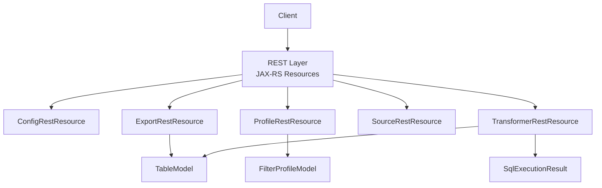
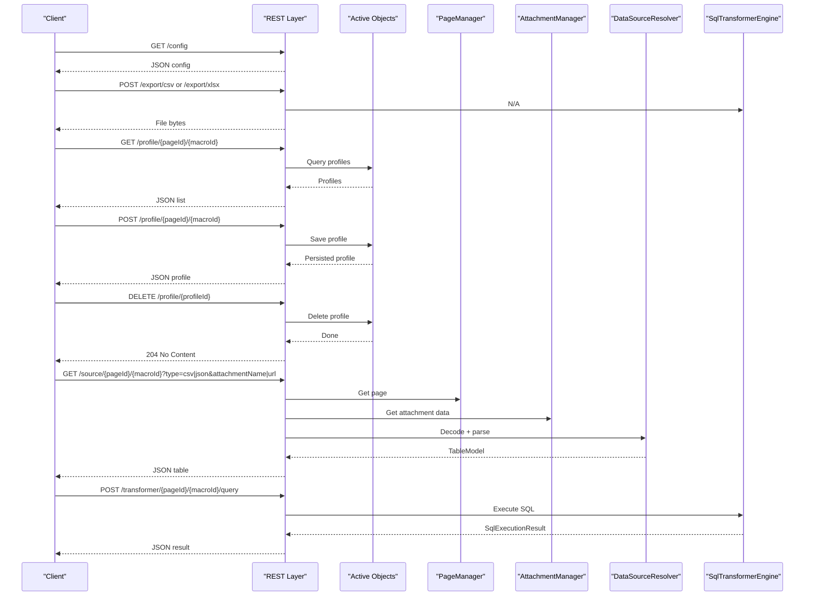
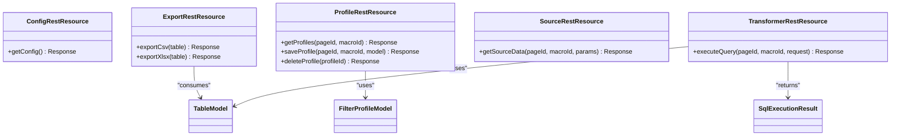

# API Reference

<cite>
**Referenced Files in This Document**
- [ConfigRestResource.java](file://src/main/java/org/opentfc/rest/ConfigRestResource.java)
- [ExportRestResource.java](file://src/main/java/org/opentfc/rest/ExportRestResource.java)
- [ProfileRestResource.java](file://src/main/java/org/opentfc/rest/ProfileRestResource.java)
- [SourceRestResource.java](file://src/main/java/org/opentfc/rest/SourceRestResource.java)
- [TransformerRestResource.java](file://src/main/java/org/opentfc/rest/TransformerRestResource.java)
- [TableModel.java](file://src/main/java/org/opentfc/model/TableModel.java)
- [FilterProfileModel.java](file://src/main/java/org/opentfc/model/FilterProfileModel.java)
- [SqlExecutionResult.java](file://src/main/java/org/opentfc/model/SqlExecutionResult.java)
- [README.md](file://README.md)
- [USER_GUIDE.md](file://USER_GUIDE.md)
</cite>

## Table of Contents
1. [Introduction](#introduction)
2. [Project Structure](#project-structure)
3. [Core Components](#core-components)
4. [Architecture Overview](#architecture-overview)
5. [Detailed Component Analysis](#detailed-component-analysis)
6. [Dependency Analysis](#dependency-analysis)
7. [Performance Considerations](#performance-considerations)
8. [Troubleshooting Guide](#troubleshooting-guide)
9. [Conclusion](#conclusion)
10. [Appendices](#appendices)

## Introduction
This document provides comprehensive API documentation for the OpenTFC REST endpoints exposed under `/rest/opentfc/1.0/`. It covers:
- ConfigRestResource
- ExportRestResource
- ProfileRestResource
- SourceRestResource
- TransformerRestResource

For each endpoint, you will find HTTP methods, URL patterns, request and response schemas, authentication requirements, parameter validation rules, error handling behavior, example calls, security considerations, rate limiting notes, client integration guidelines, and versioning guidance.

OpenTFC is a Confluence plugin that provides table filtering, charts, pivot tables, SQL transformations via DuckDB, spreadsheets, CSV/JSON sources, and export capabilities. The REST layer supports client-side features such as configuration retrieval, data source resolution, profile persistence, SQL execution, and file export.

**Section sources**
- [README.md:1-104](file://README.md#L1-L104)
- [USER_GUIDE.md:1-357](file://USER_GUIDE.md#L1-L357)

## Project Structure
The REST APIs are implemented as JAX-RS resources under `org.opentfc.rest`. Each resource class defines one or more endpoints with clear path annotations and media types. Data models used across endpoints live under `org.opentfc.model`.

**Diagram sources**
- [ConfigRestResource.java:17-38](file://src/main/java/org/opentfc/rest/ConfigRestResource.java#L17-L38)
- [ExportRestResource.java:17-57](file://src/main/java/org/opentfc/rest/ExportRestResource.java#L17-L57)
- [ProfileRestResource.java:23-126](file://src/main/java/org/opentfc/rest/ProfileRestResource.java#L23-L126)
- [SourceRestResource.java:25-111](file://src/main/java/org/opentfc/rest/SourceRestResource.java#L25-L111)
- [TransformerRestResource.java:19-52](file://src/main/java/org/opentfc/rest/TransformerRestResource.java#L19-L52)
- [TableModel.java:12-75](file://src/main/java/org/opentfc/model/TableModel.java#L12-L75)
- [FilterProfileModel.java:10-78](file://src/main/java/org/opentfc/model/FilterProfileModel.java#L10-L78)
- [SqlExecutionResult.java:10-75](file://src/main/java/org/opentfc/model/SqlExecutionResult.java#L10-L75)

**Section sources**
- [ConfigRestResource.java:1-39](file://src/main/java/org/opentfc/rest/ConfigRestResource.java#L1-L39)
- [ExportRestResource.java:1-59](file://src/main/java/org/opentfc/rest/ExportRestResource.java#L1-L59)
- [ProfileRestResource.java:1-128](file://src/main/java/org/opentfc/rest/ProfileRestResource.java#L1-L128)
- [SourceRestResource.java:1-113](file://src/main/java/org/opentfc/rest/SourceRestResource.java#L1-L113)
- [TransformerRestResource.java:1-54](file://src/main/java/org/opentfc/rest/TransformerRestResource.java#L1-L54)
- [TableModel.java:1-76](file://src/main/java/org/opentfc/model/TableModel.java#L1-L76)
- [FilterProfileModel.java:1-79](file://src/main/java/org/opentfc/model/FilterProfileModel.java#L1-L79)
- [SqlExecutionResult.java:1-76](file://src/main/java/org/opentfc/model/SqlExecutionResult.java#L1-L76)

## Core Components
- Configuration endpoint returns plugin version, feature flags, and runtime limits to clients.
- Export endpoints stream CSV/XLSX files from a provided table model.
- Profile endpoints persist user-specific filter profiles using Active Objects.
- Source endpoint resolves external or attachment-based table sources (CSV/TSV/JSON).
- Transformer endpoint executes SQL queries against provided tables using an in-memory engine.

These components collectively enable dynamic table rendering, transformation, visualization, and export within Confluence pages.

**Section sources**
- [ConfigRestResource.java:13-38](file://src/main/java/org/opentfc/rest/ConfigRestResource.java#L13-L38)
- [ExportRestResource.java:14-57](file://src/main/java/org/opentfc/rest/ExportRestResource.java#L14-L57)
- [ProfileRestResource.java:20-126](file://src/main/java/org/opentfc/rest/ProfileRestResource.java#L20-L126)
- [SourceRestResource.java:22-111](file://src/main/java/org/opentfc/rest/SourceRestResource.java#L22-L111)
- [TransformerRestResource.java:16-52](file://src/main/java/org/opentfc/rest/TransformerRestResource.java#L16-L52)

## Architecture Overview
The REST layer integrates with Confluence services and internal services:
- Authentication is enforced by Confluence’s session context; some endpoints explicitly check for authenticated users.
- Active Objects persists user filter profiles.
- Page and Attachment managers provide access to page-scoped attachments.
- External URL fetching uses a whitelist-based SSRF protection mechanism.
- SQL execution runs in a sandboxed environment with read-only constraints.

**Diagram sources**
- [ConfigRestResource.java:21-37](file://src/main/java/org/opentfc/rest/ConfigRestResource.java#L21-L37)
- [ExportRestResource.java:23-57](file://src/main/java/org/opentfc/rest/ExportRestResource.java#L23-L57)
- [ProfileRestResource.java:47-126](file://src/main/java/org/opentfc/rest/ProfileRestResource.java#L47-L126)
- [SourceRestResource.java:61-111](file://src/main/java/org/opentfc/rest/SourceRestResource.java#L61-L111)
- [TransformerRestResource.java:32-52](file://src/main/java/org/opentfc/rest/TransformerRestResource.java#L32-L52)

## Detailed Component Analysis

### Configuration Endpoint
- Base path: `/rest/opentfc/1.0/config`
- Method: GET
- Produces: `application/json`
- Authentication: Required (no anonymous access)
- Response schema:
  - `version`: string
  - `sqlTimeoutSeconds`: number
  - `maxResultRows`: number
  - `maxFileSizeMb`: number
  - `features`: object with boolean flags for UI features

Example call:
- Request: `GET /rest/opentfc/1.0/config`
- Response: JSON containing version, limits, and feature flags.

Validation and errors:
- No input parameters; server returns configuration.
- If unauthenticated, Confluence may return 401 before reaching this endpoint.

Security considerations:
- Exposes feature flags and limits; do not rely on these values for authorization decisions.

Rate limiting:
- Not implemented at the endpoint level; apply client-side caching and respect server rate limits if configured externally.

Backwards compatibility:
- New fields may be added without breaking existing clients due to JSON field tolerance.

**Section sources**
- [ConfigRestResource.java:13-38](file://src/main/java/org/opentfc/rest/ConfigRestResource.java#L13-L38)

### Export Endpoints
- Base paths:
  - `/rest/opentfc/1.0/export/csv`
  - `/rest/opentfc/1.0/export/xlsx`
- Methods: POST
- Consumes: `application/json`
- Produces:
  - CSV: `text/csv; charset=UTF-8`
  - XLSX: `application/vnd.openxmlformats-officedocument.spreadsheetml.sheet`
- Authentication: Not explicitly checked in code; ensure Confluence enforces auth at the route level.
- Request schema: `TableModel`
- Response: Binary file download with appropriate headers.

Request schema details (`TableModel`):
- `id`: string
- `columns`: array of column definitions
- `rows`: array of row objects
- `totalRows`: integer

Example calls:
- CSV export:
  - Request: `POST /rest/opentfc/1.0/export/csv` with JSON body representing a table.
  - Response: CSV file bytes with `Content-Disposition: attachment; filename="export.csv"` and content type `text/csv; charset=UTF-8`.
- XLSX export:
  - Request: `POST /rest/opentfc/1.0/export/xlsx` with JSON body representing a table.
  - Response: XLSX file bytes with `Content-Disposition: attachment; filename="export.xlsx"` and Excel content type.

Validation and errors:
- IO exceptions during export return 500 with a descriptive message.

Security considerations:
- Validate table size and row counts before exporting to avoid large payloads.
- Enforce server-side limits for max rows and file sizes.

Rate limiting:
- Not implemented at the endpoint level; consider applying rate limiting at the gateway or application level.

Backwards compatibility:
- Adding new columns or fields in `TableModel` should remain compatible due to Jackson’s ignoreUnknown behavior.

**Section sources**
- [ExportRestResource.java:14-57](file://src/main/java/org/opentfc/rest/ExportRestResource.java#L14-L57)
- [TableModel.java:12-75](file://src/main/java/org/opentfc/model/TableModel.java#L12-L75)

### Profile Endpoints
- Base paths:
  - `/rest/opentfc/1.0/profile/{pageId}/{macroId}`
  - `/rest/opentfc/1.0/profile/{profileId}`
- Methods:
  - GET: Retrieve profiles for a page and macro
  - POST: Save or update a profile
  - DELETE: Delete a profile by ID
- Produces/Consumes: `application/json`
- Authentication: Required; explicit checks for save and delete operations.

GET `/profile/{pageId}/{macroId}`:
- Path parameters:
  - `pageId`: long
  - `macroId`: string
- Response: Array of `FilterProfileModel` entries.

POST `/profile/{pageId}/{macroId}`:
- Path parameters:
  - `pageId`: long
  - `macroId`: string
- Request schema: `FilterProfileModel`
- Validation:
  - Name required and not blank
  - Name length <= 100 characters
  - Name must match allowed character set
- Response: Saved `FilterProfileModel`.

DELETE `/profile/{profileId}`:
- Path parameters:
  - `profileId`: long
- Response: 204 No Content on success; 404 if not found.

Error handling:
- Unauthenticated requests return 401.
- Invalid profile name returns 400 with a message.
- Missing profile returns 404.

Security considerations:
- Profiles are scoped to user key, page ID, and macro ID.
- Ensure only authorized users can modify their own profiles.

Rate limiting:
- Not implemented at the endpoint level; consider rate limiting write operations.

Backwards compatibility:
- Additional fields in `FilterProfileModel` are ignored by Jackson.

**Section sources**
- [ProfileRestResource.java:20-126](file://src/main/java/org/opentfc/rest/ProfileRestResource.java#L20-L126)
- [FilterProfileModel.java:10-78](file://src/main/java/org/opentfc/model/FilterProfileModel.java#L10-L78)

### Source Endpoint
- Base path: `/rest/opentfc/1.0/source/{pageId}/{macroId}`
- Method: GET
- Produces: `application/json`
- Authentication: Not explicitly checked; ensure Confluence enforces auth at the route level.
- Query parameters:
  - `type`: csv | json (default csv)
  - `attachmentName`: string (optional)
  - `url`: string (optional)
  - `encoding`: UTF-8 | Windows-1251 | ISO-8859-1 (default UTF-8)
  - `delimiter`: auto | comma | semicolon | tab | pipe (default auto)

Behavior:
- If `attachmentName` is provided, reads attachment data from the specified page.
- If `url` is provided, fetches data safely using a whitelist-based SSRF protection.
- Decodes bytes using the specified encoding.
- Parses into `TableModel` based on `type`.

Response schema: `TableModel`

Example calls:
- CSV from attachment:
  - Request: `GET /rest/opentfc/1.0/source/123/my-macro?attachmentName=data.csv&type=csv&encoding=UTF-8&delimiter=auto`
  - Response: JSON table model.
- JSON from URL:
  - Request: `GET /rest/opentfc/1.0/source/123/my-macro?url=https://internal.example.com/data.json&type=json&encoding=UTF-8`
  - Response: JSON table model.

Validation and errors:
- If no source is found, returns 404 with a message.
- On parsing or IO errors, returns 500 with a generic error message.

Security considerations:
- External URL fetching is protected by a whitelist; ensure the whitelist is properly configured.
- Limit maximum fetch size to prevent memory exhaustion.

Rate limiting:
- Not implemented at the endpoint level; consider rate limiting external fetches.

Backwards compatibility:
- New query parameters can be added without breaking existing clients.

**Section sources**
- [SourceRestResource.java:22-111](file://src/main/java/org/opentfc/rest/SourceRestResource.java#L22-L111)
- [TableModel.java:12-75](file://src/main/java/org/opentfc/model/TableModel.java#L12-L75)

### Transformer Endpoint
- Base path: `/rest/opentfc/1.0/transformer/{pageId}/{macroId}/query`
- Method: POST
- Consumes/Produces: `application/json`
- Authentication: Not explicitly checked; ensure Confluence enforces auth at the route level.
- Request schema:
  - `sql`: string (required)
  - `tables`: array of `TableModel` (optional)
- Response schema: `SqlExecutionResult`

Behavior:
- Validates presence of SQL.
- Executes SQL against provided tables using an in-memory engine.
- Returns success flag, optional table result, execution time, and error message.

Example call:
- Request: `POST /rest/opentfc/1.0/transformer/123/my-macro/query`
  - Body: `{ "sql": "SELECT * FROM T1", "tables": [...] }`
- Response: JSON with success status, optional table, execution time, and error message.

Validation and errors:
- Missing SQL returns 400 with an error message.
- Execution errors return 200 with `success=false` and an error message.

Security considerations:
- SQL execution is sandboxed; only SELECT queries are allowed.
- DDL/DML and filesystem access are blocked.

Rate limiting:
- Not implemented at the endpoint level; consider rate limiting SQL executions.

Backwards compatibility:
- New fields in `SqlExecutionResult` are ignored by Jackson.

**Section sources**
- [TransformerRestResource.java:16-52](file://src/main/java/org/opentfc/rest/TransformerRestResource.java#L16-L52)
- [SqlExecutionResult.java:10-75](file://src/main/java/org/opentfc/model/SqlExecutionResult.java#L10-L75)
- [TableModel.java:12-75](file://src/main/java/org/opentfc/model/TableModel.java#L12-L75)

## Dependency Analysis
The REST resources depend on:
- Confluence services: PageManager, AttachmentManager, ActiveObjects
- Internal services: DataSourceResolver, SqlTransformerEngine, ExportService
- Models: TableModel, FilterProfileModel, SqlExecutionResult

**Diagram sources**
- [ConfigRestResource.java:17-38](file://src/main/java/org/opentfc/rest/ConfigRestResource.java#L17-L38)
- [ExportRestResource.java:17-57](file://src/main/java/org/opentfc/rest/ExportRestResource.java#L17-L57)
- [ProfileRestResource.java:23-126](file://src/main/java/org/opentfc/rest/ProfileRestResource.java#L23-L126)
- [SourceRestResource.java:25-111](file://src/main/java/org/opentfc/rest/SourceRestResource.java#L25-L111)
- [TransformerRestResource.java:19-52](file://src/main/java/org/opentfc/rest/TransformerRestResource.java#L19-L52)
- [TableModel.java:12-75](file://src/main/java/org/opentfc/model/TableModel.java#L12-L75)
- [FilterProfileModel.java:10-78](file://src/main/java/org/opentfc/model/FilterProfileModel.java#L10-L78)
- [SqlExecutionResult.java:10-75](file://src/main/java/org/opentfc/model/SqlExecutionResult.java#L10-L75)

**Section sources**
- [ConfigRestResource.java:1-39](file://src/main/java/org/opentfc/rest/ConfigRestResource.java#L1-L39)
- [ExportRestResource.java:1-59](file://src/main/java/org/opentfc/rest/ExportRestResource.java#L1-L59)
- [ProfileRestResource.java:1-128](file://src/main/java/org/opentfc/rest/ProfileRestResource.java#L1-L128)
- [SourceRestResource.java:1-113](file://src/main/java/org/opentfc/rest/SourceRestResource.java#L1-L113)
- [TransformerRestResource.java:1-54](file://src/main/java/org/opentfc/rest/TransformerRestResource.java#L1-L54)
- [TableModel.java:1-76](file://src/main/java/org/opentfc/model/TableModel.java#L1-L76)
- [FilterProfileModel.java:1-79](file://src/main/java/org/opentfc/model/FilterProfileModel.java#L1-L79)
- [SqlExecutionResult.java:1-76](file://src/main/java/org/opentfc/model/SqlExecutionResult.java#L1-L76)

## Performance Considerations
- Export endpoints stream binary responses; ensure clients handle large payloads efficiently.
- Source endpoint decodes and parses data; limit payload sizes and use appropriate encodings.
- Transformer endpoint executes SQL in-memory; constrain query complexity and table sizes.
- Configuration endpoint is lightweight; cache results on the client side.

[No sources needed since this section provides general guidance]

## Troubleshooting Guide
Common issues and resolutions:
- Unauthenticated access: Some endpoints require authentication; ensure valid session or token.
- Profile validation failures: Check profile name constraints (length, allowed characters).
- Source not found: Verify page ID, attachment name, or URL accessibility and whitelist configuration.
- Export failures: Inspect server logs for IO exceptions; validate table structure.
- SQL execution errors: Review error messages in `SqlExecutionResult`; ensure SELECT-only queries.

**Section sources**
- [ProfileRestResource.java:74-84](file://src/main/java/org/opentfc/rest/ProfileRestResource.java#L74-L84)
- [SourceRestResource.java:90-110](file://src/main/java/org/opentfc/rest/SourceRestResource.java#L90-L110)
- [ExportRestResource.java:36-56](file://src/main/java/org/opentfc/rest/ExportRestResource.java#L36-L56)
- [TransformerRestResource.java:37-51](file://src/main/java/org/opentfc/rest/TransformerRestResource.java#L37-L51)

## Conclusion
The OpenTFC REST API provides a robust set of endpoints for configuration, data sourcing, transformation, profile management, and export. Clients should implement proper authentication, validation, error handling, and caching strategies. Security measures include SSRF protection, SQL sandboxing, and user-scoped profile persistence. Versioning is handled via the base path `/rest/opentfc/1.0/`, and backwards compatibility is supported through flexible JSON handling.

[No sources needed since this section summarizes without analyzing specific files]

## Appendices

### API Summary Table
- Configuration
  - GET `/rest/opentfc/1.0/config`
  - Auth: Required
  - Response: JSON config
- Export
  - POST `/rest/opentfc/1.0/export/csv`
  - POST `/rest/opentfc/1.0/export/xlsx`
  - Auth: Not explicitly checked
  - Request: `TableModel`
  - Response: Binary file
- Profile
  - GET `/rest/opentfc/1.0/profile/{pageId}/{macroId}`
  - POST `/rest/opentfc/1.0/profile/{pageId}/{macroId}`
  - DELETE `/rest/opentfc/1.0/profile/{profileId}`
  - Auth: Required for write/delete
  - Request/Response: `FilterProfileModel`
- Source
  - GET `/rest/opentfc/1.0/source/{pageId}/{macroId}`
  - Auth: Not explicitly checked
  - Query params: type, attachmentName, url, encoding, delimiter
  - Response: `TableModel`
- Transformer
  - POST `/rest/opentfc/1.0/transformer/{pageId}/{macroId}/query`
  - Auth: Not explicitly checked
  - Request: `{ sql, tables }`
  - Response: `SqlExecutionResult`

[No sources needed since this section aggregates information without direct file analysis]