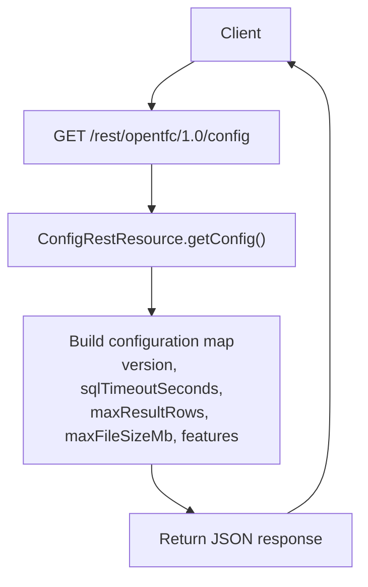
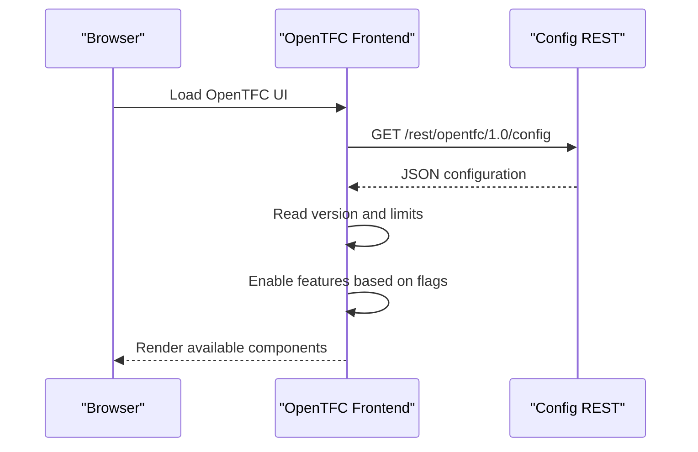

# Configuration API

<cite>
**Referenced Files in This Document**
- [ConfigRestResource.java](file://src/main/java/org/opentfc/rest/ConfigRestResource.java)
- [OpenTfcVersion.java](file://src/main/java/org/opentfc/service/OpenTfcVersion.java)
</cite>

## Table of Contents
1. [Introduction](#introduction)
2. [Endpoint Summary](#endpoint-summary)
3. [Authentication and Access](#authentication-and-access)
4. [Request Format](#request-format)
5. [Response Schema](#response-schema)
6. [Example Requests and Responses](#example-requests-and-responses)
7. [Client Usage Patterns](#client-usage-patterns)
8. [Error Handling](#error-handling)
9. [Security Considerations](#security-considerations)
10. [Operational Notes](#operational-notes)
11. [Conclusion](#conclusion)

## Introduction
This document describes the OpenTFC Configuration REST endpoint that provides client-side plugin configuration and feature flags. Clients call this endpoint to discover supported features, runtime limits, and the current plugin version before rendering tables, charts, pivot tables, spreadsheets, CSV/JSON sources, or SQL transformations.

The endpoint is implemented as a JAX-RS resource and returns JSON data consumed by the OpenTFC frontend components.

**Section sources**
- [ConfigRestResource.java:13-19](file://src/main/java/org/opentfc/rest/ConfigRestResource.java#L13-L19)

## Endpoint Summary
| Field | Value |
|---|---|
| Method | `GET` |
| Path | `/rest/opentfc/1.0/config` |
| Base URL | Replace with your Confluence host, for example `https://your-confluence.example.com/rest/opentfc/1.0/config` |
| Content-Type | `application/json` |
| Authentication | Anonymous access is allowed; no explicit authentication annotation is present on the method |
| Response format | JSON object containing version, limits, and feature flags |



**Diagram sources**
- [ConfigRestResource.java:21-38](file://src/main/java/org/opentfc/rest/ConfigRestResource.java#L21-L38)

**Section sources**
- [ConfigRestResource.java:17-38](file://src/main/java/org/opentfc/rest/ConfigRestResource.java#L17-L38)

## Authentication and Access
- The configuration endpoint does not declare an anonymous-access annotation on the handler method.
- The class-level comment states that authentication is required and explicitly notes the absence of anonymous access.
- In practice, clients should treat this endpoint as part of the OpenTFC REST surface and follow Confluence’s normal routing and security model. If your deployment requires authentication for REST endpoints, ensure the calling context satisfies Confluence’s access policy.

Important distinction:
- The endpoint itself does not perform custom authentication logic.
- It returns static configuration values rather than user-specific data.

**Section sources**
- [ConfigRestResource.java:13-19](file://src/main/java/org/opentfc/rest/ConfigRestResource.java#L13-L19)

## Request Format
- HTTP method: `GET`
- No request body
- No required query parameters
- No required headers beyond standard HTTP behavior
- The path is relative to the Confluence server root under `/rest/opentfc/1.0/config`

Recommended client behavior:
- Call the endpoint once during application initialization or when loading OpenTFC UI components.
- Cache the result in memory while the page or session is active.
- Re-fetch only if you need to detect a plugin reload or version change.

**Section sources**
- [ConfigRestResource.java:21-38](file://src/main/java/org/opentfc/rest/ConfigRestResource.java#L21-L38)

## Response Schema
The response is a JSON object with the following top-level fields:

| Field | Type | Description |
|---|---|---|
| `version` | string | Current OpenTFC plugin version |
| `sqlTimeoutSeconds` | number | Maximum allowed SQL execution timeout in seconds |
| `maxResultRows` | number | Maximum number of rows returned by table operations |
| `maxFileSizeMb` | number | Maximum allowed file size in megabytes |
| `features` | object | Boolean flags enabling or disabling OpenTFC client-side features |

### Features Object
| Feature Key | Type | Meaning |
|---|---|---|
| `tableFilter` | boolean | Enables the interactive table filter |
| `chartFromTable` | boolean | Enables chart generation from table data |
| `pivotTable` | boolean | Enables pivot table functionality |
| `tableTransformer` | boolean | Enables SQL-based table transformation |
| `tableSpreadsheet` | boolean | Enables spreadsheet editing and persistence |
| `csvTable` | boolean | Enables loading tables from CSV sources |
| `jsonTable` | boolean | Enables loading tables from JSON sources |

### Version Source
The `version` value comes from the OpenTFC version constant used by the plugin.

**Section sources**
- [ConfigRestResource.java:23-37](file://src/main/java/org/opentfc/rest/ConfigRestResource.java#L23-L37)
- [OpenTfcVersion.java:7-8](file://src/main/java/org/opentfc/service/OpenTfcVersion.java#L7-L8)

## Example Requests and Responses

### Example Request
```http
GET /rest/opentfc/1.0/config HTTP/1.1
Host: your-confluence.example.com
Accept: application/json
```

### Example Response
```json
{
  "version": "1.0.5",
  "sqlTimeoutSeconds": 10,
  "maxResultRows": 50000,
  "maxFileSizeMb": 10,
  "features": {
    "tableFilter": true,
    "chartFromTable": true,
    "pivotTable": true,
    "tableTransformer": true,
    "tableSpreadsheet": true,
    "csvTable": true,
    "jsonTable": true
  }
}
```

Notes:
- The example response reflects the current implementation values.
- Clients should parse the JSON schema rather than hardcoding field names.
- Feature flags may change between plugin versions or deployments.

**Section sources**
- [ConfigRestResource.java:23-37](file://src/main/java/org/opentfc/rest/ConfigRestResource.java#L23-L37)
- [OpenTfcVersion.java:7-8](file://src/main/java/org/opentfc/service/OpenTfcVersion.java#L7-L8)

## Client Usage Patterns
Clients use the configuration endpoint to enable or disable UI capabilities dynamically. A typical flow is:



**Diagram sources**
- [ConfigRestResource.java:21-38](file://src/main/java/org/opentfc/rest/ConfigRestResource.java#L21-L38)

### Recommended Client Logic
1. Fetch the configuration at startup.
2. Store `version`, `sqlTimeoutSeconds`, `maxResultRows`, and `maxFileSizeMb`.
3. Use each boolean flag in `features` to conditionally render:
   - Table filter controls
   - Chart creation tools
   - Pivot table editor
   - Transformer SQL interface
   - Spreadsheet editor
   - CSV source loader
   - JSON source loader
4. Respect numeric limits when executing queries or loading files.
5. Optionally compare `version` to decide whether to show upgrade notices or adjust UI behavior.

**Section sources**
- [ConfigRestResource.java:23-37](file://src/main/java/org/opentfc/rest/ConfigRestResource.java#L23-L37)

## Error Handling
The implementation returns a successful response with status code 200 and a JSON body. There is no explicit error handling branch in the configuration handler.

Expected client behavior:
- Treat non-200 responses as network, routing, or platform-level errors.
- Retry with backoff only if transient.
- Fall back to default UI behavior if the configuration cannot be loaded.
- Do not assume all fields are present if future changes alter the response shape; validate required keys before use.

**Section sources**
- [ConfigRestResource.java:21-38](file://src/main/java/org/opentfc/rest/ConfigRestResource.java#L21-L38)

## Security Considerations
- The endpoint returns configuration metadata, not secrets or user data.
- Because it exposes plugin version and feature availability, treat it as public-facing metadata within the Confluence environment.
- Follow Confluence’s overall REST security model:
  - If your deployment restricts anonymous REST access, configure it consistently across OpenTFC endpoints.
  - Avoid logging sensitive request URLs or response bodies in untrusted environments.
- Clients should not trust feature flags alone to enforce backend permissions; always validate server-side authorization where applicable.

**Section sources**
- [ConfigRestResource.java:13-19](file://src/main/java/org/opentfc/rest/ConfigRestResource.java#L13-L19)

## Operational Notes
- The configuration is currently static:
  - `sqlTimeoutSeconds` is fixed.
  - `maxResultRows` is fixed.
  - `maxFileSizeMb` is fixed.
  - All feature flags are enabled by default.
- The version is centralized in a single constant, so updates propagate automatically through the configuration response.
- Future enhancements could make these values configurable per installation without changing the response schema.

**Section sources**
- [ConfigRestResource.java:23-37](file://src/main/java/org/opentfc/rest/ConfigRestResource.java#L23-L37)
- [OpenTfcVersion.java:7-8](file://src/main/java/org/opentfc/service/OpenTfcVersion.java#L7-L8)

## Conclusion
The OpenTFC Configuration REST endpoint provides a simple, stable contract for client-side feature discovery and runtime limits. Clients should call `GET /rest/opentfc/1.0/config`, parse the JSON response, and use the `features` object to enable or disable OpenTFC capabilities such as table filtering, charts, pivot tables, transformers, spreadsheets, CSV, and JSON support. Numeric limits should guide safe execution of queries and file operations, while the `version` field helps clients adapt to plugin upgrades.