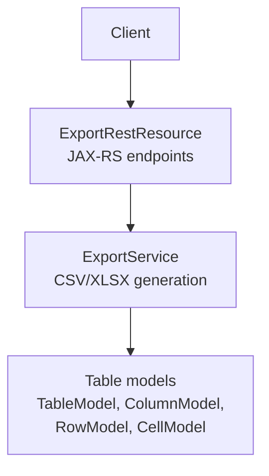
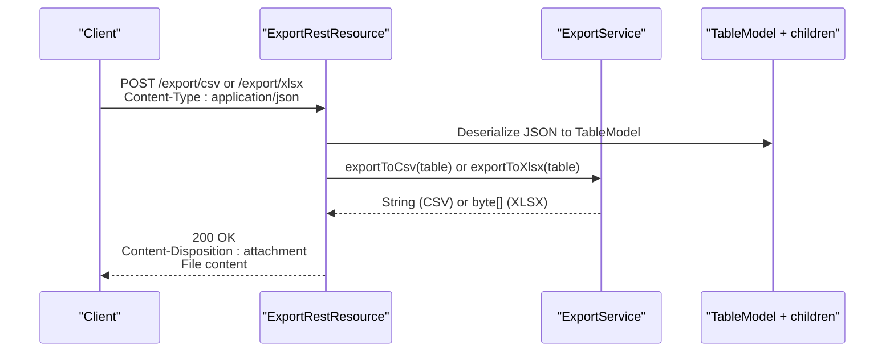
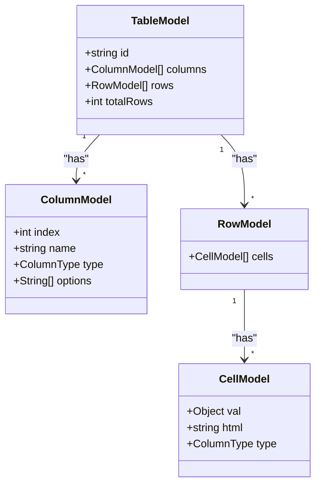
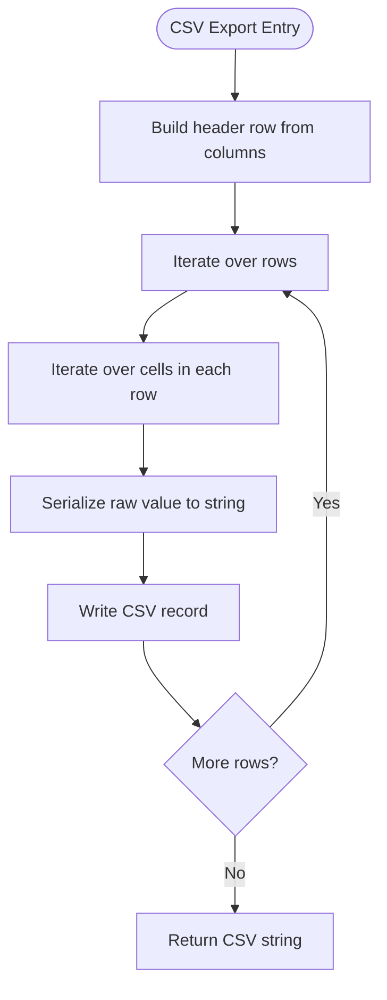
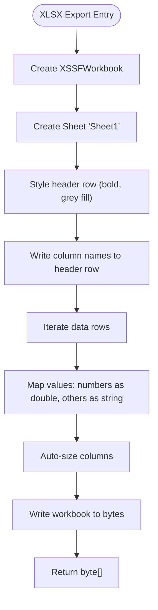
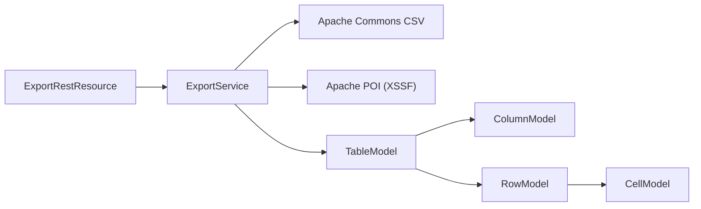

# Export API

<cite>
**Referenced Files in This Document**
- [ExportRestResource.java](file://src/main/java/org/opentfc/rest/ExportRestResource.java)
- [ExportService.java](file://src/main/java/org/opentfc/service/ExportService.java)
- [TableModel.java](file://src/main/java/org/opentfc/model/TableModel.java)
- [ColumnModel.java](file://src/main/java/org/opentfc/model/ColumnModel.java)
- [RowModel.java](file://src/main/java/org/opentfc/model/RowModel.java)
- [CellModel.java](file://src/main/java/org/opentfc/model/CellModel.java)
</cite>

## Table of Contents
1. [Introduction](#introduction)
2. [Project Structure](#project-structure)
3. [Core Components](#core-components)
4. [Architecture Overview](#architecture-overview)
5. [Detailed Component Analysis](#detailed-component-analysis)
6. [Dependency Analysis](#dependency-analysis)
7. [Performance Considerations](#performance-considerations)
8. [Troubleshooting Guide](#troubleshooting-guide)
9. [Conclusion](#conclusion)

## Introduction
This document describes the Export REST API for generating CSV and XLSX files from table data. The API accepts a JSON representation of a table (columns, rows, and cells) and returns downloadable files. It is designed to be simple and predictable: two endpoints, one per format, both consuming JSON and returning binary file downloads.

## Project Structure
The export functionality is implemented as a JAX-RS resource backed by a service that performs the actual serialization into CSV or XLSX formats. The request payload is modeled using domain classes representing tables, columns, rows, and cells.

**Diagram sources**
- [ExportRestResource.java:17-57](file://src/main/java/org/opentfc/rest/ExportRestResource.java#L17-L57)
- [ExportService.java:23-106](file://src/main/java/org/opentfc/service/ExportService.java#L23-L106)
- [TableModel.java:12-75](file://src/main/java/org/opentfc/model/TableModel.java#L12-L75)
- [ColumnModel.java:12-67](file://src/main/java/org/opentfc/model/ColumnModel.java#L12-L67)
- [RowModel.java:12-36](file://src/main/java/org/opentfc/model/RowModel.java#L12-L36)
- [CellModel.java:10-54](file://src/main/java/org/opentfc/model/CellModel.java#L10-L54)

**Section sources**
- [ExportRestResource.java:17-57](file://src/main/java/org/opentfc/rest/ExportRestResource.java#L17-L57)
- [ExportService.java:23-106](file://src/main/java/org/opentfc/service/ExportService.java#L23-L106)

## Core Components
- Export REST Resource: Exposes HTTP endpoints for CSV and XLSX exports.
- Export Service: Converts a TableModel into CSV text or XLSX bytes.
- Data Models: Define the JSON contract for table data sent to the API.

Key responsibilities:
- Validate input via Jackson deserialization into TableModel.
- Generate CSV using Apache Commons CSV.
- Generate XLSX using Apache POI with basic header styling and auto-sized columns.

**Section sources**
- [ExportRestResource.java:17-57](file://src/main/java/org/opentfc/rest/ExportRestResource.java#L17-L57)
- [ExportService.java:23-106](file://src/main/java/org/opentfc/service/ExportService.java#L23-L106)
- [TableModel.java:12-75](file://src/main/java/org/opentfc/model/TableModel.java#L12-L75)
- [ColumnModel.java:12-67](file://src/main/java/org/opentfc/model/ColumnModel.java#L12-L67)
- [RowModel.java:12-36](file://src/main/java/org/opentfc/model/RowModel.java#L12-L36)
- [CellModel.java:10-54](file://src/main/java/org/opentfc/model/CellModel.java#L10-L54)

## Architecture Overview
The export flow is straightforward:
- Client sends a POST request with a JSON body describing the table.
- The resource method delegates to ExportService.
- ExportService serializes the data into the requested format.
- The response is a binary file download with appropriate headers.

**Diagram sources**
- [ExportRestResource.java:23-57](file://src/main/java/org/opentfc/rest/ExportRestResource.java#L23-L57)
- [ExportService.java:29-106](file://src/main/java/org/opentfc/service/ExportService.java#L29-L106)
- [TableModel.java:12-75](file://src/main/java/org/opentfc/model/TableModel.java#L12-L75)

## Detailed Component Analysis

### REST Endpoints

#### Export CSV
- Method: POST
- URL: /export/csv
- Request Content-Type: application/json
- Request Body: TableModel JSON
- Response Content-Type: text/csv; charset=UTF-8
- Response Headers:
  - Content-Disposition: attachment; filename="export.csv"
- Success Status: 200 OK
- Error Handling: On IOException during export, returns 500 Server Error with an error message string.

Notes:
- The entire CSV is built in memory before being returned.
- No query parameters are supported; filtering must be applied to the client-side table before sending it to this endpoint.

**Section sources**
- [ExportRestResource.java:23-40](file://src/main/java/org/opentfc/rest/ExportRestResource.java#L23-L40)

#### Export XLSX
- Method: POST
- URL: /export/xlsx
- Request Content-Type: application/json
- Request Body: TableModel JSON
- Response Content-Type: application/vnd.openxmlformats-officedocument.spreadsheetml.sheet
- Response Headers:
  - Content-Disposition: attachment; filename="export.xlsx"
- Success Status: 200 OK
- Error Handling: On IOException during export, returns 500 Server Error with an error message string.

Notes:
- The workbook is created in memory and written to a byte array before being returned.
- Header row uses bold font and grey background; column widths are auto-sized.

**Section sources**
- [ExportRestResource.java:42-57](file://src/main/java/org/opentfc/rest/ExportRestResource.java#L42-L57)

### Data Model Contract

The request body is a JSON object matching the TableModel structure. Unknown properties are ignored.

- TableModel fields:
  - id: string (optional identifier)
  - columns: list of ColumnModel
  - rows: list of RowModel
  - totalRows: integer (auto-updated when rows change)

- ColumnModel fields:
  - index: integer
  - name: string (used as CSV header and Excel header cell)
  - type: enum ColumnType (TEXT, NUMBER, etc.)
  - options: list of strings

- RowModel fields:
  - cells: list of CellModel

- CellModel fields:
  - val: any (raw value; used for export)
  - html: string (not used for export)
  - type: enum ColumnType

**Diagram sources**
- [TableModel.java:12-75](file://src/main/java/org/opentfc/model/TableModel.java#L12-L75)
- [ColumnModel.java:12-67](file://src/main/java/org/opentfc/model/ColumnModel.java#L12-L67)
- [RowModel.java:12-36](file://src/main/java/org/opentfc/model/RowModel.java#L12-L36)
- [CellModel.java:10-54](file://src/main/java/org/opentfc/model/CellModel.java#L10-L54)

**Section sources**
- [TableModel.java:12-75](file://src/main/java/org/opentfc/model/TableModel.java#L12-L75)
- [ColumnModel.java:12-67](file://src/main/java/org/opentfc/model/ColumnModel.java#L12-L67)
- [RowModel.java:12-36](file://src/main/java/org/opentfc/model/RowModel.java#L12-L36)
- [CellModel.java:10-54](file://src/main/java/org/opentfc/model/CellModel.java#L10-L54)

### Processing Logic

#### CSV Generation Flow

**Diagram sources**
- [ExportService.java:29-49](file://src/main/java/org/opentfc/service/ExportService.java#L29-L49)

#### XLSX Generation Flow

**Diagram sources**
- [ExportService.java:54-106](file://src/main/java/org/opentfc/service/ExportService.java#L54-L106)

**Section sources**
- [ExportService.java:29-106](file://src/main/java/org/opentfc/service/ExportService.java#L29-L106)

## Dependency Analysis
- ExportRestResource depends on ExportService for serialization logic.
- ExportService depends on:
  - Apache Commons CSV for CSV generation.
  - Apache POI (XSSF) for XLSX generation.
- Both endpoints consume TableModel, which is composed of ColumnModel, RowModel, and CellModel.

**Diagram sources**
- [ExportRestResource.java:1-11](file://src/main/java/org/opentfc/rest/ExportRestResource.java#L1-L11)
- [ExportService.java:1-19](file://src/main/java/org/opentfc/service/ExportService.java#L1-L19)
- [TableModel.java:1-8](file://src/main/java/org/opentfc/model/TableModel.java#L1-L8)
- [ColumnModel.java:1-8](file://src/main/java/org/opentfc/model/ColumnModel.java#L1-L8)
- [RowModel.java:1-8](file://src/main/java/org/opentfc/model/RowModel.java#L1-L8)
- [CellModel.java:1-6](file://src/main/java/org/opentfc/model/CellModel.java#L1-L6)

**Section sources**
- [ExportRestResource.java:1-11](file://src/main/java/org/opentfc/rest/ExportRestResource.java#L1-L11)
- [ExportService.java:1-19](file://src/main/java/org/opentfc/service/ExportService.java#L1-L19)

## Performance Considerations
- Memory usage:
  - CSV: Builds the full CSV string in memory before returning.
  - XLSX: Creates an in-memory workbook and writes to a byte array.
- Large datasets:
  - For very large tables, consider exporting smaller filtered subsets from the client side before calling the API.
  - Avoid sending excessively wide tables (many columns) due to auto-sizing overhead in XLSX generation.
- Streaming:
  - Current implementation does not stream responses; the entire file is materialized in memory.
- File size limits:
  - There are no explicit server-side file size checks in the export endpoints. Enforce limits at the proxy/load balancer or application boundary if needed.

[No sources needed since this section provides general guidance]

## Troubleshooting Guide
Common issues and resolutions:
- 500 Server Error with "Export failed: ..." message:
  - Indicates an IOException occurred during export processing. Check logs for details and validate the input TableModel structure.
- Empty or malformed CSV/XLSX:
  - Ensure the JSON payload includes valid columns and rows. Missing or mismatched cell counts can cause unexpected output.
- Unexpected number formatting in XLSX:
  - Numeric values are exported as doubles; ensure your client sends numbers appropriately.

**Section sources**
- [ExportRestResource.java:36-39](file://src/main/java/org/opentfc/rest/ExportRestResource.java#L36-L39)
- [ExportRestResource.java:53-56](file://src/main/java/org/opentfc/rest/ExportRestResource.java#L53-L56)

## Conclusion
The Export API provides two simple endpoints for downloading CSV and XLSX files from a JSON table model. It is best suited for moderate-sized datasets where in-memory processing is acceptable. For large exports, pre-filter data on the client side and consider implementing streaming or pagination at the application layer.

[No sources needed since this section summarizes without analyzing specific files]