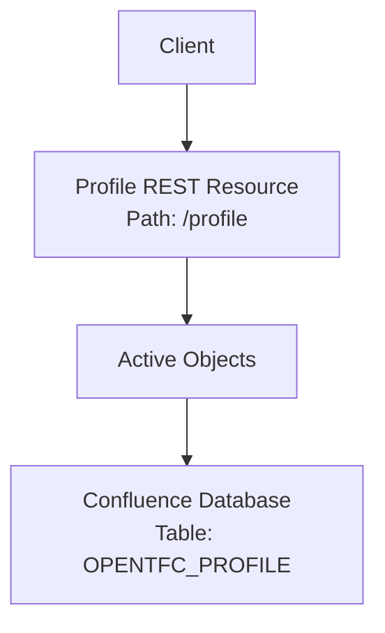
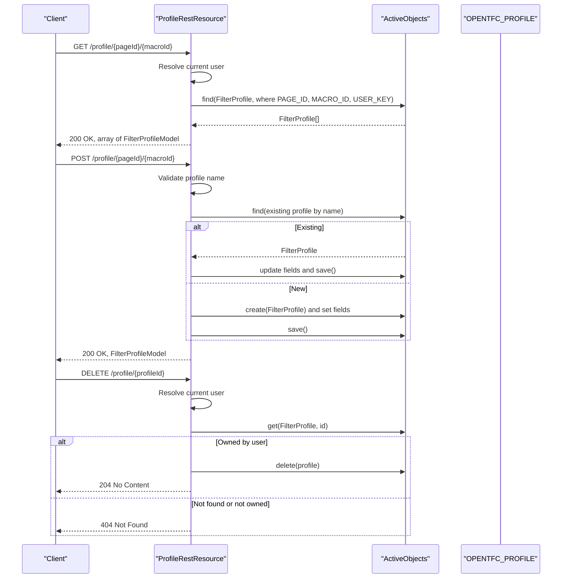
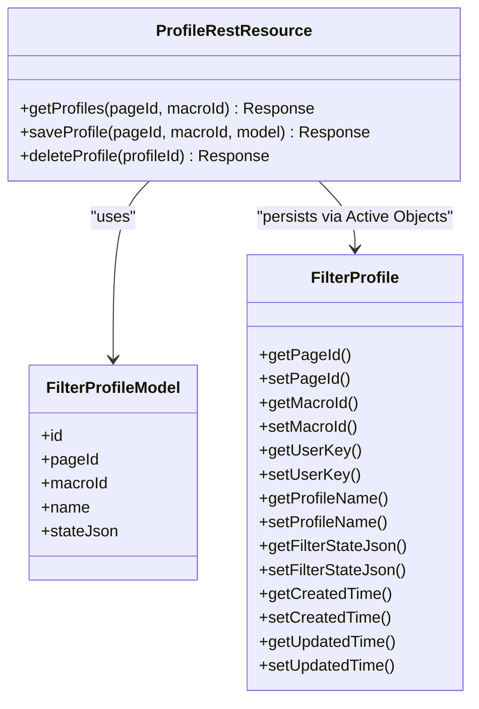
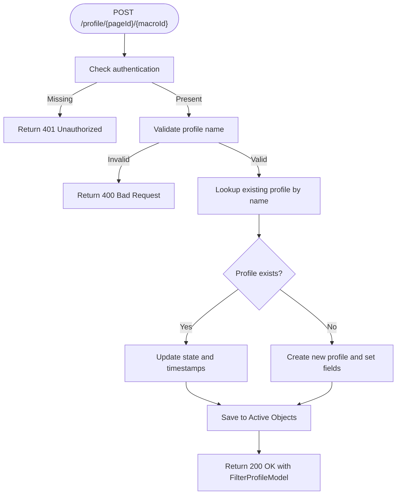
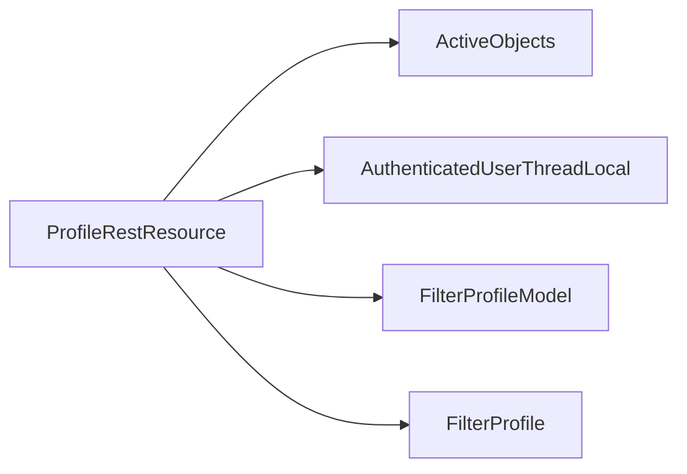

# Profile API

<cite>
**Referenced Files in This Document**
- [ProfileRestResource.java](file://src/main/java/org/opentfc/rest/ProfileRestResource.java)
- [FilterProfileModel.java](file://src/main/java/org/opentfc/model/FilterProfileModel.java)
- [FilterProfile.java](file://src/main/java/org/opentfc/ao/FilterProfile.java)
- [ProfileRestResourceTest.java](file://src/test/java/org/opentfc/rest/ProfileRestResourceTest.java)
</cite>

## Table of Contents
1. [Introduction](#introduction)
2. [Project Structure](#project-structure)
3. [Core Components](#core-components)
4. [Architecture Overview](#architecture-overview)
5. [Detailed Component Analysis](#detailed-component-analysis)
6. [Dependency Analysis](#dependency-analysis)
7. [Performance Considerations](#performance-considerations)
8. [Troubleshooting Guide](#troubleshooting-guide)
9. [Conclusion](#conclusion)

## Introduction
This document describes the Profile REST API for managing user-specific filter profiles and preferences. The API enables clients to:
- List saved filter profiles for a given page and macro, scoped to the current user.
- Save or update a named filter profile with its JSON state.
- Delete a profile owned by the authenticated user.

The API is implemented as a JAX-RS resource backed by Active Objects for persistence. Profiles are stored per user, page, macro, and profile name.

## Project Structure
The Profile API is part of the OpenTFC Confluence plugin. The relevant implementation lives under `org.opentfc.rest`, with data models under `org.opentfc.model` and Active Objects entities under `org.opentfc.ao`.

**Diagram sources**
- [ProfileRestResource.java:20-26](file://src/main/java/org/opentfc/rest/ProfileRestResource.java#L20-L26)
- [FilterProfile.java:12-14](file://src/main/java/org/opentfc/ao/FilterProfile.java#L12-L14)

**Section sources**
- [ProfileRestResource.java:1-26](file://src/main/java/org/opentfc/rest/ProfileRestResource.java#L1-L26)
- [FilterProfile.java:1-42](file://src/main/java/org/opentfc/ao/FilterProfile.java#L1-L42)

## Core Components
- Profile REST endpoint: Provides GET, POST, and DELETE operations for filter profiles.
- Filter profile model: JSON DTO used for request/response payloads.
- Active Objects entity: Persistent schema for storing profiles.

Key responsibilities:
- Authentication handling via Confluence’s thread-local user context.
- Validation of profile names on save.
- Persistence through Active Objects.

**Section sources**
- [ProfileRestResource.java:20-127](file://src/main/java/org/opentfc/rest/ProfileRestResource.java#L20-L127)
- [FilterProfileModel.java:1-79](file://src/main/java/org/opentfc/model/FilterProfileModel.java#L1-L79)
- [FilterProfile.java:1-42](file://src/main/java/org/opentfc/ao/FilterProfile.java#L1-L42)

## Architecture Overview
The Profile API follows a simple layered design:
- HTTP layer: JAX-RS endpoints define routes and media types.
- Service layer: Business logic validates inputs and manages persistence.
- Data layer: Active Objects maps to the database table.

**Diagram sources**
- [ProfileRestResource.java:47-126](file://src/main/java/org/opentfc/rest/ProfileRestResource.java#L47-L126)
- [FilterProfile.java:12-40](file://src/main/java/org/opentfc/ao/FilterProfile.java#L12-L40)

## Detailed Component Analysis

### REST Endpoints

Base path: `/profile`
Content-Type: `application/json`

#### GET /profile/{pageId}/{macroId}
- Purpose: Retrieve all filter profiles for the specified page and macro, scoped to the current user.
- Path parameters:
  - pageId (long): Page identifier.
  - macroId (string): Macro identifier.
- Authentication: Optional for reading; if no user is present, results are filtered using an anonymous key.
- Success response: 200 OK with array of FilterProfileModel.
- Error responses: None defined beyond standard server errors.

Example response body:
- Array of FilterProfileModel objects.

**Section sources**
- [ProfileRestResource.java:47-60](file://src/main/java/org/opentfc/rest/ProfileRestResource.java#L47-L60)
- [ProfileRestResourceTest.java:61-88](file://src/test/java/org/opentfc/rest/ProfileRestResourceTest.java#L61-L88)

#### POST /profile/{pageId}/{macroId}
- Purpose: Create or update a named filter profile for the current user.
- Path parameters:
  - pageId (long): Page identifier.
  - macroId (string): Macro identifier.
- Request body: FilterProfileModel.
- Authentication: Required. Unauthenticated requests receive 401 Unauthorized.
- Validation rules:
  - Name must be non-blank.
  - Name length must be 100 characters or less.
  - Name must match allowed characters pattern.
- Behavior:
  - If a profile with the same name exists for this user/page/macro, it updates the state and timestamps.
  - Otherwise, creates a new profile record.
- Success response: 200 OK with saved FilterProfileModel.
- Error responses:
  - 400 Bad Request when validation fails.
  - 401 Unauthorized when unauthenticated.

Example request body:
- FilterProfileModel with name and stateJson.

**Section sources**
- [ProfileRestResource.java:63-109](file://src/main/java/org/opentfc/rest/ProfileRestResource.java#L63-L109)
- [ProfileRestResourceTest.java:90-134](file://src/test/java/org/opentfc/rest/ProfileRestResourceTest.java#L90-L134)

#### DELETE /profile/{profileId}
- Purpose: Delete a filter profile owned by the current user.
- Path parameters:
  - profileId (long): Profile identifier.
- Authentication: Required. Unauthenticated requests receive 401 Unauthorized.
- Authorization: Only the owner can delete the profile; otherwise returns 404 Not Found.
- Success response: 204 No Content.
- Error responses:
  - 404 Not Found when profile does not exist or is not owned by the user.

**Section sources**
- [ProfileRestResource.java:112-126](file://src/main/java/org/opentfc/rest/ProfileRestResource.java#L112-L126)
- [ProfileRestResourceTest.java:136-176](file://src/test/java/org/opentfc/rest/ProfileRestResourceTest.java#L136-L176)

### Data Model: FilterProfileModel
JSON schema summary:
- id (number): Server-assigned unique identifier.
- pageId (number): Page identifier associated with the profile.
- macroId (string): Macro identifier associated with the profile.
- name (string): Human-readable profile name.
- state (string): JSON string containing the filter configuration state.

Notes:
- Unknown properties are ignored during deserialization.
- All fields are serialized/deserialized using Jackson annotations.

**Section sources**
- [FilterProfileModel.java:1-79](file://src/main/java/org/opentfc/model/FilterProfileModel.java#L1-L79)

### Persistence Model: Active Objects Entity
Entity: FilterProfile
Database table: OPENTFC_PROFILE

Fields:
- pageId (long, required)
- macroId (string, required)
- userKey (string, required)
- profileName (string, required)
- filterStateJson (string, unlimited length)
- createdTime (long)
- updatedTime (long)

Behavior:
- Preload enabled for performance.
- Used by Active Objects to map to the underlying database table.

**Section sources**
- [FilterProfile.java:1-42](file://src/main/java/org/opentfc/ao/FilterProfile.java#L1-L42)

### Class Relationships

**Diagram sources**
- [ProfileRestResource.java:20-127](file://src/main/java/org/opentfc/rest/ProfileRestResource.java#L20-L127)
- [FilterProfileModel.java:1-79](file://src/main/java/org/opentfc/model/FilterProfileModel.java#L1-L79)
- [FilterProfile.java:1-42](file://src/main/java/org/opentfc/ao/FilterProfile.java#L1-L42)

### Save Flow Logic

**Diagram sources**
- [ProfileRestResource.java:63-109](file://src/main/java/org/opentfc/rest/ProfileRestResource.java#L63-L109)

## Dependency Analysis
- ProfileRestResource depends on:
  - Active Objects for persistence.
  - Confluence user context for authentication.
  - FilterProfileModel for payload mapping.
  - FilterProfile entity for database mapping.

**Diagram sources**
- [ProfileRestResource.java:1-127](file://src/main/java/org/opentfc/rest/ProfileRestResource.java#L1-L127)

**Section sources**
- [ProfileRestResource.java:1-127](file://src/main/java/org/opentfc/rest/ProfileRestResource.java#L1-L127)

## Performance Considerations
- Reading profiles uses a single query filtered by page, macro, and user key.
- Saving profiles performs a lookup by name to determine create vs update.
- The FilterProfile entity has preload enabled, which may improve read performance.
- Consider indexing strategies at the database level for frequently queried columns (PAGE_ID, MACRO_ID, USER_KEY, PROFILE_NAME).

[No sources needed since this section provides general guidance]

## Troubleshooting Guide
Common issues and resolutions:
- 401 Unauthorized on save/delete: Ensure the client is authenticated within the Confluence session.
- 400 Bad Request on save: Verify that the profile name is non-blank, ≤100 characters, and contains only allowed characters.
- 404 Not Found on delete: Confirm the profile exists and belongs to the current user.
- Empty list on get: Check that the correct pageId and macroId are provided and that the user has saved profiles.

Validation and behavior are covered by unit tests.

**Section sources**
- [ProfileRestResourceTest.java:61-176](file://src/test/java/org/opentfc/rest/ProfileRestResourceTest.java#L61-L176)

## Conclusion
The Profile API provides a focused interface for managing user-specific filter profiles tied to pages and macros. It enforces authentication for write operations, validates input, and persists data through Active Objects. Clients can save, retrieve, and delete profiles while respecting user ownership constraints.

[No sources needed since this section summarizes without analyzing specific files]