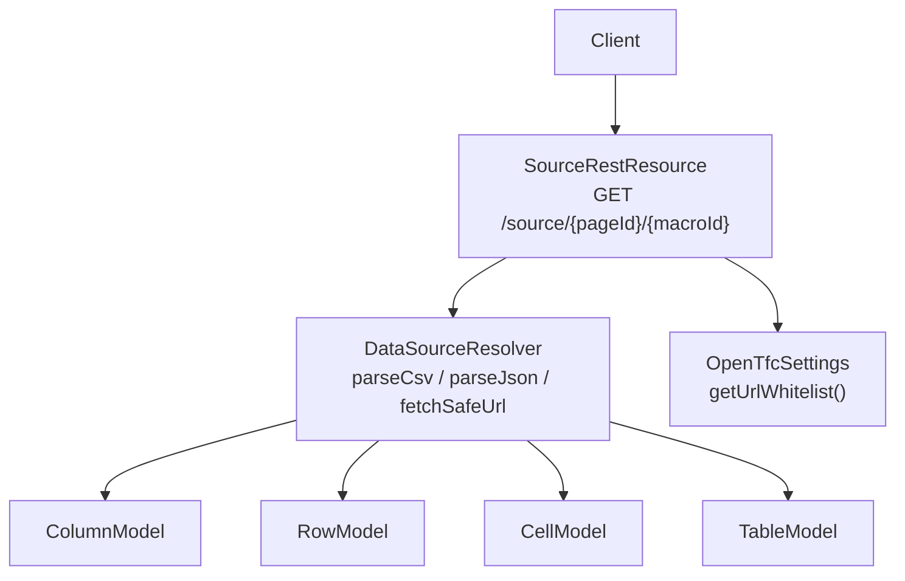
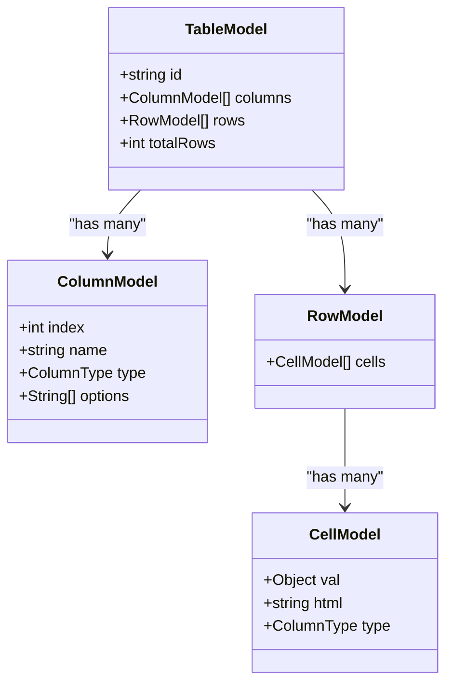
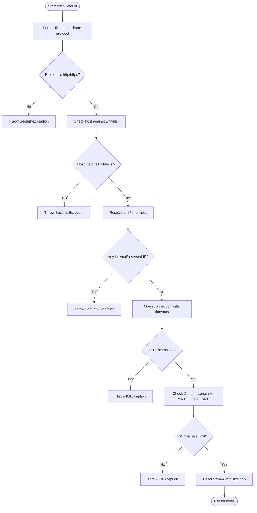
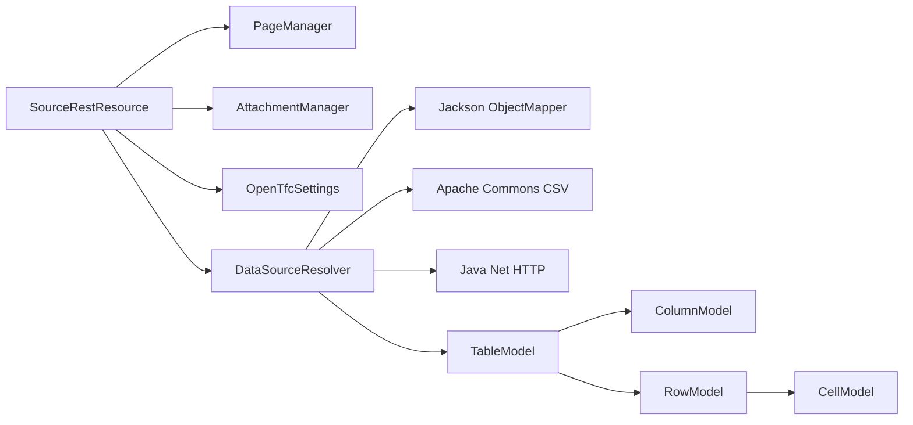

# Source API

<cite>
**Referenced Files in This Document**
- [SourceRestResource.java](file://src/main/java/org/opentfc/rest/SourceRestResource.java)
- [DataSourceResolver.java](file://src/main/java/org/opentfc/service/DataSourceResolver.java)
- [OpenTfcSettings.java](file://src/main/java/org/opentfc/service/OpenTfcSettings.java)
- [TableModel.java](file://src/main/java/org/opentfc/model/TableModel.java)
- [ColumnModel.java](file://src/main/java/org/opentfc/model/ColumnModel.java)
- [RowModel.java](file://src/main/java/org/opentfc/model/RowModel.java)
- [CellModel.java](file://src/main/java/org/opentfc/model/CellModel.java)
</cite>

## Table of Contents
1. [Introduction](#introduction)
2. [Project Structure](#project-structure)
3. [Core Components](#core-components)
4. [Architecture Overview](#architecture-overview)
5. [Detailed Component Analysis](#detailed-component-analysis)
6. [Dependency Analysis](#dependency-analysis)
7. [Performance Considerations](#performance-considerations)
8. [Troubleshooting Guide](#troubleshooting-guide)
9. [Conclusion](#conclusion)

## Introduction
This document specifies the Source REST API for loading and processing external data sources in OpenTFC. The API supports:
- Fetching CSV or JSON data from Confluence page attachments
- Fetching CSV or JSON data from remote HTTP/HTTPS URLs with SSRF protection
- Parsing and returning a normalized table model suitable for rendering tables, charts, pivots, and spreadsheets

The primary endpoint is a GET that returns a structured table representation. There are no upload endpoints; data is loaded from existing attachments or remote URLs.

## Project Structure
The Source API is implemented as a JAX-RS resource under the REST package and relies on service classes for parsing and secure fetching.



**Diagram sources**
- [SourceRestResource.java:25-111](file://src/main/java/org/opentfc/rest/SourceRestResource.java#L25-L111)
- [DataSourceResolver.java:40-288](file://src/main/java/org/opentfc/service/DataSourceResolver.java#L40-L288)
- [OpenTfcSettings.java:49-57](file://src/main/java/org/opentfc/service/OpenTfcSettings.java#L49-L57)
- [TableModel.java:12-75](file://src/main/java/org/opentfc/model/TableModel.java#L12-L75)
- [ColumnModel.java:12-67](file://src/main/java/org/opentfc/model/ColumnModel.java#L12-L67)
- [RowModel.java:12-36](file://src/main/java/org/opentfc/model/RowModel.java#L12-L36)
- [CellModel.java:12-54](file://src/main/java/org/opentfc/model/CellModel.java#L12-L54)

**Section sources**
- [SourceRestResource.java:25-111](file://src/main/java/org/opentfc/rest/SourceRestResource.java#L25-L111)
- [DataSourceResolver.java:40-288](file://src/main/java/org/opentfc/service/DataSourceResolver.java#L40-L288)

## Core Components
- SourceRestResource: Exposes the REST endpoint to load and parse source data.
- DataSourceResolver: Parses CSV/JSON into a unified TableModel and safely fetches remote URLs with SSRF protections.
- OpenTfcSettings: Provides configuration such as URL whitelist used by the resolver.
- TableModel, ColumnModel, RowModel, CellModel: Data structures returned by the API.

Key responsibilities:
- Resolve attachment content by page ID and attachment name
- Fetch remote data via HTTP/HTTPS with host and IP checks
- Decode text with explicit encoding or auto-detection
- Parse CSV (with delimiter detection) and JSON (array of objects or arrays)
- Return a normalized TableModel

**Section sources**
- [SourceRestResource.java:25-111](file://src/main/java/org/opentfc/rest/SourceRestResource.java#L25-L111)
- [DataSourceResolver.java:40-288](file://src/main/java/org/opentfc/service/DataSourceResolver.java#L40-L288)
- [OpenTfcSettings.java:49-57](file://src/main/java/org/opentfc/service/OpenTfcSettings.java#L49-L57)
- [TableModel.java:12-75](file://src/main/java/org/opentfc/model/TableModel.java#L12-L75)

## Architecture Overview
The Source API follows a simple request-response flow:
- Client calls GET /source/{pageId}/{macroId}
- Server resolves data from either an attachment or a remote URL
- Server decodes bytes to text using the specified or detected encoding
- Server parses text as CSV or JSON into a TableModel
- Server returns the TableModel as JSON

```mermaid
sequenceDiagram
participant C as "Client"
participant R as "SourceRestResource"
participant P as "PageManager"
participant A as "AttachmentManager"
participant S as "OpenTfcSettings"
participant D as "DataSourceResolver"
C->>R : GET /source/{pageId}/{macroId}?type=csv|json&attachmentName=...&url=...&encoding=...&delimiter=auto|...
alt Attachment source
R->>P : getPage(pageId)
P-->>R : Page
R->>A : getAttachment(page, attachmentName)
A-->>R : Attachment
R->>A : getAttachmentData(attachment)
A-->>R : InputStream
R->>D : decode(bytes, encoding)
D-->>R : String text
else Remote URL source
R->>S : getUrlWhitelist()
S-->>R : List<String> whitelist
R->>D : fetchSafeUrl(url, whitelist)
D-->>R : byte[] bytes
R->>D : decode(bytes, encoding)
D-->>R : String text
end
opt type=json
R->>D : parseJson(text, "$")
D-->>R : TableModel
else type=csv (default)
R->>D : parseCsv(text, delimiter)
D-->>R : TableModel
end
R-->>C : 200 OK { id, columns, rows, totalRows }
```

**Diagram sources**
- [SourceRestResource.java:61-111](file://src/main/java/org/opentfc/rest/SourceRestResource.java#L61-L111)
- [DataSourceResolver.java:48-75](file://src/main/java/org/opentfc/service/DataSourceResolver.java#L48-L75)
- [DataSourceResolver.java:97-131](file://src/main/java/org/opentfc/service/DataSourceResolver.java#L97-L131)
- [DataSourceResolver.java:139-187](file://src/main/java/org/opentfc/service/DataSourceResolver.java#L139-L187)
- [DataSourceResolver.java:212-258](file://src/main/java/org/opentfc/service/DataSourceResolver.java#L212-L258)
- [OpenTfcSettings.java:49-57](file://src/main/java/org/opentfc/service/OpenTfcSettings.java#L49-L57)

## Detailed Component Analysis

### Endpoint: Get Source Data
- Method: GET
- Path: /source/{pageId}/{macroId}
- Produces: application/json

Query parameters:
- type: csv | json (default: csv)
- attachmentName: string (optional; when present, loads from Confluence attachment)
- url: string (optional; when present, loads from remote HTTP/HTTPS URL)
- encoding: string (default: UTF-8; can be any charset name or "auto")
- delimiter: string (default: auto; supports comma, semicolon, tab, pipe, or "tab"/"\t")

Behavior:
- If attachmentName is provided and valid, the server reads the attachment stream, enforces size limits, decodes it, and parses based on type.
- If url is provided, the server fetches the remote content with SSRF protections, enforces size/time limits, decodes it, and parses based on type.
- If neither attachmentName nor url yields data, the server returns 404 Not Found.
- For type=json, the server parses JSON as an array of objects or array of arrays and maps to TableModel.
- For type=csv (default), the server parses CSV with header row and optional delimiter detection.

Request schemas:
- File uploads: Not supported by this endpoint. Use Confluence UI to attach files to pages, then reference them via attachmentName.
- JSON payloads: Not accepted by this endpoint.
- URL-based data sources: Provide url query parameter pointing to HTTP/HTTPS resources.

Response schema:
- 200 OK: TableModel JSON body
- 404 Not Found: When source cannot be opened (missing attachment or invalid URL)
- 500 Internal Server Error: On unexpected errors during loading/parsing

Error responses:
- 404 Not Found: "Source data stream could not be opened"
- 500 Internal Server Error: "Error loading source data. Check server logs for details."

Security restrictions:
- Only HTTP and HTTPS protocols are allowed for remote URLs.
- Host must match the configured URL whitelist; otherwise, access is denied.
- Resolved IPs are checked to block loopback, site-local, link-local, any-local, and multicast addresses to prevent SSRF.
- Redirects are disabled for remote requests.
- Timeouts: connect timeout and read timeout are enforced.
- Size limit: maximum fetch size is enforced for both remote and attachment streams.

Supported formats:
- CSV: First row is treated as header; delimiter detection supports comma, semicolon, tab, pipe; "auto" selects the most frequent among these in the first line.
- JSON: Array of objects or array of arrays; object keys become column names; missing values map to empty strings.

File size limits:
- Maximum fetch size: 10 MB (applies to both remote and attachment streams).

Notes:
- macroId is attached to the response TableModel as its id field.
- Encoding defaults to UTF-8 but can be explicitly set or auto-detected.

**Section sources**
- [SourceRestResource.java:61-111](file://src/main/java/org/opentfc/rest/SourceRestResource.java#L61-L111)
- [DataSourceResolver.java:48-75](file://src/main/java/org/opentfc/service/DataSourceResolver.java#L48-L75)
- [DataSourceResolver.java:97-131](file://src/main/java/org/opentfc/service/DataSourceResolver.java#L97-L131)
- [DataSourceResolver.java:139-187](file://src/main/java/org/opentfc/service/DataSourceResolver.java#L139-L187)
- [DataSourceResolver.java:212-258](file://src/main/java/org/opentfc/service/DataSourceResolver.java#L212-L258)
- [OpenTfcSettings.java:49-57](file://src/main/java/org/opentfc/service/OpenTfcSettings.java#L49-L57)

### Data Model: TableModel
The API returns a normalized table structure:
- id: string identifier (set to macroId)
- columns: list of ColumnModel entries describing headers and metadata
- rows: list of RowModel entries containing cells
- totalRows: number of rows parsed



**Diagram sources**
- [TableModel.java:12-75](file://src/main/java/org/opentfc/model/TableModel.java#L12-L75)
- [ColumnModel.java:12-67](file://src/main/java/org/opentfc/model/ColumnModel.java#L12-L67)
- [RowModel.java:12-36](file://src/main/java/org/opentfc/model/RowModel.java#L12-L36)
- [CellModel.java:12-54](file://src/main/java/org/opentfc/model/CellModel.java#L12-L54)

**Section sources**
- [TableModel.java:12-75](file://src/main/java/org/opentfc/model/TableModel.java#L12-L75)
- [ColumnModel.java:12-67](file://src/main/java/org/opentfc/model/ColumnModel.java#L12-L67)
- [RowModel.java:12-36](file://src/main/java/org/opentfc/model/RowModel.java#L12-L36)
- [CellModel.java:12-54](file://src/main/java/org/opentfc/model/CellModel.java#L12-L54)

### Security and Validation Flow
Remote URL fetching includes multiple validation steps to prevent SSRF and resource exhaustion.



**Diagram sources**
- [DataSourceResolver.java:212-258](file://src/main/java/org/opentfc/service/DataSourceResolver.java#L212-L258)
- [DataSourceResolver.java:274-288](file://src/main/java/org/opentfc/service/DataSourceResolver.java#L274-L288)

**Section sources**
- [DataSourceResolver.java:212-258](file://src/main/java/org/opentfc/service/DataSourceResolver.java#L212-L258)
- [DataSourceResolver.java:274-288](file://src/main/java/org/opentfc/service/DataSourceResolver.java#L274-L288)

## Dependency Analysis
- SourceRestResource depends on:
  - PageManager and AttachmentManager for attachment resolution
  - OpenTfcSettings for URL whitelist configuration
  - DataSourceResolver for decoding, parsing, and safe fetching
- DataSourceResolver depends on:
  - Jackson ObjectMapper for JSON parsing
  - Apache Commons CSV for CSV parsing
  - Java networking APIs for HTTP/HTTPS requests
- Models (TableModel, ColumnModel, RowModel, CellModel) are pure data structures serialized to JSON.



**Diagram sources**
- [SourceRestResource.java:30-51](file://src/main/java/org/opentfc/rest/SourceRestResource.java#L30-L51)
- [DataSourceResolver.java:3-12](file://src/main/java/org/opentfc/service/DataSourceResolver.java#L3-L12)
- [DataSourceResolver.java:46-46](file://src/main/java/org/opentfc/service/DataSourceResolver.java#L46-L46)
- [TableModel.java:12-75](file://src/main/java/org/opentfc/model/TableModel.java#L12-L75)

**Section sources**
- [SourceRestResource.java:30-51](file://src/main/java/org/opentfc/rest/SourceRestResource.java#L30-L51)
- [DataSourceResolver.java:3-12](file://src/main/java/org/opentfc/service/DataSourceResolver.java#L3-L12)
- [TableModel.java:12-75](file://src/main/java/org/opentfc/model/TableModel.java#L12-L75)

## Performance Considerations
- Maximum fetch size: 10 MB for both remote and attachment streams to prevent memory exhaustion.
- Timeouts: Connect timeout and read timeout are enforced for remote requests.
- CSV parsing uses streaming-like iteration over records; large datasets may still consume significant memory due to building the full TableModel.
- JSON parsing reads entire payload into memory before mapping to TableModel.
- Delimiter detection scans only the first line to minimize overhead.

[No sources needed since this section provides general guidance]

## Troubleshooting Guide
Common issues and resolutions:
- 404 Not Found: Ensure attachmentName exists on the specified pageId or that url points to a reachable resource.
- 500 Internal Server Error: Check server logs for detailed error messages related to network failures, parsing exceptions, or encoding issues.
- Invalid URL protocol: Only HTTP and HTTPS are allowed; ensure the url starts with http:// or https://.
- Host not whitelisted: Configure the URL whitelist in OpenTFC settings to include the target host or wildcard patterns.
- SSRF blocked: The server blocks internal, loopback, link-local, any-local, and multicast addresses; use publicly routable hosts.
- Encoding problems: Set encoding explicitly (e.g., windows-1251) or rely on auto-detection which handles BOM and common encodings.
- CSV delimiter mismatch: Specify delimiter explicitly if auto-detection does not choose the correct one.

Operational notes:
- Logging: Failures are logged with context including pageId, attachmentName, url, and type.
- Settings: URL whitelist is managed via OpenTFC plugin settings and affects remote URL fetching.

**Section sources**
- [SourceRestResource.java:90-110](file://src/main/java/org/opentfc/rest/SourceRestResource.java#L90-L110)
- [DataSourceResolver.java:212-258](file://src/main/java/org/opentfc/service/DataSourceResolver.java#L212-L258)
- [OpenTfcSettings.java:49-57](file://src/main/java/org/opentfc/service/OpenTfcSettings.java#L49-L57)

## Conclusion
The Source REST API provides a secure and flexible way to load CSV and JSON data from Confluence attachments or remote HTTP/HTTPS URLs and return a normalized table model. It enforces strict security controls against SSRF, validates protocols and hosts, and applies size and time limits. Clients should prepare their data as CSV or JSON and use the GET endpoint to retrieve structured table data for further processing or visualization.

[No sources needed since this section summarizes without analyzing specific files]