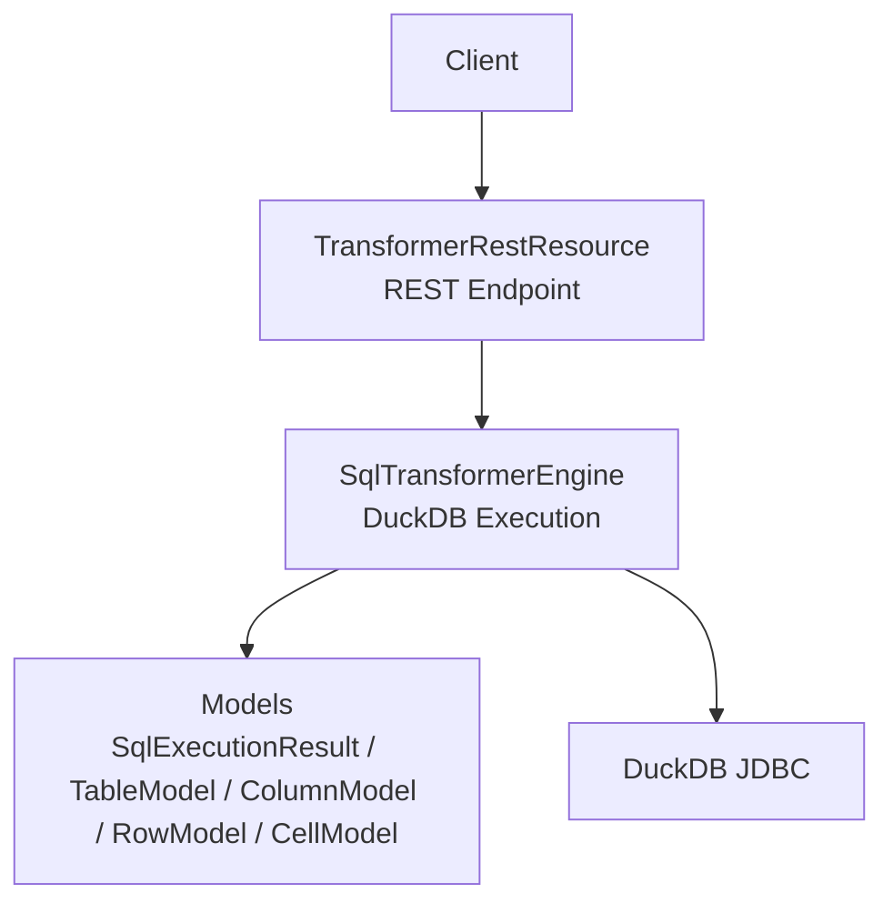
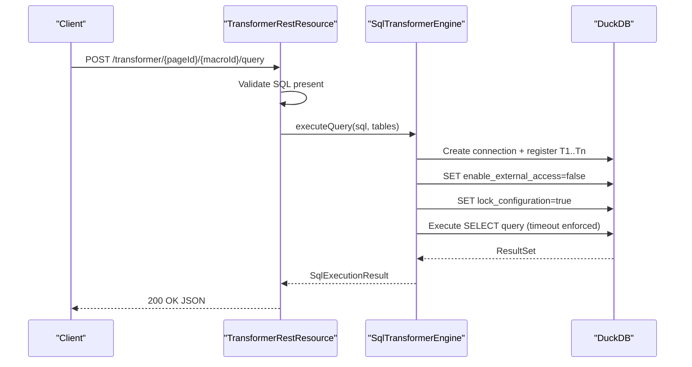
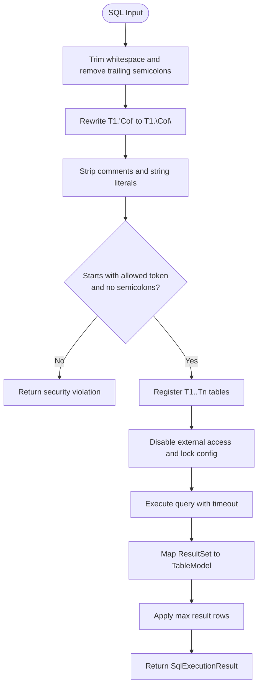
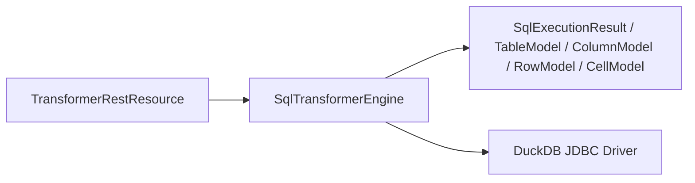

# Transformer API

<cite>
**Referenced Files in This Document**
- [TransformerRestResource.java](file://src/main/java/org/opentfc/rest/TransformerRestResource.java)
- [SqlTransformerEngine.java](file://src/main/java/org/opentfc/service/SqlTransformerEngine.java)
- [SqlExecutionResult.java](file://src/main/java/org/opentfc/model/SqlExecutionResult.java)
- [TableModel.java](file://src/main/java/org/opentfc/model/TableModel.java)
- [ColumnModel.java](file://src/main/java/org/opentfc/model/ColumnModel.java)
- [RowModel.java](file://src/main/java/org/opentfc/model/RowModel.java)
- [CellModel.java](file://src/main/java/org/opentfc/model/CellModel.java)
- [ColumnType.java](file://src/main/java/org/opentfc/model/ColumnType.java)
- [README.md](file://README.md)
</cite>

## Table of Contents
1. [Introduction](#introduction)
2. [Project Structure](#project-structure)
3. [Core Components](#core-components)
4. [Architecture Overview](#architecture-overview)
5. [Detailed Component Analysis](#detailed-component-analysis)
6. [Dependency Analysis](#dependency-analysis)
7. [Performance Considerations](#performance-considerations)
8. [Troubleshooting Guide](#troubleshooting-guide)
9. [Conclusion](#conclusion)

## Introduction
The Transformer API provides a secure, sandboxed REST endpoint for executing SQL transformations over in-memory tables using the DuckDB engine. It is designed to transform Confluence table data by accepting one or more source tables and a single read-only SQL statement. The API supports T1/T2 table references, JOIN operations, UNION statements, PIVOT, and window functions as documented in the project overview.

Key capabilities:
- Submit SQL queries via a POST endpoint.
- Reference input tables as T1, T2, etc., inside the query.
- Execute only allowed SELECT-style statements with strict sandboxing.
- Enforce execution timeouts and result row limits.
- Return structured result sets with column metadata and typed cell values.

**Section sources**
- [README.md:36-39](file://README.md#L36-L39)

## Project Structure
The Transformer feature spans three main layers:
- REST layer: exposes the HTTP endpoint and validates basic request structure.
- Service layer: implements DuckDB-backed SQL execution, sandboxing, and result mapping.
- Model layer: defines JSON-compatible structures for requests and responses.

**Diagram sources**
- [TransformerRestResource.java:19-52](file://src/main/java/org/opentfc/rest/TransformerRestResource.java#L19-L52)
- [SqlTransformerEngine.java:32-148](file://src/main/java/org/opentfc/service/SqlTransformerEngine.java#L32-L148)
- [SqlExecutionResult.java:10-75](file://src/main/java/org/opentfc/model/SqlExecutionResult.java#L10-L75)
- [TableModel.java:12-75](file://src/main/java/org/opentfc/model/TableModel.java#L12-L75)
- [ColumnModel.java:12-67](file://src/main/java/org/opentfc/model/ColumnModel.java#L12-L67)
- [RowModel.java:12-36](file://src/main/java/org/opentfc/model/RowModel.java#L12-L36)
- [CellModel.java:10-54](file://src/main/java/org/opentfc/model/CellModel.java#L10-L54)

**Section sources**
- [TransformerRestResource.java:19-52](file://src/main/java/org/opentfc/rest/TransformerRestResource.java#L19-L52)
- [SqlTransformerEngine.java:32-148](file://src/main/java/org/opentfc/service/SqlTransformerEngine.java#L32-L148)

## Core Components
- Transformer REST resource: handles POST requests, validates presence of SQL, logs execution context, and delegates to the SQL engine.
- SQL transformer engine: creates an in-memory DuckDB connection, registers source tables as T1..Tn, enforces security settings, executes the query with timeout, and maps results into typed models.
- Data models: define the JSON schema for request payloads and response bodies.

**Section sources**
- [TransformerRestResource.java:27-52](file://src/main/java/org/opentfc/rest/TransformerRestResource.java#L27-L52)
- [SqlTransformerEngine.java:56-148](file://src/main/java/org/opentfc/service/SqlTransformerEngine.java#L56-L148)
- [SqlExecutionResult.java:10-75](file://src/main/java/org/opentfc/model/SqlExecutionResult.java#L10-L75)
- [TableModel.java:12-75](file://src/main/java/org/opentfc/model/TableModel.java#L12-L75)
- [ColumnModel.java:12-67](file://src/main/java/org/opentfc/model/ColumnModel.java#L12-L67)
- [RowModel.java:12-36](file://src/main/java/org/opentfc/model/RowModel.java#L12-L36)
- [CellModel.java:10-54](file://src/main/java/org/opentfc/model/CellModel.java#L10-L54)

## Architecture Overview
The API follows a simple request-to-result flow with strong safeguards:
- The client submits a JSON payload containing the SQL and optional source tables.
- The REST layer validates the request and forwards it to the engine.
- The engine prepares a sandboxed DuckDB session, registers tables as T1..Tn, and executes the query within a timeout.
- Results are mapped to a typed table model and returned as JSON.

**Diagram sources**
- [TransformerRestResource.java:32-52](file://src/main/java/org/opentfc/rest/TransformerRestResource.java#L32-L52)
- [SqlTransformerEngine.java:95-148](file://src/main/java/org/opentfc/service/SqlTransformerEngine.java#L95-L148)

## Detailed Component Analysis

### REST Endpoint: Execute Query
- Method: POST
- Path: /transformer/{pageId}/{macroId}/query
- Content-Type: application/json
- Produces: application/json

Request body schema:
- sql: string (required). The SQL query to execute.
- tables: array of TableModel objects (optional). Each object represents a source table referenced as T1, T2, etc.

Response body schema:
- success: boolean
- table: TableModel (present on success)
- executionTimeMs: number (milliseconds)
- errorMessage: string (present on failure)

Error handling:
- Missing SQL returns 400 Bad Request with error message.
- Security violations and SQL errors return 200 OK with success=false and errorMessage populated.

Notes:
- pageId and macroId are path parameters used for logging and context; they do not affect query execution.

**Section sources**
- [TransformerRestResource.java:19-52](file://src/main/java/org/opentfc/rest/TransformerRestResource.java#L19-L52)

### SQL Engine: Sandboxing, Timeout, and Result Mapping
Security and sandboxing:
- Only a single SELECT-style statement is allowed. Comments and string literals are stripped before validation.
- Allowed starting tokens include SELECT, WITH, FROM, PIVOT, UNPIVOT, VALUES, optionally wrapped in parentheses.
- Semicolons are rejected to prevent multiple statements.
- External access is disabled and configuration is locked before execution.

Timeout and concurrency:
- Queries run in a fixed-size thread pool with a per-query timeout.
- On timeout, the statement is cancelled and a timeout error is returned.

Result processing:
- Columns are inferred from JDBC metadata and mapped to supported types.
- Numeric values are normalized and may be represented as integers when appropriate.
- Non-numeric and non-boolean values are converted to strings.
- Result rows are limited by a configurable maximum.

Table registration:
- Input tables are created as T1, T2, ..., Tn in DuckDB.
- Column names are quoted to support spaces and special characters.
- Numeric columns are detected based on content and inserted as DOUBLE; otherwise VARCHAR.

Supported SQL features:
- JOINs across T1/T2 tables.
- UNION and UNION ALL.
- PIVOT and UNPIVOT.
- Window functions.

**Section sources**
- [SqlTransformerEngine.java:50-148](file://src/main/java/org/opentfc/service/SqlTransformerEngine.java#L50-L148)
- [SqlTransformerEngine.java:150-284](file://src/main/java/org/opentfc/service/SqlTransformerEngine.java#L150-L284)

### Data Models: Request and Response Schemas

#### QueryRequest
- sql: string (required)
- tables: array of TableModel (optional)

#### TableModel
- id: string
- columns: array of ColumnModel
- rows: array of RowModel
- totalRows: integer

#### ColumnModel
- index: integer
- name: string
- type: ColumnType enum
- options: array of strings

#### RowModel
- cells: array of CellModel

#### CellModel
- val: any (raw value)
- html: string
- type: ColumnType enum

#### ColumnType
- TEXT
- NUMBER
- DATE
- SELECT
- LINK
- BOOLEAN

#### SqlExecutionResult
- success: boolean
- table: TableModel
- executionTimeMs: number
- errorMessage: string

**Section sources**
- [TransformerRestResource.java:27-30](file://src/main/java/org/opentfc/rest/TransformerRestResource.java#L27-L30)
- [SqlExecutionResult.java:10-75](file://src/main/java/org/opentfc/model/SqlExecutionResult.java#L10-L75)
- [TableModel.java:12-75](file://src/main/java/org/opentfc/model/TableModel.java#L12-L75)
- [ColumnModel.java:12-67](file://src/main/java/org/opentfc/model/ColumnModel.java#L12-L67)
- [RowModel.java:12-36](file://src/main/java/org/opentfc/model/RowModel.java#L12-L36)
- [CellModel.java:10-54](file://src/main/java/org/opentfc/model/CellModel.java#L10-L54)
- [ColumnType.java:6-13](file://src/main/java/org/opentfc/model/ColumnType.java#L6-L13)

### SQL Syntax and Processing Flow
The engine preprocesses user SQL to ensure safety and compatibility:
- Trims trailing semicolons.
- Rewrites prototype column references like T1.'Column Name' to T1."Column Name".
- Strips comments and string literals before validating allowed command prefixes.

**Diagram sources**
- [SqlTransformerEngine.java:79-93](file://src/main/java/org/opentfc/service/SqlTransformerEngine.java#L79-L93)
- [SqlTransformerEngine.java:95-148](file://src/main/java/org/opentfc/service/SqlTransformerEngine.java#L95-L148)
- [SqlTransformerEngine.java:150-180](file://src/main/java/org/opentfc/service/SqlTransformerEngine.java#L150-L180)

**Section sources**
- [SqlTransformerEngine.java:79-148](file://src/main/java/org/opentfc/service/SqlTransformerEngine.java#L79-L148)

### Examples of Complex Transformations
Below are conceptual examples demonstrating supported patterns. Replace placeholders with your actual data and desired logic.

- JOIN between T1 and T2:
  - Use SELECT with JOIN conditions referencing T1 and T2 columns.
  - Example pattern: select aggregated fields from T1 joined to T2 on matching keys.

- UNION of two queries:
  - Combine results from two SELECT statements using UNION or UNION ALL.
  - Ensure both sides have compatible column counts and types.

- PIVOT transformation:
  - Use PIVOT to aggregate values across categories defined in a column.
  - Useful for converting rows to columns for reporting.

- Window functions:
  - Apply ROW_NUMBER(), RANK(), SUM() OVER(), etc., for advanced analytics.

Note: These examples describe usage patterns; refer to the engine’s supported features and preprocessing rules for exact behavior.

[No sources needed since this section describes conceptual usage patterns]

## Dependency Analysis
The REST resource depends on the SQL engine, which in turn depends on DuckDB JDBC and the shared model classes.

**Diagram sources**
- [TransformerRestResource.java:25-52](file://src/main/java/org/opentfc/rest/TransformerRestResource.java#L25-L52)
- [SqlTransformerEngine.java:108-148](file://src/main/java/org/opentfc/service/SqlTransformerEngine.java#L108-L148)
- [SqlExecutionResult.java:10-75](file://src/main/java/org/opentfc/model/SqlExecutionResult.java#L10-L75)
- [TableModel.java:12-75](file://src/main/java/org/opentfc/model/TableModel.java#L12-L75)
- [ColumnModel.java:12-67](file://src/main/java/org/opentfc/model/ColumnModel.java#L12-L67)
- [RowModel.java:12-36](file://src/main/java/org/opentfc/model/RowModel.java#L12-L36)
- [CellModel.java:10-54](file://src/main/java/org/opentfc/model/CellModel.java#L10-L54)

**Section sources**
- [TransformerRestResource.java:25-52](file://src/main/java/org/opentfc/rest/TransformerRestResource.java#L25-L52)
- [SqlTransformerEngine.java:108-148](file://src/main/java/org/opentfc/service/SqlTransformerEngine.java#L108-L148)

## Performance Considerations
- Thread pool: A fixed-size executor manages concurrent DuckDB queries to avoid thread leaks.
- Timeout: Default timeout is configured at engine construction; queries exceeding the limit are cancelled.
- Result size: Maximum result rows are enforced to prevent large payloads.
- Type inference: Numeric detection and normalization occur during table population and result mapping.
- Logging: Execution context and errors are logged for monitoring and diagnostics.

Recommendations:
- Keep queries selective and use WHERE clauses to reduce result sizes.
- Avoid unnecessary joins and subqueries that can increase execution time.
- Monitor executionTimeMs in responses to identify slow queries.
- Tune timeout and maxResultRows according to workload characteristics if you customize the engine constructor.

**Section sources**
- [SqlTransformerEngine.java:39-48](file://src/main/java/org/opentfc/service/SqlTransformerEngine.java#L39-L48)
- [SqlTransformerEngine.java:60-67](file://src/main/java/org/opentfc/service/SqlTransformerEngine.java#L60-L67)
- [SqlTransformerEngine.java:121-148](file://src/main/java/org/opentfc/service/SqlTransformerEngine.java#L121-L148)
- [SqlTransformerEngine.java:150-180](file://src/main/java/org/opentfc/service/SqlTransformerEngine.java#L150-L180)

## Troubleshooting Guide
Common issues and resolutions:
- Missing SQL:
  - Symptom: 400 Bad Request with error message indicating SQL must be provided.
  - Resolution: Include a non-empty sql field in the request body.

- Security violation:
  - Symptom: success=false with a message indicating only a single SELECT query is permitted.
  - Resolution: Ensure the query starts with an allowed token and contains no semicolons.

- Query timeout:
  - Symptom: success=false with a timeout message.
  - Resolution: Optimize the query or increase the timeout setting if you control the engine configuration.

- SQL execution error:
  - Symptom: success=false with an error message including a code.
  - Resolution: Review the error message and adjust the query accordingly.

Monitoring and diagnostics:
- Check logs for “rest-transformer” and “sql-engine” entries to trace request context and failures.
- Inspect executionTimeMs in successful responses to track performance trends.

**Section sources**
- [TransformerRestResource.java:37-51](file://src/main/java/org/opentfc/rest/TransformerRestResource.java#L37-L51)
- [SqlTransformerEngine.java:98-148](file://src/main/java/org/opentfc/service/SqlTransformerEngine.java#L98-L148)

## Conclusion
The Transformer API offers a secure, efficient way to perform SQL-based transformations over in-memory tables using DuckDB. By enforcing strict sandboxing, timeouts, and result limits, it balances flexibility with safety. Clients should submit well-formed SELECT-style queries, reference input tables as T1/T2, and process the structured JSON responses containing typed columns and rows. For complex transformations, leverage JOINs, UNIONs, PIVOT, and window functions while adhering to the security constraints and performance guidelines outlined above.

[No sources needed since this section summarizes without analyzing specific files]