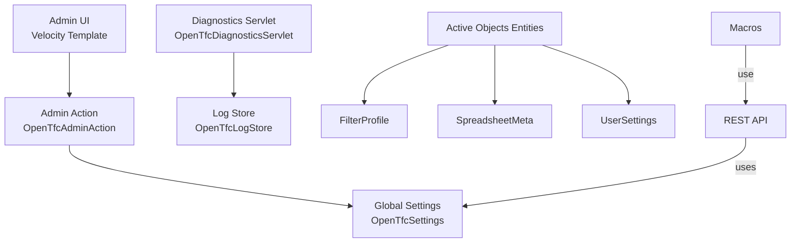
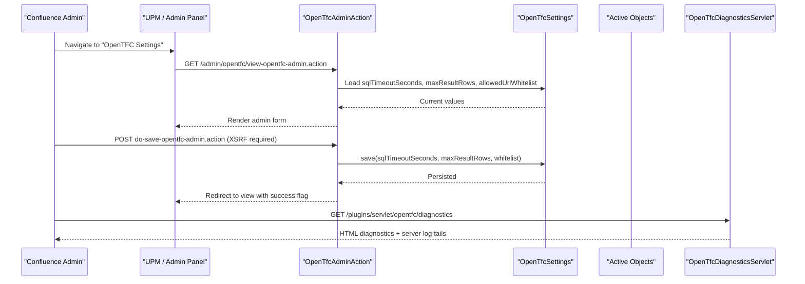
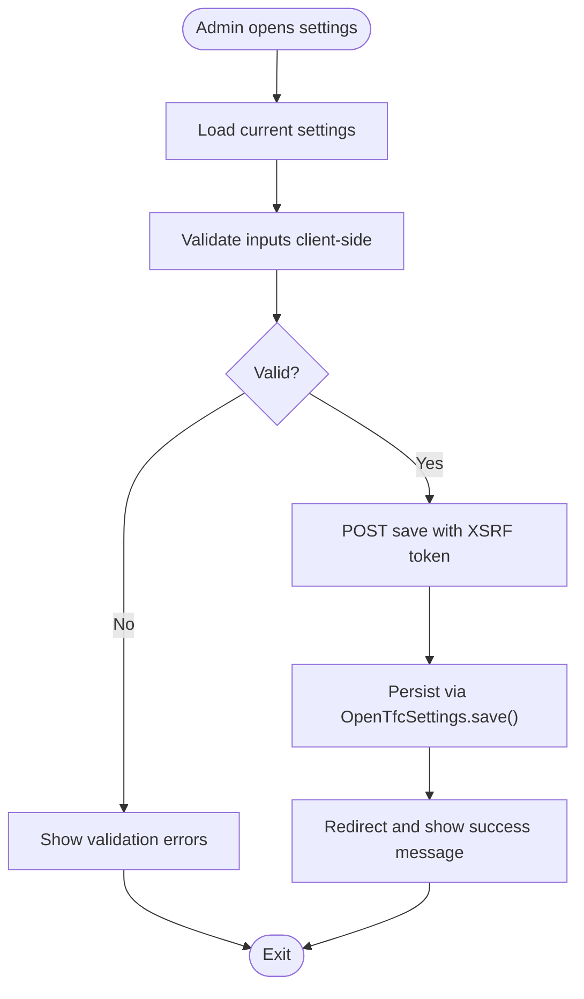
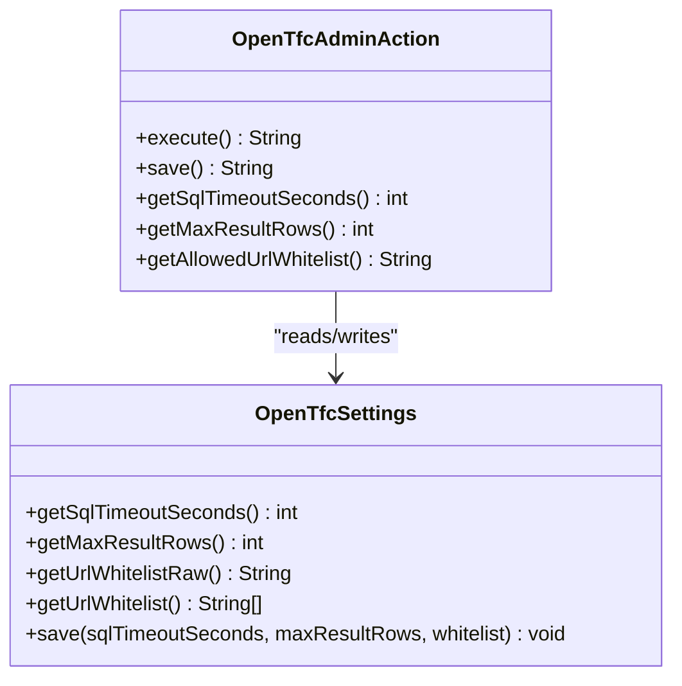
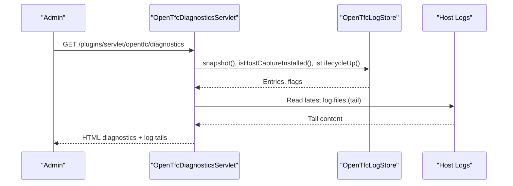
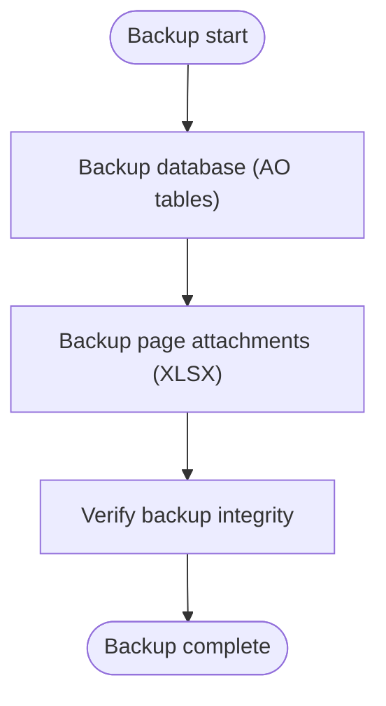
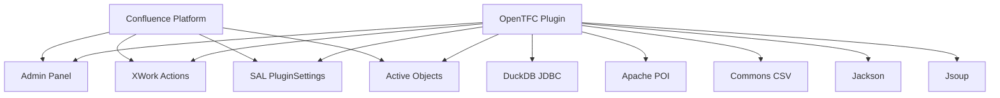
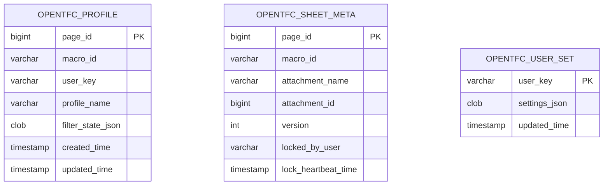

# Administration Guide

<cite>
**Referenced Files in This Document**
- [README.md](file://README.md)
- [INSTALL.md](file://INSTALL.md)
- [atlassian-plugin.xml](file://src/main/resources/atlassian-plugin.xml)
- [OpenTfcAdminAction.java](file://src/main/java/org/opentfc/admin/OpenTfcAdminAction.java)
- [opentfc-admin.vm](file://src/main/resources/templates/admin/opentfc-admin.vm)
- [OpenTfcSettings.java](file://src/main/java/org/opentfc/service/OpenTfcSettings.java)
- [OpenTfcDiagnosticsServlet.java](file://src/main/java/org/opentfc/diag/OpenTfcDiagnosticsServlet.java)
- [FilterProfile.java](file://src/main/java/org/opentfc/ao/FilterProfile.java)
- [SpreadsheetMeta.java](file://src/main/java/org/opentfc/ao/SpreadsheetMeta.java)
- [UserSettings.java](file://src/main/java/org/opentfc/ao/UserSettings.java)
</cite>

## Table of Contents
1. [Introduction](#introduction)
2. [Project Structure](#project-structure)
3. [Core Components](#core-components)
4. [Architecture Overview](#architecture-overview)
5. [Detailed Component Analysis](#detailed-component-analysis)
6. [Dependency Analysis](#dependency-analysis)
7. [Performance Considerations](#performance-considerations)
8. [Troubleshooting Guide](#troubleshooting-guide)
9. [Conclusion](#conclusion)
10. [Appendices](#appendices)

## Introduction
This document provides comprehensive administration guidance for the OpenTFC plugin in Confluence Data Center and Server. It focuses on:
- The admin interface under Confluence administration.
- Plugin configuration options, including SQL execution limits and URL whitelisting.
- User permissions and security controls relevant to administrators.
- Monitoring and logging through the built-in diagnostics servlet.
- Backup and recovery procedures for Active Objects data.
- Upgrade, migration, and rollback strategies.
- Troubleshooting common administrative issues and using diagnostic endpoints.

The plugin exposes an administration web item, XWork actions, a diagnostics servlet, REST resources, macros, and Active Objects entities that persist user profiles, spreadsheet metadata, and user settings.

**Section sources**
- [README.md:15-57](file://README.md#L15-L57)
- [INSTALL.md:98-105](file://INSTALL.md#L98-L105)
- [atlassian-plugin.xml:45-68](file://src/main/resources/atlassian-plugin.xml#L45-L68)

## Project Structure
OpenTFC is implemented as a Confluence plugin with:
- An admin action and Velocity template for global settings.
- A diagnostics servlet for browser-based logs and host log tailing.
- Active Objects entities for filter profiles, spreadsheet metadata, and user settings.
- REST resources for configuration, export, profiles, sources, and transformer operations.
- Macros for table filtering, charts, pivot tables, transformers, spreadsheets, CSV/JSON import, and attachment listing.

**Diagram sources**
- [atlassian-plugin.xml:45-68](file://src/main/resources/atlassian-plugin.xml#L45-L68)
- [OpenTfcAdminAction.java:14-62](file://src/main/java/org/opentfc/admin/OpenTfcAdminAction.java#L14-L62)
- [OpenTfcSettings.java:13-65](file://src/main/java/org/opentfc/service/OpenTfcSettings.java#L13-L65)
- [OpenTfcDiagnosticsServlet.java:23-30](file://src/main/java/org/opentfc/diag/OpenTfcDiagnosticsServlet.java#L23-L30)
- [FilterProfile.java:12-41](file://src/main/java/org/opentfc/ao/FilterProfile.java#L12-L41)
- [SpreadsheetMeta.java:11-38](file://src/main/java/org/opentfc/ao/SpreadsheetMeta.java#L11-L38)
- [UserSettings.java:12-26](file://src/main/java/org/opentfc/ao/UserSettings.java#L12-L26)

**Section sources**
- [atlassian-plugin.xml:15-27](file://src/main/resources/atlassian-plugin.xml#L15-L27)
- [atlassian-plugin.xml:70-286](file://src/main/resources/atlassian-plugin.xml#L70-L286)

## Core Components
- Administration page and action:
  - Web item adds “OpenTFC Settings” under Confluence administration.
  - XWork action renders the admin form and persists settings via SAL PluginSettings.
  - Save action requires an XSRF token.
- Global settings storage:
  - SQL timeout seconds (bounded).
  - Maximum result rows (bounded).
  - Allowed URL whitelist (domain list).
- Diagnostics servlet:
  - Browser-visible logs without velocity decorators or AUI.
  - Host log capture and tailing from Confluence home/logs.
  - Downloadable text and auto-refresh support.
- Active Objects entities:
  - Filter profiles per user and macro/page.
  - Spreadsheet metadata with attachment versioning and soft locks.
  - User settings JSON blob.

**Section sources**
- [atlassian-plugin.xml:45-62](file://src/main/resources/atlassian-plugin.xml#L45-L62)
- [OpenTfcAdminAction.java:14-91](file://src/main/java/org/opentfc/admin/OpenTfcAdminAction.java#L14-L91)
- [OpenTfcSettings.java:13-65](file://src/main/java/org/opentfc/service/OpenTfcSettings.java#L13-L65)
- [OpenTfcDiagnosticsServlet.java:23-30](file://src/main/java/org/opentfc/diag/OpenTfcDiagnosticsServlet.java#L23-L30)
- [FilterProfile.java:12-41](file://src/main/java/org/opentfc/ao/FilterProfile.java#L12-L41)
- [SpreadsheetMeta.java:11-38](file://src/main/java/org/opentfc/ao/SpreadsheetMeta.java#L11-L38)
- [UserSettings.java:12-26](file://src/main/java/org/opentfc/ao/UserSettings.java#L12-L26)

## Architecture Overview
The administration workflow integrates Confluence’s admin panel, XWork actions, SAL settings, and Active Objects persistence. The diagnostics servlet operates independently of the rendering pipeline to provide reliable troubleshooting information.

**Diagram sources**
- [atlassian-plugin.xml:45-68](file://src/main/resources/atlassian-plugin.xml#L45-L68)
- [OpenTfcAdminAction.java:44-62](file://src/main/java/org/opentfc/admin/OpenTfcAdminAction.java#L44-L62)
- [OpenTfcSettings.java:59-65](file://src/main/java/org/opentfc/service/OpenTfcSettings.java#L59-L65)
- [OpenTfcDiagnosticsServlet.java:147-179](file://src/main/java/org/opentfc/diag/OpenTfcDiagnosticsServlet.java#L147-L179)

## Detailed Component Analysis

### Administration Interface and Configuration
- Access path: Confluence Administration → OpenTFC Settings.
- Fields:
  - SQL Timeout Seconds: bounded between 1 and 120; default 10.
  - Max Result Rows: bounded between 100 and 500000; default 50000.
  - Allowed URL Whitelist: domain list; local addresses are blocked by design.
- Security:
  - Save action enforces XSRF token validation.
  - Admin area restricts access to Confluence administrators.

**Diagram sources**
- [opentfc-admin.vm:23-49](file://src/main/resources/templates/admin/opentfc-admin.vm#L23-L49)
- [OpenTfcAdminAction.java:54-62](file://src/main/java/org/opentfc/admin/OpenTfcAdminAction.java#L54-L62)
- [OpenTfcSettings.java:59-65](file://src/main/java/org/opentfc/service/OpenTfcSettings.java#L59-L65)

**Section sources**
- [INSTALL.md:98-105](file://INSTALL.md#L98-L105)
- [atlassian-plugin.xml:45-62](file://src/main/resources/atlassian-plugin.xml#L45-L62)
- [OpenTfcAdminAction.java:14-91](file://src/main/java/org/opentfc/admin/OpenTfcAdminAction.java#L14-L91)
- [opentfc-admin.vm:1-86](file://src/main/resources/templates/admin/opentfc-admin.vm#L1-L86)
- [OpenTfcSettings.java:13-65](file://src/main/java/org/opentfc/service/OpenTfcSettings.java#L13-L65)

### User Permissions and Security Settings
- Admin-only access:
  - The admin action resides under `/admin/`, which Confluence protects for administrators.
- XSRF protection:
  - Save operation requires a valid security token.
- SSRF protection:
  - External URL access is restricted; local networks and loopback are blocked automatically.
- Diagnostics access:
  - Requires authentication; falls back to session cookie check if SAL is unavailable.

**Diagram sources**
- [OpenTfcAdminAction.java:14-91](file://src/main/java/org/opentfc/admin/OpenTfcAdminAction.java#L14-L91)
- [OpenTfcSettings.java:13-65](file://src/main/java/org/opentfc/service/OpenTfcSettings.java#L13-L65)

**Section sources**
- [OpenTfcAdminAction.java:14-91](file://src/main/java/org/opentfc/admin/OpenTfcAdminAction.java#L14-L91)
- [OpenTfcSettings.java:13-65](file://src/main/java/org/opentfc/service/OpenTfcSettings.java#L13-L65)
- [INSTALL.md:122-123](file://INSTALL.md#L122-L123)
- [OpenTfcDiagnosticsServlet.java:192-227](file://src/main/java/org/opentfc/diag/OpenTfcDiagnosticsServlet.java#L192-L227)

### Monitoring and Logging Capabilities
- Diagnostics servlet:
  - Displays OpenTFC events, plugin framework events, and captured WARN/ERROR entries.
  - Shows server log tails from `<home>/logs`.
  - Supports filters (ALL/INFO+/WARN+/ERROR), auto-refresh, and text download.
- Diagnostic states:
  - Spring/lifecycle bean status.
  - Host log capture installation state.
  - Version info and record counts.

**Diagram sources**
- [OpenTfcDiagnosticsServlet.java:147-179](file://src/main/java/org/opentfc/diag/OpenTfcDiagnosticsServlet.java#L147-L179)
- [OpenTfcDiagnosticsServlet.java:239-358](file://src/main/java/org/opentfc/diag/OpenTfcDiagnosticsServlet.java#L239-L358)

**Section sources**
- [INSTALL.md:61-83](file://INSTALL.md#L61-L83)
- [OpenTfcDiagnosticsServlet.java:23-30](file://src/main/java/org/opentfc/diag/OpenTfcDiagnosticsServlet.java#L23-L30)
- [OpenTfcDiagnosticsServlet.java:147-179](file://src/main/java/org/opentfc/diag/OpenTfcDiagnosticsServlet.java#L147-L179)
- [OpenTfcDiagnosticsServlet.java:239-358](file://src/main/java/org/opentfc/diag/OpenTfcDiagnosticsServlet.java#L239-L358)

### Backup and Recovery Procedures for Active Objects Data
Active Objects stores:
- Filter profiles per user and macro/page.
- Spreadsheet metadata with attachment versioning and lock state.
- User settings JSON.

Recommended backup approach:
- Use Confluence Data Center backup tools to include Active Objects tables:
  - `OPENTFC_PROFILE`
  - `OPENTFC_SHEET_META`
  - `OPENTFC_USER_SET`
- Ensure backups cover both database and attachments (spreadsheet XLSX files stored as page attachments).

Recovery steps:
- Restore database and attachments from backup.
- Verify Active Objects schema integrity after restore.
- Validate user filter profiles and spreadsheet metadata.

[No sources needed since this section provides general guidance]

### Upgrade Procedures, Migration Strategies, and Rollback Plans
- Upgrade:
  - Install the new JAR via UPM.
  - Confirm plugin enabled and diagnostics page accessible.
  - Review logs for plugin framework events and any cascade disables.
- Migration:
  - Active Objects schema changes are managed by AO; ensure AO migrations run successfully.
  - Validate user filter profiles and spreadsheet metadata post-upgrade.
- Rollback:
  - Disable or remove the new plugin via UPM.
  - If activation fails, use the companion diagnostics plugin (`diag-lite`) to inspect failures.
  - Revert database and attachments to pre-upgrade backups if necessary.

**Section sources**
- [INSTALL.md:86-94](file://INSTALL.md#L86-L94)
- [INSTALL.md:47-58](file://INSTALL.md#L47-L58)
- [README.md:99-104](file://README.md#L99-L104)

### Troubleshooting Common Administrative Issues
- Diagnostics page not found:
  - Indicates plugin did not activate; check UPM and logs.
- Spring/lifecycle bean not up:
  - OSGi resolved but Spring context failed; review plugin logs and dependencies.
- Cascade disable of bundled plugins:
  - Suggests a broken rendering pipeline; remove OpenTFC via UPM and restart.
- Host log capture not installed:
  - log4j-core not bridged; server-side errors visible only in file logs.

Diagnostic endpoints:
- `/plugins/servlet/opentfc/diagnostics`: main diagnostics page.
- `/plugins/servlet/diag-lite`: companion diagnostics when main plugin fails to activate.

**Section sources**
- [INSTALL.md:61-83](file://INSTALL.md#L61-L83)
- [OpenTfcDiagnosticsServlet.java:192-227](file://src/main/java/org/opentfc/diag/OpenTfcDiagnosticsServlet.java#L192-L227)

## Dependency Analysis
OpenTFC depends on:
- Confluence Admin panel and XWork for admin actions.
- SAL PluginSettings for global configuration.
- Active Objects for persistent entities.
- DuckDB JDBC for in-memory SQL transformation.
- Apache POI and Commons CSV for export/import.
- Jackson and Jsoup for JSON and HTML processing.

**Diagram sources**
- [README.md:53-57](file://README.md#L53-L57)
- [atlassian-plugin.xml:15-27](file://src/main/resources/atlassian-plugin.xml#L15-L27)

**Section sources**
- [README.md:53-57](file://README.md#L53-L57)
- [atlassian-plugin.xml:15-27](file://src/main/resources/atlassian-plugin.xml#L15-L27)

## Performance Considerations
- SQL timeout and max result rows:
  - Tune these parameters to balance query performance and memory usage.
  - Default values protect JVM memory while allowing reasonable query sizes.
- Export and transformation:
  - Large exports and transformations can be CPU and memory intensive; consider limiting result sets.
- Diagnostics:
  - Auto-refresh and large log tails may impact browser performance; use filtered views and downloads for heavy logs.

[No sources needed since this section provides general guidance]

## Troubleshooting Guide
- Access diagnostics:
  - Navigate to `/plugins/servlet/opentfc/diagnostics`.
  - Use filters and auto-refresh to isolate issues.
- Download logs:
  - Use the text download option to capture diagnostics and server log tails.
- Companion diagnostics:
  - If main plugin fails to activate, install `opentfc-diag-lite.jar` and visit `/plugins/servlet/diag-lite`.
- Validate configuration:
  - Ensure SQL timeout and max rows are within bounds.
  - Verify whitelist domains are correctly formatted.

**Section sources**
- [INSTALL.md:61-83](file://INSTALL.md#L61-L83)
- [OpenTfcDiagnosticsServlet.java:147-179](file://src/main/java/org/opentfc/diag/OpenTfcDiagnosticsServlet.java#L147-L179)
- [OpenTfcSettings.java:28-47](file://src/main/java/org/opentfc/service/OpenTfcSettings.java#L28-L47)

## Conclusion
OpenTFC provides a robust administration interface for configuring SQL execution limits, URL whitelisting, and monitoring through a dedicated diagnostics servlet. Administrators should regularly review diagnostics, tune performance parameters, and maintain backups of Active Objects data. In case of upgrade or activation issues, leverage the companion diagnostics plugin and follow the documented rollback procedures.

[No sources needed since this section summarizes without analyzing specific files]

## Appendices

### Active Objects Data Model

**Diagram sources**
- [FilterProfile.java:12-41](file://src/main/java/org/opentfc/ao/FilterProfile.java#L12-L41)
- [SpreadsheetMeta.java:11-38](file://src/main/java/org/opentfc/ao/SpreadsheetMeta.java#L11-L38)
- [UserSettings.java:12-26](file://src/main/java/org/opentfc/ao/UserSettings.java#L12-L26)