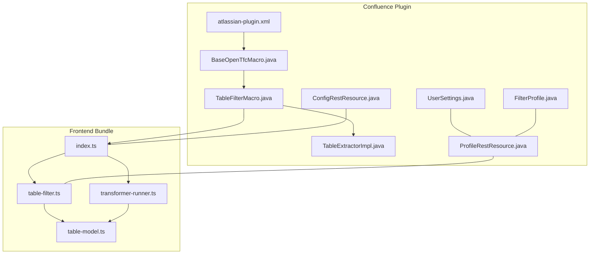
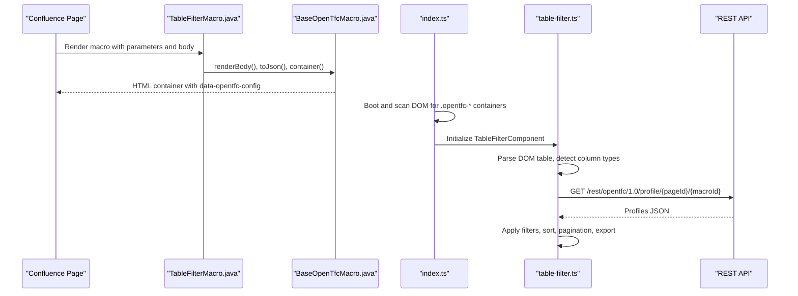
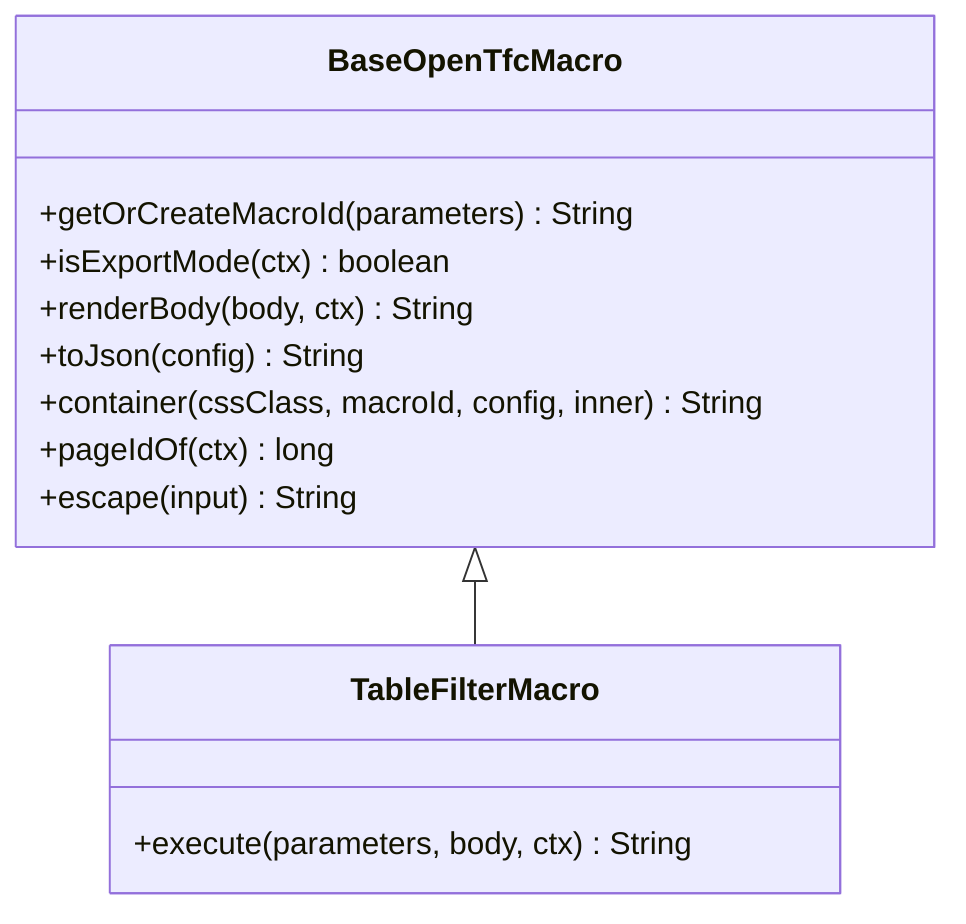
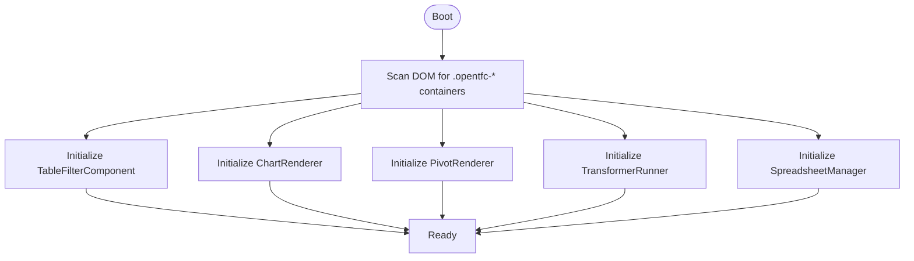
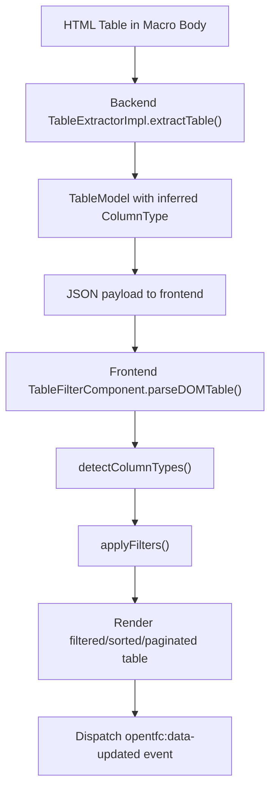
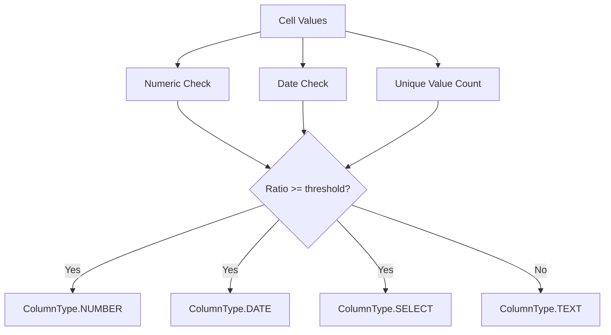
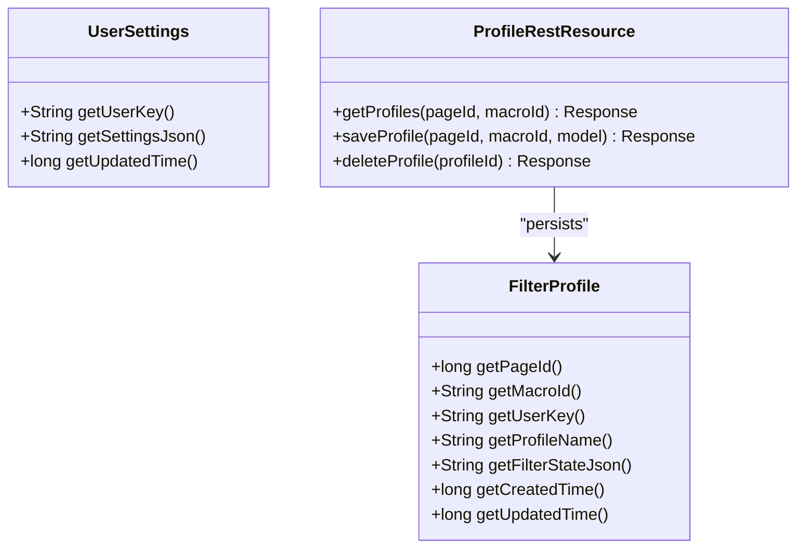
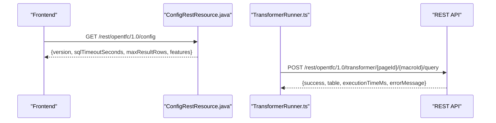
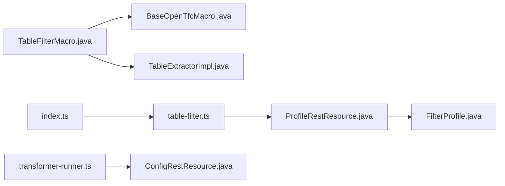

# Core Concepts

<cite>
**Referenced Files in This Document**
- [README.md](file://README.md)
- [atlassian-plugin.xml](file://src/main/resources/atlassian-plugin.xml)
- [BaseOpenTfcMacro.java](file://src/main/java/org/opentfc/macro/BaseOpenTfcMacro.java)
- [TableFilterMacro.java](file://src/main/java/org/opentfc/macro/TableFilterMacro.java)
- [ConfigRestResource.java](file://src/main/java/org/opentfc/rest/ConfigRestResource.java)
- [ProfileRestResource.java](file://src/main/java/org/opentfc/rest/ProfileRestResource.java)
- [UserSettings.java](file://src/main/java/org/opentfc/ao/UserSettings.java)
- [FilterProfile.java](file://src/main/java/org/opentfc/ao/FilterProfile.java)
- [TableExtractorImpl.java](file://src/main/java/org/opentfc/service/TableExtractorImpl.java)
- [table-model.ts](file://src/main/frontend/src/core/table-model.ts)
- [index.ts](file://src/main/frontend/src/index.ts)
- [table-filter.ts](file://src/main/frontend/src/filter/table-filter.ts)
- [transformer-runner.ts](file://src/main/frontend/src/transformer/transformer-runner.ts)
</cite>

## Table of Contents
1. [Introduction](#introduction)
2. [Project Structure](#project-structure)
3. [Core Components](#core-components)
4. [Architecture Overview](#architecture-overview)
5. [Detailed Component Analysis](#detailed-component-analysis)
6. [Dependency Analysis](#dependency-analysis)
7. [Performance Considerations](#performance-considerations)
8. [Troubleshooting Guide](#troubleshooting-guide)
9. [Conclusion](#conclusion)

## Introduction
OpenTFC is a Confluence Data Center / Server plugin that brings interactive tables, charts, pivot tables, spreadsheets, and SQL transformations into Confluence pages via macros. It integrates with Confluence through the macro framework, exposes a REST API for frontend components, persists user preferences and filter profiles using Active Objects, and provides both backend type inference and frontend data processing. The plugin bundles TypeScript-based UI components and Java services, coordinated by a plugin descriptor and a shared base macro class.

Key capabilities include:
- Interactive filtering, sorting, column hiding, totals, pagination, and export
- Charts from table data
- Pivot tables with aggregation
- In-memory SQL transformation powered by DuckDB
- Spreadsheets persisted as XLSX attachments
- CSV/JSON sources and attachment listing
- User-specific filter profiles and settings

**Section sources**
- [README.md:1-104](file://README.md#L1-L104)

## Project Structure
The project follows a clear separation between backend Java services and frontend TypeScript components:
- Backend:
  - Macros under `org.opentfc.macro` render HTML containers and configuration for the frontend
  - Services under `org.opentfc.service` parse HTML tables, infer types, and transform data
  - REST resources under `org.opentfc.rest` expose endpoints for configuration, transformer queries, exports, and profiles
  - Active Objects entities under `org.opentfc.ao` persist user settings and filter profiles
- Frontend:
  - TypeScript modules under `src/main/frontend/src` implement UI components (filter, chart, pivot, transformer, spreadsheet)
  - A central bootstrapper initializes components on page load and integrates with Confluence’s AJS lifecycle

**Diagram sources**
- [atlassian-plugin.xml:1-289](file://src/main/resources/atlassian-plugin.xml#L1-L289)
- [BaseOpenTfcMacro.java:1-115](file://src/main/java/org/opentfc/macro/BaseOpenTfcMacro.java#L1-L115)
- [TableFilterMacro.java:1-86](file://src/main/java/org/opentfc/macro/TableFilterMacro.java#L1-L86)
- [TableExtractorImpl.java:1-166](file://src/main/java/org/opentfc/service/TableExtractorImpl.java#L1-L166)
- [ConfigRestResource.java:1-40](file://src/main/java/org/opentfc/rest/ConfigRestResource.java#L1-L40)
- [ProfileRestResource.java:1-116](file://src/main/java/org/opentfc/rest/ProfileRestResource.java#L1-L116)
- [UserSettings.java:1-27](file://src/main/java/org/opentfc/ao/UserSettings.java#L1-L27)
- [FilterProfile.java:1-42](file://src/main/java/org/opentfc/ao/FilterProfile.java#L1-L42)
- [index.ts:1-81](file://src/main/frontend/src/index.ts#L1-L81)
- [table-filter.ts:1-800](file://src/main/frontend/src/filter/table-filter.ts#L1-L800)
- [transformer-runner.ts:1-173](file://src/main/frontend/src/transformer/transformer-runner.ts#L1-L173)
- [table-model.ts:1-36](file://src/main/frontend/src/core/table-model.ts#L1-L36)

**Section sources**
- [atlassian-plugin.xml:1-289](file://src/main/resources/atlassian-plugin.xml#L1-L289)
- [index.ts:1-81](file://src/main/frontend/src/index.ts#L1-L81)

## Core Components
- Macro system fundamentals:
  - All OpenTFC macros extend a shared base class that standardizes parameter handling, body rendering, JSON config serialization, container wrapping, and export-mode detection.
  - The plugin descriptor registers each macro with its parameters and metadata, enabling Confluence to render them in pages and editor previews.
- BaseOpenTfcMacro abstract class:
  - Provides helpers for generating stable macro IDs, detecting export modes (PDF/Word/email), converting rich-text bodies to view HTML, serializing configuration to JSON, escaping content, and wrapping output in a standardized container div with attributes consumed by the frontend.
- Plugin architecture:
  - Backend Java services handle parsing, type inference, persistence, and REST endpoints.
  - Frontend TypeScript components consume server-rendered HTML + JSON config, perform client-side filtering/sorting, and call REST APIs for advanced features like SQL transformation and profile management.

**Section sources**
- [BaseOpenTfcMacro.java:1-115](file://src/main/java/org/opentfc/macro/BaseOpenTfcMacro.java#L1-L115)
- [atlassian-plugin.xml:70-286](file://src/main/resources/atlassian-plugin.xml#L70-L286)

## Architecture Overview
OpenTFC integrates with Confluence through macros that render a container element carrying a JSON configuration. The frontend bundle boots on page load, discovers these containers, and initializes corresponding components. For features requiring server-side processing (e.g., SQL transformation, profile persistence), components call REST endpoints exposed by the plugin.

**Diagram sources**
- [TableFilterMacro.java:24-83](file://src/main/java/org/opentfc/macro/TableFilterMacro.java#L24-L83)
- [BaseOpenTfcMacro.java:35-103](file://src/main/java/org/opentfc/macro/BaseOpenTfcMacro.java#L35-L103)
- [index.ts:10-51](file://src/main/frontend/src/index.ts#L10-L51)
- [table-filter.ts:29-73](file://src/main/frontend/src/filter/table-filter.ts#L29-L73)
- [ProfileRestResource.java:47-60](file://src/main/java/org/opentfc/rest/ProfileRestResource.java#L47-L60)

## Detailed Component Analysis

### Macro System and BaseOpenTfcMacro
- Responsibilities:
  - Generate or reuse a stable macro ID for chaining and state tracking
  - Detect export mode to provide static fallbacks when JavaScript is unavailable
  - Convert rich-text macro bodies to view HTML so nested macros render correctly
  - Serialize macro configuration to JSON and embed it in a standardized container div
  - Provide utilities for logging first use, escaping HTML, and extracting page context
- Integration points:
  - Each concrete macro extends this base and composes its specific behavior while reusing common functionality

**Diagram sources**
- [BaseOpenTfcMacro.java:21-103](file://src/main/java/org/opentfc/macro/BaseOpenTfcMacro.java#L21-L103)
- [TableFilterMacro.java:14-83](file://src/main/java/org/opentfc/macro/TableFilterMacro.java#L14-L83)

**Section sources**
- [BaseOpenTfcMacro.java:1-115](file://src/main/java/org/opentfc/macro/BaseOpenTfcMacro.java#L1-L115)
- [TableFilterMacro.java:1-86](file://src/main/java/org/opentfc/macro/TableFilterMacro.java#L1-L86)

### Frontend Bootstrap and Component Initialization
- The frontend entry point:
  - Imports core models and feature components
  - Exposes a global app class that scans the DOM for OpenTFC containers and initializes corresponding components
  - Integrates with Confluence’s AJS lifecycle and standard DOM events to ensure initialization occurs at the right time

**Diagram sources**
- [index.ts:10-51](file://src/main/frontend/src/index.ts#L10-L51)

**Section sources**
- [index.ts:1-81](file://src/main/frontend/src/index.ts#L1-L81)

### Data Flow: HTML Tables to Processed Results
- Backend extraction and type inference:
  - Parses HTML tables using Jsoup
  - Extracts headers and rows, infers column types (number, date, select, text) based on heuristics
  - Produces a structured model suitable for JSON serialization and frontend consumption
- Frontend processing:
  - Parses DOM tables directly when no server model is provided
  - Performs local type detection and builds an internal representation
  - Applies global search, per-column filters, multi-sorting, pagination, and frozen columns
  - Emits custom events to notify downstream components (e.g., charts, pivots) about updated data

**Diagram sources**
- [TableExtractorImpl.java:31-103](file://src/main/java/org/opentfc/service/TableExtractorImpl.java#L31-L103)
- [TableExtractorImpl.java:105-145](file://src/main/java/org/opentfc/service/TableExtractorImpl.java#L105-L145)
- [table-filter.ts:75-123](file://src/main/frontend/src/filter/table-filter.ts#L75-L123)
- [table-filter.ts:125-181](file://src/main/frontend/src/filter/table-filter.ts#L125-L181)
- [table-filter.ts:697-797](file://src/main/frontend/src/filter/table-filter.ts#L697-L797)

**Section sources**
- [TableExtractorImpl.java:1-166](file://src/main/java/org/opentfc/service/TableExtractorImpl.java#L1-L166)
- [table-filter.ts:75-181](file://src/main/frontend/src/filter/table-filter.ts#L75-L181)
- [table-filter.ts:697-797](file://src/main/frontend/src/filter/table-filter.ts#L697-L797)

### Type Inference and Model Transformation
- Backend:
  - Uses regex and date parsing patterns to classify numeric and date values
  - Treats low-cardinality columns as select lists when thresholds are met
  - Tracks unique values to support dropdown filters
- Frontend:
  - Mirrors similar logic to detect numbers, dates, and categorical options
  - Normalizes currency suffixes and cleans values before numeric checks
  - Maintains a typed model interface for consistent data flow across components

**Diagram sources**
- [TableExtractorImpl.java:105-145](file://src/main/java/org/opentfc/service/TableExtractorImpl.java#L105-L145)
- [table-filter.ts:125-181](file://src/main/frontend/src/filter/table-filter.ts#L125-L181)

**Section sources**
- [TableExtractorImpl.java:105-164](file://src/main/java/org/opentfc/service/TableExtractorImpl.java#L105-L164)
- [table-filter.ts:125-181](file://src/main/frontend/src/filter/table-filter.ts#L125-L181)
- [table-model.ts:1-36](file://src/main/frontend/src/core/table-model.ts#L1-L36)

### Active Objects Integration for Persistent Storage
- Entities:
  - FilterProfile stores per-user filter profiles keyed by page and macro, including JSON state and timestamps
  - UserSettings stores per-user UI preferences as JSON with update timestamps
- Registration:
  - Active Objects module declares entities in the plugin descriptor
- REST access:
  - ProfileRestResource provides CRUD operations for filter profiles, enforcing authentication and ownership checks

**Diagram sources**
- [FilterProfile.java:9-41](file://src/main/java/org/opentfc/ao/FilterProfile.java#L9-L41)
- [UserSettings.java:9-26](file://src/main/java/org/opentfc/ao/UserSettings.java#L9-L26)
- [ProfileRestResource.java:23-114](file://src/main/java/org/opentfc/rest/ProfileRestResource.java#L23-L114)
- [atlassian-plugin.xml:15-21](file://src/main/resources/atlassian-plugin.xml#L15-L21)

**Section sources**
- [FilterProfile.java:1-42](file://src/main/java/org/opentfc/ao/FilterProfile.java#L1-L42)
- [UserSettings.java:1-27](file://src/main/java/org/opentfc/ao/UserSettings.java#L1-L27)
- [ProfileRestResource.java:1-116](file://src/main/java/org/opentfc/rest/ProfileRestResource.java#L1-L116)
- [atlassian-plugin.xml:15-21](file://src/main/resources/atlassian-plugin.xml#L15-L21)

### REST API Layer and Frontend Communication
- Configuration endpoint:
  - Returns client-side configuration such as version, timeouts, limits, and feature flags
- Transformer endpoint:
  - Accepts SQL queries and source tables, executes them server-side, and returns results
- Profile endpoints:
  - Manage per-user filter profiles with read, write, and delete operations

**Diagram sources**
- [ConfigRestResource.java:16-38](file://src/main/java/org/opentfc/rest/ConfigRestResource.java#L16-L38)
- [transformer-runner.ts:94-160](file://src/main/frontend/src/transformer/transformer-runner.ts#L94-L160)

**Section sources**
- [ConfigRestResource.java:1-40](file://src/main/java/org/opentfc/rest/ConfigRestResource.java#L1-L40)
- [transformer-runner.ts:1-173](file://src/main/frontend/src/transformer/transformer-runner.ts#L1-L173)

## Dependency Analysis
- Macro-to-service coupling:
  - Concrete macros depend on BaseOpenTfcMacro for common behavior and may delegate to services for data extraction and transformation
- Frontend-to-backend coupling:
  - Frontend components rely on REST endpoints for configuration, transformer execution, and profile management
- Persistence coupling:
  - Profile management depends on Active Objects entities declared in the plugin descriptor

**Diagram sources**
- [TableFilterMacro.java:14-83](file://src/main/java/org/opentfc/macro/TableFilterMacro.java#L14-L83)
- [BaseOpenTfcMacro.java:21-103](file://src/main/java/org/opentfc/macro/BaseOpenTfcMacro.java#L21-L103)
- [TableExtractorImpl.java:31-103](file://src/main/java/org/opentfc/service/TableExtractorImpl.java#L31-L103)
- [index.ts:10-51](file://src/main/frontend/src/index.ts#L10-L51)
- [table-filter.ts:29-73](file://src/main/frontend/src/filter/table-filter.ts#L29-L73)
- [ProfileRestResource.java:47-114](file://src/main/java/org/opentfc/rest/ProfileRestResource.java#L47-L114)
- [FilterProfile.java:9-41](file://src/main/java/org/opentfc/ao/FilterProfile.java#L9-L41)
- [transformer-runner.ts:94-160](file://src/main/frontend/src/transformer/transformer-runner.ts#L94-L160)
- [ConfigRestResource.java:16-38](file://src/main/java/org/opentfc/rest/ConfigRestResource.java#L16-L38)

**Section sources**
- [TableFilterMacro.java:1-86](file://src/main/java/org/opentfc/macro/TableFilterMacro.java#L1-L86)
- [BaseOpenTfcMacro.java:1-115](file://src/main/java/org/opentfc/macro/BaseOpenTfcMacro.java#L1-L115)
- [TableExtractorImpl.java:1-166](file://src/main/java/org/opentfc/service/TableExtractorImpl.java#L1-L166)
- [index.ts:1-81](file://src/main/frontend/src/index.ts#L1-L81)
- [table-filter.ts:1-800](file://src/main/frontend/src/filter/table-filter.ts#L1-L800)
- [ProfileRestResource.java:1-116](file://src/main/java/org/opentfc/rest/ProfileRestResource.java#L1-L116)
- [FilterProfile.java:1-42](file://src/main/java/org/opentfc/ao/FilterProfile.java#L1-L42)
- [transformer-runner.ts:1-173](file://src/main/frontend/src/transformer/transformer-runner.ts#L1-L173)
- [ConfigRestResource.java:1-40](file://src/main/java/org/opentfc/rest/ConfigRestResource.java#L1-L40)

## Performance Considerations
- Type inference thresholds:
  - Backend uses ratio thresholds (e.g., numeric/date detection) and cardinality limits to avoid expensive computations on large datasets
- Client-side filtering:
  - Debounced input handlers reduce re-renders during typing
  - Local filtering and sorting operate on in-memory arrays; pagination reduces DOM size
- Export modes:
  - Static fallbacks in export contexts avoid heavy JS execution where unsupported
- SQL transformation:
  - Server-side execution includes timeouts and row limits to protect performance

[No sources needed since this section provides general guidance]

## Troubleshooting Guide
- Macro body rendering failures:
  - If converting storage format to view HTML fails, the base macro logs a warning and falls back to raw body content
- Diagnostics:
  - The plugin exposes diagnostics endpoints and log store utilities to inspect macro usage and errors
- Profile persistence:
  - Ensure the user is authenticated when saving or deleting profiles; unauthorized requests return appropriate status codes
- Frontend initialization:
  - Verify that the bundle is loaded and that AJS lifecycle hooks are available; check that containers have correct CSS classes and data attributes

**Section sources**
- [BaseOpenTfcMacro.java:56-69](file://src/main/java/org/opentfc/macro/BaseOpenTfcMacro.java#L56-L69)
- [ProfileRestResource.java:63-98](file://src/main/java/org/opentfc/rest/ProfileRestResource.java#L63-L98)
- [ProfileRestResource.java:100-114](file://src/main/java/org/opentfc/rest/ProfileRestResource.java#L100-L114)

## Conclusion
OpenTFC’s architecture cleanly separates concerns: macros render safe, configurable containers; services parse and transform data; REST endpoints enable advanced features; Active Objects persist user state; and the frontend bundle delivers interactive experiences. The base macro class ensures consistency across features, while the plugin descriptor ties everything together. This design supports extensibility, maintainability, and robust integration with Confluence.

[No sources needed since this section summarizes without analyzing specific files]