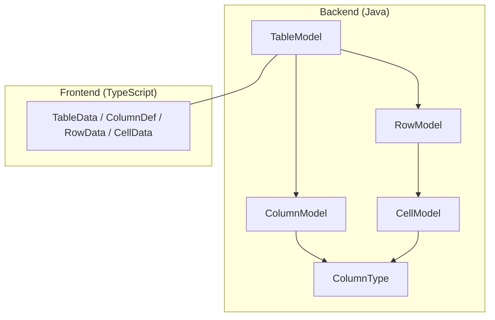
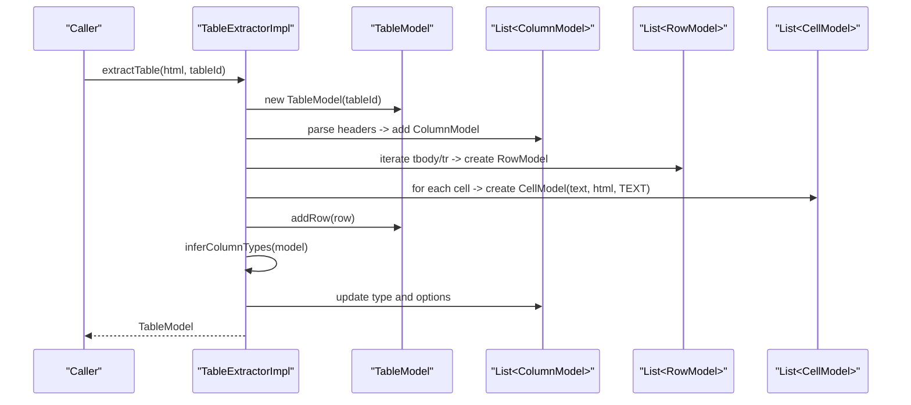
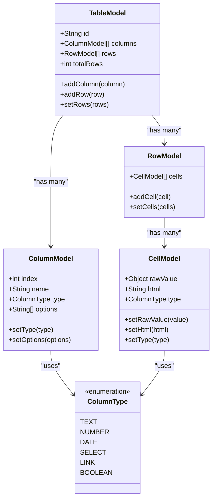
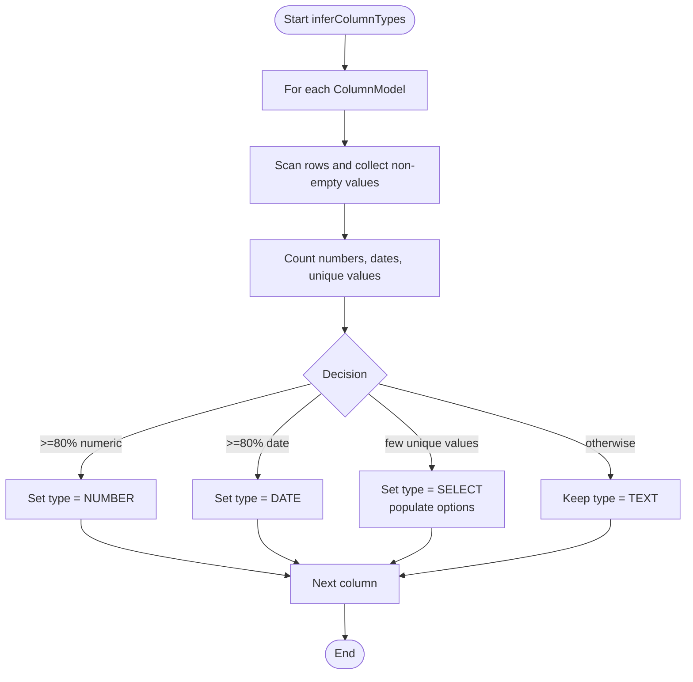
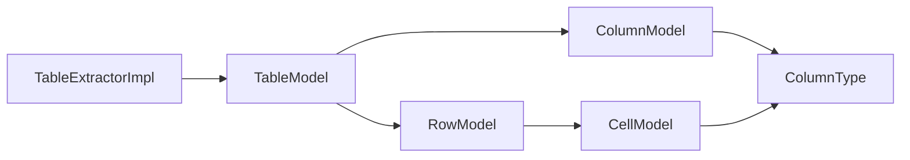

# Core Data Models

<cite>
**Referenced Files in This Document**
- [TableModel.java](file://src/main/java/org/opentfc/model/TableModel.java)
- [ColumnModel.java](file://src/main/java/org/opentfc/model/ColumnModel.java)
- [RowModel.java](file://src/main/java/org/opentfc/model/RowModel.java)
- [CellModel.java](file://src/main/java/org/opentfc/model/CellModel.java)
- [ColumnType.java](file://src/main/java/org/opentfc/model/ColumnType.java)
- [TableExtractorImpl.java](file://src/main/java/org/opentfc/service/TableExtractorImpl.java)
- [table-model.ts](file://src/main/frontend/src/core/table-model.ts)
- [ModelTest.java](file://src/test/java/org/opentfc/model/ModelTest.java)
</cite>

## Table of Contents
1. [Introduction](#introduction)
2. [Project Structure](#project-structure)
3. [Core Components](#core-components)
4. [Architecture Overview](#architecture-overview)
5. [Detailed Component Analysis](#detailed-component-analysis)
6. [Dependency Analysis](#dependency-analysis)
7. [Performance Considerations](#performance-considerations)
8. [Troubleshooting Guide](#troubleshooting-guide)
9. [Conclusion](#conclusion)

## Introduction
This document explains OpenTFC’s core data model architecture that powers tabular data processing, transformation, and rendering across the application. At its center is a small set of Java value objects representing tables, columns, rows, and cells, plus an enum for column types. These models are used to:
- Parse HTML tables into structured data
- Infer column types and options
- Transform and render results in macros, charts, pivots, spreadsheets, and filters
- Serialize and deserialize table payloads between backend and frontend via JSON

The models are intentionally simple and focused on data representation, while type inference and extraction logic live in dedicated services.

## Project Structure
The core data models reside under the Java package `org.opentfc.model`. A corresponding TypeScript interface file exists in the frontend bundle to mirror the JSON contract with the browser.

**Diagram sources**
- [TableModel.java:1-76](file://src/main/java/org/opentfc/model/TableModel.java#L1-L76)
- [ColumnModel.java:1-68](file://src/main/java/org/opentfc/model/ColumnModel.java#L1-L68)
- [RowModel.java:1-37](file://src/main/java/org/opentfc/model/RowModel.java#L1-L37)
- [CellModel.java:1-55](file://src/main/java/org/opentfc/model/CellModel.java#L1-L55)
- [ColumnType.java:1-14](file://src/main/java/org/opentfc/model/ColumnType.java#L1-L14)
- [table-model.ts:1-36](file://src/main/frontend/src/core/table-model.ts#L1-L36)

**Section sources**
- [TableModel.java:1-76](file://src/main/java/org/opentfc/model/TableModel.java#L1-L76)
- [table-model.ts:1-36](file://src/main/frontend/src/core/table-model.ts#L1-L36)

## Core Components
- TableModel: Central container for a parsed table, including an identifier, a list of columns, a list of rows, and a total row count. It keeps totalRows synchronized when rows are added or replaced.
- ColumnModel: Metadata for each column, including index, name, inferred type, and optional enumerated values for select-type columns.
- RowModel: A container for a sequence of CellModel instances representing one record.
- CellModel: Represents a single cell with raw value, preformatted HTML, and type information.
- ColumnType: Enumerates supported column types: TEXT, NUMBER, DATE, SELECT, LINK, BOOLEAN.

These components form a layered structure: TableModel contains ColumnModel and RowModel; RowModel contains CellModel; both ColumnModel and CellModel reference ColumnType.

**Section sources**
- [TableModel.java:1-76](file://src/main/java/org/opentfc/model/TableModel.java#L1-L76)
- [ColumnModel.java:1-68](file://src/main/java/org/opentfc/model/ColumnModel.java#L1-L68)
- [RowModel.java:1-37](file://src/main/java/org/opentfc/model/RowModel.java#L1-L37)
- [CellModel.java:1-55](file://src/main/java/org/opentfc/model/CellModel.java#L1-L55)
- [ColumnType.java:1-14](file://src/main/java/org/opentfc/model/ColumnType.java#L1-L14)

## Architecture Overview
The data flow from HTML to processed results typically follows this path:
1. An HTML string containing a table is passed to the extractor service.
2. The extractor parses the DOM, builds ColumnModel entries from headers, and RowModel entries from body rows.
3. Cells are initially created as text with placeholder HTML.
4. After parsing, the extractor infers column types and populates options for select-type columns.
5. The resulting TableModel is serialized to JSON and consumed by macros, REST endpoints, and the frontend.

**Diagram sources**
- [TableExtractorImpl.java:31-103](file://src/main/java/org/opentfc/service/TableExtractorImpl.java#L31-L103)
- [TableExtractorImpl.java:105-146](file://src/main/java/org/opentfc/service/TableExtractorImpl.java#L105-L146)
- [TableModel.java:1-76](file://src/main/java/org/opentfc/model/TableModel.java#L1-L76)
- [ColumnModel.java:1-68](file://src/main/java/org/opentfc/model/ColumnModel.java#L1-L68)
- [RowModel.java:1-37](file://src/main/java/org/opentfc/model/RowModel.java#L1-L37)
- [CellModel.java:1-55](file://src/main/java/org/opentfc/model/CellModel.java#L1-L55)

## Detailed Component Analysis

### TableModel
- Purpose: Holds the complete table definition and data payload.
- Key fields: id, columns, rows, totalRows.
- Behavior:
  - Provides convenience methods to add columns and rows.
  - Maintains totalRows in sync with the rows collection.
  - Uses Jackson annotations to map JSON keys like id, columns, rows, totalRows.

Typical usage patterns:
- Construction with an explicit id for traceability.
- Adding columns before rows to define schema.
- Replacing rows via setter to refresh the dataset.

**Section sources**
- [TableModel.java:1-76](file://src/main/java/org/opentfc/model/TableModel.java#L1-L76)
- [ModelTest.java:19-52](file://src/test/java/org/opentfc/model/ModelTest.java#L19-L52)

### ColumnModel
- Purpose: Describes a column’s identity, position, type, and options.
- Key fields: index, name, type, options.
- Behavior:
  - Default type is TEXT.
  - Options are populated for SELECT columns during type inference.
  - Jackson maps to JSON keys index, name, type, options.

Typical usage patterns:
- Create with index, name, and initial type.
- Update type after inference.
- Populate options when the column becomes a SELECT type.

**Section sources**
- [ColumnModel.java:1-68](file://src/main/java/org/opentfc/model/ColumnModel.java#L1-L68)
- [ModelTest.java:54-69](file://src/test/java/org/opentfc/model/ModelTest.java#L54-L69)

### RowModel
- Purpose: Encapsulates a single row’s cells.
- Key fields: cells (list of CellModel).
- Behavior:
  - Supports adding individual cells or replacing the entire list.
  - Jackson maps to JSON key cells.

Typical usage patterns:
- Build a row by adding cells in column order.
- Replace cells to transform or normalize row data.

**Section sources**
- [RowModel.java:1-37](file://src/main/java/org/opentfc/model/RowModel.java#L1-L37)
- [ModelTest.java:71-92](file://src/test/java/org/opentfc/model/ModelTest.java#L71-L92)

### CellModel
- Purpose: Represents a cell with raw value, formatted HTML, and type.
- Key fields: rawValue, html, type.
- Behavior:
  - Stores both the original value and a pre-rendered HTML representation.
  - Type defaults to TEXT and can be updated based on column inference.
  - Jackson maps to JSON keys val, html, type.

Typical usage patterns:
- Initialize with raw text and HTML fallback.
- Update type to match the column’s inferred type.
- Use html for safe rendering in UIs.

**Section sources**
- [CellModel.java:1-55](file://src/main/java/org/opentfc/model/CellModel.java#L1-L55)
- [ModelTest.java:71-92](file://src/test/java/org/opentfc/model/ModelTest.java#L71-L92)

### ColumnType
- Purpose: Enumerates supported column types for consistent typing across models and UI.
- Values: TEXT, NUMBER, DATE, SELECT, LINK, BOOLEAN.

Usage:
- Used by ColumnModel to describe column semantics.
- Used by CellModel to annotate cell-level type hints.
- Mirrored in frontend TypeScript definitions for consistent contracts.

**Section sources**
- [ColumnType.java:1-14](file://src/main/java/org/opentfc/model/ColumnType.java#L1-L14)
- [table-model.ts:1-36](file://src/main/frontend/src/core/table-model.ts#L1-L36)

### Class Diagram

**Diagram sources**
- [TableModel.java:1-76](file://src/main/java/org/opentfc/model/TableModel.java#L1-L76)
- [ColumnModel.java:1-68](file://src/main/java/org/opentfc/model/ColumnModel.java#L1-L68)
- [RowModel.java:1-37](file://src/main/java/org/opentfc/model/RowModel.java#L1-L37)
- [CellModel.java:1-55](file://src/main/java/org/opentfc/model/CellModel.java#L1-L55)
- [ColumnType.java:1-14](file://src/main/java/org/opentfc/model/ColumnType.java#L1-L14)

### Type Inference Flow
The extractor performs type inference after parsing:
- For each column, it scans non-empty cell values.
- If at least 80% of non-empty values match numeric patterns, the column becomes NUMBER.
- If at least 80% match known date formats, the column becomes DATE.
- If there are few unique values within a threshold and enough samples, the column becomes SELECT and options are populated.
- Otherwise, the column remains TEXT.

**Diagram sources**
- [TableExtractorImpl.java:105-146](file://src/main/java/org/opentfc/service/TableExtractorImpl.java#L105-L146)

**Section sources**
- [TableExtractorImpl.java:105-146](file://src/main/java/org/opentfc/service/TableExtractorImpl.java#L105-L146)

### Frontend Contract
The frontend defines matching interfaces to consume the same JSON shape:
- TableData mirrors TableModel fields.
- ColumnDef mirrors ColumnModel fields.
- RowData mirrors RowModel fields.
- CellData mirrors CellModel fields, using val for raw value.

This ensures consistent serialization and deserialization between Java and TypeScript.

**Section sources**
- [table-model.ts:1-36](file://src/main/frontend/src/core/table-model.ts#L1-L36)
- [ModelTest.java:143-162](file://src/test/java/org/opentfc/model/ModelTest.java#L143-L162)

## Dependency Analysis
- TableModel depends on ColumnModel and RowModel.
- RowModel depends on CellModel.
- ColumnModel and CellModel depend on ColumnType.
- TableExtractorImpl depends on all four models to build and enrich the TableModel.

**Diagram sources**
- [TableExtractorImpl.java:1-166](file://src/main/java/org/opentfc/service/TableExtractorImpl.java#L1-L166)
- [TableModel.java:1-76](file://src/main/java/org/opentfc/model/TableModel.java#L1-L76)
- [ColumnModel.java:1-68](file://src/main/java/org/opentfc/model/ColumnModel.java#L1-L68)
- [RowModel.java:1-37](file://src/main/java/org/opentfc/model/RowModel.java#L1-L37)
- [CellModel.java:1-55](file://src/main/java/org/opentfc/model/CellModel.java#L1-L55)
- [ColumnType.java:1-14](file://src/main/java/org/opentfc/model/ColumnType.java#L1-L14)

**Section sources**
- [TableExtractorImpl.java:1-166](file://src/main/java/org/opentfc/service/TableExtractorImpl.java#L1-L166)
- [TableModel.java:1-76](file://src/main/java/org/opentfc/model/TableModel.java#L1-L76)

## Performance Considerations
- Type inference scans every non-empty cell per column. For large datasets, consider:
  - Sampling strategies if full scans become expensive.
  - Early termination once thresholds are met.
- HTML parsing uses Jsoup; ensure input size limits and avoid deeply nested structures where possible.
- Avoid unnecessary recomputation of totalRows by leveraging existing setters that maintain consistency.

[No sources needed since this section provides general guidance]

## Troubleshooting Guide
Common issues and resolutions:
- Empty or malformed HTML:
  - The extractor returns an empty TableModel when no table element is found. Validate the HTML fragment and ensure a table node exists.
- Missing headers:
  - If no thead is present, the first row may be treated as header. Ensure your HTML structure matches expectations or provide explicit headers.
- Unexpected column types:
  - Numeric detection tolerates currency symbols and decimals. Date detection requires one of the configured patterns. Adjust inputs or extend patterns if needed.
- JSON serialization mismatches:
  - Unknown JSON properties are ignored due to Jackson configuration. Verify field names align with expected aliases (e.g., val for raw value).

**Section sources**
- [TableExtractorImpl.java:31-103](file://src/main/java/org/opentfc/service/TableExtractorImpl.java#L31-L103)
- [TableModel.java:12-13](file://src/main/java/org/opentfc/model/TableModel.java#L12-L13)
- [ModelTest.java:164-170](file://src/test/java/org/opentfc/model/ModelTest.java#L164-L170)

## Conclusion
OpenTFC’s core data models provide a clear, extensible foundation for representing tabular data. TableModel orchestrates columns and rows, while ColumnModel and CellModel carry metadata and typed values. The extractor bridges HTML tables to these models, performing type inference and option population. Together, they enable consistent transformations, rendering, and serialization across macros, REST APIs, and the frontend.

[No sources needed since this section summarizes without analyzing specific files]