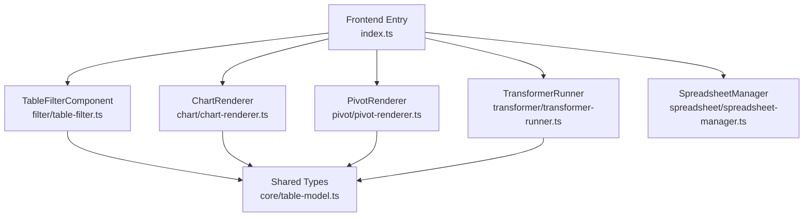
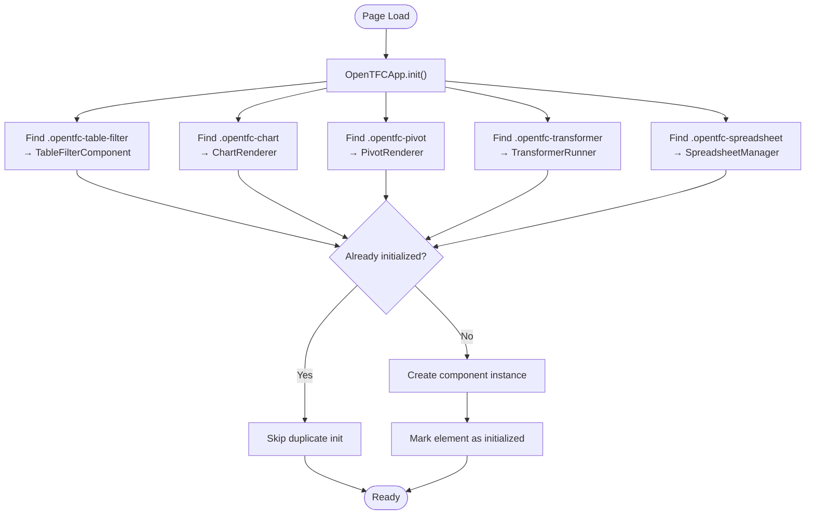
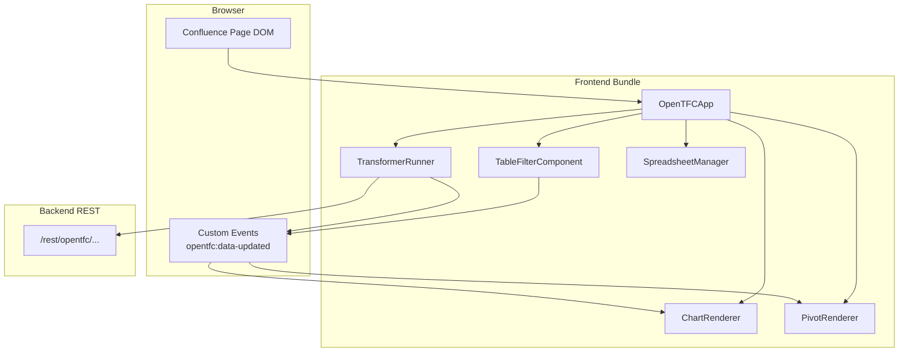
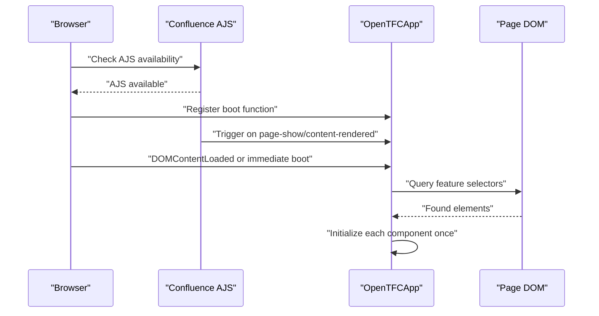
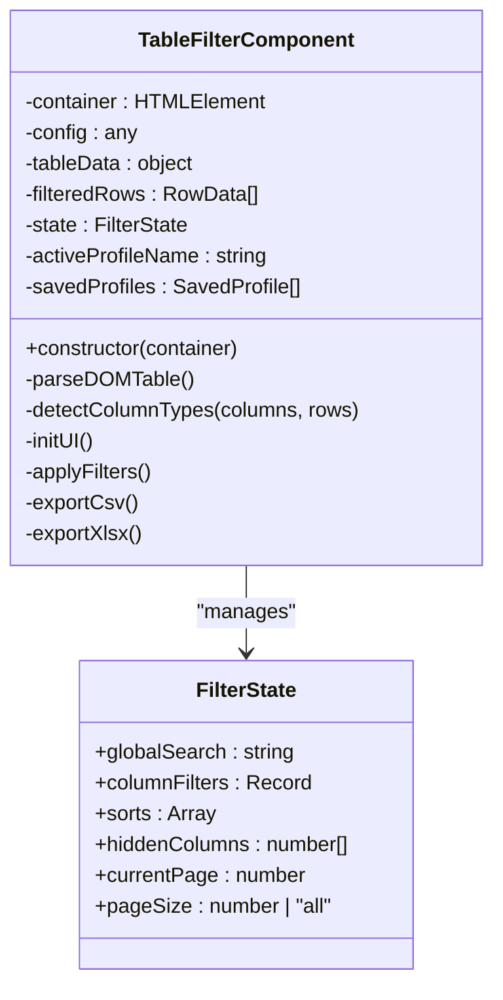
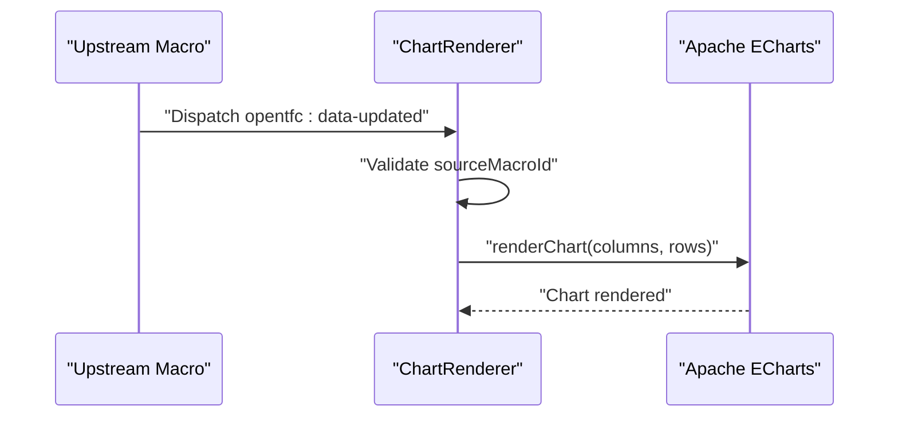
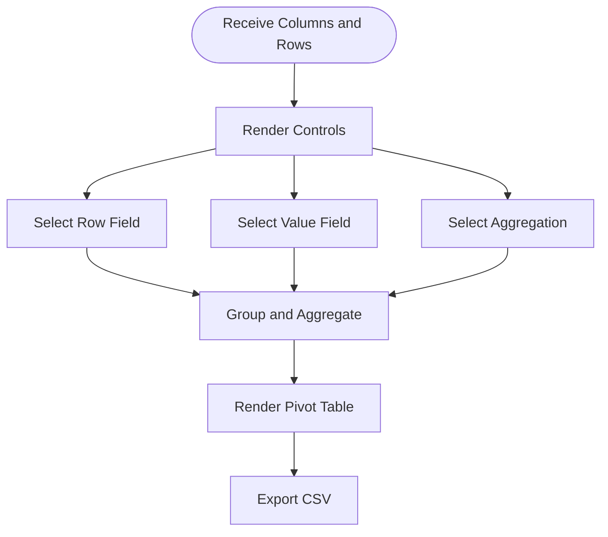
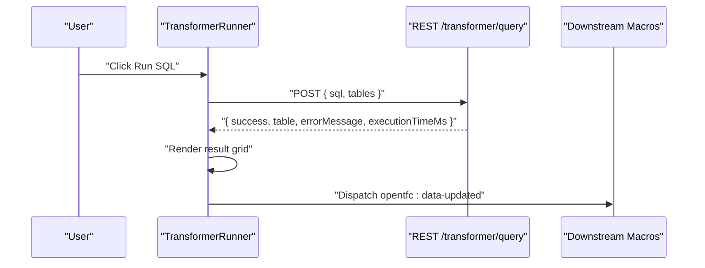
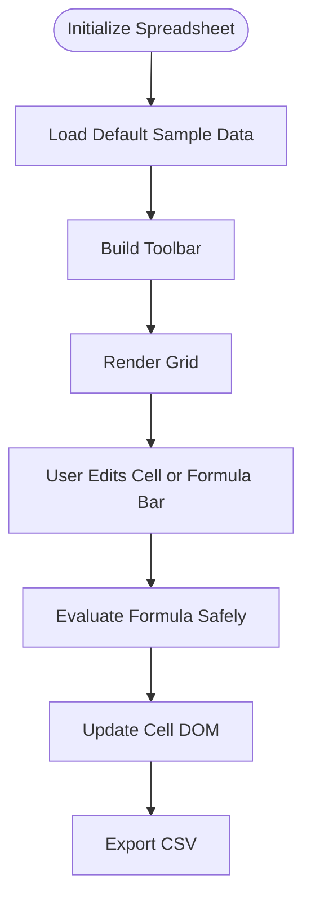
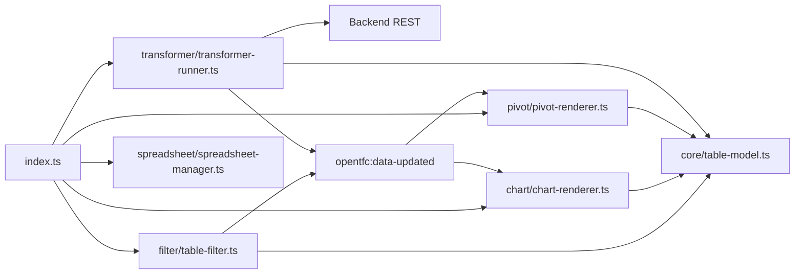

# Frontend Component Architecture

<cite>
**Referenced Files in This Document**   
- [index.ts](file://src/main/frontend/src/index.ts)
- [table-filter.ts](file://src/main/frontend/src/filter/table-filter.ts)
- [chart-renderer.ts](file://src/main/frontend/src/chart/chart-renderer.ts)
- [pivot-renderer.ts](file://src/main/frontend/src/pivot/pivot-renderer.ts)
- [spreadsheet-manager.ts](file://src/main/frontend/src/spreadsheet/spreadsheet-manager.ts)
- [transformer-runner.ts](file://src/main/frontend/src/transformer/transformer-runner.ts)
- [table-model.ts](file://src/main/frontend/src/core/table-model.ts)
- [package.json](file://package.json)
- [README.md](file://README.md)
</cite>

## Table of Contents
1. [Introduction](#introduction)
2. [Project Structure](#project-structure)
3. [Core Components](#core-components)
4. [Architecture Overview](#architecture-overview)
5. [Detailed Component Analysis](#detailed-component-analysis)
6. [Dependency Analysis](#dependency-analysis)
7. [Performance Considerations](#performance-considerations)
8. [Troubleshooting Guide](#troubleshooting-guide)
9. [Conclusion](#conclusion)

## Introduction
This document explains the OpenTFC TypeScript frontend architecture for Confluence Data Center. It focuses on how the application bootstraps through `index.ts`, how feature modules are discovered and initialized, and how components communicate with each other and with backend REST APIs. It also documents the data binding model, configuration consumption via `data-opentfc-config` attributes, event-driven updates, state management patterns, and lifecycle behavior across filtering, charting, pivoting, transformation, and spreadsheet features.

The frontend is a TypeScript bundle built with Webpack and integrated into Confluence using Atlassian JavaScript (`AJS`) and standard DOM events. The main runtime entry point exports an application class that scans the page for known component markers and instantiates corresponding feature classes.

## Project Structure
The frontend source lives under `src/main/frontend/src`. It is organized by feature:

- `core`: shared type definitions for table models and filter state.
- `filter`: interactive table filtering, sorting, column visibility, pagination, and profile persistence.
- `chart`: Apache ECharts-based visualization driven by table data.
- `pivot`: pivot aggregation UI over table data.
- `transformer`: SQL transformer runner that calls backend endpoints and emits updated data.
- `spreadsheet`: lightweight spreadsheet editor with formula evaluation and CSV export.
- `css`: component styles bundled into the plugin.

**Diagram sources**
- [index.ts:10-51](file://src/main/frontend/src/index.ts#L10-L51)
- [table-filter.ts:15-73](file://src/main/frontend/src/filter/table-filter.ts#L15-L73)
- [chart-renderer.ts:4-30](file://src/main/frontend/src/chart/chart-renderer.ts#L4-L30)
- [pivot-renderer.ts:5-29](file://src/main/frontend/src/pivot/pivot-renderer.ts#L5-L29)
- [spreadsheet-manager.ts:8-28](file://src/main/frontend/src/spreadsheet/spreadsheet-manager.ts#L8-L28)
- [transformer-runner.ts:3-20](file://src/main/frontend/src/transformer/transformer-runner.ts#L3-L20)
- [table-model.ts:1-36](file://src/main/frontend/src/core/table-model.ts#L1-L36)

**Section sources**
- [package.json:1-26](file://package.json#L1-L26)
- [README.md:53-58](file://README.md#L53-L58)

## Core Components
OpenTFC exposes one bootstrap class, `OpenTFCApp`, which discovers feature containers on the page and initializes them exactly once. Each feature module is responsible for its own configuration parsing, DOM setup, event handling, and rendering.

Key responsibilities:
- Bootstrap and integration with Confluence AJS and browser DOM.
- Feature discovery by CSS class selectors.
- One-time initialization guard using a dataset flag.
- Configuration loading from `data-opentfc-config`.
- Event-driven communication between components.

**Diagram sources**
- [index.ts:10-51](file://src/main/frontend/src/index.ts#L10-L51)

**Section sources**
- [index.ts:10-81](file://src/main/frontend/src/index.ts#L10-L81)

## Architecture Overview
The frontend follows a modular, event-driven architecture:

- **Bootstrap layer**: `OpenTFCApp` integrates with Confluence and the browser to initialize feature components.
- **Feature layer**: Each feature encapsulates its own state, UI, and data flow.
- **Data layer**: Shared TypeScript interfaces define the contract for columns, rows, and table data.
- **Communication layer**: Custom DOM events propagate data changes between components; REST calls are used where server-side processing is required.

**Diagram sources**
- [index.ts:10-81](file://src/main/frontend/src/index.ts#L10-L81)
- [chart-renderer.ts:99-106](file://src/main/frontend/src/chart/chart-renderer.ts#L99-L106)
- [pivot-renderer.ts:54-61](file://src/main/frontend/src/pivot/pivot-renderer.ts#L54-L61)
- [transformer-runner.ts:147-156](file://src/main/frontend/src/transformer/transformer-runner.ts#L147-L156)
- [transformer-runner.ts:106-113](file://src/main/frontend/src/transformer/transformer-runner.ts#L106-L113)

## Detailed Component Analysis

### Bootstrap and Initialization: `OpenTFCApp`
`OpenTFCApp.init()` performs five discovery passes:
1. `.opentfc-table-filter` → `TableFilterComponent`
2. `.opentfc-chart` → `ChartRenderer`
3. `.opentfc-pivot` → `PivotRenderer`
4. `.opentfc-transformer` → `TransformerRunner`
5. `.opentfc-spreadsheet` → `SpreadsheetManager`

Each pass checks `dataset.opentfcInitialized` to avoid reinitialization. After instantiation, the element is marked as initialized.

Integration points:
- Confluence AJS: registers initialization via `AJS.toInit`, `AJS.bind('page-show')`, and `AJS.bind('content-rendered')`.
- Standard browser: listens to `DOMContentLoaded` or boots immediately if the document is already ready.
- Global exposure: attaches `OpenTFCApp` to `window.OpenTFCApp` and `window.OpenTFC`.

**Diagram sources**
- [index.ts:54-81](file://src/main/frontend/src/index.ts#L54-L81)

**Section sources**
- [index.ts:10-81](file://src/main/frontend/src/index.ts#L10-L81)

### Filtering Component: `TableFilterComponent`
The filter component parses inline HTML tables, detects column types, builds a toolbar, manages filter state, and renders filtered/sorted results.

Key behaviors:
- Configuration parsing from `data-opentfc-config`.
- Column type detection: numeric, date, select, text.
- Global search and per-column filters.
- Multi-sorting with Shift+click support.
- Column visibility toggling.
- Sticky header and frozen columns.
- Export buttons for CSV/XLSX.
- Saved filter profiles (UI present; persistence logic referenced but not fully shown here).
- URL state synchronization for shareable views.

Configuration consumption:
- Reads `data-opentfc-config` JSON string.
- Normalizes defaults such as search box visibility, column filters, sticky header, totals row, export buttons, pagination, and page size.

State management:
- Maintains internal `state` object with global search, column filters, sorts, hidden columns, current page, and page size.
- Updates state on user interactions and applies filters before re-rendering.

Event handling:
- Debounced input listeners for performance.
- Dropdown toggle handlers.
- Header click handlers for multi-sort.
- Emits `opentfc:data-updated` after applying filters so downstream components can react.

**Diagram sources**
- [table-filter.ts:15-73](file://src/main/frontend/src/filter/table-filter.ts#L15-L73)
- [table-filter.ts:125-181](file://src/main/frontend/src/filter/table-filter.ts#L125-L181)
- [table-filter.ts:697-797](file://src/main/frontend/src/filter/table-filter.ts#L697-L797)

**Section sources**
- [table-filter.ts:15-800](file://src/main/frontend/src/filter/table-filter.ts#L15-L800)

### Charting Component: `ChartRenderer`
The chart component renders Apache ECharts visualizations based on table data. It supports multiple chart types including column, stacked column, bar, line, area, pie, donut, scatter, radar, funnel, and Gantt.

Key behaviors:
- Initializes ECharts instance inside `.opentfc-chart-canvas`.
- Parses inline source table or consumes upstream data via `opentfc:data-updated`.
- Provides a toolbar for selecting chart type and exporting PNG.
- Handles window resize to keep charts responsive.

Configuration consumption:
- Reads `data-opentfc-config` JSON string.
- Uses fields like `chartType`, `chartTitle`, and `sourceMacroId`.

Event handling:
- Listens to `opentfc:data-updated` and re-renders when matching macro data arrives.

**Diagram sources**
- [chart-renderer.ts:12-30](file://src/main/frontend/src/chart/chart-renderer.ts#L12-L30)
- [chart-renderer.ts:99-106](file://src/main/frontend/src/chart/chart-renderer.ts#L99-L106)
- [chart-renderer.ts:108-226](file://src/main/frontend/src/chart/chart-renderer.ts#L108-L226)

**Section sources**
- [chart-renderer.ts:1-283](file://src/main/frontend/src/chart/chart-renderer.ts#L1-L283)

### Pivot Component: `PivotRenderer`
The pivot component aggregates table data by selected row and value columns with configurable aggregation functions.

Key behaviors:
- Parses inline source table.
- Renders controls for row field, value field, and aggregation selection.
- Computes grouped aggregates and renders result table with totals.
- Exports pivot results to CSV.

Configuration consumption:
- Reads `data-opentfc-config` JSON string.
- Supports `aggregateFunction` and `sourceMacroId`.

Event handling:
- Subscribes to `opentfc:data-updated` and updates pivot data when matching macro data arrives.

**Diagram sources**
- [pivot-renderer.ts:63-71](file://src/main/frontend/src/pivot/pivot-renderer.ts#L63-L71)
- [pivot-renderer.ts:73-126](file://src/main/frontend/src/pivot/pivot-renderer.ts#L73-L126)
- [pivot-renderer.ts:128-195](file://src/main/frontend/src/pivot/pivot-renderer.ts#L128-L195)
- [pivot-renderer.ts:197-216](file://src/main/frontend/src/pivot/pivot-renderer.ts#L197-L216)

**Section sources**
- [pivot-renderer.ts:1-228](file://src/main/frontend/src/pivot/pivot-renderer.ts#L1-L228)

### Transformer Component: `TransformerRunner`
The transformer component provides a DuckDB-style SQL sandbox UI. It parses inline source tables, lets users write or select presets, executes queries against the backend, and displays results.

Key behaviors:
- Parses inline source tables into typed `TableData`.
- Renders SQL textarea, preset selector, and run button.
- Calls backend REST endpoint `/rest/opentfc/1.0/transformer/{pageId}/{macroId}/query`.
- Displays execution time and result rows.
- Emits `opentfc:data-updated` with transformed data for downstream consumers.

REST API communication:
- POST request with JSON payload containing `sql` and `tables`.
- Headers include `Content-Type: application/json` and `X-Atlassian-Token: no-check`.
- Response includes success flag, error message, table structure, and execution metrics.

**Diagram sources**
- [transformer-runner.ts:94-161](file://src/main/frontend/src/transformer/transformer-runner.ts#L94-L161)

**Section sources**
- [transformer-runner.ts:1-173](file://src/main/frontend/src/transformer/transformer-runner.ts#L1-L173)

### Spreadsheet Component: `SpreadsheetManager`
The spreadsheet component implements a lightweight editable grid with basic formulas and formatting.

Key behaviors:
- Initializes default sample data.
- Renders toolbar with bold toggle, active cell label, formula bar, save, and CSV export.
- Renders grid cells with contenteditable interaction.
- Evaluates simple formulas like `=SUM(...)`, `=AVERAGE(...)`, and arithmetic expressions safely.
- Exports current sheet to CSV.

Configuration consumption:
- Reads `data-opentfc-config` JSON string.
- Uses `macroId` for export filenames.

State management:
- Stores cell data in a dictionary keyed by cell address (e.g., `A1`).
- Tracks active cell and synchronizes formula bar and cell display.

**Diagram sources**
- [spreadsheet-manager.ts:16-28](file://src/main/frontend/src/spreadsheet/spreadsheet-manager.ts#L16-L28)
- [spreadsheet-manager.ts:50-96](file://src/main/frontend/src/spreadsheet/spreadsheet-manager.ts#L50-L96)
- [spreadsheet-manager.ts:98-147](file://src/main/frontend/src/spreadsheet/spreadsheet-manager.ts#L98-L147)
- [spreadsheet-manager.ts:169-238](file://src/main/frontend/src/spreadsheet/spreadsheet-manager.ts#L169-L238)
- [spreadsheet-manager.ts:288-304](file://src/main/frontend/src/spreadsheet/spreadsheet-manager.ts#L288-L304)

**Section sources**
- [spreadsheet-manager.ts:1-306](file://src/main/frontend/src/spreadsheet/spreadsheet-manager.ts#L1-L306)

### Shared Data Model: `table-model.ts`
The shared model defines the common contract for table data consumed by all components:

- `ColumnType`: supported column types.
- `ColumnDef`: column metadata including index, name, type, options, and visibility.
- `CellData`: cell value, optional HTML representation, and type.
- `RowData`: collection of cells.
- `TableData`: table identifier, columns, rows, and total row count.
- `FilterState`: filter component state shape.

These types ensure consistent data flow between components and between frontend and backend responses.

**Section sources**
- [table-model.ts:1-36](file://src/main/frontend/src/core/table-model.ts#L1-L36)

## Dependency Analysis
The frontend has clear separation of concerns:

- `index.ts` depends on all feature modules and imports shared CSS.
- Feature modules depend on shared types from `core/table-model.ts`.
- Only `TransformerRunner` directly calls backend REST endpoints.
- `ChartRenderer` and `PivotRenderer` consume data via custom DOM events rather than direct REST calls.
- `TableFilterComponent` emits data-updated events to notify downstream components.

**Diagram sources**
- [index.ts:1-7](file://src/main/frontend/src/index.ts#L1-L7)
- [table-filter.ts:1-2](file://src/main/frontend/src/filter/table-filter.ts#L1-L2)
- [chart-renderer.ts:1-2](file://src/main/frontend/src/chart/chart-renderer.ts#L1-L2)
- [pivot-renderer.ts:1-1](file://src/main/frontend/src/pivot/pivot-renderer.ts#L1-L1)
- [transformer-runner.ts:1-1](file://src/main/frontend/src/transformer/transformer-runner.ts#L1-L1)
- [transformer-runner.ts:106-113](file://src/main/frontend/src/transformer/transformer-runner.ts#L106-L113)

**Section sources**
- [index.ts:1-81](file://src/main/frontend/src/index.ts#L1-L81)
- [transformer-runner.ts:106-113](file://src/main/frontend/src/transformer/transformer-runner.ts#L106-L113)

## Performance Considerations
- Debounced input handling reduces frequent re-renders during typing in filters and spreadsheets.
- One-time initialization guard prevents duplicate component instances.
- ECharts instance is resized on window resize instead of recreating it.
- Filtering applies transformations in-memory; large datasets may benefit from pagination or virtualization strategies.
- Safe arithmetic evaluation avoids unsafe `eval` usage in spreadsheet formulas.

[No sources needed since this section provides general guidance]

## Troubleshooting Guide
Common issues and diagnostics:

- Component not initializing:
  - Ensure the container has the correct CSS class selector.
  - Verify `data-opentfc-config` contains valid JSON.
  - Check that the element is not already marked as initialized.

- Chart not updating:
  - Confirm `sourceMacroId` matches the emitting macro.
  - Ensure `opentfc:data-updated` is dispatched with `columns` and `rows`.

- Transformer query errors:
  - Inspect response `success` and `errorMessage`.
  - Validate SQL syntax and table references.
  - Check network headers and Confluence token settings.

- Spreadsheet formula errors:
  - Use supported functions: `=SUM(range)`, `=AVERAGE(range)`.
  - For arithmetic expressions, ensure only safe operators and numbers are used.

**Section sources**
- [chart-renderer.ts:99-106](file://src/main/frontend/src/chart/chart-renderer.ts#L99-L106)
- [transformer-runner.ts:115-160](file://src/main/frontend/src/transformer/transformer-runner.ts#L115-L160)
- [spreadsheet-manager.ts:169-191](file://src/main/frontend/src/spreadsheet/spreadsheet-manager.ts#L169-L191)

## Conclusion
OpenTFC’s frontend architecture is modular, event-driven, and tightly integrated with Confluence. `OpenTFCApp` bootstraps feature components by scanning the DOM, while components communicate through shared data contracts and custom events. Configuration is declarative via `data-opentfc-config`, enabling macros to control behavior without hardcoding. The transformer component bridges frontend and backend REST APIs, while other components focus on presentation and interaction. This design promotes clarity, testability, and extensibility for future features.

[No sources needed since this section summarizes without analyzing specific files]