# Macro System Fundamentals

<cite>
**Referenced Files in This Document**
- [BaseOpenTfcMacro.java](file://src/main/java/org/opentfc/macro/BaseOpenTfcMacro.java)
- [TableFilterMacro.java](file://src/main/java/org/opentfc/macro/TableFilterMacro.java)
- [ChartFromTableMacro.java](file://src/main/java/org/opentfc/macro/ChartFromTableMacro.java)
- [PivotTableMacro.java](file://src/main/java/org/opentfc/macro/PivotTableMacro.java)
- [TableTransformerMacro.java](file://src/main/java/org/opentfc/macro/TableTransformerMacro.java)
- [TableSpreadsheetMacro.java](file://src/main/java/org/opentfc/macro/TableSpreadsheetMacro.java)
- [SpreadsheetIncludeMacro.java](file://src/main/java/org/opentfc/macro/SpreadsheetIncludeMacro.java)
- [AttachmentTableMacro.java](file://src/main/java/org/opentfc/macro/AttachmentTableMacro.java)
- [CsvTableMacro.java](file://src/main/java/org/opentfc/macro/CsvTableMacro.java)
- [JsonTableMacro.java](file://src/main/java/org/opentfc/macro/JsonTableMacro.java)
- [atlassian-plugin.xml](file://src/main/resources/atlassian-plugin.xml)
</cite>

## Table of Contents
1. [Introduction](#introduction)
2. [Project Structure](#project-structure)
3. [Core Components](#core-components)
4. [Architecture Overview](#architecture-overview)
5. [Detailed Component Analysis](#detailed-component-analysis)
6. [Dependency Analysis](#dependency-analysis)
7. [Performance Considerations](#performance-considerations)
8. [Troubleshooting Guide](#troubleshooting-guide)
9. [Conclusion](#conclusion)

## Introduction
This document explains the OpenTFC macro system architecture and how macros integrate with Confluence’s rendering pipeline through the BaseOpenTfcMacro abstract class. It covers the macro lifecycle (parameter processing, body rendering, output generation), the container div structure with data-opentfc-config attributes for frontend communication, export mode handling for PDF/Word/email outputs where JavaScript is unavailable, macro ID generation and management, and examples of macro registration in atlassian-plugin.xml.

## Project Structure
The macro subsystem lives under org.opentfc.macro. Each concrete macro extends BaseOpenTfcMacro and implements execute to produce HTML that the frontend bundle consumes. Registration of macros is declared in atlassian-plugin.xml as xhtml-macro modules.

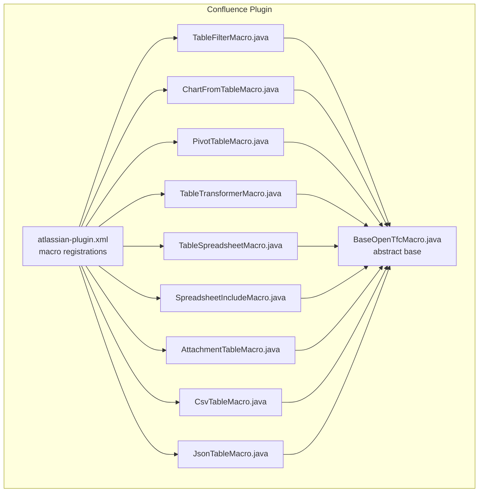

**Diagram sources**
- [atlassian-plugin.xml:70-286](file://src/main/resources/atlassian-plugin.xml#L70-L286)
- [BaseOpenTfcMacro.java:18-23](file://src/main/java/org/opentfc/macro/BaseOpenTfcMacro.java#L18-L23)
- [TableFilterMacro.java:14-22](file://src/main/java/org/opentfc/macro/TableFilterMacro.java#L14-L22)
- [ChartFromTableMacro.java:14-22](file://src/main/java/org/opentfc/macro/ChartFromTableMacro.java#L14-L22)
- [PivotTableMacro.java:14-22](file://src/main/java/org/opentfc/macro/PivotTableMacro.java#L14-L22)
- [TableTransformerMacro.java:14-22](file://src/main/java/org/opentfc/macro/TableTransformerMacro.java#L14-L22)
- [TableSpreadsheetMacro.java:14-22](file://src/main/java/org/opentfc/macro/TableSpreadsheetMacro.java#L14-L22)
- [SpreadsheetIncludeMacro.java:14-22](file://src/main/java/org/opentfc/macro/SpreadsheetIncludeMacro.java#L14-L22)
- [AttachmentTableMacro.java:29-53](file://src/main/java/org/opentfc/macro/AttachmentTableMacro.java#L29-L53)
- [CsvTableMacro.java:14-22](file://src/main/java/org/opentfc/macro/CsvTableMacro.java#L14-L22)
- [JsonTableMacro.java:14-22](file://src/main/java/org/opentfc/macro/JsonTableMacro.java#L14-L22)

**Section sources**
- [atlassian-plugin.xml:70-286](file://src/main/resources/atlassian-plugin.xml#L70-L286)
- [BaseOpenTfcMacro.java:18-23](file://src/main/java/org/opentfc/macro/BaseOpenTfcMacro.java#L18-L23)

## Core Components
- BaseOpenTfcMacro: Abstract base implementing Confluence’s Macro interface. Provides parameter helpers, body rendering, JSON config serialization, container wrapping, export-mode detection, macro ID generation, page ID extraction, HTML escaping, and diagnostics logging.
- Concrete macros: TableFilterMacro, ChartFromTableMacro, PivotTableMacro, TableTransformerMacro, TableSpreadsheetMacro, SpreadsheetIncludeMacro, AttachmentTableMacro, CsvTableMacro, JsonTableMacro. Each overrides execute to process parameters, handle export mode, build a configuration map, and return an HTML string via container or direct markup.

Key responsibilities:
- Parameter processing: Read and normalize macro parameters into a typed configuration map.
- Body rendering: Convert storage-format rich text to view HTML when needed.
- Output generation: Produce either interactive HTML (with JS-enabled containers) or static fallback HTML for exports.
- Container wrapping: Emit a standard div with id, CSS class, and data-opentfc-config attribute for frontend initialization.

**Section sources**
- [BaseOpenTfcMacro.java:18-114](file://src/main/java/org/opentfc/macro/BaseOpenTfcMacro.java#L18-L114)
- [TableFilterMacro.java:24-84](file://src/main/java/org/opentfc/macro/TableFilterMacro.java#L24-L84)
- [ChartFromTableMacro.java:24-53](file://src/main/java/org/opentfc/macro/ChartFromTableMacro.java#L24-L53)
- [PivotTableMacro.java:24-45](file://src/main/java/org/opentfc/macro/PivotTableMacro.java#L24-L45)
- [TableTransformerMacro.java:24-43](file://src/main/java/org/opentfc/macro/TableTransformerMacro.java#L24-L43)
- [TableSpreadsheetMacro.java:24-49](file://src/main/java/org/opentfc/macro/TableSpreadsheetMacro.java#L24-L49)
- [SpreadsheetIncludeMacro.java:24-46](file://src/main/java/org/opentfc/macro/SpreadsheetIncludeMacro.java#L24-L46)
- [AttachmentTableMacro.java:63-118](file://src/main/java/org/opentfc/macro/AttachmentTableMacro.java#L63-L118)
- [CsvTableMacro.java:24-46](file://src/main/java/org/opentfc/macro/CsvTableMacro.java#L24-L46)
- [JsonTableMacro.java:24-45](file://src/main/java/org/opentfc/macro/JsonTableMacro.java#L24-L45)

## Architecture Overview
At runtime, Confluence invokes each macro’s execute method with parameters, body, and ConversionContext. The macro:
1. Renders the body if needed.
2. Detects export mode.
3. Resolves or generates a stable macroId.
4. Builds a configuration map.
5. Emits either a static fallback or a containerized HTML block with data-opentfc-config.

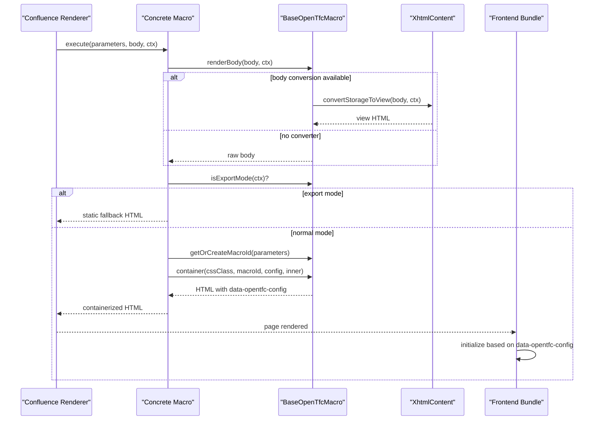

**Diagram sources**
- [BaseOpenTfcMacro.java:44-103](file://src/main/java/org/opentfc/macro/BaseOpenTfcMacro.java#L44-L103)
- [TableFilterMacro.java:24-84](file://src/main/java/org/opentfc/macro/TableFilterMacro.java#L24-L84)
- [ChartFromTableMacro.java:24-53](file://src/main/java/org/opentfc/macro/ChartFromTableMacro.java#L24-L53)
- [PivotTableMacro.java:24-45](file://src/main/java/org/opentfc/macro/PivotTableMacro.java#L24-L45)
- [TableTransformerMacro.java:24-43](file://src/main/java/org/opentfc/macro/TableTransformerMacro.java#L24-L43)
- [TableSpreadsheetMacro.java:24-49](file://src/main/java/org/opentfc/macro/TableSpreadsheetMacro.java#L24-L49)
- [SpreadsheetIncludeMacro.java:24-46](file://src/main/java/org/opentfc/macro/SpreadsheetIncludeMacro.java#L24-L46)

## Detailed Component Analysis

### BaseOpenTfcMacro
Responsibilities:
- Lifecycle hooks: getBodyType returns RICH_TEXT by default; getOutputType returns BLOCK.
- Export mode detection: isExportMode checks ConversionContext output type for pdf, word, email.
- Body rendering: renderBody converts storage to view HTML using injected XhtmlContent, with safe fallback to raw body and diagnostic logging.
- Config serialization: toJson serializes configuration objects to JSON safely.
- Container wrapper: container builds a div with class opentfc-container, unique id, and data-opentfc-config containing serialized configuration.
- Macro ID management: getOrCreateMacroId reads macroId from parameters or generates a prefixed short UUID.
- Utilities: pageIdOf extracts current page ID; escape HTML-encodes values; logFirstUse emits one-time diagnostic per instance.

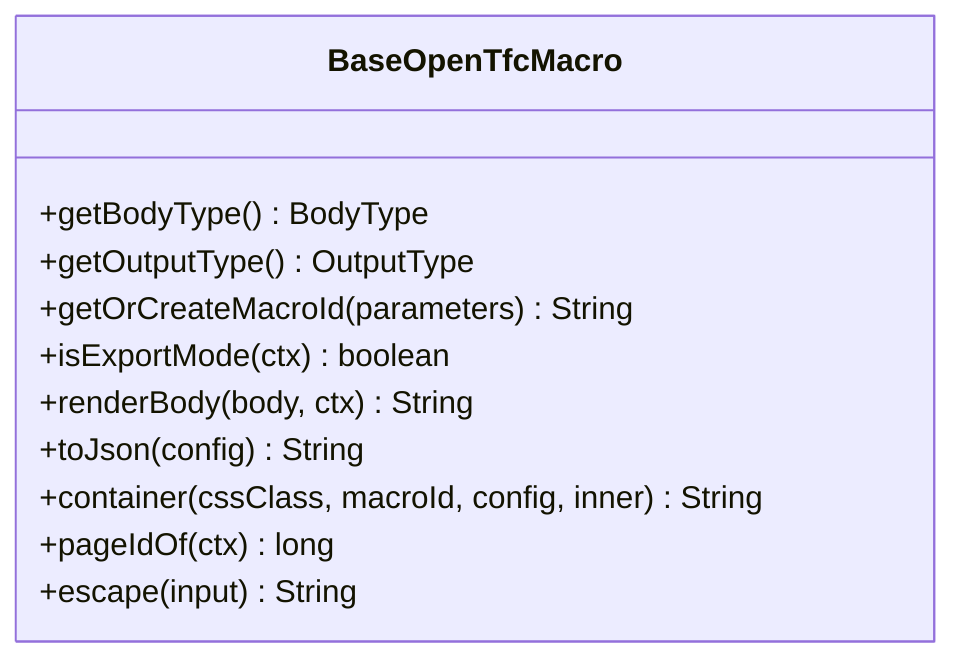

**Diagram sources**
- [BaseOpenTfcMacro.java:21-114](file://src/main/java/org/opentfc/macro/BaseOpenTfcMacro.java#L21-L114)

**Section sources**
- [BaseOpenTfcMacro.java:18-114](file://src/main/java/org/opentfc/macro/BaseOpenTfcMacro.java#L18-L114)

### TableFilterMacro
Behavior:
- Renders body, then detects export mode to emit a simple wrapper div.
- In normal mode, parses UI options (search box, column filters, sticky header, frozen columns, totals, hideable columns, export buttons, pagination).
- Builds a configuration map including macroId, pageId, and feature flags.
- Emits a container with toolbar, table wrapper, and optional pagination bar.

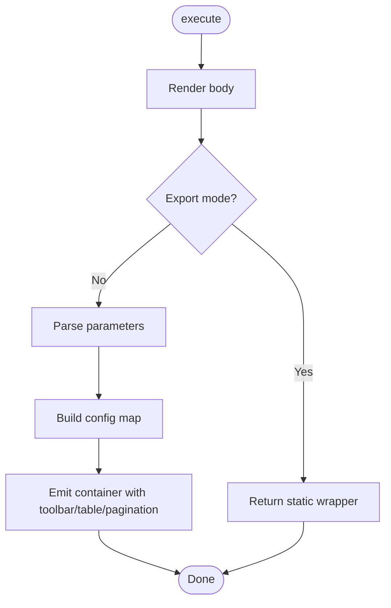

**Diagram sources**
- [TableFilterMacro.java:24-84](file://src/main/java/org/opentfc/macro/TableFilterMacro.java#L24-L84)
- [BaseOpenTfcMacro.java:44-103](file://src/main/java/org/opentfc/macro/BaseOpenTfcMacro.java#L44-L103)

**Section sources**
- [TableFilterMacro.java:24-84](file://src/main/java/org/opentfc/macro/TableFilterMacro.java#L24-L84)

### ChartFromTableMacro
Behavior:
- Renders body, then detects export mode to show source data table with title.
- Normal mode builds chart configuration (type, axes, aggregation, title, height).
- Emits container with toolbar, canvas placeholder, and hidden source div.

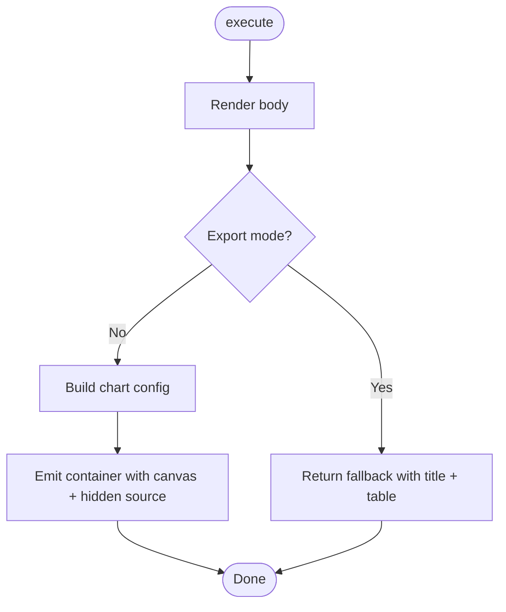

**Diagram sources**
- [ChartFromTableMacro.java:24-53](file://src/main/java/org/opentfc/macro/ChartFromTableMacro.java#L24-L53)
- [BaseOpenTfcMacro.java:44-103](file://src/main/java/org/opentfc/macro/BaseOpenTfcMacro.java#L44-L103)

**Section sources**
- [ChartFromTableMacro.java:24-53](file://src/main/java/org/opentfc/macro/ChartFromTableMacro.java#L24-L53)

### PivotTableMacro
Behavior:
- Renders body, then detects export mode to return a static wrapper.
- Normal mode builds pivot configuration (row/column/value fields, aggregate function).
- Emits container with controls, grid placeholder, and hidden source div.

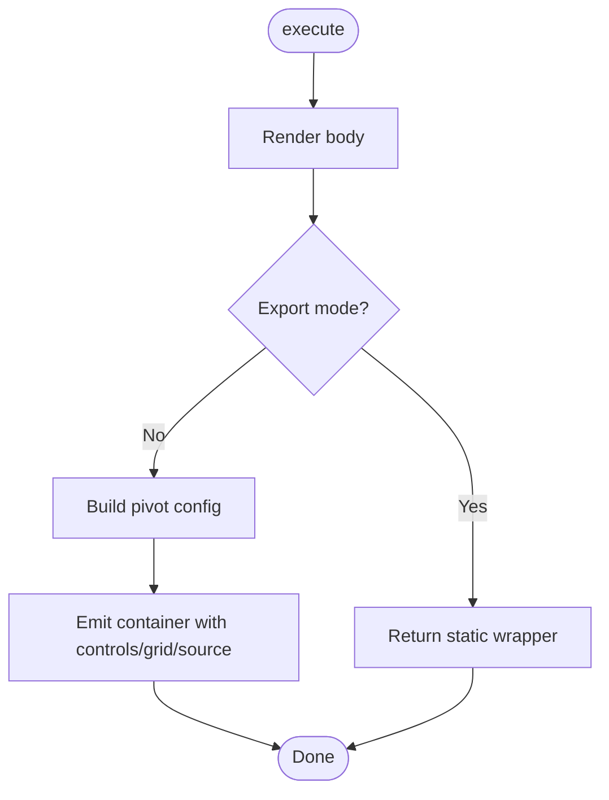

**Diagram sources**
- [PivotTableMacro.java:24-45](file://src/main/java/org/opentfc/macro/PivotTableMacro.java#L24-L45)
- [BaseOpenTfcMacro.java:44-103](file://src/main/java/org/opentfc/macro/BaseOpenTfcMacro.java#L44-L103)

**Section sources**
- [PivotTableMacro.java:24-45](file://src/main/java/org/opentfc/macro/PivotTableMacro.java#L24-L45)

### TableTransformerMacro
Behavior:
- Renders body, then detects export mode to return a static wrapper.
- Normal mode builds transformer configuration (source macro IDs, SQL query, preset).
- Emits container with output placeholder and hidden sources div.

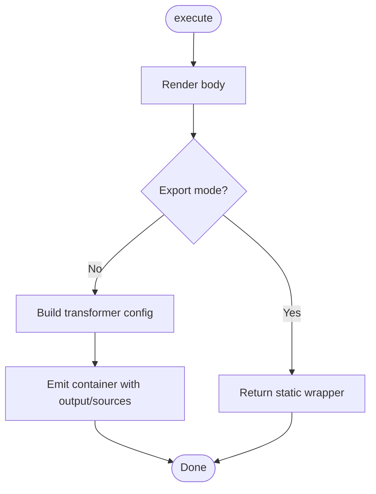

**Diagram sources**
- [TableTransformerMacro.java:24-43](file://src/main/java/org/opentfc/macro/TableTransformerMacro.java#L24-L43)
- [BaseOpenTfcMacro.java:44-103](file://src/main/java/org/opentfc/macro/BaseOpenTfcMacro.java#L44-L103)

**Section sources**
- [TableTransformerMacro.java:24-43](file://src/main/java/org/opentfc/macro/TableTransformerMacro.java#L24-L43)

### TableSpreadsheetMacro
Behavior:
- Declares BodyType.NONE (no body content).
- Export mode returns a static marker div.
- Normal mode builds spreadsheet configuration (attachment name, read-only flag, height).
- Emits container with toolbar and viewport placeholder.

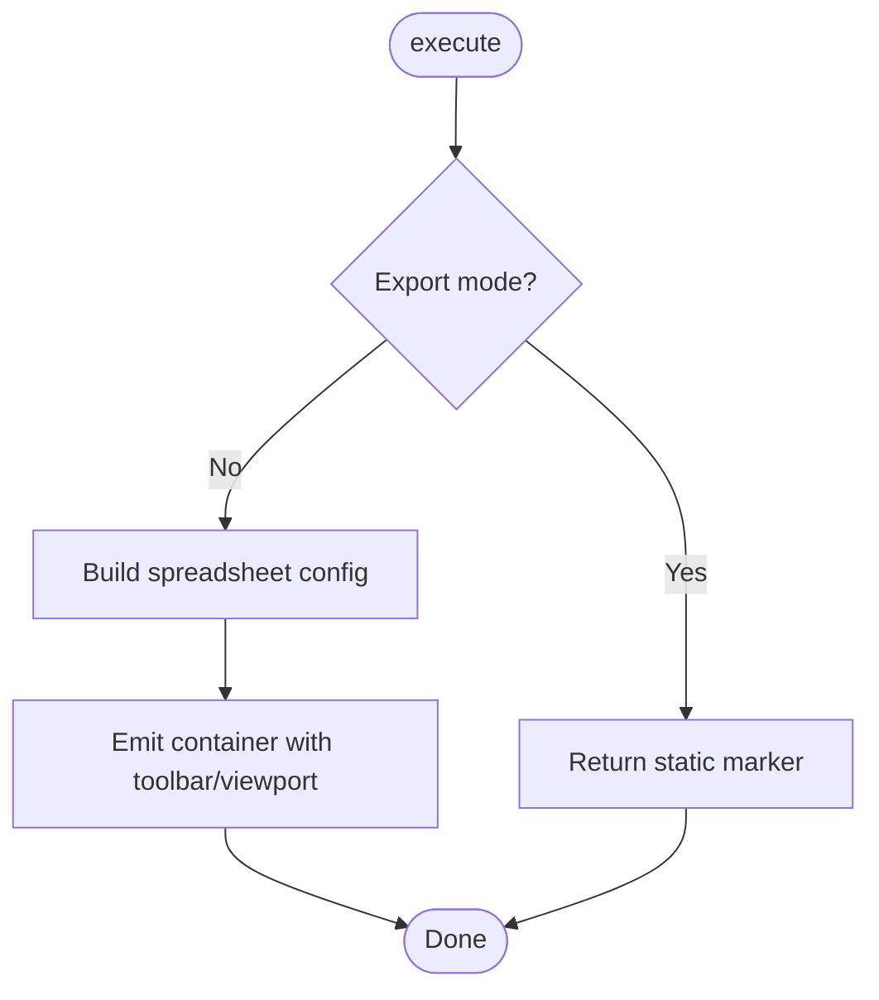

**Diagram sources**
- [TableSpreadsheetMacro.java:24-49](file://src/main/java/org/opentfc/macro/TableSpreadsheetMacro.java#L24-L49)
- [BaseOpenTfcMacro.java:44-103](file://src/main/java/org/opentfc/macro/BaseOpenTfcMacro.java#L44-L103)

**Section sources**
- [TableSpreadsheetMacro.java:24-49](file://src/main/java/org/opentfc/macro/TableSpreadsheetMacro.java#L24-L49)

### SpreadsheetIncludeMacro
Behavior:
- Declares BodyType.NONE.
- Export mode returns a static marker div.
- Normal mode builds include configuration (target page ID, sheet macro ID, sheet name, range).
- Emits container with include view placeholder.

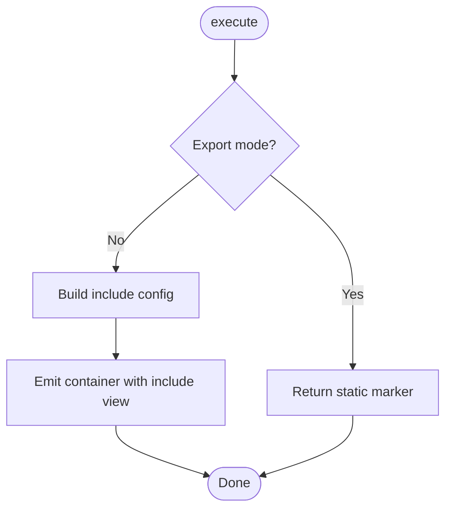

**Diagram sources**
- [SpreadsheetIncludeMacro.java:24-46](file://src/main/java/org/opentfc/macro/SpreadsheetIncludeMacro.java#L24-L46)
- [BaseOpenTfcMacro.java:44-103](file://src/main/java/org/opentfc/macro/BaseOpenTfcMacro.java#L44-L103)

**Section sources**
- [SpreadsheetIncludeMacro.java:24-46](file://src/main/java/org/opentfc/macro/SpreadsheetIncludeMacro.java#L24-L46)

### AttachmentTableMacro
Behavior:
- Declares BodyType.NONE.
- Generates a static HTML table listing page attachments with metadata (name, size, creator, modified date, comment).
- Applies include/exclude extension filters.
- Does not use the standard container; instead, it directly renders a table div.

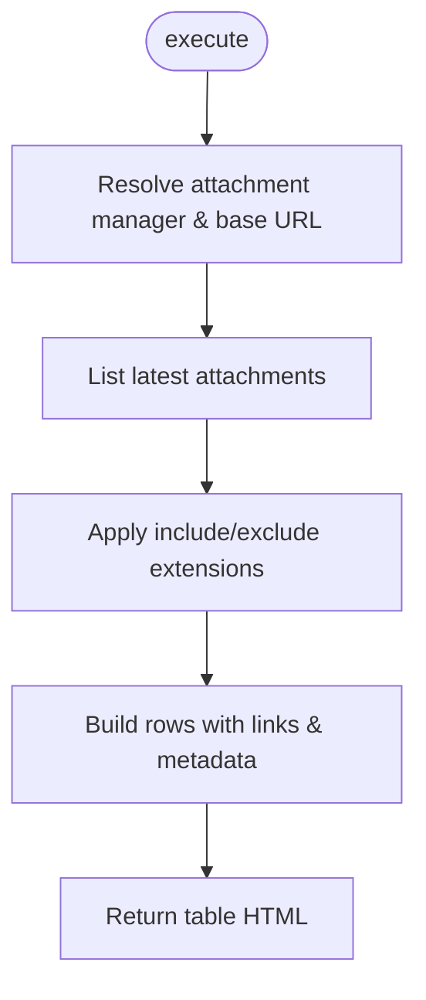

**Diagram sources**
- [AttachmentTableMacro.java:63-118](file://src/main/java/org/opentfc/macro/AttachmentTableMacro.java#L63-L118)

**Section sources**
- [AttachmentTableMacro.java:63-118](file://src/main/java/org/opentfc/macro/AttachmentTableMacro.java#L63-L118)

### CsvTableMacro
Behavior:
- Declares BodyType.PLAIN_TEXT.
- Builds datasource configuration (type csv, source type, attachment name, url, delimiter, encoding, inline body).
- Emits container with a loading placeholder.

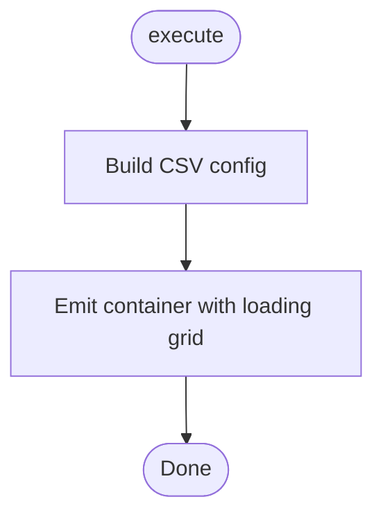

**Diagram sources**
- [CsvTableMacro.java:24-46](file://src/main/java/org/opentfc/macro/CsvTableMacro.java#L24-L46)
- [BaseOpenTfcMacro.java:44-103](file://src/main/java/org/opentfc/macro/BaseOpenTfcMacro.java#L44-L103)

**Section sources**
- [CsvTableMacro.java:24-46](file://src/main/java/org/opentfc/macro/CsvTableMacro.java#L24-L46)

### JsonTableMacro
Behavior:
- Declares BodyType.PLAIN_TEXT.
- Builds datasource configuration (type json, source type, attachment name, url, jsonPath, inline body).
- Emits container with a loading placeholder.

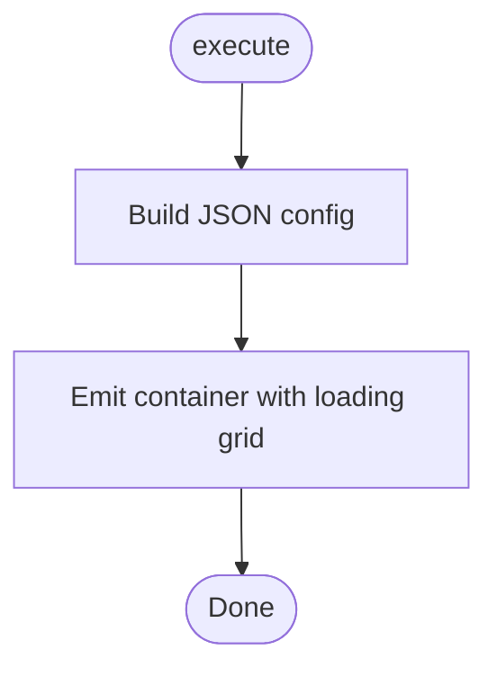

**Diagram sources**
- [JsonTableMacro.java:24-45](file://src/main/java/org/opentfc/macro/JsonTableMacro.java#L24-L45)
- [BaseOpenTfcMacro.java:44-103](file://src/main/java/org/opentfc/macro/BaseOpenTfcMacro.java#L44-L103)

**Section sources**
- [JsonTableMacro.java:24-45](file://src/main/java/org/opentfc/macro/JsonTableMacro.java#L24-L45)

## Dependency Analysis
- Confluence integration: All macros implement the Macro interface via BaseOpenTfcMacro and are registered as xhtml-macro modules in atlassian-plugin.xml.
- Rendering dependencies: Macros may depend on XhtmlContent for converting storage format to view HTML.
- Service dependencies: AttachmentTableMacro uses AttachmentManager and ApplicationProperties to list and link attachments.
- Frontend contract: Containers expose data-opentfc-config JSON for the frontend bundle to initialize features.

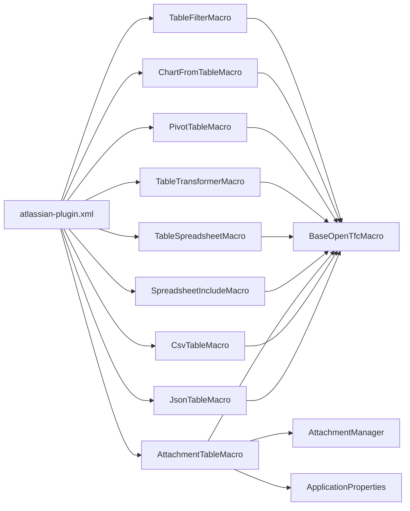

**Diagram sources**
- [atlassian-plugin.xml:70-286](file://src/main/resources/atlassian-plugin.xml#L70-L286)
- [BaseOpenTfcMacro.java:18-23](file://src/main/java/org/opentfc/macro/BaseOpenTfcMacro.java#L18-L23)
- [AttachmentTableMacro.java:34-53](file://src/main/java/org/opentfc/macro/AttachmentTableMacro.java#L34-L53)

**Section sources**
- [atlassian-plugin.xml:70-286](file://src/main/resources/atlassian-plugin.xml#L70-L286)
- [AttachmentTableMacro.java:34-53](file://src/main/java/org/opentfc/macro/AttachmentTableMacro.java#L34-L53)

## Performance Considerations
- Avoid unnecessary conversions: renderBody falls back to raw body if conversion fails; prefer passing already-view HTML when possible.
- Minimize JSON payload size: keep configuration maps minimal; avoid embedding large datasets in data-opentfc-config.
- Export mode optimization: return lightweight static HTML to reduce server-side work during PDF/Word/email generation.
- Pagination and filtering: enable only required features (e.g., disable pagination or column filters) to reduce client-side overhead.

[No sources needed since this section provides general guidance]

## Troubleshooting Guide
Common issues and resolutions:
- Nested macros not rendering: Ensure renderBody is used so nested macros are converted from storage to view HTML. Check logs for conversion failures.
- Missing macroId: If macroId is empty, BaseOpenTfcMacro generates a prefixed short UUID; verify frontend can locate the container by id.
- Export mode not working: Confirm ConversionContext output type is pdf, word, or email; macros should return static fallback HTML in these cases.
- Configuration not applied: Verify data-opentfc-config contains expected keys; ensure toJson does not fail and returns valid JSON.
- Attachment table empty: Check include/exclude extension filters and permissions; verify AttachmentManager is available.

Operational hints:
- Use the diagnostics endpoint to see first-use logs per macro instance.
- Validate HTML escaping to prevent malformed attributes in container ids and config values.

**Section sources**
- [BaseOpenTfcMacro.java:56-69](file://src/main/java/org/opentfc/macro/BaseOpenTfcMacro.java#L56-L69)
- [BaseOpenTfcMacro.java:81-88](file://src/main/java/org/opentfc/macro/BaseOpenTfcMacro.java#L81-L88)
- [AttachmentTableMacro.java:86-117](file://src/main/java/org/opentfc/macro/AttachmentTableMacro.java#L86-L117)

## Conclusion
The OpenTFC macro system centers around BaseOpenTfcMacro, which standardizes parameter handling, body rendering, export mode detection, and containerized output with data-opentfc-config. Concrete macros extend this base to provide specialized functionality such as filtering, charts, pivots, transformations, spreadsheets, and data sources. Registration in atlassian-plugin.xml wires each macro into Confluence’s rendering pipeline, enabling consistent behavior across interactive pages and non-JavaScript export contexts.

[No sources needed since this section summarizes without analyzing specific files]