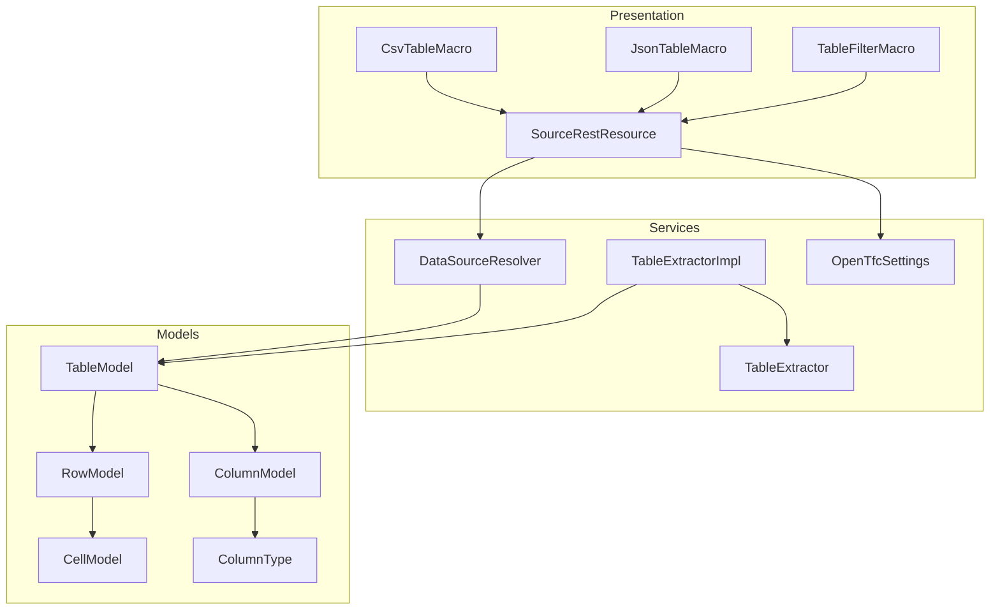
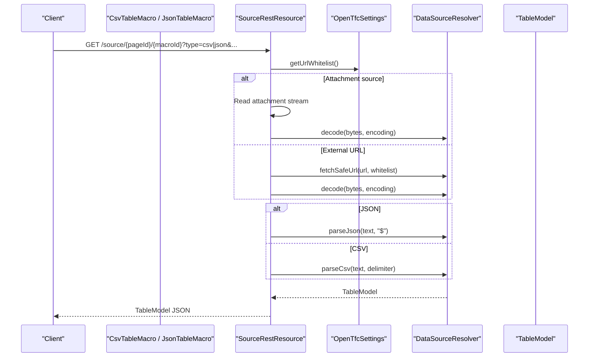
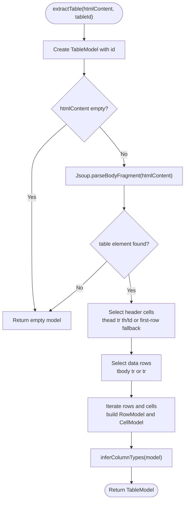
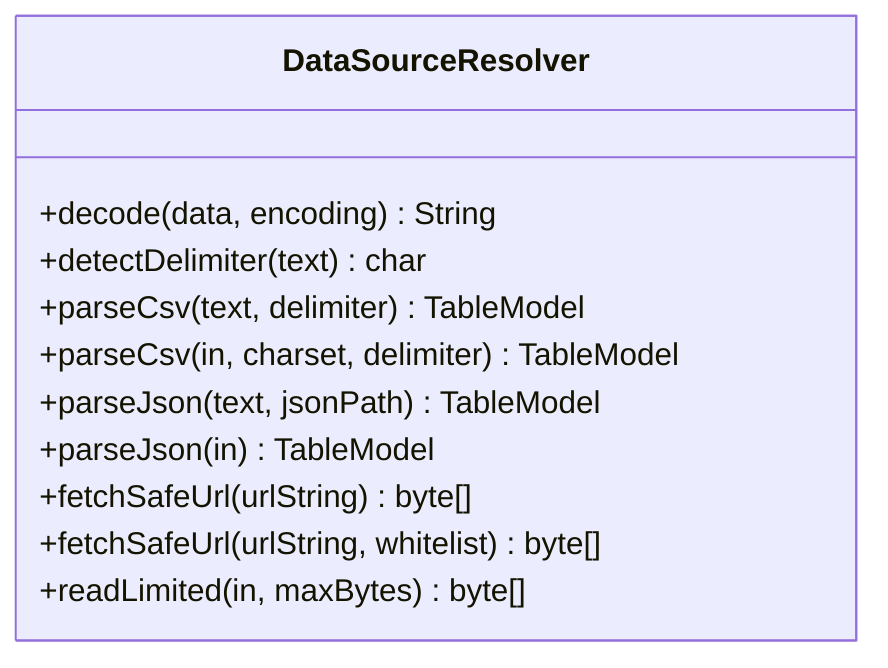
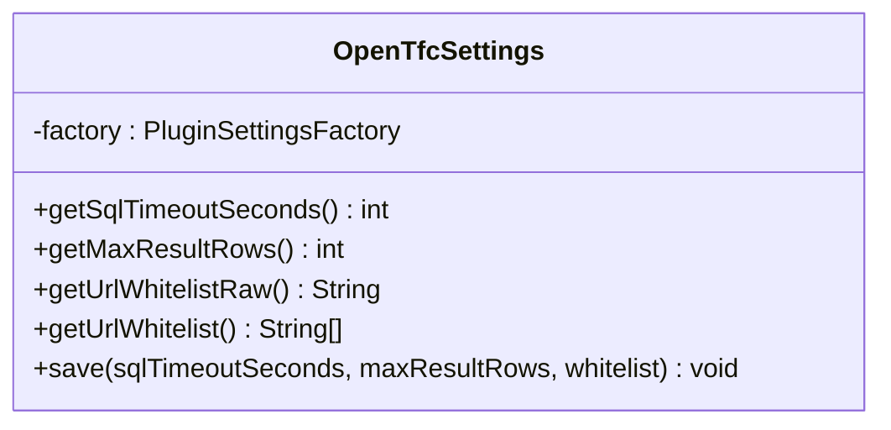
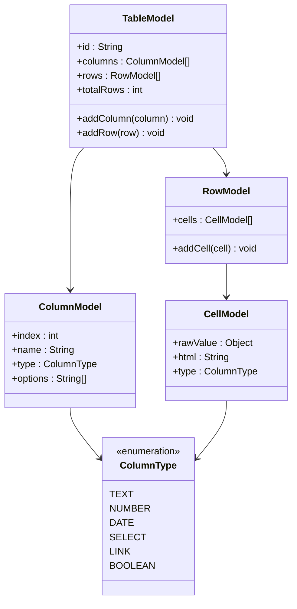
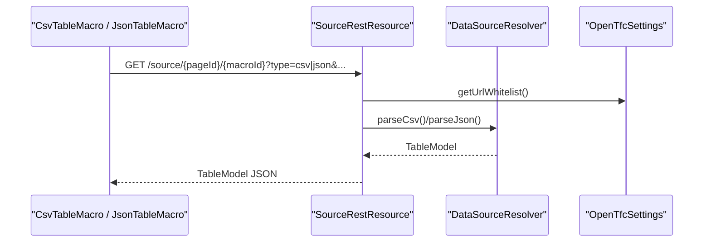
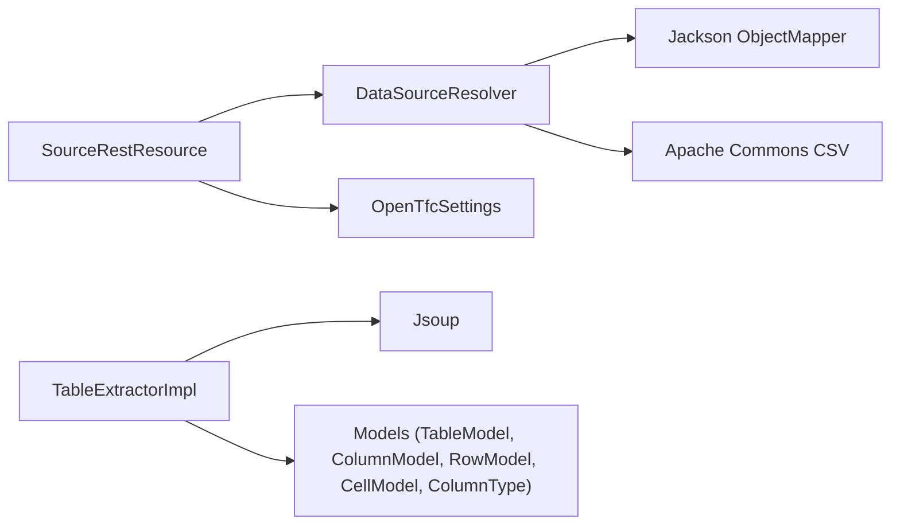

# Service Layer Architecture

<cite>
**Referenced Files in This Document**
- [TableExtractor.java](file://src/main/java/org/opentfc/service/TableExtractor.java)
- [TableExtractorImpl.java](file://src/main/java/org/opentfc/service/TableExtractorImpl.java)
- [DataSourceResolver.java](file://src/main/java/org/opentfc/service/DataSourceResolver.java)
- [OpenTfcSettings.java](file://src/main/java/org/opentfc/service/OpenTfcSettings.java)
- [TableModel.java](file://src/main/java/org/opentfc/model/TableModel.java)
- [ColumnModel.java](file://src/main/java/org/opentfc/model/ColumnModel.java)
- [RowModel.java](file://src/main/java/org/opentfc/model/RowModel.java)
- [CellModel.java](file://src/main/java/org/opentfc/model/CellModel.java)
- [ColumnType.java](file://src/main/java/org/opentfc/model/ColumnType.java)
- [CsvTableMacro.java](file://src/main/java/org/opentfc/macro/CsvTableMacro.java)
- [JsonTableMacro.java](file://src/main/java/org/opentfc/macro/JsonTableMacro.java)
- [TableFilterMacro.java](file://src/main/java/org/opentfc/macro/TableFilterMacro.java)
- [SourceRestResource.java](file://src/main/java/org/opentfc/rest/SourceRestResource.java)
</cite>

## Table of Contents
1. [Introduction](#introduction)
2. [Project Structure](#project-structure)
3. [Core Components](#core-components)
4. [Architecture Overview](#architecture-overview)
5. [Detailed Component Analysis](#detailed-component-analysis)
6. [Dependency Analysis](#dependency-analysis)
7. [Performance Considerations](#performance-considerations)
8. [Troubleshooting Guide](#troubleshooting-guide)
9. [Conclusion](#conclusion)

## Introduction
This document explains the OpenTFC service layer design and how it separates business logic from presentation through dedicated services. It focuses on:
- HTML table parsing and type inference via TableExtractor and TableExtractorImpl
- Data source resolution for CSV, JSON, attachments, and external URLs via DataSourceResolver
- Plugin configuration management via OpenTfcSettings
- How macros and REST endpoints consume these services to provide reusable functionality across the application

The goal is to make the architecture clear for both backend developers and users who need to understand how data flows from various sources into a unified TableModel used by UI components.

## Project Structure
The service layer resides under org.opentfc.service and is consumed by:
- Macros (org.opentfc.macro) that render Confluence content and prepare client-side configurations
- REST resources (org.opentfc.rest) that expose data retrieval endpoints

**Diagram sources**
- [CsvTableMacro.java:1-48](file://src/main/java/org/opentfc/macro/CsvTableMacro.java#L1-L48)
- [JsonTableMacro.java:1-47](file://src/main/java/org/opentfc/macro/JsonTableMacro.java#L1-L47)
- [TableFilterMacro.java:1-86](file://src/main/java/org/opentfc/macro/TableFilterMacro.java#L1-L86)
- [SourceRestResource.java:1-113](file://src/main/java/org/opentfc/rest/SourceRestResource.java#L1-L113)
- [TableExtractor.java:1-19](file://src/main/java/org/opentfc/service/TableExtractor.java#L1-L19)
- [TableExtractorImpl.java:1-166](file://src/main/java/org/opentfc/service/TableExtractorImpl.java#L1-L166)
- [DataSourceResolver.java:1-290](file://src/main/java/org/opentfc/service/DataSourceResolver.java#L1-L290)
- [OpenTfcSettings.java:1-67](file://src/main/java/org/opentfc/service/OpenTfcSettings.java#L1-L67)
- [TableModel.java:1-76](file://src/main/java/org/opentfc/model/TableModel.java#L1-L76)
- [ColumnModel.java:1-68](file://src/main/java/org/opentfc/model/ColumnModel.java#L1-L68)
- [RowModel.java:1-37](file://src/main/java/org/opentfc/model/RowModel.java#L1-L37)
- [CellModel.java:1-55](file://src/main/java/org/opentfc/model/CellModel.java#L1-L55)
- [ColumnType.java:1-14](file://src/main/java/org/opentfc/model/ColumnType.java#L1-L14)

**Section sources**
- [CsvTableMacro.java:1-48](file://src/main/java/org/opentfc/macro/CsvTableMacro.java#L1-L48)
- [JsonTableMacro.java:1-47](file://src/main/java/org/opentfc/macro/JsonTableMacro.java#L1-L47)
- [TableFilterMacro.java:1-86](file://src/main/java/org/opentfc/macro/TableFilterMacro.java#L1-L86)
- [SourceRestResource.java:1-113](file://src/main/java/org/opentfc/rest/SourceRestResource.java#L1-L113)

## Core Components
- TableExtractor interface defines a contract for extracting a normalized TableModel from raw HTML/XHTML or macro bodies.
- TableExtractorImpl implements robust HTML parsing using Jsoup, header detection, row extraction, and column type inference (TEXT, NUMBER, DATE, SELECT).
- DataSourceResolver parses CSV and JSON into TableModel, decodes text with BOM and charset handling, and fetches external URLs with SSRF protection and size/time limits.
- OpenTfcSettings manages plugin-wide settings such as SQL timeout, max result rows, and URL whitelist for safe fetching.
- Models (TableModel, ColumnModel, RowModel, CellModel, ColumnType) represent a unified tabular structure consumed by both macros and REST endpoints.

Key responsibilities:
- Parsing and normalization: TableExtractorImpl, DataSourceResolver
- Configuration: OpenTfcSettings
- Presentation integration: CsvTableMacro, JsonTableMacro, TableFilterMacro, SourceRestResource

**Section sources**
- [TableExtractor.java:1-19](file://src/main/java/org/opentfc/service/TableExtractor.java#L1-L19)
- [TableExtractorImpl.java:1-166](file://src/main/java/org/opentfc/service/TableExtractorImpl.java#L1-L166)
- [DataSourceResolver.java:1-290](file://src/main/java/org/opentfc/service/DataSourceResolver.java#L1-L290)
- [OpenTfcSettings.java:1-67](file://src/main/java/org/opentfc/service/OpenTfcSettings.java#L1-L67)
- [TableModel.java:1-76](file://src/main/java/org/opentfc/model/TableModel.java#L1-L76)
- [ColumnModel.java:1-68](file://src/main/java/org/opentfc/model/ColumnModel.java#L1-L68)
- [RowModel.java:1-37](file://src/main/java/org/opentfc/model/RowModel.java#L1-L37)
- [CellModel.java:1-55](file://src/main/java/org/opentfc/model/CellModel.java#L1-L55)
- [ColumnType.java:1-14](file://src/main/java/org/opentfc/model/ColumnType.java#L1-L14)

## Architecture Overview
The service layer provides reusable data processing capabilities behind a clean abstraction. Macros focus on rendering and configuration; REST endpoints focus on exposing data retrieval. Services encapsulate parsing, type inference, and secure fetching.

**Diagram sources**
- [SourceRestResource.java:61-111](file://src/main/java/org/opentfc/rest/SourceRestResource.java#L61-L111)
- [OpenTfcSettings.java:49-57](file://src/main/java/org/opentfc/service/OpenTfcSettings.java#L49-L57)
- [DataSourceResolver.java:48-79](file://src/main/java/org/opentfc/service/DataSourceResolver.java#L48-L79)
- [DataSourceResolver.java:97-131](file://src/main/java/org/opentfc/service/DataSourceResolver.java#L97-L131)
- [DataSourceResolver.java:139-187](file://src/main/java/org/opentfc/service/DataSourceResolver.java#L139-L187)
- [DataSourceResolver.java:212-258](file://src/main/java/org/opentfc/service/DataSourceResolver.java#L212-L258)

## Detailed Component Analysis

### TableExtractor and TableExtractorImpl
Responsibilities:
- Parse HTML/XHTML tables into a normalized TableModel
- Detect headers from thead or first row fallback
- Extract rows and cells, preserving both raw and HTML values
- Infer column types based on heuristics (numeric, date, select options)

Type inference rules:
- Numeric if at least 80% of non-empty values match numeric patterns
- Date if at least 80% of non-empty values match supported date formats
- Select if unique values are few and thresholded, with options populated
- Otherwise TEXT

Complexity:
- Parsing and building rows: O(R*C) where R = rows, C = columns
- Type inference: O(R*C) with regex/date checks per cell

Error handling:
- Exceptions during parsing are logged and an empty model may be returned

**Diagram sources**
- [TableExtractorImpl.java:31-103](file://src/main/java/org/opentfc/service/TableExtractorImpl.java#L31-L103)
- [TableExtractorImpl.java:105-164](file://src/main/java/org/opentfc/service/TableExtractorImpl.java#L105-L164)

**Section sources**
- [TableExtractor.java:1-19](file://src/main/java/org/opentfc/service/TableExtractor.java#L1-L19)
- [TableExtractorImpl.java:1-166](file://src/main/java/org/opentfc/service/TableExtractorImpl.java#L1-L166)

### DataSourceResolver
Responsibilities:
- Decode byte arrays with explicit charset or auto-detection (UTF-8 BOM, UTF-16 BOM, strict UTF-8, fallback to windows-1251)
- Auto-detect CSV delimiter among comma, semicolon, tab, pipe
- Parse CSV into TableModel (first row as header)
- Parse JSON into TableModel (array of objects or array of arrays), with optional simple path selector
- Fetch external URLs safely with SSRF protection, timeouts, no redirects, and size limits

Security and safety:
- Protocol check: only http/https allowed
- Host whitelist enforcement with wildcard support
- Internal/private IP address blocking
- Timeouts and redirect disabling
- Max payload size enforcement

JSON path selection:
- Supports simple dot notation and bracket indices after stripping leading "$"

**Diagram sources**
- [DataSourceResolver.java:48-79](file://src/main/java/org/opentfc/service/DataSourceResolver.java#L48-L79)
- [DataSourceResolver.java:81-95](file://src/main/java/org/opentfc/service/DataSourceResolver.java#L81-L95)
- [DataSourceResolver.java:97-131](file://src/main/java/org/opentfc/service/DataSourceResolver.java#L97-L131)
- [DataSourceResolver.java:139-187](file://src/main/java/org/opentfc/service/DataSourceResolver.java#L139-L187)
- [DataSourceResolver.java:196-210](file://src/main/java/org/opentfc/service/DataSourceResolver.java#L196-L210)
- [DataSourceResolver.java:212-258](file://src/main/java/org/opentfc/service/DataSourceResolver.java#L212-L258)
- [DataSourceResolver.java:260-288](file://src/main/java/org/opentfc/service/DataSourceResolver.java#L260-L288)

**Section sources**
- [DataSourceResolver.java:1-290](file://src/main/java/org/opentfc/service/DataSourceResolver.java#L1-L290)

### OpenTfcSettings
Responsibilities:
- Provide typed accessors for global plugin settings stored via SAL PluginSettings
- Validate and clamp integer values within safe ranges
- Parse and normalize URL whitelist entries

Common usage:
- REST endpoints read the URL whitelist to restrict external data sources
- Admin actions persist validated settings

**Diagram sources**
- [OpenTfcSettings.java:13-66](file://src/main/java/org/opentfc/service/OpenTfcSettings.java#L13-L66)

**Section sources**
- [OpenTfcSettings.java:1-67](file://src/main/java/org/opentfc/service/OpenTfcSettings.java#L1-L67)

### Models: TableModel, ColumnModel, RowModel, CellModel, ColumnType
Unified representation of tabular data:
- TableModel holds id, columns, rows, and totalRows
- ColumnModel defines index, name, type, and options (for SELECT columns)
- RowModel contains a list of CellModel
- CellModel stores raw value, HTML representation, and type hint
- ColumnType enumerates supported types: TEXT, NUMBER, DATE, SELECT, LINK, BOOLEAN

These models are produced by services and consumed by macros and REST endpoints.

**Diagram sources**
- [TableModel.java:1-76](file://src/main/java/org/opentfc/model/TableModel.java#L1-L76)
- [ColumnModel.java:1-68](file://src/main/java/org/opentfc/model/ColumnModel.java#L1-L68)
- [RowModel.java:1-37](file://src/main/java/org/opentfc/model/RowModel.java#L1-L37)
- [CellModel.java:1-55](file://src/main/java/org/opentfc/model/CellModel.java#L1-L55)
- [ColumnType.java:1-14](file://src/main/java/org/opentfc/model/ColumnType.java#L1-L14)

**Section sources**
- [TableModel.java:1-76](file://src/main/java/org/opentfc/model/TableModel.java#L1-L76)
- [ColumnModel.java:1-68](file://src/main/java/org/opentfc/model/ColumnModel.java#L1-L68)
- [RowModel.java:1-37](file://src/main/java/org/opentfc/model/RowModel.java#L1-L37)
- [CellModel.java:1-55](file://src/main/java/org/opentfc/model/CellModel.java#L1-L55)
- [ColumnType.java:1-14](file://src/main/java/org/opentfc/model/ColumnType.java#L1-L14)

### Integration Points: Macros and REST Endpoints
Macros:
- CsvTableMacro and JsonTableMacro build a client-side configuration object describing the data source (attachment, URL, inline body) and pass it to the frontend container. They do not perform heavy parsing themselves; they delegate to REST endpoints when needed.
- TableFilterMacro wraps existing HTML tables and configures client-side filtering/sorting/pagination.

REST:
- SourceRestResource exposes a single endpoint to retrieve data from attachments or external URLs, parse them into TableModel, and return JSON. It uses OpenTfcSettings for URL whitelisting and DataSourceResolver for decoding, parsing, and safe fetching.

**Diagram sources**
- [CsvTableMacro.java:24-46](file://src/main/java/org/opentfc/macro/CsvTableMacro.java#L24-L46)
- [JsonTableMacro.java:24-45](file://src/main/java/org/opentfc/macro/JsonTableMacro.java#L24-L45)
- [SourceRestResource.java:61-111](file://src/main/java/org/opentfc/rest/SourceRestResource.java#L61-L111)
- [OpenTfcSettings.java:49-57](file://src/main/java/org/opentfc/service/OpenTfcSettings.java#L49-L57)
- [DataSourceResolver.java:97-131](file://src/main/java/org/opentfc/service/DataSourceResolver.java#L97-L131)
- [DataSourceResolver.java:139-187](file://src/main/java/org/opentfc/service/DataSourceResolver.java#L139-L187)

**Section sources**
- [CsvTableMacro.java:1-48](file://src/main/java/org/opentfc/macro/CsvTableMacro.java#L1-L48)
- [JsonTableMacro.java:1-47](file://src/main/java/org/opentfc/macro/JsonTableMacro.java#L1-L47)
- [TableFilterMacro.java:1-86](file://src/main/java/org/opentfc/macro/TableFilterMacro.java#L1-L86)
- [SourceRestResource.java:1-113](file://src/main/java/org/opentfc/rest/SourceRestResource.java#L1-L113)

## Dependency Analysis
High-level dependencies:
- SourceRestResource depends on PageManager, AttachmentManager, OpenTfcSettings, and DataSourceResolver
- DataSourceResolver depends on Jackson ObjectMapper, Apache Commons CSV, and Java networking APIs
- TableExtractorImpl depends on Jsoup and the model classes
- OpenTfcSettings depends on Atlassian SAL PluginSettingsFactory

**Diagram sources**
- [SourceRestResource.java:1-113](file://src/main/java/org/opentfc/rest/SourceRestResource.java#L1-L113)
- [DataSourceResolver.java:1-290](file://src/main/java/org/opentfc/service/DataSourceResolver.java#L1-L290)
- [TableExtractorImpl.java:1-166](file://src/main/java/org/opentfc/service/TableExtractorImpl.java#L1-L166)
- [OpenTfcSettings.java:1-67](file://src/main/java/org/opentfc/service/OpenTfcSettings.java#L1-L67)

**Section sources**
- [SourceRestResource.java:1-113](file://src/main/java/org/opentfc/rest/SourceRestResource.java#L1-L113)
- [DataSourceResolver.java:1-290](file://src/main/java/org/opentfc/service/DataSourceResolver.java#L1-L290)
- [TableExtractorImpl.java:1-166](file://src/main/java/org/opentfc/service/TableExtractorImpl.java#L1-L166)
- [OpenTfcSettings.java:1-67](file://src/main/java/org/opentfc/service/OpenTfcSettings.java#L1-L67)

## Performance Considerations
- CSV parsing uses streaming via CSVParser and bounded memory reads to avoid large allocations.
- JSON parsing builds intermediate structures but remains efficient for typical dataset sizes; consider pagination or server-side filtering for very large payloads.
- External URL fetching enforces timeouts and maximum payload size to prevent resource exhaustion.
- Type inference scans each cell once; for extremely wide tables, consider pre-filtering or limiting rows processed.

[No sources needed since this section provides general guidance]

## Troubleshooting Guide
Common issues and diagnostics:
- HTML parsing failures: TableExtractorImpl logs errors and returns an empty model; verify input HTML structure and ensure a table element exists.
- CSV/JSON parsing errors: DataSourceResolver throws IOExceptions for malformed data or oversized payloads; validate delimiters, encodings, and JSON paths.
- External URL fetch failures: DataSourceResolver enforces protocol, host whitelist, internal IP checks, and size limits; ensure the URL is whitelisted and reachable.
- Settings misconfiguration: OpenTfcSettings clamps values; verify saved settings and whitelist format.

Operational tips:
- Use SourceRestResource to isolate data loading and inspect returned TableModel for correctness.
- For attachment-based sources, confirm attachment names and page IDs.
- For external sources, review the URL whitelist and network connectivity.

**Section sources**
- [TableExtractorImpl.java:98-100](file://src/main/java/org/opentfc/service/TableExtractorImpl.java#L98-L100)
- [DataSourceResolver.java:221-258](file://src/main/java/org/opentfc/service/DataSourceResolver.java#L221-L258)
- [SourceRestResource.java:90-110](file://src/main/java/org/opentfc/rest/SourceRestResource.java#L90-L110)
- [OpenTfcSettings.java:28-39](file://src/main/java/org/opentfc/service/OpenTfcSettings.java#L28-L39)

## Conclusion
The OpenTFC service layer cleanly separates concerns:
- Services encapsulate parsing, type inference, and secure data fetching
- Macros focus on rendering and client configuration
- REST endpoints provide a stable API for data retrieval

This separation enables reuse across backend macros and REST endpoints, consistent behavior, and safer operations through centralized configuration and validation.

[No sources needed since this section summarizes without analyzing specific files]