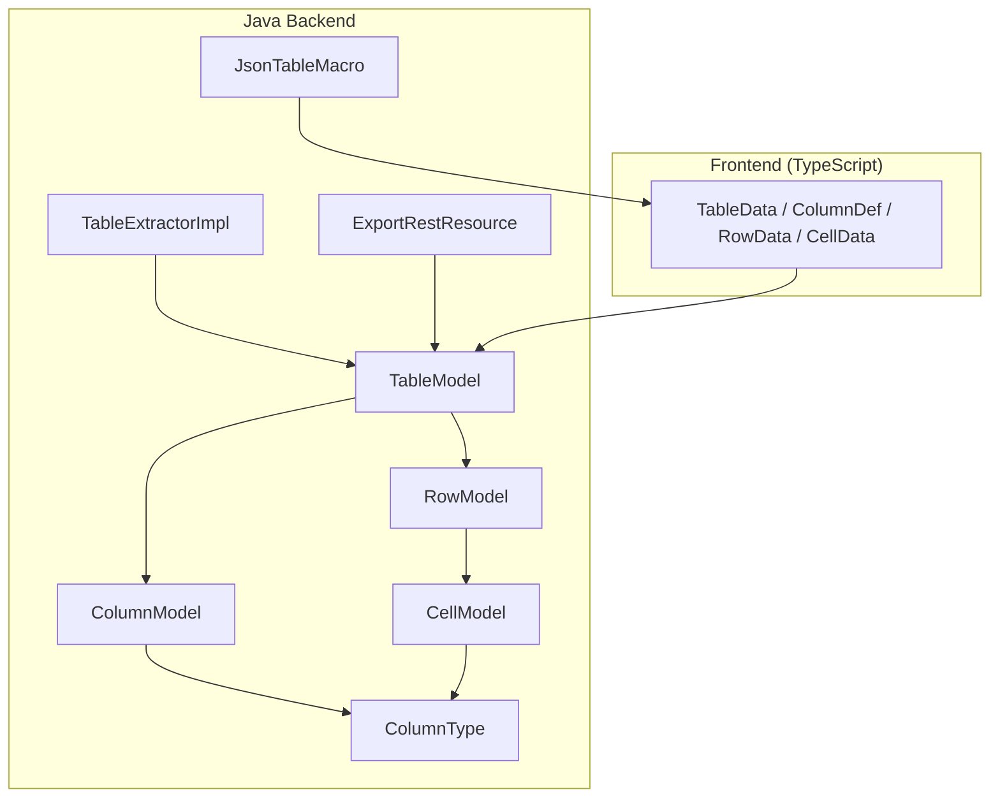
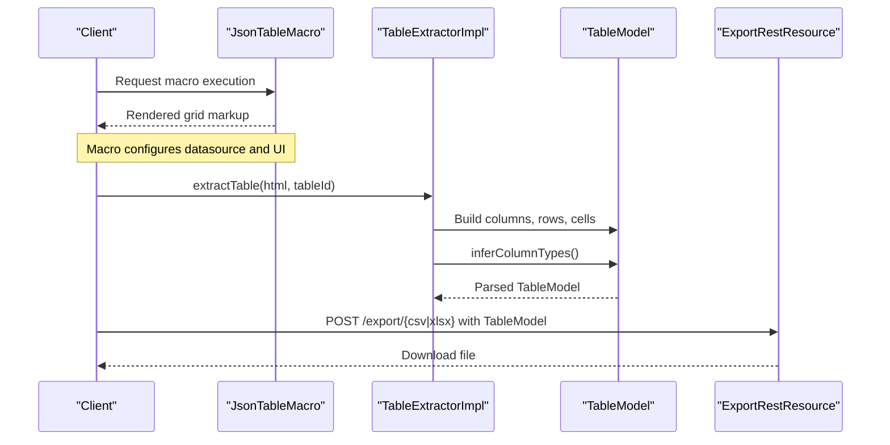
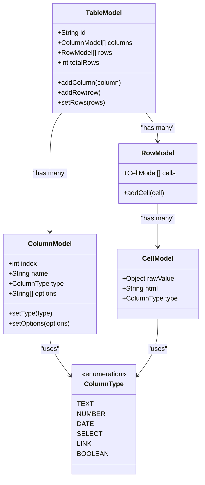
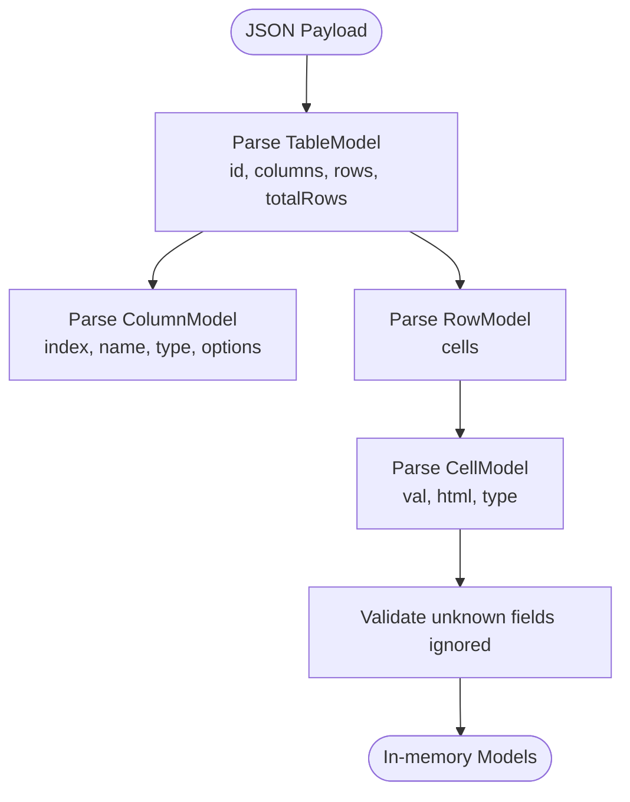
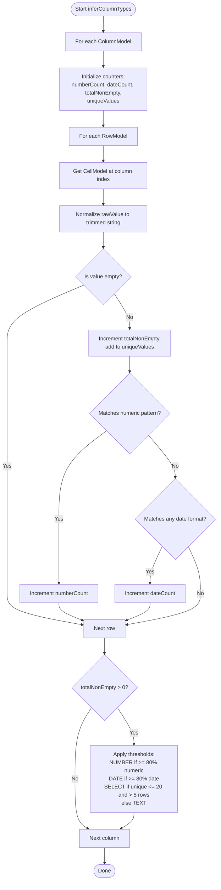
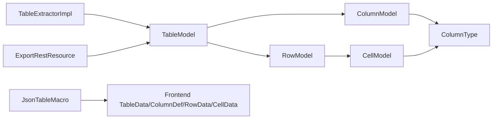

# Data Models

<cite>
**Referenced Files in This Document**
- [TableModel.java](file://src/main/java/org/opentfc/model/TableModel.java)
- [ColumnModel.java](file://src/main/java/org/opentfc/model/ColumnModel.java)
- [RowModel.java](file://src/main/java/org/opentfc/model/RowModel.java)
- [CellModel.java](file://src/main/java/org/opentfc/model/CellModel.java)
- [ColumnType.java](file://src/main/java/org/opentfc/model/ColumnType.java)
- [table-model.ts](file://src/main/frontend/src/core/table-model.ts)
- [TableExtractorImpl.java](file://src/main/java/org/opentfc/service/TableExtractorImpl.java)
- [ExportRestResource.java](file://src/main/java/org/opentfc/rest/ExportRestResource.java)
- [JsonTableMacro.java](file://src/main/java/org/opentfc/macro/JsonTableMacro.java)
- [ModelTest.java](file://src/test/java/org/opentfc/model/ModelTest.java)
</cite>

## Table of Contents
1. [Introduction](#introduction)
2. [Project Structure](#project-structure)
3. [Core Components](#core-components)
4. [Architecture Overview](#architecture-overview)
5. [Detailed Component Analysis](#detailed-component-analysis)
6. [Dependency Analysis](#dependency-analysis)
7. [Performance Considerations](#performance-considerations)
8. [Troubleshooting Guide](#troubleshooting-guide)
9. [Conclusion](#conclusion)

## Introduction
This document describes the core data models that power table processing in OpenTFC. It focuses on the Java value objects that represent a parsed table and its contents, as well as their frontend TypeScript counterparts. The documentation explains entity relationships, field definitions, data types, validation rules, serialization formats, conversion patterns between model types, and the automatic column type inference system used when extracting tables from HTML.

## Project Structure
The core table models live under the Java package for domain models and are mirrored by TypeScript interfaces in the frontend bundle. The extraction pipeline transforms raw HTML into these models, which are then consumed by macros, REST endpoints, and rendering components.

**Diagram sources**
- [TableModel.java:1-76](file://src/main/java/org/opentfc/model/TableModel.java#L1-L76)
- [ColumnModel.java:1-68](file://src/main/java/org/opentfc/model/ColumnModel.java#L1-L68)
- [RowModel.java:1-37](file://src/main/java/org/opentfc/model/RowModel.java#L1-L37)
- [CellModel.java:1-55](file://src/main/java/org/opentfc/model/CellModel.java#L1-L55)
- [ColumnType.java:1-14](file://src/main/java/org/opentfc/model/ColumnType.java#L1-L14)
- [TableExtractorImpl.java:31-103](file://src/main/java/org/opentfc/service/TableExtractorImpl.java#L31-L103)
- [ExportRestResource.java:23-57](file://src/main/java/org/opentfc/rest/ExportRestResource.java#L23-L57)
- [JsonTableMacro.java:30-44](file://src/main/java/org/opentfc/macro/JsonTableMacro.java#L30-L44)
- [table-model.ts:1-36](file://src/main/frontend/src/core/table-model.ts#L1-L36)

**Section sources**
- [TableModel.java:1-76](file://src/main/java/org/opentfc/model/TableModel.java#L1-L76)
- [table-model.ts:1-36](file://src/main/frontend/src/core/table-model.ts#L1-L36)

## Core Components
OpenTFC’s table processing is built around five core entities:

- TableModel: Represents an entire table with columns, rows, and metadata such as total row count.
- ColumnModel: Describes a column’s index, name, inferred or explicit type, and optional enumerated options.
- RowModel: A container for cells within a single table row.
- CellModel: Holds a cell’s raw value, formatted HTML representation, and type hint.
- ColumnType: Enumerates supported data types used across the system.

These models are serializable and designed to be exchanged via JSON between backend and frontend. They support both programmatic construction and deserialization from external payloads.

**Section sources**
- [TableModel.java:9-75](file://src/main/java/org/opentfc/model/TableModel.java#L9-L75)
- [ColumnModel.java:9-67](file://src/main/java/org/opentfc/model/ColumnModel.java#L9-L67)
- [RowModel.java:9-36](file://src/main/java/org/opentfc/model/RowModel.java#L9-L36)
- [CellModel.java:7-54](file://src/main/java/org/opentfc/model/CellModel.java#L7-L54)
- [ColumnType.java:3-13](file://src/main/java/org/opentfc/model/ColumnType.java#L3-L13)

## Architecture Overview
The typical flow is:

1. HTML input is parsed by TableExtractorImpl to produce a TableModel populated with ColumnModel, RowModel, and CellModel instances.
2. Column types are inferred based on content heuristics.
3. Macros and REST endpoints consume TableModel for rendering or export.
4. Frontend TypeScript interfaces mirror the same structure for client-side operations.

**Diagram sources**
- [TableExtractorImpl.java:31-103](file://src/main/java/org/opentfc/service/TableExtractorImpl.java#L31-L103)
- [ExportRestResource.java:23-57](file://src/main/java/org/opentfc/rest/ExportRestResource.java#L23-L57)
- [JsonTableMacro.java:30-44](file://src/main/java/org/opentfc/macro/JsonTableMacro.java#L30-L44)

## Detailed Component Analysis

### Entity Relationships
The models form a clear hierarchy:

- TableModel contains multiple ColumnModel and RowModel entries.
- Each RowModel contains multiple CellModel entries.
- ColumnModel and CellModel reference ColumnType to indicate semantics.

**Diagram sources**
- [TableModel.java:12-75](file://src/main/java/org/opentfc/model/TableModel.java#L12-L75)
- [ColumnModel.java:12-67](file://src/main/java/org/opentfc/model/ColumnModel.java#L12-L67)
- [RowModel.java:12-36](file://src/main/java/org/opentfc/model/RowModel.java#L12-L36)
- [CellModel.java:10-54](file://src/main/java/org/opentfc/model/CellModel.java#L10-L54)
- [ColumnType.java:6-13](file://src/main/java/org/opentfc/model/ColumnType.java#L6-L13)

### Field Definitions and Validation Rules

- TableModel
  - id: String identifier for the table instance.
  - columns: List of ColumnModel; defaults to empty list.
  - rows: List of RowModel; defaults to empty list.
  - totalRows: Integer reflecting current row count; updated automatically when rows change.
  - Validation: totalRows is synchronized with rows size; null rows reset totalRows to zero.

- ColumnModel
  - index: Numeric position of the column.
  - name: Human-readable column label.
  - type: ColumnType; defaults to TEXT.
  - options: List of allowed values for SELECT-type columns; defaults to empty list.
  - Validation: No explicit constraints; options populated during type inference for SELECT.

- RowModel
  - cells: List of CellModel; defaults to empty list.
  - Validation: No explicit constraints; length should match column count for consistent rendering.

- CellModel
  - rawValue: Generic object representing the parsed value.
  - html: Formatted HTML string for display.
  - type: ColumnType; defaults to TEXT.
  - Validation: No explicit constraints; type may be refined by inference.

- ColumnType
  - Supported values: TEXT, NUMBER, DATE, SELECT, LINK, BOOLEAN.
  - Used to guide filtering, sorting, and rendering behavior.

**Section sources**
- [TableModel.java:16-74](file://src/main/java/org/opentfc/model/TableModel.java#L16-L74)
- [ColumnModel.java:16-66](file://src/main/java/org/opentfc/model/ColumnModel.java#L16-L66)
- [RowModel.java:16-35](file://src/main/java/org/opentfc/model/RowModel.java#L16-L35)
- [CellModel.java:14-53](file://src/main/java/org/opentfc/model/CellModel.java#L14-L53)
- [ColumnType.java:6-13](file://src/main/java/org/opentfc/model/ColumnType.java#L6-L13)

### Serialization Formats and JSON Contract
All models are annotated for Jackson JSON serialization:

- TableModel fields map to JSON keys: id, columns, rows, totalRows.
- ColumnModel fields map to JSON keys: index, name, type, options.
- RowModel fields map to JSON key: cells.
- CellModel fields map to JSON keys: val, html, type.
- Unknown JSON properties are ignored at all levels.

Frontend TypeScript mirrors this contract:

- TableData corresponds to TableModel.
- ColumnDef corresponds to ColumnModel.
- RowData corresponds to RowModel.
- CellData corresponds to CellModel.
- ColumnType is represented as a union of string literals matching the Java enum names.

**Diagram sources**
- [TableModel.java:12-75](file://src/main/java/org/opentfc/model/TableModel.java#L12-L75)
- [ColumnModel.java:12-67](file://src/main/java/org/opentfc/model/ColumnModel.java#L12-L67)
- [RowModel.java:12-36](file://src/main/java/org/opentfc/model/RowModel.java#L12-L36)
- [CellModel.java:10-54](file://src/main/java/org/opentfc/model/CellModel.java#L10-L54)
- [table-model.ts:1-36](file://src/main/frontend/src/core/table-model.ts#L1-L36)

**Section sources**
- [ModelTest.java:143-170](file://src/test/java/org/opentfc/model/ModelTest.java#L143-L170)
- [table-model.ts:1-36](file://src/main/frontend/src/core/table-model.ts#L1-L36)

### Conversion Patterns Between Model Types
- Backend to Frontend:
  - TableModel is serialized to JSON and consumed by frontend code expecting TableData, ColumnDef, RowData, and CellData structures.
  - The val alias in CellModel maps to the frontend’s CellData.val property.

- Frontend to Backend:
  - Client-side filters, sorts, and exports can send back TableModel-compatible JSON to REST endpoints such as CSV/XLSX export.

- Programmatic Construction:
  - Tests demonstrate building TableModel with ColumnModel and RowModel, adding CellModel entries, and verifying JSON round-trips.

**Section sources**
- [ModelTest.java:19-52](file://src/test/java/org/opentfc/model/ModelTest.java#L19-L52)
- [ModelTest.java:71-92](file://src/test/java/org/opentfc/model/ModelTest.java#L71-L92)
- [ModelTest.java:143-170](file://src/test/java/org/opentfc/model/ModelTest.java#L143-L170)

### Type Inference System
TableExtractorImpl infers column types after initial parsing:

- Heuristics:
  - Numeric detection uses a regex pattern supporting integers, decimals, scientific notation, and common currency suffixes.
  - Date detection tries several date formats strictly without leniency.
  - SELECT detection triggers when unique non-empty values are few and exceed a minimum threshold.

- Thresholds:
  - If at least 80% of non-empty values match numeric patterns, the column becomes NUMBER.
  - If at least 80% of non-empty values parse as dates, the column becomes DATE.
  - If unique values are between 1 and 20 and there are more than 5 non-empty values, the column becomes SELECT and options are populated.
  - Otherwise, the column remains TEXT.

**Diagram sources**
- [TableExtractorImpl.java:105-146](file://src/main/java/org/opentfc/service/TableExtractorImpl.java#L105-L146)
- [TableExtractorImpl.java:148-164](file://src/main/java/org/opentfc/service/TableExtractorImpl.java#L148-L164)

**Section sources**
- [TableExtractorImpl.java:31-103](file://src/main/java/org/opentfc/service/TableExtractorImpl.java#L31-L103)
- [TableExtractorImpl.java:105-164](file://src/main/java/org/opentfc/service/TableExtractorImpl.java#L105-L164)

### Usage Across the Application
- Extraction:
  - TableExtractorImpl parses HTML into TableModel, populates ColumnModel, RowModel, and CellModel, and runs type inference.

- Rendering:
  - Macros like JsonTableMacro configure the frontend grid and datasource, relying on the shared data contract.

- Export:
  - ExportRestResource consumes TableModel to generate CSV or XLSX files.

- Frontend:
  - TypeScript interfaces define the expected shape of data for filtering, sorting, and rendering.

**Section sources**
- [TableExtractorImpl.java:31-103](file://src/main/java/org/opentfc/service/TableExtractorImpl.java#L31-L103)
- [JsonTableMacro.java:30-44](file://src/main/java/org/opentfc/macro/JsonTableMacro.java#L30-L44)
- [ExportRestResource.java:23-57](file://src/main/java/org/opentfc/rest/ExportRestResource.java#L23-L57)
- [table-model.ts:1-36](file://src/main/frontend/src/core/table-model.ts#L1-L36)

## Dependency Analysis
The following diagram highlights how the core models depend on each other and on external services:

**Diagram sources**
- [TableExtractorImpl.java:31-103](file://src/main/java/org/opentfc/service/TableExtractorImpl.java#L31-L103)
- [TableModel.java:12-75](file://src/main/java/org/opentfc/model/TableModel.java#L12-L75)
- [ColumnModel.java:12-67](file://src/main/java/org/opentfc/model/ColumnModel.java#L12-L67)
- [RowModel.java:12-36](file://src/main/java/org/opentfc/model/RowModel.java#L12-L36)
- [CellModel.java:10-54](file://src/main/java/org/opentfc/model/CellModel.java#L10-L54)
- [ColumnType.java:6-13](file://src/main/java/org/opentfc/model/ColumnType.java#L6-L13)
- [ExportRestResource.java:23-57](file://src/main/java/org/opentfc/rest/ExportRestResource.java#L23-L57)
- [JsonTableMacro.java:30-44](file://src/main/java/org/opentfc/macro/JsonTableMacro.java#L30-L44)
- [table-model.ts:1-36](file://src/main/frontend/src/core/table-model.ts#L1-L36)

**Section sources**
- [TableModel.java:12-75](file://src/main/java/org/opentfc/model/TableModel.java#L12-L75)
- [ColumnModel.java:12-67](file://src/main/java/org/opentfc/model/ColumnModel.java#L12-L67)
- [RowModel.java:12-36](file://src/main/java/org/opentfc/model/RowModel.java#L12-L36)
- [CellModel.java:10-54](file://src/main/java/org/opentfc/model/CellModel.java#L10-L54)
- [ColumnType.java:6-13](file://src/main/java/org/opentfc/model/ColumnType.java#L6-L13)
- [TableExtractorImpl.java:31-103](file://src/main/java/org/opentfc/service/TableExtractorImpl.java#L31-L103)
- [ExportRestResource.java:23-57](file://src/main/java/org/opentfc/rest/ExportRestResource.java#L23-L57)
- [JsonTableMacro.java:30-44](file://src/main/java/org/opentfc/macro/JsonTableMacro.java#L30-L44)
- [table-model.ts:1-36](file://src/main/frontend/src/core/table-model.ts#L1-L36)

## Performance Considerations
- Parsing overhead:
  - Jsoup parsing and DOM traversal occur once per table extraction. Large HTML inputs may increase memory usage and CPU time.
- Type inference cost:
  - The inference algorithm scans every cell once per column, performing string normalization and pattern checks. For very large tables, consider pre-filtering or sampling strategies.
- Serialization:
  - Jackson serialization/deserialization is efficient but can be costly for extremely large payloads. Streaming or pagination may be necessary for big datasets.
- Frontend rendering:
  - Rendering large grids benefits from virtualization and pagination; ensure pageSize and currentPage are used appropriately.

[No sources needed since this section provides general guidance]

## Troubleshooting Guide
Common issues and resolutions:

- Unexpected column types:
  - Verify that cell values conform to expected patterns. Numeric detection requires strict numeric formatting; date detection requires one of the supported formats.
  - Adjust data before extraction or refine heuristics in the extractor if necessary.

- Missing or incorrect options for SELECT columns:
  - Ensure sufficient unique values exist and exceed the minimum threshold for SELECT inference.
  - Manually set ColumnType.SELECT and populate options if automatic detection does not trigger.

- JSON deserialization errors:
  - Unknown fields are ignored; ensure required fields (id, columns, rows, totalRows) are present.
  - Confirm that CellModel uses the val alias for raw values.

- Export failures:
  - Validate that TableModel is fully populated and rows/columns are consistent.
  - Check server logs for IO exceptions during CSV/XLSX generation.

**Section sources**
- [TableExtractorImpl.java:105-164](file://src/main/java/org/opentfc/service/TableExtractorImpl.java#L105-L164)
- [ModelTest.java:143-170](file://src/test/java/org/opentfc/model/ModelTest.java#L143-L170)
- [ExportRestResource.java:23-57](file://src/main/java/org/opentfc/rest/ExportRestResource.java#L23-L57)

## Conclusion
OpenTFC’s core data models provide a robust foundation for table extraction, transformation, and rendering. TableModel, ColumnModel, RowModel, CellModel, and ColumnType work together to represent tabular data consistently across backend and frontend. The type inference system simplifies data preparation by automatically detecting semantic types from HTML content. Together with clear JSON contracts and service integrations, these models enable reliable table processing throughout the application.