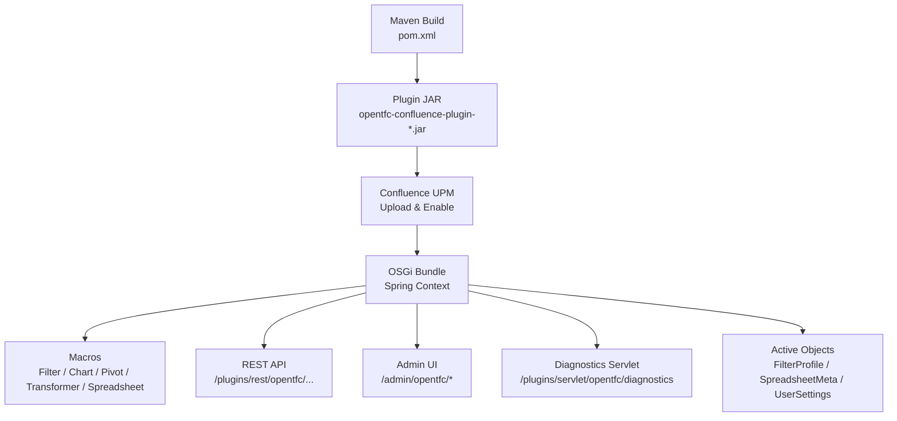
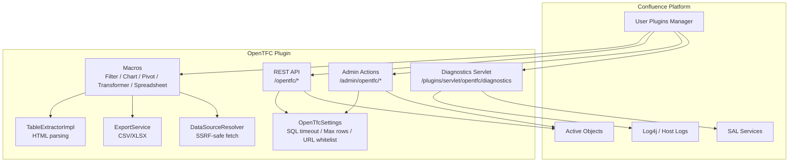
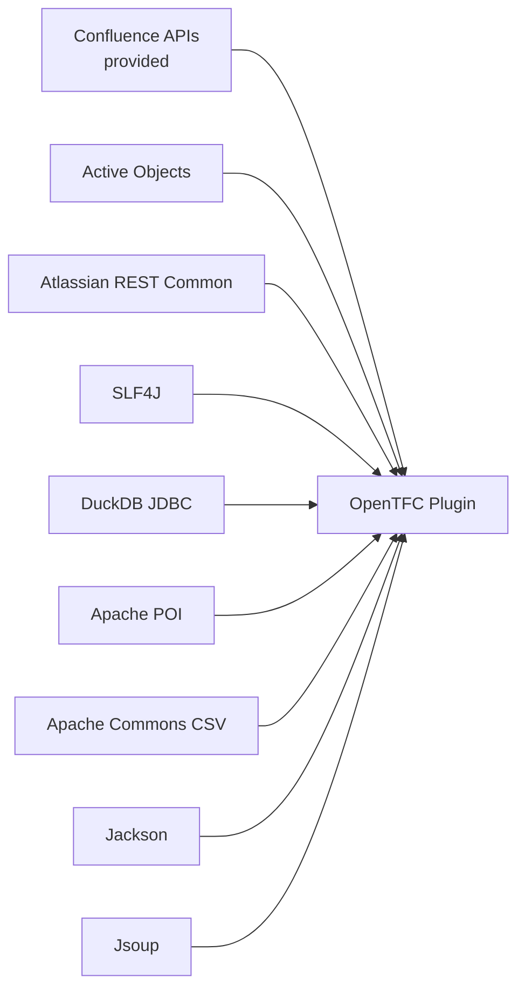
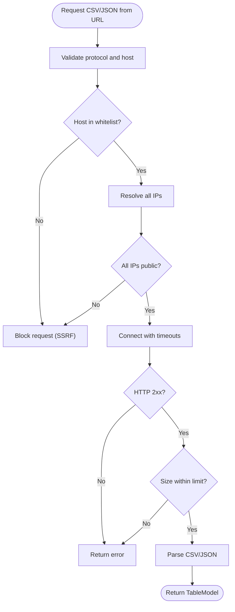
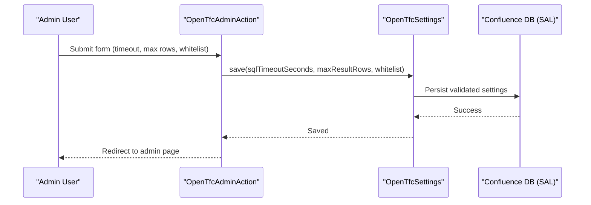

# Deployment and Operations

<cite>
**Referenced Files in This Document**
- [README.md](file://README.md)
- [INSTALL.md](file://INSTALL.md)
- [USER_GUIDE.md](file://USER_GUIDE.md)
- [pom.xml](file://pom.xml)
- [atlassian-plugin.xml](file://src/main/resources/atlassian-plugin.xml)
- [plugin-context.xml](file://src/main/resources/META-INF/spring/plugin-context.xml)
- [OpenTfcAdminAction.java](file://src/main/java/org/opentfc/admin/OpenTfcAdminAction.java)
- [OpenTfcSettings.java](file://src/main/java/org/opentfc/service/OpenTfcSettings.java)
- [OpenTfcDiagnosticsServlet.java](file://src/main/java/org/opentfc/diag/OpenTfcDiagnosticsServlet.java)
- [HostCapture.java](file://src/main/java/org/opentfc/diag/HostCapture.java)
- [ConfigRestResource.java](file://src/main/java/org/opentfc/rest/ConfigRestResource.java)
- [DataSourceResolver.java](file://src/main/java/org/opentfc/service/DataSourceResolver.java)
- [TableExtractorImpl.java](file://src/main/java/org/opentfc/service/TableExtractorImpl.java)
- [ExportService.java](file://src/main/java/org/opentfc/service/ExportService.java)
- [SpreadsheetMeta.java](file://src/main/java/org/opentfc/ao/SpreadsheetMeta.java)
</cite>

## Table of Contents
1. [Introduction](#introduction)
2. [Project Structure](#project-structure)
3. [Core Components](#core-components)
4. [Architecture Overview](#architecture-overview)
5. [Detailed Component Analysis](#detailed-component-analysis)
6. [Dependency Analysis](#dependency-analysis)
7. [Performance Considerations](#performance-considerations)
8. [Troubleshooting Guide](#troubleshooting-guide)
9. [Conclusion](#conclusion)
10. [Appendices](#appendices)

## Introduction
This document provides production deployment and operations guidance for OpenTFC, an Atlassian Confluence Data Center plugin that adds table filtering, charts, pivot tables, SQL transformation via DuckDB, spreadsheets, CSV/JSON import, and attachment listing. It focuses on:

- Confluence Data Center deployment considerations and high availability
- Scaling strategies and resource planning
- Plugin lifecycle management, version upgrades, and dependency management
- Monitoring, alerting, log collection, and diagnostics
- Security configuration, firewall requirements, and external data source access
- Backup and disaster recovery for plugin data and spreadsheet files
- Maintenance schedules and operational procedures

The content is grounded in the repository’s build, plugin descriptor, admin settings, diagnostics, and service implementations.

## Project Structure
OpenTFC is a Confluence plugin packaged as an Atlassian plugin JAR. The Maven project defines Java 17 compilation, bundled dependencies (DuckDB, Apache POI, Jackson, Jsoup), and provided dependencies from Confluence. The plugin descriptor registers macros, REST endpoints, web resources, Active Objects entities, and a diagnostics servlet.

**Diagram sources**
- [pom.xml:1-309](file://pom.xml#L1-L309)
- [atlassian-plugin.xml:1-289](file://src/main/resources/atlassian-plugin.xml#L1-L289)
- [plugin-context.xml:1-7](file://src/main/resources/META-INF/spring/plugin-context.xml#L1-L7)

**Section sources**
- [pom.xml:1-309](file://pom.xml#L1-L309)
- [atlassian-plugin.xml:1-289](file://src/main/resources/atlassian-plugin.xml#L1-L289)
- [plugin-context.xml:1-7](file://src/main/resources/META-INF/spring/plugin-context.xml#L1-L7)

## Core Components
- Admin configuration: SQL timeout, max result rows, URL whitelist for external CSV/JSON sources.
- Diagnostics: Browser-based logs, host log capture, server log tailing, health indicators.
- External data fetching: SSRF-safe HTTP fetch with whitelist enforcement and size/time limits.
- Table extraction: HTML table parsing and type inference.
- Export: CSV and XLSX generation.
- Spreadsheets: In-page spreadsheets persisted as XLSX attachments with locking metadata.

Operational implications:
- Use admin settings to constrain SQL execution and restrict external URLs.
- Monitor diagnostics page for activation issues and runtime errors.
- Ensure outbound network rules allow only approved domains for CSV/JSON sources.
- Back up Confluence home directory to preserve Active Objects and spreadsheet attachments.

**Section sources**
- [OpenTfcAdminAction.java:1-92](file://src/main/java/org/opentfc/admin/OpenTfcAdminAction.java#L1-L92)
- [OpenTfcSettings.java:1-67](file://src/main/java/org/opentfc/service/OpenTfcSettings.java#L1-L67)
- [OpenTfcDiagnosticsServlet.java:1-387](file://src/main/java/org/opentfc/diag/OpenTfcDiagnosticsServlet.java#L1-L387)
- [HostCapture.java:1-35](file://src/main/java/org/opentfc/diag/HostCapture.java#L1-L35)
- [DataSourceResolver.java:1-290](file://src/main/java/org/opentfc/service/DataSourceResolver.java#L1-L290)
- [TableExtractorImpl.java:1-166](file://src/main/java/org/opentfc/service/TableExtractorImpl.java#L1-L166)
- [ExportService.java:1-108](file://src/main/java/org/opentfc/service/ExportService.java#L1-L108)
- [SpreadsheetMeta.java:1-39](file://src/main/java/org/opentfc/ao/SpreadsheetMeta.java#L1-L39)

## Architecture Overview
OpenTFC integrates into Confluence through OSGi/Spring, exposing macros, REST endpoints, admin actions, and a diagnostics servlet. It uses Confluence-provided services (SAL, Active Objects, REST framework) and bundles DuckDB for in-memory SQL transformations.

**Diagram sources**
- [atlassian-plugin.xml:1-289](file://src/main/resources/atlassian-plugin.xml#L1-L289)
- [OpenTfcSettings.java:1-67](file://src/main/java/org/opentfc/service/OpenTfcSettings.java#L1-L67)
- [OpenTfcDiagnosticsServlet.java:1-387](file://src/main/java/org/opentfc/diag/OpenTfcDiagnosticsServlet.java#L1-L387)
- [DataSourceResolver.java:1-290](file://src/main/java/org/opentfc/service/DataSourceResolver.java#L1-L290)
- [TableExtractorImpl.java:1-166](file://src/main/java/org/opentfc/service/TableExtractorImpl.java#L1-L166)
- [ExportService.java:1-108](file://src/main/java/org/opentfc/service/ExportService.java#L1-L108)

## Detailed Component Analysis

### Confluence Data Center Deployment and High Availability
- Supported versions: Confluence Data Center 8.5 LTS – 9.x; run across multiple nodes.
- Installation steps: Upload the built JAR via UPM and ensure it is enabled.
- Health check: Open the diagnostics page to verify Spring context and log capture status.
- Cluster behavior: Settings are stored in SAL PluginSettings (shared DB), ensuring cluster-wide consistency.

Operational checklist:
- Verify all nodes report diagnostics page accessible.
- Confirm Active Objects tables exist and are synchronized.
- Validate that each node can reach external data sources per whitelist.

**Section sources**
- [INSTALL.md:1-124](file://INSTALL.md#L1-L124)
- [README.md:1-104](file://README.md#L1-L104)
- [OpenTfcSettings.java:1-67](file://src/main/java/org/opentfc/service/OpenTfcSettings.java#L1-L67)
- [OpenTfcDiagnosticsServlet.java:1-387](file://src/main/java/org/opentfc/diag/OpenTfcDiagnosticsServlet.java#L1-L387)

### Scaling Strategies
- SQL execution limits: Configure SQL timeout and maximum result rows to prevent long-running queries and large result sets.
- Data source limits: Enforce URL whitelist and size/time limits for external CSV/JSON fetches.
- Frontend assets: Prebuilt JS/CSS bundles reduce frontend build overhead at runtime.
- Resource sizing: Allocate sufficient JVM heap for Confluence; plugin uses platform-managed memory.

Recommendations:
- Start with default SQL timeout and max rows; tune based on workload.
- Restrict external sources to internal trusted domains to minimize latency and risk.
- Monitor CPU/memory during heavy chart/pivot rendering and adjust Confluence JVM accordingly.

**Section sources**
- [OpenTfcSettings.java:1-67](file://src/main/java/org/opentfc/service/OpenTfcSettings.java#L1-L67)
- [DataSourceResolver.java:1-290](file://src/main/java/org/opentfc/service/DataSourceResolver.java#L1-L290)
- [pom.xml:1-309](file://pom.xml#L1-L309)

### Plugin Lifecycle Management
- Activation: Managed by Confluence UPM; diagnostics page shows ENABLED/DISABLED events.
- Diagnostics: If main plugin fails to activate, use the companion diag-lite plugin to inspect activation failures.
- Spring wiring: Optional imports degrade gracefully; missing log4j-core degrades to “capture unavailable”.

Best practices:
- Always open diagnostics after installation or upgrade.
- Keep diag-lite available for emergency troubleshooting when main plugin is down.

**Section sources**
- [INSTALL.md:61-96](file://INSTALL.md#L61-L96)
- [OpenTfcDiagnosticsServlet.java:1-387](file://src/main/java/org/opentfc/diag/OpenTfcDiagnosticsServlet.java#L1-L387)
- [HostCapture.java:1-35](file://src/main/java/org/opentfc/diag/HostCapture.java#L1-L35)

### Version Upgrades and Dependency Management
- Build toolchain: JDK 17, Node.js 18+, Atlassian Plugin SDK or Maven 3.8+.
- Dependencies: Bundled DuckDB, Apache POI, Jackson, Jsoup; provided Confluence APIs.
- Upgrade procedure: Rebuild JAR, upload via UPM, verify diagnostics and smoke tests.

Notes:
- Confluence platform BOM pins some transitive dependencies; plugin explicitly pins critical ones to avoid downgrade.
- CI validates TypeScript checks, frontend build, and Maven verify.

**Section sources**
- [README.md:61-104](file://README.md#L61-L104)
- [pom.xml:1-309](file://pom.xml#L1-L309)

### Security Configuration and Network Requirements
- Admin settings:
  - SQL timeout seconds
  - Maximum result rows
  - Allowed URL whitelist (domains for external CSV/JSON)
- SSRF protection:
  - Only http/https allowed
  - Host must be whitelisted
  - Resolved IPs must be public (loopback/site-local/link-local/multicast blocked)
  - No redirects, connect/read timeouts enforced, max payload size enforced

Firewall requirements:
- Outbound HTTPS to whitelisted domains only
- Block private/reserved IP ranges from resolving to external hosts
- Ensure DNS resolution returns public addresses for allowed domains

**Section sources**
- [OpenTfcAdminAction.java:1-92](file://src/main/java/org/opentfc/admin/OpenTfcAdminAction.java#L1-L92)
- [OpenTfcSettings.java:1-67](file://src/main/java/org/opentfc/service/OpenTfcSettings.java#L1-L67)
- [DataSourceResolver.java:212-272](file://src/main/java/org/opentfc/service/DataSourceResolver.java#L212-L272)

### Monitoring and Alerting
- Diagnostics page:
  - Shows Spring/lifecycle bean status
  - Host log capture status
  - Server log tailing from Confluence home/logs
  - Filtered log entries (ALL/INFO+/WARN+/ERROR)
  - Auto-refresh and text download
- Log capture:
  - Attempts to install host log capture; degrades gracefully if unavailable
- Alerts:
  - Integrate Confluence system metrics and JVM monitoring
  - Alert on repeated DISABLED plugin events and diagnostic errors

**Section sources**
- [OpenTfcDiagnosticsServlet.java:1-387](file://src/main/java/org/opentfc/diag/OpenTfcDiagnosticsServlet.java#L1-L387)
- [HostCapture.java:1-35](file://src/main/java/org/opentfc/diag/HostCapture.java#L1-L35)

### Log Collection
- In-memory buffer: Captures OpenTFC events and WARN/ERROR entries from host logging.
- Server logs: Reads recent .log files from Confluence home/logs; supports downloading tail.
- Download options:
  - Text export of diagnostics buffer
  - Tail of most recent server log file

Operational tips:
- Periodically download diagnostics logs for audit and support cases.
- Correlate plugin events with Confluence startup and plugin activation logs.

**Section sources**
- [OpenTfcDiagnosticsServlet.java:106-135](file://src/main/java/org/opentfc/diag/OpenTfcDiagnosticsServlet.java#L106-L135)
- [OpenTfcDiagnosticsServlet.java:229-237](file://src/main/java/org/opentfc/diag/OpenTfcDiagnosticsServlet.java#L229-L237)

### Performance Optimization Techniques
- SQL execution:
  - Tune SQL timeout and max result rows via admin settings
  - Avoid overly complex queries in transformer macro
- Data sources:
  - Limit external file sizes and enforce timeouts
  - Cache frequently used CSV/JSON where possible
- Rendering:
  - Prefer pagination and smaller datasets for filter/chart/pivot
  - Use export features for offline analysis instead of heavy in-browser processing

**Section sources**
- [OpenTfcSettings.java:1-67](file://src/main/java/org/opentfc/service/OpenTfcSettings.java#L1-L67)
- [DataSourceResolver.java:41-43](file://src/main/java/org/opentfc/service/DataSourceResolver.java#L41-L43)
- [ExportService.java:1-108](file://src/main/java/org/opentfc/service/ExportService.java#L1-L108)

### Backup Strategies
- Active Objects data:
  - Stored in Confluence database; back up the database regularly
- Spreadsheet files:
  - Persisted as XLSX attachments in Confluence page attachments
  - Back up Confluence home directory to include attachments and AO metadata
- Settings:
  - Global settings stored in SAL PluginSettings (shared DB); covered by DB backup

Recommended schedule:
- Daily incremental backups of Confluence DB and home directory
- Weekly full backups and restore drills

**Section sources**
- [SpreadsheetMeta.java:1-39](file://src/main/java/org/opentfc/ao/SpreadsheetMeta.java#L1-L39)
- [INSTALL.md:98-105](file://INSTALL.md#L98-L105)

### Disaster Recovery Procedures
- Restore Confluence DB and home directory from latest known-good backup
- Verify plugin activation via diagnostics page
- Validate external data source connectivity against configured whitelist
- Run smoke tests to confirm core functionality (filter, chart, pivot, transformer, spreadsheet)

**Section sources**
- [INSTALL.md:109-124](file://INSTALL.md#L109-L124)
- [OpenTfcDiagnosticsServlet.java:1-387](file://src/main/java/org/opentfc/diag/OpenTfcDiagnosticsServlet.java#L1-L387)

### Maintenance Schedules
- Weekly:
  - Review diagnostics logs for errors and disabled plugins
  - Validate URL whitelist and external source availability
- Monthly:
  - Test restore procedures using backups
  - Evaluate dependency updates and security advisories
- Quarterly:
  - Perform capacity review and tune SQL/export limits
  - Conduct user training refreshers for advanced features

[No sources needed since this section provides general guidance]

## Dependency Analysis
OpenTFC depends on Confluence-provided APIs and bundles several libraries for data processing and visualization.

**Diagram sources**
- [pom.xml:106-234](file://pom.xml#L106-L234)

**Section sources**
- [pom.xml:106-234](file://pom.xml#L106-L234)

## Performance Considerations
- JVM tuning: Ensure adequate heap for Confluence; plugin relies on platform memory management.
- Query limits: Set conservative SQL timeouts and max rows to protect performance.
- External fetch limits: Enforce size and timeout constraints to avoid slow or oversized responses.
- Export operations: Use CSV/XLSX exports for large datasets rather than in-browser rendering.

[No sources needed since this section provides general guidance]

## Troubleshooting Guide
Common issues and resolutions:
- Plugin not activated:
  - Check UPM and diagnostics page for Spring context status
  - Use diag-lite to inspect activation errors
- Host log capture unavailable:
  - Indicates log4j-core not exposed; diagnostics still works but host log capture will be unavailable
- External data source blocked:
  - Verify URL whitelist includes target domain
  - Ensure DNS resolves to public IPs and firewall allows outbound HTTPS
- Slow or failing SQL transforms:
  - Increase SQL timeout cautiously; reduce dataset size or simplify queries

Diagnostic tools:
- Diagnostics page: View events, host log capture status, server log tails
- Text export: Download diagnostics buffer for support cases

**Section sources**
- [INSTALL.md:61-96](file://INSTALL.md#L61-L96)
- [OpenTfcDiagnosticsServlet.java:1-387](file://src/main/java/org/opentfc/diag/OpenTfcDiagnosticsServlet.java#L1-L387)
- [HostCapture.java:1-35](file://src/main/java/org/opentfc/diag/HostCapture.java#L1-L35)
- [DataSourceResolver.java:212-272](file://src/main/java/org/opentfc/service/DataSourceResolver.java#L212-L272)

## Conclusion
OpenTFC provides robust analytics capabilities within Confluence Data Center. Production deployments should focus on secure external data access, controlled SQL execution, comprehensive diagnostics, and reliable backups. Regular maintenance, monitoring, and testing ensure stable operation and quick recovery in case of incidents.

[No sources needed since this section summarizes without analyzing specific files]

## Appendices

### Operational Workflows

#### External Data Source Fetch Flow

**Diagram sources**
- [DataSourceResolver.java:212-272](file://src/main/java/org/opentfc/service/DataSourceResolver.java#L212-L272)

#### Admin Settings Save Flow

**Diagram sources**
- [OpenTfcAdminAction.java:54-62](file://src/main/java/org/opentfc/admin/OpenTfcAdminAction.java#L54-L62)
- [OpenTfcSettings.java:59-65](file://src/main/java/org/opentfc/service/OpenTfcSettings.java#L59-L65)