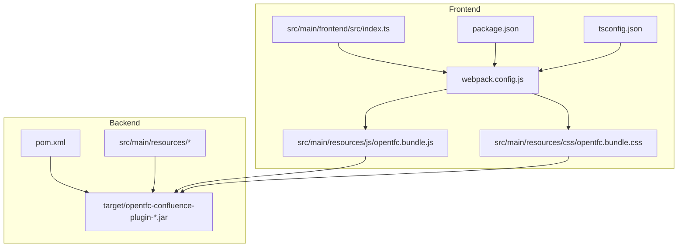
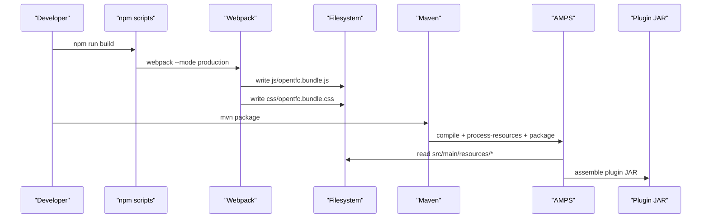
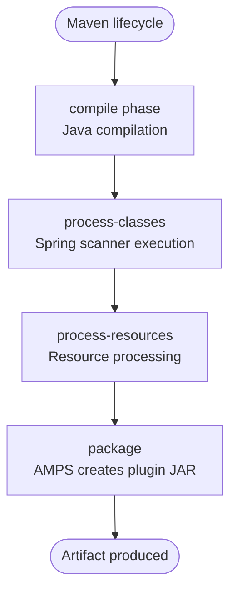
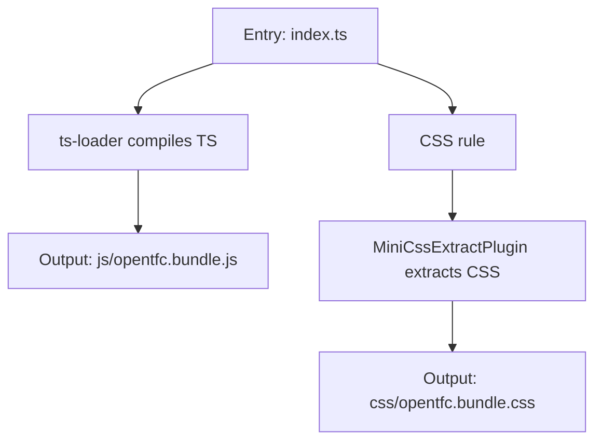
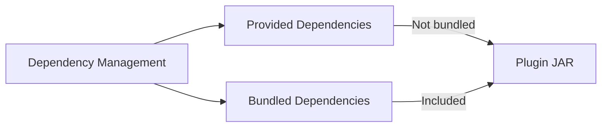
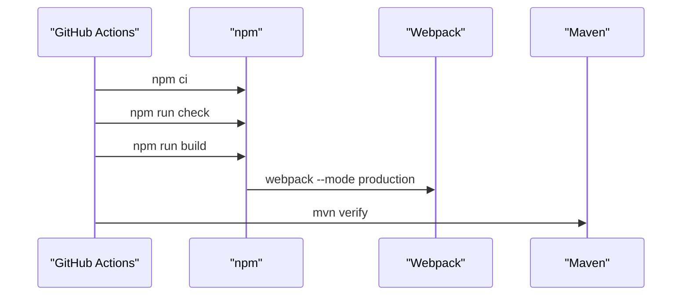
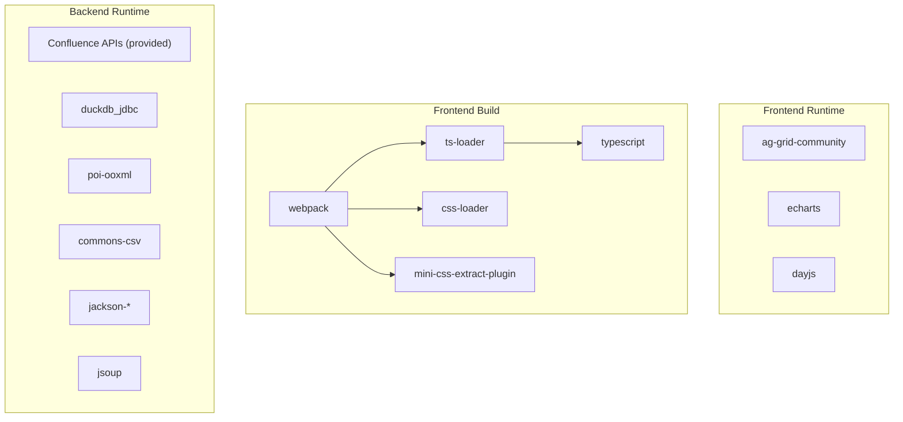

# Build Process

<cite>
**Referenced Files in This Document**
- [pom.xml](file://pom.xml)
- [webpack.config.js](file://webpack.config.js)
- [package.json](file://package.json)
- [tsconfig.json](file://tsconfig.json)
- [.github/workflows/ci.yml](file://.github/workflows/ci.yml)
- [.mvn/settings-direct.xml](file://.mvn/settings-direct.xml)
- [README.md](file://README.md)
- [INSTALL.md](file://INSTALL.md)
</cite>

## Table of Contents
1. [Introduction](#introduction)
2. [Project Structure](#project-structure)
3. [Core Components](#core-components)
4. [Architecture Overview](#architecture-overview)
5. [Detailed Component Analysis](#detailed-component-analysis)
6. [Dependency Analysis](#dependency-analysis)
7. [Performance Considerations](#performance-considerations)
8. [Troubleshooting Guide](#troubleshooting-guide)
9. [Conclusion](#conclusion)

## Introduction
This document explains the OpenTFC build system for the Confluence Data Center plugin, covering both Maven and Webpack processes. It details how Java code is compiled and packaged into an Atlassian plugin JAR, how TypeScript and CSS are bundled by Webpack, and how frontend assets are included in the final artifact. It also provides commands for development, production, and incremental builds, and documents the integration between Maven and Webpack as orchestrated by CI and documentation.

## Project Structure
The project uses a dual-build approach:
- Frontend assets (TypeScript and CSS) are built with Webpack and TypeScript.
- Backend Java code and resources are built with Maven using the Atlassian Plugin SDK (AMPS).

**Diagram sources**
- [webpack.config.js:1-43](file://webpack.config.js#L1-L43)
- [package.json:1-26](file://package.json#L1-L26)
- [tsconfig.json:1-16](file://tsconfig.json#L1-L16)
- [pom.xml:1-309](file://pom.xml#L1-L309)

**Section sources**
- [webpack.config.js:1-43](file://webpack.config.js#L1-L43)
- [package.json:1-26](file://package.json#L1-L26)
- [tsconfig.json:1-16](file://tsconfig.json#L1-L16)
- [pom.xml:1-309](file://pom.xml#L1-L309)

## Core Components
- Maven build:
  - Uses AMPS to produce an Atlassian plugin JAR.
  - Compiles Java with JDK 17.
  - Runs Spring scanner during `process-classes`.
  - Configures OSGi imports/exports and plugin metadata.
- Webpack build:
  - Entry point is TypeScript under `src/main/frontend/src`.
  - Outputs UMD bundle to `src/main/resources/js` and CSS to `src/main/resources/css`.
  - Uses ts-loader for TypeScript and MiniCssExtractPlugin for CSS bundling.
- Integration:
  - CI runs npm scripts before Maven verify.
  - Documentation instructs building frontend first, then packaging with Maven.

**Section sources**
- [pom.xml:236-306](file://pom.xml#L236-L306)
- [webpack.config.js:1-43](file://webpack.config.js#L1-L43)
- [package.json:6-10](file://package.json#L6-L10)
- [.github/workflows/ci.yml:28-38](file://.github/workflows/ci.yml#L28-L38)
- [INSTALL.md:19-35](file://INSTALL.md#L19-L35)

## Architecture Overview
The build pipeline consists of two stages:
1. Frontend stage: TypeScript compilation and CSS extraction via Webpack.
2. Backend stage: Java compilation, resource processing, and plugin packaging via Maven.

**Diagram sources**
- [package.json:6-10](file://package.json#L6-L10)
- [webpack.config.js:1-43](file://webpack.config.js#L1-L43)
- [pom.xml:236-306](file://pom.xml#L236-L306)

## Detailed Component Analysis

### Maven Build Lifecycle and Plugins
- Packaging type: `atlassian-plugin`, producing a plugin JAR consumed by Confluence.
- AMPS configuration:
  - Targets Confluence versions and disables quick reload for standard builds.
  - Disables resource compression and banned dependency checks where configured.
  - Declares OSGi Import-Package directives with optional resolution for non-critical packages.
- Spring scanner:
  - Executes during `process-classes` to generate scanner index for component discovery.
- Compiler:
  - Java 17 release target with UTF-8 encoding.

**Diagram sources**
- [pom.xml:236-306](file://pom.xml#L236-L306)

**Section sources**
- [pom.xml:10-10](file://pom.xml#L10-L10)
- [pom.xml:236-306](file://pom.xml#L236-L306)

### Webpack Configuration for TypeScript and CSS
- Entry: `src/main/frontend/src/index.ts`.
- Output:
  - JavaScript bundle: `src/main/resources/js/[name].bundle.js`.
  - Library name: `OpenTFC`, UMD format.
- Loaders:
  - TypeScript via ts-loader.
  - CSS via MiniCssExtractPlugin.loader and css-loader.
- CSS output: `src/main/resources/css/[name].bundle.css`.
- Performance hints disabled to avoid warnings during builds.

**Diagram sources**
- [webpack.config.js:1-43](file://webpack.config.js#L1-L43)

**Section sources**
- [webpack.config.js:1-43](file://webpack.config.js#L1-L43)
- [tsconfig.json:1-16](file://tsconfig.json#L1-L16)

### Dependency Management in Maven
- Provided dependencies:
  - Confluence platform APIs, Active Objects, SAL, REST, Servlet API, logging, etc., marked as provided so they are not bundled.
- Bundled dependencies:
  - DuckDB JDBC, Apache POI, Commons CSV, Jackson, Jsoup are included in the plugin JAR.
- Dependency management:
  - Centralizes versions for transitive dependencies and Jackson modules.
  - Pins critical libraries to avoid platform downgrades.

**Diagram sources**
- [pom.xml:47-104](file://pom.xml#L47-L104)
- [pom.xml:106-234](file://pom.xml#L106-L234)

**Section sources**
- [pom.xml:47-104](file://pom.xml#L47-L104)
- [pom.xml:106-234](file://pom.xml#L106-L234)

### Integration Between Maven and Webpack
- CI workflow:
  - Installs Node dependencies.
  - Runs TypeScript type check.
  - Builds frontend bundles with Webpack.
  - Runs Maven verify to compile backend and package the plugin.
- Local workflow per documentation:
  - Build frontend assets first.
  - Then run Maven package or verify to include generated assets in the plugin JAR.

**Diagram sources**
- [.github/workflows/ci.yml:28-38](file://.github/workflows/ci.yml#L28-L38)
- [package.json:6-10](file://package.json#L6-L10)
- [webpack.config.js:1-43](file://webpack.config.js#L1-L43)

**Section sources**
- [.github/workflows/ci.yml:28-38](file://.github/workflows/ci.yml#L28-L38)
- [INSTALL.md:19-35](file://INSTALL.md#L19-L35)
- [README.md:68-84](file://README.md#L68-L84)

### Custom Maven Goals and Webpack Plugins
- Maven goals:
  - Standard AMPS lifecycle goals such as `package` and `verify`.
  - Spring scanner goal `atlassian-spring-scanner` bound to `process-classes`.
- Webpack plugins:
  - `mini-css-extract-plugin` extracts CSS into a separate file.
  - `ts-loader` compiles TypeScript.
  - `css-loader` resolves CSS imports.

**Section sources**
- [pom.xml:281-296](file://pom.xml#L281-L296)
- [webpack.config.js:1-43](file://webpack.config.js#L1-L43)
- [package.json:16-24](file://package.json#L16-L24)

## Dependency Analysis
- Frontend dependencies:
  - Runtime: AG Grid Community, ECharts, Day.js.
  - Build-time: Webpack, ts-loader, css-loader, mini-css-extract-plugin, typescript, webpack-cli.
- Backend dependencies:
  - Provided by Confluence at runtime.
  - Bundled libraries for data processing and parsing.

**Diagram sources**
- [package.json:11-24](file://package.json#L11-L24)
- [pom.xml:106-234](file://pom.xml#L106-L234)

**Section sources**
- [package.json:11-24](file://package.json#L11-L24)
- [pom.xml:106-234](file://pom.xml#L106-L234)

## Performance Considerations
- Frontend:
  - Production mode enables minification and optimization through Webpack defaults.
  - Source maps are enabled in TypeScript compiler options; ensure they are suitable for your environment.
- Backend:
  - AMPS JVM arguments set to increase heap size for builds.
  - Resource compression can be toggled via AMPS configuration.

[No sources needed since this section provides general guidance]

## Troubleshooting Guide
- Missing frontend artifacts:
  - Ensure you ran the frontend build before Maven packaging so that `src/main/resources/js` and `src/main/resources/css` contain the generated bundles.
- Type errors:
  - Run the TypeScript type check script to catch issues early.
- Network/proxy issues with Maven:
  - Use the provided settings to bypass local proxies when accessing Atlassian repositories.
- CI failures:
  - Confirm Node and JDK versions match the CI configuration and that npm cache is restored.

**Section sources**
- [INSTALL.md:19-35](file://INSTALL.md#L19-L35)
- [.mvn/settings-direct.xml:1-8](file://.mvn/settings-direct.xml#L1-L8)
- [.github/workflows/ci.yml:15-26](file://.github/workflows/ci.yml#L15-L26)

## Conclusion
OpenTFC’s build system separates concerns between frontend and backend tooling while ensuring consistent outputs. Webpack produces optimized JavaScript and CSS assets placed under resources, which Maven includes when assembling the plugin JAR. The CI pipeline enforces type checking, frontend builds, and Maven verification, providing a reliable path from source to deployable artifact.

[No sources needed since this section summarizes without analyzing specific files]