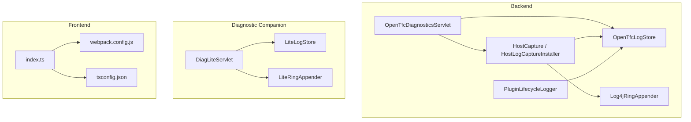
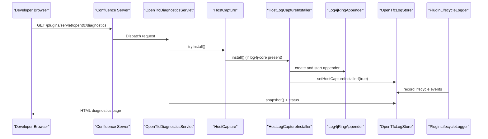
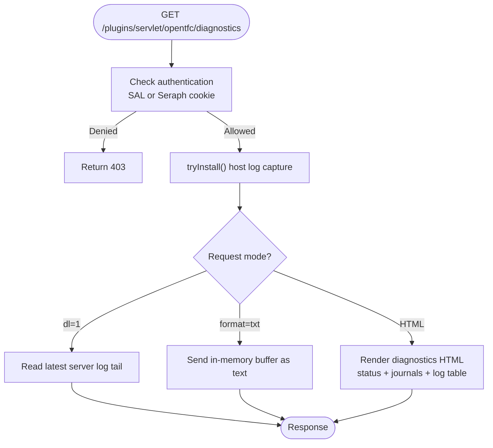
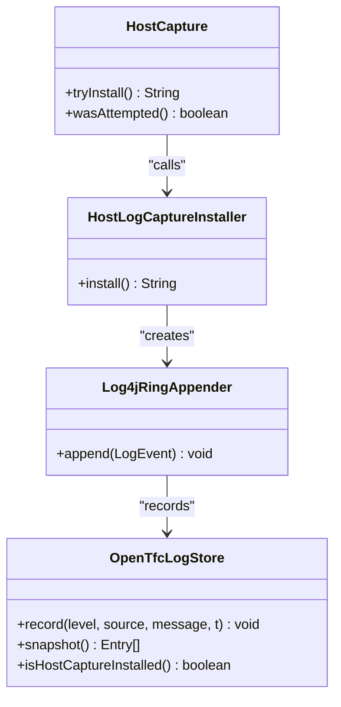
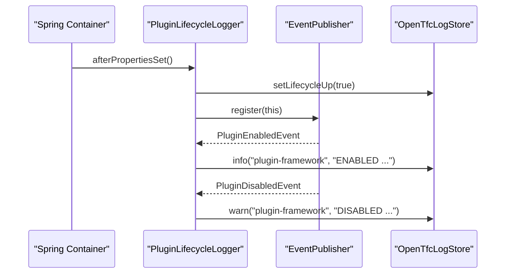
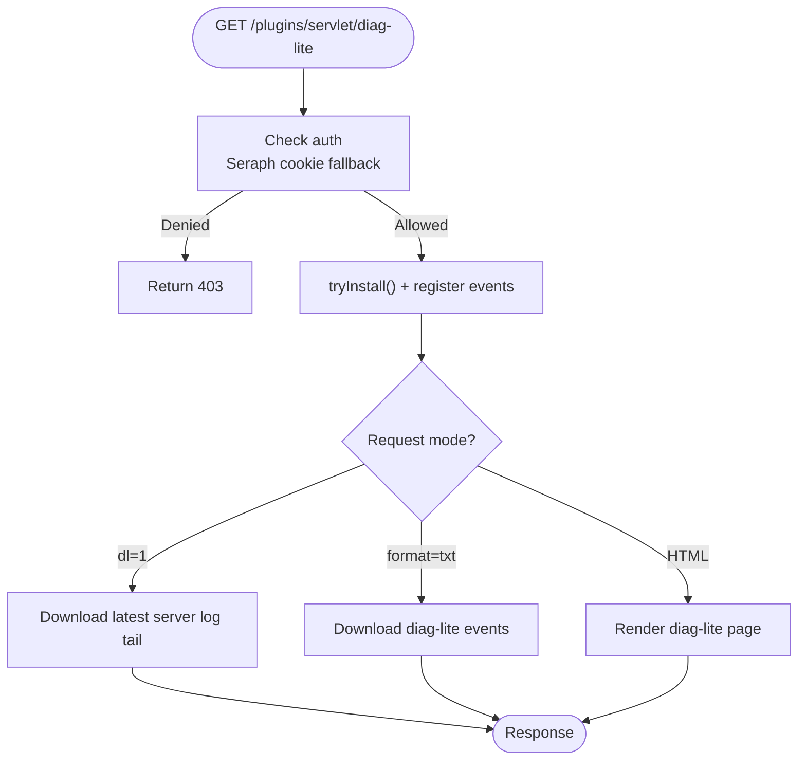
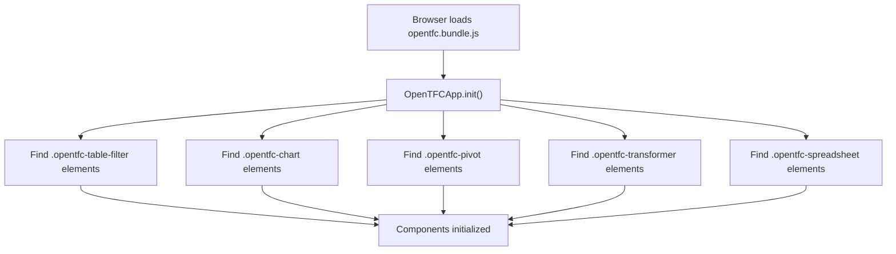
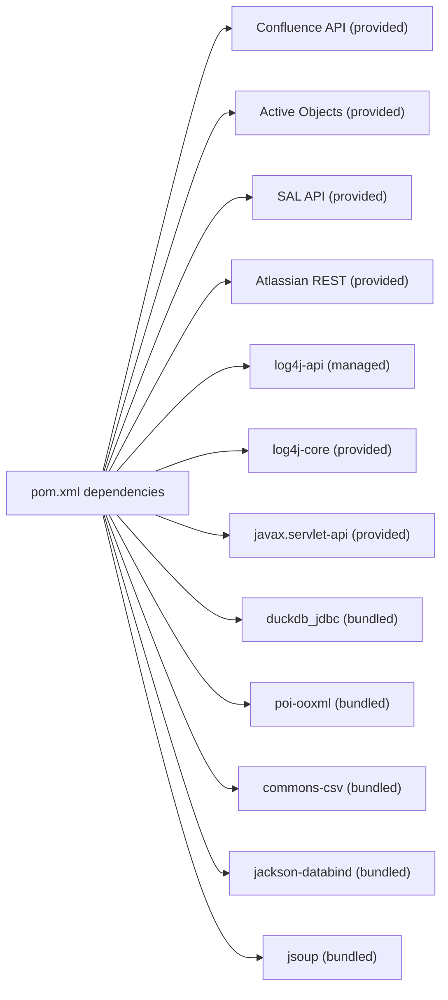

# Debugging Guide

<cite>
**Referenced Files in This Document**
- [README.md](file://README.md)
- [INSTALL.md](file://INSTALL.md)
- [pom.xml](file://pom.xml)
- [package.json](file://package.json)
- [webpack.config.js](file://webpack.config.js)
- [tsconfig.json](file://tsconfig.json)
- [atlassian-plugin.xml](file://src/main/resources/atlassian-plugin.xml)
- [OpenTfcDiagnosticsServlet.java](file://src/main/java/org/opentfc/diag/OpenTfcDiagnosticsServlet.java)
- [Log4jRingAppender.java](file://src/main/java/org/opentfc/diag/Log4jRingAppender.java)
- [HostCapture.java](file://src/main/java/org/opentfc/diag/HostCapture.java)
- [HostLogCaptureInstaller.java](file://src/main/java/org/opentfc/diag/HostLogCaptureInstaller.java)
- [OpenTfcLogStore.java](file://src/main/java/org/opentfc/diag/OpenTfcLogStore.java)
- [PluginLifecycleLogger.java](file://src/main/java/org/opentfc/diag/PluginLifecycleLogger.java)
- [DiagLiteServlet.java](file://diag-lite/src/main/java/org/opentfc/diag/lite/DiagLiteServlet.java)
- [LiteRingAppender.java](file://diag-lite/src/main/java/org/opentfc/diag/lite/LiteRingAppender.java)
- [LiteLogStore.java](file://diag-lite/src/main/java/org/opentfc/diag/lite/LiteLogStore.java)
- [index.ts](file://src/main/frontend/src/index.ts)
</cite>

## Table of Contents
1. [Introduction](#introduction)
2. [Project Structure](#project-structure)
3. [Core Components](#core-components)
4. [Architecture Overview](#architecture-overview)
5. [Detailed Component Analysis](#detailed-component-analysis)
6. [Dependency Analysis](#dependency-analysis)
7. [Performance Considerations](#performance-considerations)
8. [Troubleshooting Guide](#troubleshooting-guide)
9. [Conclusion](#conclusion)
10. [Appendices](#appendices)

## Introduction
This guide explains how to debug OpenTFC for Confluence Data Center, covering backend and frontend techniques:
- Java debugging with IntelliJ IDEA or other IDEs, including remote debugging on Confluence nodes.
- Frontend debugging using browser developer tools, TypeScript source maps, and the webpack build pipeline.
- Built-in diagnostics: the OpenTFC diagnostics servlet, Log4j ring appender, and the lightweight diag-lite companion.
- Performance profiling, memory leak detection, stack trace analysis, plugin lifecycle monitoring, and Confluence diagnostics usage.

The repository provides a production-ready plugin plus a minimal diagnostic companion that can help when the main plugin cannot activate.

**Section sources**
- [README.md:53-57](file://README.md#L53-L57)
- [INSTALL.md:47-94](file://INSTALL.md#L47-L94)

## Project Structure
OpenTFC is a Maven-based Atlassian plugin with a TypeScript frontend bundled by webpack. The key debugging-related areas are:
- Backend diagnostics under `src/main/java/org/opentfc/diag`.
- A small diagnostic companion under `diag-lite`.
- Frontend entry point and webpack configuration under `src/main/frontend` and root-level build files.

**Diagram sources**
- [OpenTfcDiagnosticsServlet.java:1-387](file://src/main/java/org/opentfc/diag/OpenTfcDiagnosticsServlet.java#L1-L387)
- [HostCapture.java:1-35](file://src/main/java/org/opentfc/diag/HostCapture.java#L1-L35)
- [HostLogCaptureInstaller.java:1-35](file://src/main/java/org/opentfc/diag/HostLogCaptureInstaller.java#L1-L35)
- [Log4jRingAppender.java:1-33](file://src/main/java/org/opentfc/diag/Log4jRingAppender.java#L1-L33)
- [OpenTfcLogStore.java:1-134](file://src/main/java/org/opentfc/diag/OpenTfcLogStore.java#L1-L134)
- [PluginLifecycleLogger.java:1-91](file://src/main/java/org/opentfc/diag/PluginLifecycleLogger.java#L1-L91)
- [DiagLiteServlet.java:1-220](file://diag-lite/src/main/java/org/opentfc/diag/lite/DiagLiteServlet.java#L1-L220)
- [LiteLogStore.java:1-119](file://diag-lite/src/main/java/org/opentfc/diag/lite/LiteLogStore.java#L1-L119)
- [LiteRingAppender.java:1-30](file://diag-lite/src/main/java/org/opentfc/diag/lite/LiteRingAppender.java#L1-L30)
- [index.ts:1-81](file://src/main/frontend/src/index.ts#L1-L81)
- [webpack.config.js:1-43](file://webpack.config.js#L1-L43)
- [tsconfig.json:1-16](file://tsconfig.json#L1-L16)

**Section sources**
- [pom.xml:15-28](file://pom.xml#L15-L28)
- [package.json:1-26](file://package.json#L1-L26)
- [webpack.config.js:1-43](file://webpack.config.js#L1-L43)
- [tsconfig.json:1-16](file://tsconfig.json#L1-L16)

## Core Components
This section focuses on the built-in diagnostics and logging mechanisms used during development and troubleshooting.

- OpenTFC Diagnostics Servlet: renders `/plugins/servlet/opentfc/diagnostics`, shows OpenTFC events, plugin framework ENABLED/DISABLED events, and captured WARN/ERROR entries from the host log system. It also reads recent server logs from `<home>/logs` and supports text download and buffer clearing.
- Log4j Ring Appender: captures host WARN/ERROR log entries into an in-memory ring buffer.
- Host Capture Installer: safely wires the ring appender into the host log4j2 context only if log4j-core is available; otherwise degrades gracefully.
- Plugin Lifecycle Logger: listens to plugin framework events and records them into the diagnostics store.
- Diag Lite: a minimal servlet at `/plugins/servlet/diag-lite` that works even when the main plugin fails to activate. It shows OpenTFC state, disabled plugins cascade, and server log tails.

Key behaviors:
- The diagnostics page is rendered as plain HTML without Velocity decorators or AUI, so it remains readable even when rendering pipelines are broken.
- Access control uses SAL when available; otherwise it falls back to checking the Seraph session cookie.
- Server log tails are read from the actual `<home>/logs` directory via SAL or system property probing.

**Section sources**
- [OpenTfcDiagnosticsServlet.java:23-30](file://src/main/java/org/opentfc/diag/OpenTfcDiagnosticsServlet.java#L23-L30)
- [OpenTfcDiagnosticsServlet.java:147-190](file://src/main/java/org/opentfc/diag/OpenTfcDiagnosticsServlet.java#L147-L190)
- [OpenTfcDiagnosticsServlet.java:192-227](file://src/main/java/org/opentfc/diag/OpenTfcDiagnosticsServlet.java#L192-L227)
- [OpenTfcDiagnosticsServlet.java:239-359](file://src/main/java/org/opentfc/diag/OpenTfcDiagnosticsServlet.java#L239-L359)
- [Log4jRingAppender.java:6-32](file://src/main/java/org/opentfc/diag/Log4jRingAppender.java#L6-L32)
- [HostCapture.java:3-34](file://src/main/java/org/opentfc/diag/HostCapture.java#L3-L34)
- [HostLogCaptureInstaller.java:8-33](file://src/main/java/org/opentfc/diag/HostLogCaptureInstaller.java#L8-L33)
- [PluginLifecycleLogger.java:16-75](file://src/main/java/org/opentfc/diag/PluginLifecycleLogger.java#L16-L75)
- [DiagLiteServlet.java:13-24](file://diag-lite/src/main/java/org/opentfc/diag/lite/DiagLiteServlet.java#L13-L24)
- [DiagLiteServlet.java:39-92](file://diag-lite/src/main/java/org/opentfc/diag/lite/DiagLiteServlet.java#L39-L92)

## Architecture Overview
The diagnostics architecture connects servlets, log capture, and in-memory stores to provide immediate visibility into plugin activation and runtime issues.

**Diagram sources**
- [OpenTfcDiagnosticsServlet.java:147-190](file://src/main/java/org/opentfc/diag/OpenTfcDiagnosticsServlet.java#L147-L190)
- [HostCapture.java:15-29](file://src/main/java/org/opentfc/diag/HostCapture.java#L15-L29)
- [HostLogCaptureInstaller.java:17-33](file://src/main/java/org/opentfc/diag/HostLogCaptureInstaller.java#L17-L33)
- [Log4jRingAppender.java:17-31](file://src/main/java/org/opentfc/diag/Log4jRingAppender.java#L17-L31)
- [OpenTfcLogStore.java:62-76](file://src/main/java/org/opentfc/diag/OpenTfcLogStore.java#L62-L76)
- [PluginLifecycleLogger.java:35-75](file://src/main/java/org/opentfc/diag/PluginLifecycleLogger.java#L35-L75)

## Detailed Component Analysis

### Backend Diagnostics Servlet and Logging
The diagnostics servlet exposes a robust troubleshooting surface:
- Initialization installs host log capture and announces readiness.
- GET supports:
  - Plain HTML diagnostics page with filters and auto-refresh.
  - Text download of the in-memory buffer.
  - Download of the tail of the most recent server log file.
- POST supports clearing the in-memory buffer.
- Access control allows authenticated users; if SAL is unavailable, it falls back to checking the Seraph session cookie.
- Server log tails are read from `<home>/logs` via SAL or system property probing.

**Diagram sources**
- [OpenTfcDiagnosticsServlet.java:154-190](file://src/main/java/org/opentfc/diag/OpenTfcDiagnosticsServlet.java#L154-L190)
- [OpenTfcDiagnosticsServlet.java:192-227](file://src/main/java/org/opentfc/diag/OpenTfcDiagnosticsServlet.java#L192-L227)
- [OpenTfcDiagnosticsServlet.java:239-359](file://src/main/java/org/opentfc/diag/OpenTfcDiagnosticsServlet.java#L239-L359)

**Section sources**
- [OpenTfcDiagnosticsServlet.java:147-190](file://src/main/java/org/opentfc/diag/OpenTfcDiagnosticsServlet.java#L147-L190)
- [OpenTfcDiagnosticsServlet.java:192-227](file://src/main/java/org/opentfc/diag/OpenTfcDiagnosticsServlet.java#L192-L227)
- [OpenTfcDiagnosticsServlet.java:239-359](file://src/main/java/org/opentfc/diag/OpenTfcDiagnosticsServlet.java#L239-L359)

### Log4j Ring Appender and Host Capture
- HostCapture attempts to install the ring appender only if log4j-core is available; otherwise it records a warning and degrades gracefully.
- HostLogCaptureInstaller wires the appender into the root logger at WARN level and marks capture as installed.
- Log4jRingAppender forwards host WARN/ERROR entries into OpenTfcLogStore, truncating long logger names and attaching stack traces.

**Diagram sources**
- [HostCapture.java:15-34](file://src/main/java/org/opentfc/diag/HostCapture.java#L15-L34)
- [HostLogCaptureInstaller.java:17-33](file://src/main/java/org/opentfc/diag/HostLogCaptureInstaller.java#L17-L33)
- [Log4jRingAppender.java:17-31](file://src/main/java/org/opentfc/diag/Log4jRingAppender.java#L17-L31)
- [OpenTfcLogStore.java:62-76](file://src/main/java/org/opentfc/diag/OpenTfcLogStore.java#L62-L76)

**Section sources**
- [HostCapture.java:3-34](file://src/main/java/org/opentfc/diag/HostCapture.java#L3-L34)
- [HostLogCaptureInstaller.java:8-33](file://src/main/java/org/opentfc/diag/HostLogCaptureInstaller.java#L8-L33)
- [Log4jRingAppender.java:6-32](file://src/main/java/org/opentfc/diag/Log4jRingAppender.java#L6-L32)
- [OpenTfcLogStore.java:62-76](file://src/main/java/org/opentfc/diag/OpenTfcLogStore.java#L62-L76)

### Plugin Lifecycle Monitoring
PluginLifecycleLogger integrates with Spring and Confluence’s event system:
- Marks lifecycle up when properties are set.
- Attempts to register itself with EventPublisher.
- Records ENABLED/DISABLED events and framework start events into the diagnostics store.

**Diagram sources**
- [PluginLifecycleLogger.java:35-75](file://src/main/java/org/opentfc/diag/PluginLifecycleLogger.java#L35-L75)
- [OpenTfcLogStore.java:50-60](file://src/main/java/org/opentfc/diag/OpenTfcLogStore.java#L50-L60)

**Section sources**
- [PluginLifecycleLogger.java:16-75](file://src/main/java/org/opentfc/diag/PluginLifecycleLogger.java#L16-L75)

### Diagnostic Companion (Diag Lite)
When the main plugin does not activate, use the companion JAR:
- Exposes `/plugins/servlet/diag-lite`.
- Shows OpenTFC state, disabled plugins cascade, and server log tails.
- Provides its own in-memory ring buffer and optional log4j2 capture where available.

**Diagram sources**
- [DiagLiteServlet.java:39-92](file://diag-lite/src/main/java/org/opentfc/diag/lite/DiagLiteServlet.java#L39-L92)
- [DiagLiteServlet.java:111-210](file://diag-lite/src/main/java/org/opentfc/diag/lite/DiagLiteServlet.java#L111-L210)

**Section sources**
- [DiagLiteServlet.java:13-24](file://diag-lite/src/main/java/org/opentfc/diag/lite/DiagLiteServlet.java#L13-L24)
- [DiagLiteServlet.java:39-92](file://diag-lite/src/main/java/org/opentfc/diag/lite/DiagLiteServlet.java#L39-L92)
- [DiagLiteServlet.java:111-210](file://diag-lite/src/main/java/org/opentfc/diag/lite/DiagLiteServlet.java#L111-L210)

### Frontend Boot and Source Maps
The frontend initializes components based on DOM markers and integrates with Confluence’s AJS lifecycle. TypeScript source maps are enabled, which helps map compiled bundles back to original TS sources in browsers.

**Diagram sources**
- [index.ts:10-51](file://src/main/frontend/src/index.ts#L10-L51)
- [index.ts:58-78](file://src/main/frontend/src/index.ts#L58-L78)

**Section sources**
- [index.ts:1-81](file://src/main/frontend/src/index.ts#L1-L81)
- [webpack.config.js:1-43](file://webpack.config.js#L1-L43)
- [tsconfig.json:1-16](file://tsconfig.json#L1-L16)

## Dependency Analysis
OpenTFC depends on Confluence-provided APIs and bundles internal libraries such as DuckDB, Apache POI, Jackson, and Jsoup. For diagnostics, it optionally uses log4j-core and servlet-api provided by Confluence at runtime.

**Diagram sources**
- [pom.xml:106-234](file://pom.xml#L106-L234)

**Section sources**
- [pom.xml:15-28](file://pom.xml#L15-L28)
- [pom.xml:106-234](file://pom.xml#L106-L234)

## Performance Considerations
- In-memory diagnostics buffers:
  - OpenTfcLogStore and LiteLogStore cap entries to avoid unbounded growth. When capacity is exceeded, oldest entries are dropped and a counter tracks drops.
  - Stack traces are truncated to a fixed number of lines to keep messages compact.
- Server log tailing:
  - Only recent bytes are read from the latest log files to reduce I/O overhead.
- Frontend initialization:
  - Components are attached per element marker; ensure large pages do not trigger excessive re-initialization.
- Build-time performance:
  - Webpack disables performance hints; consider enabling bundle size checks in CI if needed.

Recommendations:
- Use the diagnostics page with auto-refresh sparingly on busy instances.
- Export logs via the text endpoints rather than repeatedly refreshing large HTML responses.
- Monitor dropped counts to determine if the buffer is too small for high-volume environments.

**Section sources**
- [OpenTfcLogStore.java:19-21](file://src/main/java/org/opentfc/diag/OpenTfcLogStore.java#L19-L21)
- [OpenTfcLogStore.java:62-76](file://src/main/java/org/opentfc/diag/OpenTfcLogStore.java#L62-L76)
- [OpenTfcLogStore.java:120-132](file://src/main/java/org/opentfc/diag/OpenTfcLogStore.java#L120-L132)
- [LiteLogStore.java:18-19](file://diag-lite/src/main/java/org/opentfc/diag/lite/LiteLogStore.java#L18-L19)
- [LiteLogStore.java:54-66](file://diag-lite/src/main/java/org/opentfc/diag/lite/LiteLogStore.java#L54-L66)
- [LiteLogStore.java:105-117](file://diag-lite/src/main/java/org/opentfc/diag/lite/LiteLogStore.java#L105-L117)
- [webpack.config.js:39-41](file://webpack.config.js#L39-L41)

## Troubleshooting Guide

### Diagnosing Activation Failures Without Server Logs
- If UPM reports activation failure and you cannot access server logs:
  - Install the companion `opentfc-diag-lite.jar`.
  - Open `/plugins/servlet/diag-lite`.
  - Review OpenTFC state, disabled plugins cascade, and server log tails.
  - Use “Download journal tail” to attach logs when requesting support.

**Section sources**
- [INSTALL.md:86-94](file://INSTALL.md#L86-L94)
- [DiagLiteServlet.java:13-24](file://diag-lite/src/main/java/org/opentfc/diag/lite/DiagLiteServlet.java#L13-L24)
- [DiagLiteServlet.java:111-210](file://diag-lite/src/main/java/org/opentfc/diag/lite/DiagLiteServlet.java#L111-L210)

### Interpreting the Diagnostics Page
- 404 on `/plugins/servlet/opentfc/diagnostics`: main plugin did not activate; check UPM and logs.
- Page opens but Spring/lifecycle bean is not up: bundle resolved, but Spring context failed; inspect captured errors.
- Many DISABLED events for bundled plugins: indicates cascading disablement; remove OpenTFC via UPM and restart if necessary.
- Host log capture not installed: log4j-core not wired into the plugin; server-side errors visible only in file logs.

**Section sources**
- [INSTALL.md:61-83](file://INSTALL.md#L61-L83)
- [OpenTfcDiagnosticsServlet.java:293-307](file://src/main/java/org/opentfc/diag/OpenTfcDiagnosticsServlet.java#L293-L307)

### Analyzing Stack Traces
- Exceptions recorded through the diagnostics store include truncated stack traces.
- Use the text download endpoint to retrieve full buffered logs for offline analysis.

**Section sources**
- [OpenTfcLogStore.java:120-132](file://src/main/java/org/opentfc/diag/OpenTfcLogStore.java#L120-L132)
- [OpenTfcDiagnosticsServlet.java:229-237](file://src/main/java/org/opentfc/diag/OpenTfcDiagnosticsServlet.java#L229-L237)

### Monitoring Plugin Lifecycle Events
- Look for ENABLED/DISABLED events in the diagnostics page to detect plugin framework issues.
- A cascade of DISABLED events after installing an app often signals rendering breakage.

**Section sources**
- [PluginLifecycleLogger.java:62-75](file://src/main/java/org/opentfc/diag/PluginLifecycleLogger.java#L62-L75)
- [INSTALL.md:67-71](file://INSTALL.md#L67-L71)

### Using Confluence Diagnostics Tools
- UPM: `/plugins/servlet/upm` for managing apps even when the UI is damaged.
- Login and status probes: `/login.action`, `/status` links are shown on the diagnostics page.

**Section sources**
- [INSTALL.md:47-58](file://INSTALL.md#L47-L58)
- [OpenTfcDiagnosticsServlet.java:286-291](file://src/main/java/org/opentfc/diag/OpenTfcDiagnosticsServlet.java#L286-L291)

### Frontend Debugging Tips
- Enable browser Developer Tools:
  - Sources panel to step through TypeScript sources if source maps are present.
  - Network panel to inspect XHR calls to OpenTFC REST endpoints.
  - Console for JavaScript errors and warnings.
- Verify source maps:
  - Ensure `sourceMap` is enabled in TypeScript compilation.
  - Confirm webpack outputs bundles to resources included by the plugin.

**Section sources**
- [tsconfig.json:1-16](file://tsconfig.json#L1-L16)
- [webpack.config.js:1-43](file://webpack.config.js#L1-L43)
- [atlassian-plugin.xml:29-43](file://src/main/resources/atlassian-plugin.xml#L29-L43)

### Remote Debugging Setup for Confluence Data Center
- Attach your IDE to each Confluence node process using standard JVM remote debugging options.
- Configure breakpoints in:
  - Diagnostics servlet and log capture classes.
  - Macro renderers and REST resources.
  - Service layer methods invoked by macros or REST endpoints.
- Validate connectivity by triggering a macro render or REST call while stepping through code.

[No sources needed since this section provides general guidance]

### Memory Leak Detection
- Use your IDE’s profiler or external tools (e.g., VisualVM, YourKit) to analyze heap dumps.
- Focus on:
  - Long-lived objects referenced from static fields or caches.
  - Thread pools and executor services not shut down.
  - Large in-memory structures like log buffers or result sets.
- Reduce risk:
  - Avoid retaining request-scoped objects in static fields.
  - Close streams and connections promptly.
  - Limit sizes of in-memory collections and datasets.

[No sources needed since this section provides general guidance]

### Profiling Performance
- Identify slow SQL queries in the transformer and adjust query complexity or limits.
- Profile macro rendering paths for heavy DOM manipulation or chart re-renders.
- Use browser Performance panels to measure chart rendering and data processing.

[No sources needed since this section provides general guidance]

## Conclusion
OpenTFC provides strong built-in diagnostics for both development and production troubleshooting:
- The diagnostics servlet and diag-lite companion expose critical activation and runtime information directly in the browser.
- Log4j ring appenders capture host WARN/ERROR entries into in-memory buffers, with graceful degradation when log4j-core is unavailable.
- Frontend source maps and webpack integration enable effective client-side debugging.
- Combine these tools with standard JVM profiling and browser developer tools to diagnose performance and memory issues efficiently.

[No sources needed since this section summarizes without analyzing specific files]

## Appendices

### Key URLs and Entry Points
- Main diagnostics: `/plugins/servlet/opentfc/diagnostics`
- Companion diagnostics: `/plugins/servlet/diag-lite`
- UPM: `/plugins/servlet/upm`

**Section sources**
- [OpenTfcDiagnosticsServlet.java:23-30](file://src/main/java/org/opentfc/diag/OpenTfcDiagnosticsServlet.java#L23-L30)
- [DiagLiteServlet.java:13-24](file://diag-lite/src/main/java/org/opentfc/diag/lite/DiagLiteServlet.java#L13-L24)
- [INSTALL.md:47-58](file://INSTALL.md#L47-L58)