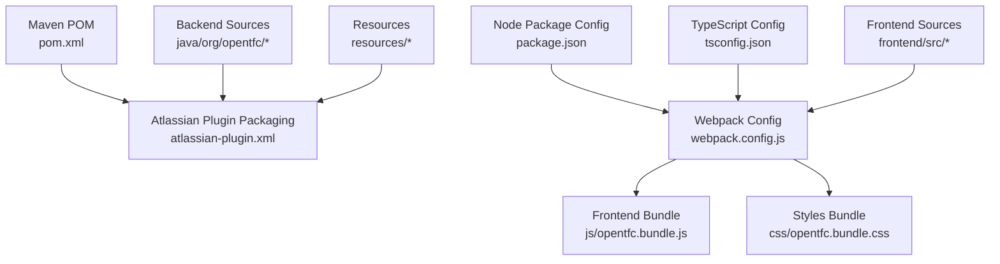
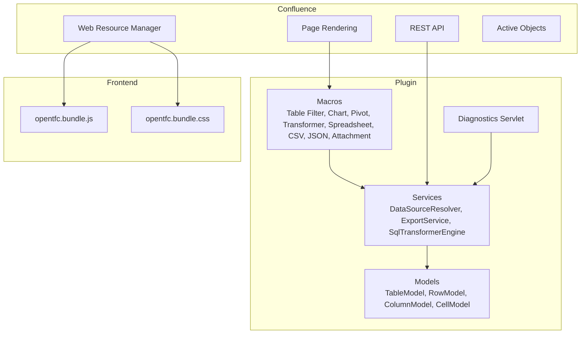
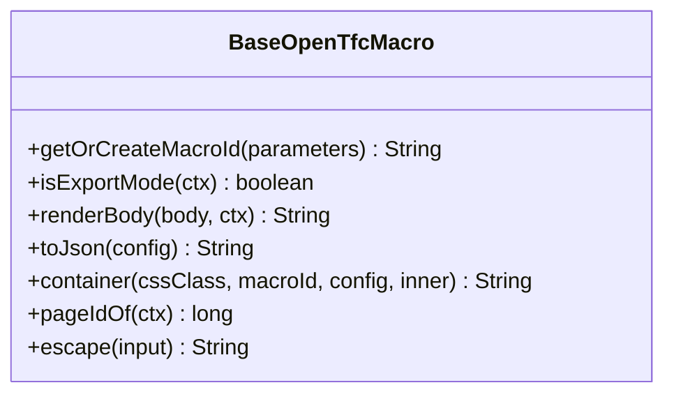
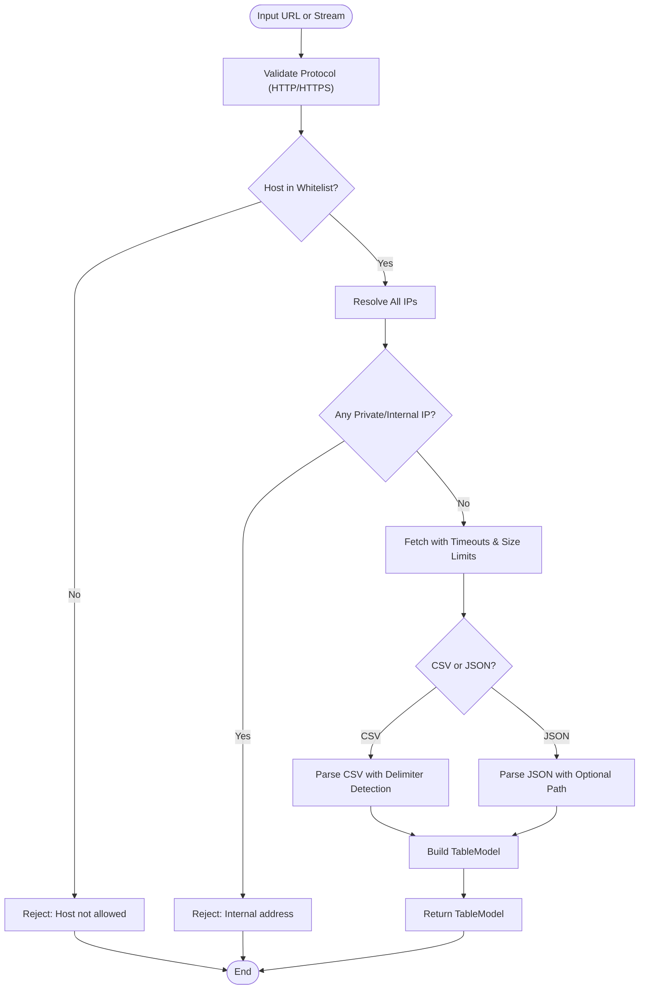
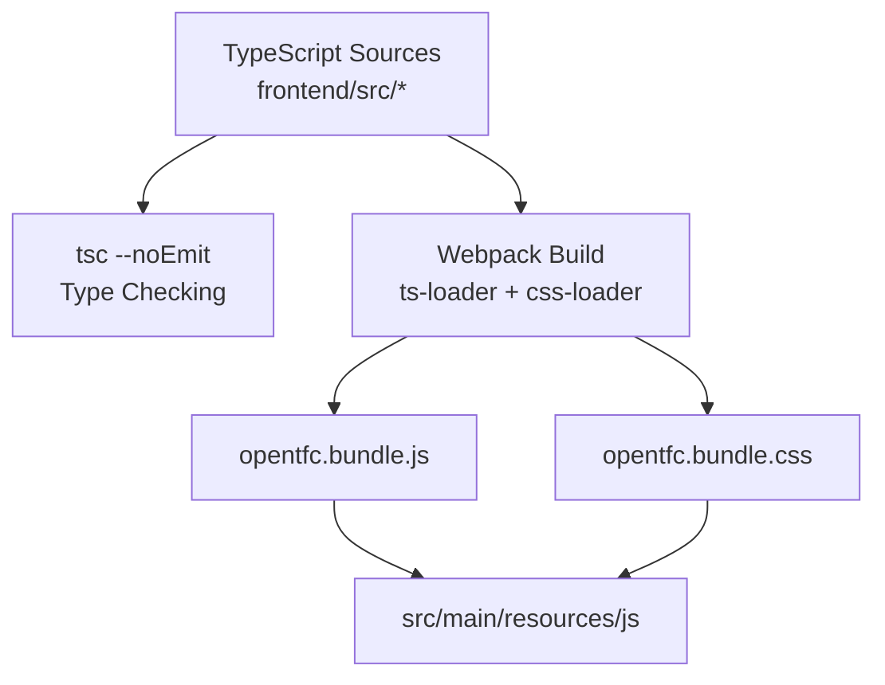

# Development Guide

<cite>
**Referenced Files in This Document**
- [README.md](file://README.md)
- [INSTALL.md](file://INSTALL.md)
- [pom.xml](file://pom.xml)
- [package.json](file://package.json)
- [webpack.config.js](file://webpack.config.js)
- [tsconfig.json](file://tsconfig.json)
- [.github/workflows/ci.yml](file://.github/workflows/ci.yml)
- [atlassian-plugin.xml](file://src/main/resources/atlassian-plugin.xml)
- [BaseOpenTfcMacro.java](file://src/main/java/org/opentfc/macro/BaseOpenTfcMacro.java)
- [DataSourceResolver.java](file://src/main/java/org/opentfc/service/DataSourceResolver.java)
- [ModelTest.java](file://src/test/java/org/opentfc/model/ModelTest.java)
- [DataSourceResolverTest.java](file://src/test/java/org/opentfc/service/DataSourceResolverTest.java)
- [MacroRenderTests.java](file://src/test/java/org/opentfc/macro/MacroRenderTests.java)
- [I18nKeysTest.java](file://src/test/java/org/opentfc/util/I18nKeysTest.java)
</cite>

## Table of Contents
1. [Introduction](#introduction)
2. [Project Structure](#project-structure)
3. [Development Environment Setup](#development-environment-setup)
4. [Build Process](#build-process)
5. [Testing Framework](#testing-framework)
6. [Architecture Overview](#architecture-overview)
7. [Detailed Component Analysis](#detailed-component-analysis)
8. [Extending the Plugin](#extending-the-plugin)
9. [Debugging Guide](#debugging-guide)
10. [CI/CD Pipeline and Contribution Workflow](#cicd-pipeline-and-contribution-workflow)
11. [Performance Considerations](#performance-considerations)
12. [Troubleshooting Guide](#troubleshooting-guide)
13. [Conclusion](#conclusion)

## Introduction
This document is a comprehensive development guide for contributing to OpenTFC, an open-source Confluence Data Center plugin that provides table filtering, charts, pivot tables, spreadsheets, SQL transformation, CSV/JSON import, and attachment listing. It covers environment setup, build and packaging, testing, debugging, extension points, CI/CD, and contribution workflow.

The project uses:
- Backend: Java 17, Atlassian AMPS, Confluence API, Active Objects, DuckDB JDBC, Apache POI, Jackson, Jsoup.
- Frontend: TypeScript, Webpack, AG Grid Community, Apache ECharts.
- Packaging: Maven with `atlassian-plugin` packaging producing a Confluence P2 JAR.

**Section sources**
- [README.md:53-97](file://README.md#L53-L97)
- [INSTALL.md:9-43](file://INSTALL.md#L9-L43)

## Project Structure
OpenTFC is a standard Atlassian Confluence plugin with a mixed backend/frontend layout:
- Backend Java code under `src/main/java`.
- Frontend TypeScript source under `src/main/frontend/src`.
- Web resources (CSS/JS bundles, images, i18n, templates) under `src/main/resources`.
- Tests under `src/test/java`.
- Build configuration via Maven (`pom.xml`) and Webpack (`webpack.config.js`).
- Node tooling via `package.json` and `tsconfig.json`.
- CI pipeline under `.github/workflows/ci.yml`.
- Plugin registration and macro definitions under `src/main/resources/atlassian-plugin.xml`.

**Diagram sources**
- [pom.xml:1-309](file://pom.xml#L1-L309)
- [atlassian-plugin.xml:1-289](file://src/main/resources/atlassian-plugin.xml#L1-L289)
- [package.json:1-26](file://package.json#L1-L26)
- [webpack.config.js:1-43](file://webpack.config.js#L1-L43)
- [tsconfig.json:1-16](file://tsconfig.json#L1-L16)

**Section sources**
- [pom.xml:1-309](file://pom.xml#L1-L309)
- [atlassian-plugin.xml:1-289](file://src/main/resources/atlassian-plugin.xml#L1-L289)
- [package.json:1-26](file://package.json#L1-L26)
- [webpack.config.js:1-43](file://webpack.config.js#L1-L43)
- [tsconfig.json:1-16](file://tsconfig.json#L1-L16)

## Development Environment Setup
Required tools:
- JDK 17
- Node.js 18+ and npm
- Atlassian Plugin SDK (`atlas-mvn`) or Maven 3.8+

Recommended IDE setup:
- Java 17 toolchain configured in your IDE.
- Maven integration enabled; ensure it uses JDK 17.
- Node.js and npm installed; verify versions match requirements.
- TypeScript type checking via `npm run check`.
- Webpack dev server can be used for frontend iteration with `npm run dev`.

Environment validation:
- Run `mvn -v` to confirm Maven and JDK 17.
- Run `node -v` and `npm -v` to confirm Node.js and npm.
- Run `atlas-mvn -v` if using Atlassian Plugin SDK.

**Section sources**
- [README.md:61-67](file://README.md#L61-L67)
- [INSTALL.md:9-13](file://INSTALL.md#L9-L13)
- [pom.xml:15-28](file://pom.xml#L15-L28)
- [package.json:6-10](file://package.json#L6-L10)

## Build Process
Frontend build:
- Install dependencies: `npm install`
- Type-check TypeScript: `npm run check`
- Build production bundles: `npm run build`
- Output files:
  - `src/main/resources/js/opentfc.bundle.js`
  - `src/main/resources/css/opentfc.bundle.css`

Backend build and packaging:
- Use Atlassian Plugin SDK: `atlas-mvn clean package -DskipTests=false`
- Or standard Maven: `mvn clean package`
- Artifact: `target/opentfc-confluence-plugin-1.0.4.jar` (version may vary by POM).

Notes:
- The Maven POM configures Java 17 compilation and Atlassian AMPS plugin for Confluence packaging.
- Webpack compiles TypeScript and CSS into UMD bundles consumed by Confluence web resources.

**Section sources**
- [README.md:68-85](file://README.md#L68-L85)
- [INSTALL.md:17-37](file://INSTALL.md#L17-L37)
- [pom.xml:236-306](file://pom.xml#L236-L306)
- [package.json:6-10](file://package.json#L6-L10)
- [webpack.config.js:1-43](file://webpack.config.js#L1-L43)

## Testing Framework
OpenTFC uses JUnit 4 with Mockito and Hamcrest for unit tests. Test categories include:
- Model contract tests verifying JSON serialization between backend and frontend.
- Macro rendering tests validating HTML output, parameter mapping, XSS escaping, and export fallback behavior.
- Service tests covering CSV/JSON parsing, encoding detection, SSRF protection, and URL fetching limits.
- i18n consistency tests ensuring keys exist across locales and translations differ.

Key test utilities and patterns:
- Mocked `ConversionContext` to simulate export modes (PDF/Word/email).
- Jsoup-based HTML assertions to validate container elements and attributes.
- ObjectMapper-based JSON assertions to verify payload contracts.
- Stream and charset helpers for CSV/JSON parsing tests.

Run tests:
- Unit tests: `mvn test`
- Full verification including packaging and manifest validation: `mvn verify`

Coverage:
- JaCoCo reports are generated at `target/site/jacoco/index.html`.

**Section sources**
- [pom.xml:209-234](file://pom.xml#L209-L234)
- [ModelTest.java:1-155](file://src/test/java/org/opentfc/model/ModelTest.java#L1-L155)
- [MacroRenderTests.java:1-194](file://src/test/java/org/opentfc/macro/MacroRenderTests.java#L1-L194)
- [DataSourceResolverTest.java:1-141](file://src/test/java/org/opentfc/service/DataSourceResolverTest.java#L1-L141)
- [I18nKeysTest.java:1-32](file://src/test/java/org/opentfc/util/I18nKeysTest.java#L1-L32)

## Architecture Overview
OpenTFC follows a layered architecture:
- Macros render HTML containers and serialize configuration into `data-opentfc-config`.
- Services provide data extraction, transformation, and export capabilities.
- REST endpoints expose configuration, profiles, sources, and transformer operations.
- Frontend bundles consume these configurations and interact with AG Grid and ECharts.

**Diagram sources**
- [atlassian-plugin.xml:23-43](file://src/main/resources/atlassian-plugin.xml#L23-L43)
- [atlassian-plugin.xml:64-289](file://src/main/resources/atlassian-plugin.xml#L64-L289)
- [BaseOpenTfcMacro.java:18-115](file://src/main/java/org/opentfc/macro/BaseOpenTfcMacro.java#L18-L115)
- [DataSourceResolver.java:37-46](file://src/main/java/org/opentfc/service/DataSourceResolver.java#L37-L46)

**Section sources**
- [atlassian-plugin.xml:1-289](file://src/main/resources/atlassian-plugin.xml#L1-L289)
- [BaseOpenTfcMacro.java:18-115](file://src/main/java/org/opentfc/macro/BaseOpenTfcMacro.java#L18-L115)
- [DataSourceResolver.java:37-46](file://src/main/java/org/opentfc/service/DataSourceResolver.java#L37-L46)

## Detailed Component Analysis

### Base Macro Infrastructure
The base macro class centralizes common functionality:
- Stable macro ID generation and reuse.
- Export mode detection for PDF/Word/email where JavaScript is unavailable.
- Rich body rendering via Confluence XHTML conversion.
- Configuration serialization to JSON for frontend consumption.
- Container wrapper generation with CSS classes and data attributes.
- First-use logging through diagnostics store.

**Diagram sources**
- [BaseOpenTfcMacro.java:18-115](file://src/main/java/org/opentfc/macro/BaseOpenTfcMacro.java#L18-L115)

**Section sources**
- [BaseOpenTfcMacro.java:18-115](file://src/main/java/org/opentfc/macro/BaseOpenTfcMacro.java#L18-L115)

### Data Source Resolver
The resolver handles safe external data ingestion and parsing:
- Decoding with explicit or auto-detected character sets (UTF-8 BOM, UTF-16 BOM, strict UTF-8, windows-1251 fallback).
- CSV parsing with delimiter detection and quoting support.
- JSON parsing supporting arrays of objects or arrays, with optional path selection.
- SSRF protection enforcing HTTP/HTTPS only, whitelist host matching, private/internal IP blocking, redirect disabling, size/time limits.

**Diagram sources**
- [DataSourceResolver.java:48-79](file://src/main/java/org/opentfc/service/DataSourceResolver.java#L48-L79)
- [DataSourceResolver.java:97-137](file://src/main/java/org/opentfc/service/DataSourceResolver.java#L97-L137)
- [DataSourceResolver.java:139-210](file://src/main/java/org/opentfc/service/DataSourceResolver.java#L139-L210)
- [DataSourceResolver.java:212-288](file://src/main/java/org/opentfc/service/DataSourceResolver.java#L212-L288)

**Section sources**
- [DataSourceResolver.java:37-289](file://src/main/java/org/opentfc/service/DataSourceResolver.java#L37-L289)

### Frontend Bundling
Webpack configuration:
- Entry point: `src/main/frontend/src/index.ts`
- Output: UMD library named `OpenTFC`
- Loaders: TypeScript via `ts-loader`, CSS via `mini-css-extract-plugin`
- Performance hints disabled for faster builds

TypeScript configuration:
- Target ES2020, module ESNext, strict mode enabled
- Source maps enabled for debugging
- Output directory aligned with Webpack resource paths

**Diagram sources**
- [webpack.config.js:1-43](file://webpack.config.js#L1-L43)
- [tsconfig.json:1-16](file://tsconfig.json#L1-L16)
- [package.json:6-10](file://package.json#L6-L10)

**Section sources**
- [webpack.config.js:1-43](file://webpack.config.js#L1-L43)
- [tsconfig.json:1-16](file://tsconfig.json#L1-L16)
- [package.json:1-26](file://package.json#L1-L26)

## Extending the Plugin
To extend OpenTFC, follow these patterns:

### Creating Custom Macros
- Implement a new macro class extending `BaseOpenTfcMacro`.
- Register the macro in `atlassian-plugin.xml` with parameters, icons, and descriptions.
- Use `container()` to wrap output and serialize configuration via `toJson()`.
- Handle export mode via `isExportMode()` to return static fallback content when needed.

Example reference:
- See existing macros like `TableFilterMacro`, `ChartFromTableMacro`, `PivotTableMacro`, `TableTransformerMacro`, `TableSpreadsheetMacro`, `CsvTableMacro`, `JsonTableMacro`, `AttachmentTableMacro`.

**Section sources**
- [BaseOpenTfcMacro.java:18-115](file://src/main/java/org/opentfc/macro/BaseOpenTfcMacro.java#L18-L115)
- [atlassian-plugin.xml:70-289](file://src/main/resources/atlassian-plugin.xml#L70-L289)

### Implementing New Data Sources
- Extend or use `DataSourceResolver` for safe fetching and parsing.
- Add support for new formats by implementing parsing logic similar to CSV/JSON methods.
- Ensure SSRF protections remain enforced for all external URLs.

**Section sources**
- [DataSourceResolver.java:37-289](file://src/main/java/org/opentfc/service/DataSourceResolver.java#L37-L289)

### Adding Chart Types
- Extend chart configuration handling in the relevant macro.
- Update frontend chart renderer to support new types.
- Add corresponding i18n labels and descriptions.

**Section sources**
- [atlassian-plugin.xml:109-148](file://src/main/resources/atlassian-plugin.xml#L109-L148)

## Debugging Guide

### Backend Java Code
- Use Confluence logs and the diagnostics servlet at `/plugins/servlet/opentfc/diagnostics`.
- Enable detailed logging by inspecting WARN/ERROR capture in the diagnostics page.
- For Spring wiring issues, review plugin activation logs and OSGi imports in the POM.

### Frontend TypeScript Components
- Use browser developer tools to inspect network requests and console errors.
- Leverage source maps enabled in `tsconfig.json` for accurate stack traces.
- Run `npm run dev` for watch mode during development.

### Macro Rendering Issues
- Verify `data-opentfc-config` attribute presence and validity.
- Check export mode behavior for PDF/Word/email outputs.
- Use Jsoup-based assertions in tests to validate HTML structure.

**Section sources**
- [INSTALL.md:61-94](file://INSTALL.md#L61-L94)
- [MacroRenderTests.java:29-46](file://src/test/java/org/opentfc/macro/MacroRenderTests.java#L29-L46)
- [tsconfig.json:1-16](file://tsconfig.json#L1-L16)

## CI/CD Pipeline and Contribution Workflow
GitHub Actions pipeline:
- Triggers on push/PR to `master` and `main`.
- Sets up JDK 17 and Node.js 20.
- Installs frontend dependencies, runs type checks, builds frontend bundles.
- Runs Maven verification including tests and packaging.

Contribution steps:
- Fork the repository and create a feature branch.
- Implement changes following existing patterns.
- Add tests for new functionality.
- Run `npm run check`, `npm run build`, and `mvn verify` locally.
- Submit a pull request with clear description and linked issues.

**Section sources**
- [.github/workflows/ci.yml:1-39](file://.github/workflows/ci.yml#L1-L39)
- [README.md:89-97](file://README.md#L89-L97)

## Performance Considerations
- Limit external data fetch sizes to prevent memory exhaustion.
- Use pagination and column hiding in large tables.
- Avoid heavy computations in macros; offload to services where possible.
- Monitor SQL query timeouts and result row limits in transformer usage.

[No sources needed since this section provides general guidance]

## Troubleshooting Guide
Common issues and resolutions:
- Plugin fails to activate: Check UPM logs and diagnostics servlet for Spring/Osgi errors.
- Diagnostics page unavailable: Ensure plugin is active; use diag-lite companion if necessary.
- Frontend assets not loading: Verify Webpack build output exists in resources directories.
- SSRF errors: Confirm whitelist configuration and avoid internal/private URLs.

**Section sources**
- [INSTALL.md:61-94](file://INSTALL.md#L61-L94)
- [DataSourceResolverTest.java:106-139](file://src/test/java/org/opentfc/service/DataSourceResolverTest.java#L106-L139)

## Conclusion
OpenTFC provides a robust, extensible foundation for table manipulation, visualization, and data transformation within Confluence. By following this development guide, contributors can set up their environment, build and test the plugin, debug effectively, and extend its capabilities safely and efficiently.

[No sources needed since this section summarizes without analyzing specific files]