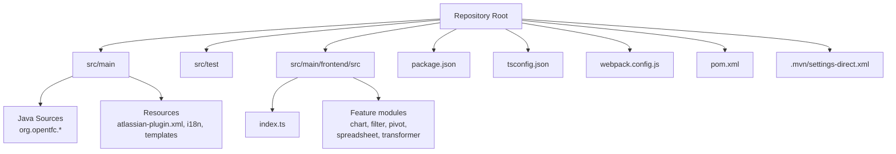
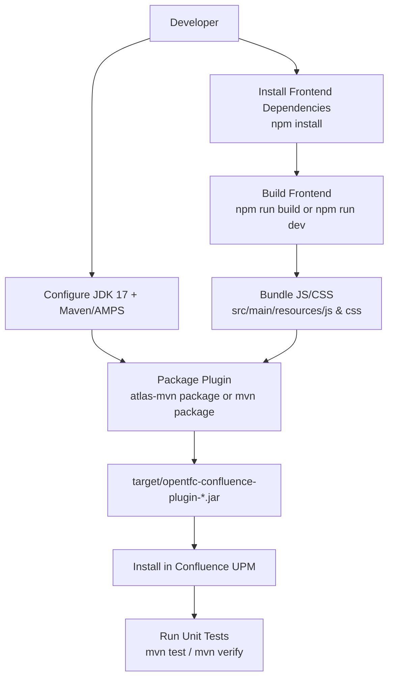
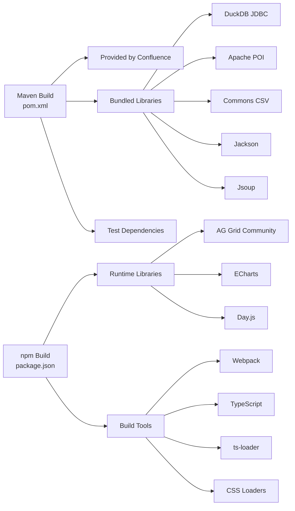

# Environment Setup

<cite>
**Referenced Files in This Document**
- [README.md](file://README.md)
- [INSTALL.md](file://INSTALL.md)
- [pom.xml](file://pom.xml)
- [package.json](file://package.json)
- [tsconfig.json](file://tsconfig.json)
- [webpack.config.js](file://webpack.config.js)
- [.mvn/settings-direct.xml](file://.mvn/settings-direct.xml)
</cite>

## Table of Contents
1. [Introduction](#introduction)
2. [Project Structure](#project-structure)
3. [Core Components](#core-components)
4. [Architecture Overview](#architecture-overview)
5. [Detailed Component Analysis](#detailed-component-analysis)
6. [Dependency Analysis](#dependency-analysis)
7. [Performance Considerations](#performance-considerations)
8. [Troubleshooting Guide](#troubleshooting-guide)
9. [Conclusion](#conclusion)

## Introduction
This document explains how to set up a local development environment for OpenTFC, an open-source Confluence Data Center plugin that provides table filtering, charts, pivot tables, spreadsheet editing, and SQL transformation capabilities. It covers prerequisites, repository cloning, dependency installation, build configuration, local Confluence setup, plugin installation, and hot reload workflows for both backend and frontend components.

OpenTFC is built with:
- Backend: Java 17, Atlassian Plugin SDK (AMPS), Confluence APIs, Active Objects, DuckDB JDBC, Apache POI, Jackson, Jsoup.
- Frontend: TypeScript, Webpack, Confluence AUI, AG Grid Community, Apache ECharts.

The project ships unit tests, type checking, and production bundling steps that are integrated into the standard Maven and npm toolchains.

**Section sources**
- [README.md:53-57](file://README.md#L53-L57)
- [README.md:61-97](file://README.md#L61-L97)

## Project Structure
At a high level, the repository contains:
- Backend code under `src/main/java`, resources under `src/main/resources`, and tests under `src/test`.
- Frontend source under `src/main/frontend/src`, compiled into bundled assets consumed by the plugin.
- Build descriptors:
  - `pom.xml` defines the Maven/AMPS build, dependencies, and plugin packaging.
  - `package.json` defines frontend scripts and dependencies.
  - `tsconfig.json` configures TypeScript compilation.
  - `webpack.config.js` configures asset bundling.
- Optional Maven settings under `.mvn/settings-direct.xml` to bypass proxies during builds.

**Diagram sources**
- [pom.xml:1-10](file://pom.xml#L1-L10)
- [package.json:1-10](file://package.json#L1-L10)
- [tsconfig.json:1-15](file://tsconfig.json#L1-L15)
- [webpack.config.js:1-10](file://webpack.config.js#L1-L10)

**Section sources**
- [pom.xml:1-28](file://pom.xml#L1-L28)
- [package.json:1-10](file://package.json#L1-L10)
- [tsconfig.json:1-15](file://tsconfig.json#L1-L15)
- [webpack.config.js:1-10](file://webpack.config.js#L1-L10)

## Core Components
This section summarizes the key build and runtime components you will interact with during development.

- Maven and AMPS (`pom.xml`)
  - Defines the plugin artifact, target Confluence versions, and AMPS plugin packaging.
  - Configures Java 17 compilation and imports Confluence platform BOMs.
  - Bundles DuckDB JDBC, Apache POI, Commons CSV, Jackson, and Jsoup.
  - Provides test dependencies and enables OBR generation and manifest validation via `mvn verify`.

- Frontend toolchain (`package.json`, `tsconfig.json`, `webpack.config.js`)
  - Entry point: `src/main/frontend/src/index.ts`.
  - Builds TypeScript and CSS into production bundles under `src/main/resources/js` and `src/main/resources/css`.
  - Exposes scripts for building, development watch mode, and type checking.

- Maven settings (`.mvn/settings-direct.xml`)
  - Temporarily disables proxies and mirrors to allow direct access to Atlassian repositories when needed.

**Section sources**
- [pom.xml:15-28](file://pom.xml#L15-L28)
- [pom.xml:183-207](file://pom.xml#L183-L207)
- [pom.xml:236-305](file://pom.xml#L236-L305)
- [package.json:1-10](file://package.json#L1-L10)
- [tsconfig.json:1-15](file://tsconfig.json#L1-L15)
- [webpack.config.js:1-10](file://webpack.config.js#L1-L10)
- [.mvn/settings-direct.xml:1-8](file://.mvn/settings-direct.xml#L1-L8)

## Architecture Overview
The development workflow consists of two parallel pipelines:
- Frontend pipeline: TypeScript + CSS → Webpack bundles → plugin resources.
- Backend pipeline: Java sources + plugin descriptor → AMPS package → Confluence plugin JAR.

**Diagram sources**
- [README.md:61-97](file://README.md#L61-L97)
- [INSTALL.md:17-43](file://INSTALL.md#L17-L43)
- [pom.xml:236-305](file://pom.xml#L236-L305)
- [package.json:6-10](file://package.json#L6-L10)

## Detailed Component Analysis

### Prerequisites
- **JDK 17**: Required for compiling Java sources and running AMPS.
- **Node.js 18+ and npm**: Required for building frontend assets and running type checks.
- **Atlassian Plugin SDK (`atlas-mvn`) or Maven 3.8+**: Used to build and package the Confluence plugin.
- **IDE**: IntelliJ IDEA is recommended for Java and TypeScript support.

These requirements are explicitly documented in the project’s README and INSTALL guides.

**Section sources**
- [README.md:61-67](file://README.md#L61-L67)
- [INSTALL.md:9-13](file://INSTALL.md#L9-L13)

### Cloning the Repository
Use your preferred Git client to clone the repository into a local directory. After cloning, navigate to the repository root before running any commands.

No specific file analysis is required for this step.

### Installing Dependencies

#### Frontend Dependencies
- Install Node modules:
  - `npm install`
- Build production bundles:
  - `npm run build`
- Type-check TypeScript without emitting files:
  - `npm run check`

The frontend entry point is `src/main/frontend/src/index.ts`, and Webpack outputs bundles to `src/main/resources/js` and `src/main/resources/css`.

**Section sources**
- [README.md:68-77](file://README.md#L68-L77)
- [package.json:6-10](file://package.json#L6-L10)
- [webpack.config.js:5-16](file://webpack.config.js#L5-L16)

#### Backend Dependencies
- Ensure JDK 17 is active.
- Use either:
  - `atlas-mvn clean package`
  - `mvn clean package`
- The resulting plugin JAR is produced under `target/`.

The Maven build uses AMPS to package the plugin and includes OBR generation and manifest validation through `mvn verify`.

**Section sources**
- [README.md:79-97](file://README.md#L79-L97)
- [INSTALL.md:28-43](file://INSTALL.md#L28-L43)
- [pom.xml:236-305](file://pom.xml#L236-L305)

### Configuring the Development Environment

#### IDE Configuration
- Use IntelliJ IDEA for best Java and TypeScript integration.
- Import the project as a Maven project so AMPS plugins and dependencies resolve correctly.
- Configure the Node interpreter and npm script execution in the IDE if needed.

No specific file analysis is required for this step.

#### Maven Settings for Proxy Issues
If your environment uses a proxy that interferes with Atlassian repositories, use the provided temporary settings file:
- `.mvn/settings-direct.xml` clears proxies and mirrors for the current build.

You can pass it to Maven using `-s .mvn/settings-direct.xml` when necessary.

**Section sources**
- [.mvn/settings-direct.xml:1-8](file://.mvn/settings-direct.xml#L1-L8)

### Local Confluence Data Center Setup
To test the plugin locally:
- Install a supported Confluence Data Center instance (8.5 LTS or 9.x).
- Start Confluence and log in as an administrator.
- Open the plugin management page:
  - Navigate to **Confluence Settings** → **Manage apps**.
  - Or go directly to `/plugins/servlet/upm`.

This process is documented in the installation guide.

**Section sources**
- [INSTALL.md:47-58](file://INSTALL.md#L47-L58)

### Plugin Installation Procedures
- Build the plugin JAR using `atlas-mvn package` or `mvn package`.
- Upload the generated JAR from `target/` via the Confluence plugin management UI.
- Confirm that the plugin status is **Enabled**.
- Optionally open the diagnostics page to validate activation:
  - `/plugins/servlet/opentfc/diagnostics`

If the main plugin fails to activate, the documentation describes using a lightweight companion diagnostic plugin to inspect activation errors.

**Section sources**
- [README.md:99-104](file://README.md#L99-L104)
- [INSTALL.md:47-58](file://INSTALL.md#L47-L58)
- [INSTALL.md:61-94](file://INSTALL.md#L61-L94)

### Hot Reload Configuration

#### Frontend Hot Reload
- Development mode:
  - `npm run dev` runs Webpack in development mode with file watching enabled.
- Output paths:
  - JavaScript bundle: `src/main/resources/js/opentfc.bundle.js`
  - CSS bundle: `src/main/resources/css/opentfc.bundle.css`

This allows rapid iteration on frontend features while rebuilding assets automatically.

**Section sources**
- [package.json:6-10](file://package.json#L6-L10)
- [webpack.config.js:5-16](file://webpack.config.js#L5-L16)
- [webpack.config.js:21-37](file://webpack.config.js#L21-L37)

#### Backend Hot Reload
- AMPS quick reload is disabled by default in the Maven configuration.
- For faster iteration during development, you can enable quick reload by setting the appropriate AMPS property when running the plugin server.
- Typical workflow:
  - Run the plugin server with quick reload enabled.
  - Rebuild only changed Java classes or resources.
  - Reload the plugin in Confluence without a full restart.

Note: Enabling quick reload is a development-time optimization; ensure you still run full builds and tests before releasing.

**Section sources**
- [pom.xml:243-250](file://pom.xml#L243-L250)

### Key Configuration Files

#### pom.xml
- Defines:
  - Group ID, artifact ID, version, and packaging type.
  - Target Confluence versions and AMPS version.
  - Java 17 compiler release.
  - Provided vs bundled dependencies.
  - AMPS plugin configuration, including plugin key, Spring context scanning, and import/export package rules.
  - Additional Maven plugins for Spring scanner and compiler.

Use this file to adjust dependency versions, plugin behavior, and JVM arguments for local builds.

**Section sources**
- [pom.xml:1-10](file://pom.xml#L1-L10)
- [pom.xml:15-28](file://pom.xml#L15-L28)
- [pom.xml:106-207](file://pom.xml#L106-L207)
- [pom.xml:236-305](file://pom.xml#L236-L305)

#### package.json
- Defines:
  - Frontend name and version.
  - Entry point for the frontend bundle.
  - Scripts for production build, development watch mode, and TypeScript type checking.
  - Runtime dependencies: AG Grid Community, ECharts, Day.js.
  - Development dependencies: Webpack, ts-loader, TypeScript, CSS loaders.

Adjust scripts or dependencies here when extending frontend functionality.

**Section sources**
- [package.json:1-25](file://package.json#L1-L25)

#### tsconfig.json
- Configures:
  - Target ES2020 and module resolution.
  - Strict type checking and interop options.
  - Source maps for debugging.
  - Output directory for compiled TypeScript.
  - Include path for frontend sources.

Modify these options if you change the TypeScript target or output layout.

**Section sources**
- [tsconfig.json:1-15](file://tsconfig.json#L1-L15)

#### webpack.config.js
- Configures:
  - Entry point for the frontend bundle.
  - Output path and filename pattern.
  - Module resolution extensions.
  - TypeScript and CSS processing rules.
  - CSS extraction plugin configuration.
  - Performance hints disabled for smoother builds.

Update this file when adding new assets or changing bundle structure.

**Section sources**
- [webpack.config.js:1-42](file://webpack.config.js#L1-L42)

## Dependency Analysis
The build has two independent dependency graphs:

- Maven dependencies
  - Provided by Confluence at runtime: Confluence API, Active Objects, SAL, REST common, Servlet API, SLF4J, etc.
  - Bundled into the plugin: DuckDB JDBC, Apache POI, Commons CSV, Jackson, Jsoup.
  - Test dependencies: JUnit, Hamcrest, Mockito, SLF4J simple.

- npm dependencies
  - Runtime libraries used by the frontend: AG Grid Community, ECharts, Day.js.
  - Build-time tools: Webpack, TypeScript, ts-loader, CSS loaders.

**Diagram sources**
- [pom.xml:106-234](file://pom.xml#L106-L234)
- [package.json:11-24](file://package.json#L11-L24)

**Section sources**
- [pom.xml:106-234](file://pom.xml#L106-L234)
- [package.json:11-24](file://package.json#L11-L24)

## Performance Considerations
- Enable quick reload in AMPS during development to reduce plugin restart time.
- Use `npm run dev` for fast frontend iteration with file watching.
- Keep TypeScript strict mode enabled to catch issues early and avoid runtime surprises.
- Run `mvn verify` before committing changes to validate the plugin manifest and generate OBR artifacts.

[No sources needed since this section provides general guidance]

## Troubleshooting Guide

### Common Build Issues
- **Proxy or mirror problems with Atlassian repositories**
  - Use `.mvn/settings-direct.xml` to bypass proxies and mirrors temporarily.
  - Pass `-s .mvn/settings-direct.xml` to Maven if needed.

- **Frontend assets not updating**
  - Ensure you ran `npm install` and `npm run build` or `npm run dev`.
  - Verify that Webpack outputs bundles to `src/main/resources/js` and `src/main/resources/css`.

- **Plugin does not activate**
  - Check the plugin management UI and Confluence logs.
  - Use the diagnostics endpoint `/plugins/servlet/opentfc/diagnostics`.
  - If the main plugin cannot activate, install the lightweight diagnostic companion plugin described in the installation guide.

**Section sources**
- [.mvn/settings-direct.xml:1-8](file://.mvn/settings-direct.xml#L1-L8)
- [INSTALL.md:61-94](file://INSTALL.md#L61-L94)

### Testing and Validation
- Run unit tests:
  - `mvn test`
- Validate plugin packaging and manifest:
  - `mvn verify`

The project includes extensive unit tests covering services, REST endpoints, export functionality, macro rendering, and security guards.

**Section sources**
- [README.md:89-97](file://README.md#L89-L97)
- [INSTALL.md:39-43](file://INSTALL.md#L39-L43)

## Conclusion
You now have a complete guide to setting up the OpenTFC development environment. You should be able to:
- Install JDK 17, Node.js 18+, npm, and Atlassian Plugin SDK.
- Clone the repository and install all dependencies.
- Build frontend assets and package the plugin.
- Install and test the plugin in a local Confluence Data Center instance.
- Use hot reload for efficient frontend and backend development.
- Diagnose activation and runtime issues using the provided diagnostics and logs.

For further details, refer to the README and INSTALL guides included in the repository.

[No sources needed since this section summarizes without analyzing specific files]