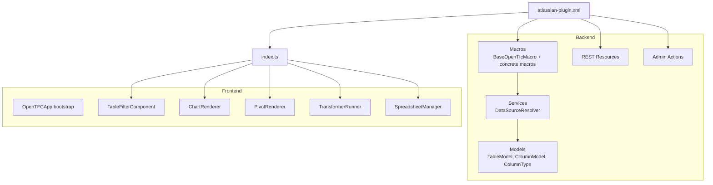
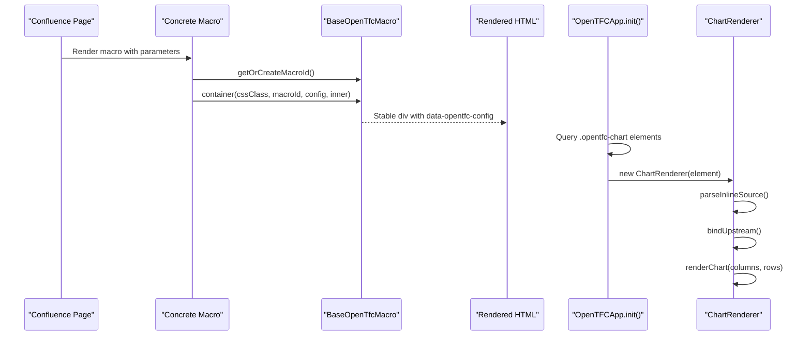
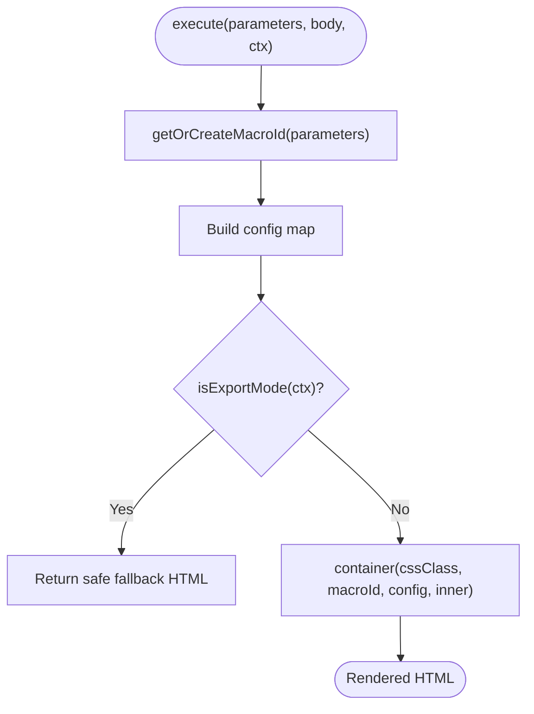
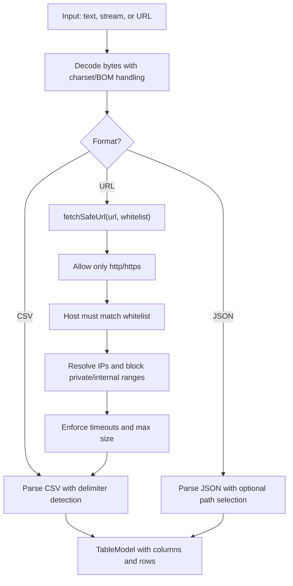
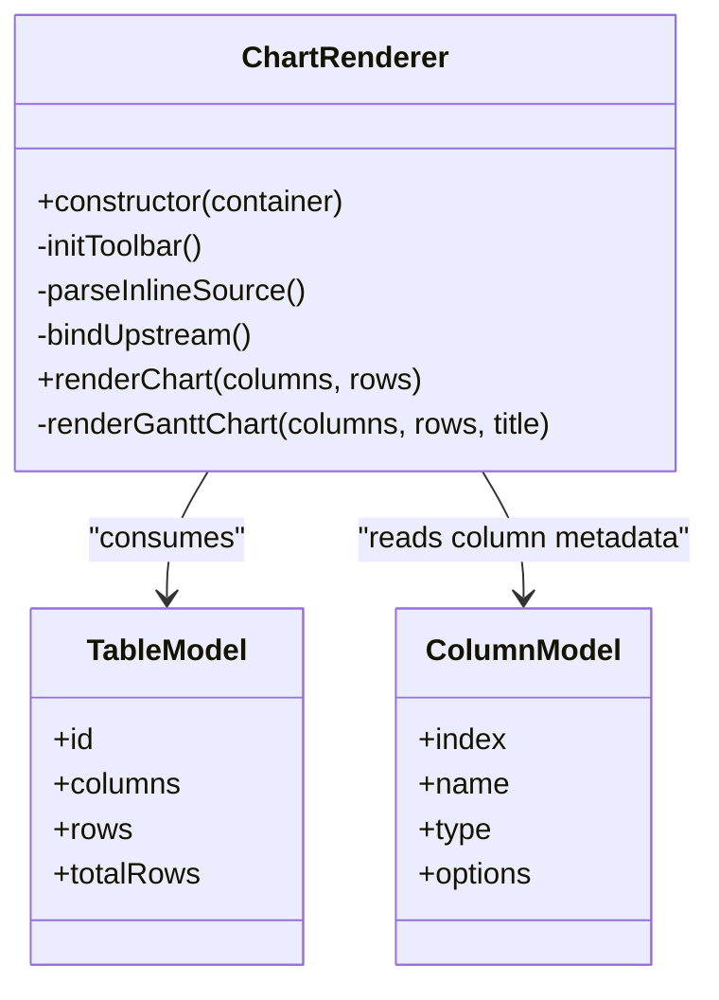
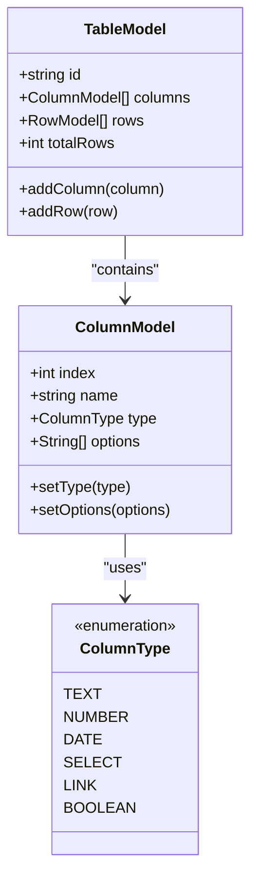
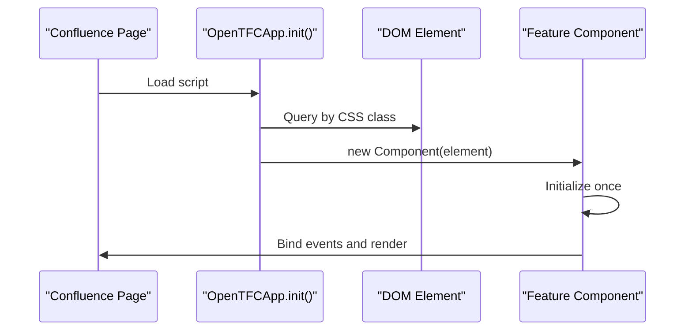
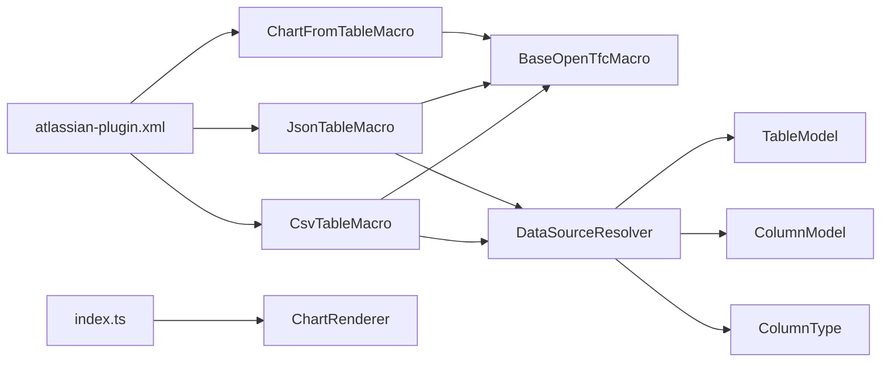

# Extending OpenTFC

<cite>
**Referenced Files in This Document**
- [README.md](file://README.md)
- [atlassian-plugin.xml](file://src/main/resources/atlassian-plugin.xml)
- [BaseOpenTfcMacro.java](file://src/main/java/org/opentfc/macro/BaseOpenTfcMacro.java)
- [CsvTableMacro.java](file://src/main/java/org/opentfc/macro/CsvTableMacro.java)
- [JsonTableMacro.java](file://src/main/java/org/opentfc/macro/JsonTableMacro.java)
- [ChartFromTableMacro.java](file://src/main/java/org/opentfc/macro/ChartFromTableMacro.java)
- [DataSourceResolver.java](file://src/main/java/org/opentfc/service/DataSourceResolver.java)
- [TableModel.java](file://src/main/java/org/opentfc/model/TableModel.java)
- [ColumnModel.java](file://src/main/java/org/opentfc/model/ColumnModel.java)
- [ColumnType.java](file://src/main/java/org/opentfc/model/ColumnType.java)
- [chart-renderer.ts](file://src/main/frontend/src/chart/chart-renderer.ts)
- [table-model.ts](file://src/main/frontend/src/core/table-model.ts)
- [index.ts](file://src/main/frontend/src/index.ts)
</cite>

## Table of Contents
1. [Introduction](#introduction)
2. [Project Structure](#project-structure)
3. [Core Components](#core-components)
4. [Architecture Overview](#architecture-overview)
5. [Detailed Component Analysis](#detailed-component-analysis)
6. [Dependency Analysis](#dependency-analysis)
7. [Performance Considerations](#performance-considerations)
8. [Troubleshooting Guide](#troubleshooting-guide)
9. [Conclusion](#conclusion)

## Introduction
This document explains how to extend OpenTFC for Confluence Data Center and Server. It focuses on:
- Creating custom macros by extending the macro base class
- Implementing new data sources through the existing parsing and fetching infrastructure
- Adding chart types via the frontend chart renderer
- Extending backend table models
- Maintaining compatibility, following naming conventions, and integrating with security and plugin configuration

OpenTFC provides a macro-driven architecture where Java macros render HTML containers with JSON configuration, and TypeScript components initialize interactive UIs such as tables, charts, pivot tables, transformers, and spreadsheets.

**Section sources**
- [README.md:1-104](file://README.md#L1-L104)

## Project Structure
OpenTFC is organized into:
- Backend Java packages under `org.opentfc` for macros, services, REST resources, models, admin actions, and diagnostics
- Frontend TypeScript modules under `src/main/frontend/src` for table filtering, chart rendering, pivot rendering, transformer execution, and spreadsheet management
- Plugin registration and web resources under `src/main/resources`

**Diagram sources**
- [atlassian-plugin.xml:1-289](file://src/main/resources/atlassian-plugin.xml#L1-L289)
- [index.ts:1-81](file://src/main/frontend/src/index.ts#L1-L81)

**Section sources**
- [atlassian-plugin.xml:1-289](file://src/main/resources/atlassian-plugin.xml#L1-L289)
- [index.ts:1-81](file://src/main/frontend/src/index.ts#L1-L81)

## Core Components
The extension surface centers around:
- Base macro class providing parameter helpers, body rendering, export mode detection, JSON config serialization, container wrapping, and logging
- Concrete macros that configure and render specific features
- DataSourceResolver for parsing CSV/JSON and safely fetching external URLs
- Table model classes representing structured tabular data
- Frontend ChartRenderer for rendering ECharts-based visualizations
- Frontend table model types consumed by chart and other components

Key responsibilities:
- Macros produce stable IDs, safe HTML, and serialized configuration
- Services parse and validate input data and enforce security constraints
- Models define the contract between backend and frontend
- Frontend bootstraps components based on CSS selectors and initializes them once per element

**Section sources**
- [BaseOpenTfcMacro.java:18-114](file://src/main/java/org/opentfc/macro/BaseOpenTfcMacro.java#L18-L114)
- [DataSourceResolver.java:37-289](file://src/main/java/org/opentfc/service/DataSourceResolver.java#L37-L289)
- [TableModel.java:9-75](file://src/main/java/org/opentfc/model/TableModel.java#L9-L75)
- [ColumnModel.java:9-67](file://src/main/java/org/opentfc/model/ColumnModel.java#L9-L67)
- [ColumnType.java:3-13](file://src/main/java/org/opentfc/model/ColumnType.java#L3-L13)
- [chart-renderer.ts:4-282](file://src/main/frontend/src/chart/chart-renderer.ts#L4-L282)
- [table-model.ts:1-36](file://src/main/frontend/src/core/table-model.ts#L1-L36)

## Architecture Overview
OpenTFC follows a clear separation between server-side macro rendering and client-side component initialization.

**Diagram sources**
- [ChartFromTableMacro.java:24-53](file://src/main/java/org/opentfc/macro/ChartFromTableMacro.java#L24-L53)
- [BaseOpenTfcMacro.java:35-103](file://src/main/java/org/opentfc/macro/BaseOpenTfcMacro.java#L35-L103)
- [index.ts:20-26](file://src/main/frontend/src/index.ts#L20-L26)
- [chart-renderer.ts:12-30](file://src/main/frontend/src/chart/chart-renderer.ts#L12-L30)
- [chart-renderer.ts:76-106](file://src/main/frontend/src/chart/chart-renderer.ts#L76-L106)
- [chart-renderer.ts:108-226](file://src/main/frontend/src/chart/chart-renderer.ts#L108-L226)

## Detailed Component Analysis

### Custom Macro Development
To create a custom macro:
1. Extend the base macro class
2. Override the execution method
3. Generate or reuse a stable macro ID
4. Build a configuration map
5. Wrap output using the container helper
6. Register the macro in the plugin descriptor

Recommended patterns:
- Use the base class’s export mode detection to provide fallback content when JavaScript is unavailable
- Escape user-provided values before embedding them in HTML
- Serialize configuration as JSON and attach it to the container element
- Keep macro body handling consistent with the macro’s expected body type

Example reference implementations:
- CSV macro shows source type selection, attachment name, URL, delimiter, encoding, and inline body
- JSON macro adds a JSON path selector
- Chart macro demonstrates nested body rendering, export fallback, height sanitization, and upstream binding

**Diagram sources**
- [BaseOpenTfcMacro.java:35-103](file://src/main/java/org/opentfc/macro/BaseOpenTfcMacro.java#L35-L103)
- [CsvTableMacro.java:30-45](file://src/main/java/org/opentfc/macro/CsvTableMacro.java#L30-L45)
- [JsonTableMacro.java:30-44](file://src/main/java/org/opentfc/macro/JsonTableMacro.java#L30-L44)
- [ChartFromTableMacro.java:24-53](file://src/main/java/org/opentfc/macro/ChartFromTableMacro.java#L24-L53)

**Section sources**
- [BaseOpenTfcMacro.java:18-114](file://src/main/java/org/opentfc/macro/BaseOpenTfcMacro.java#L18-L114)
- [CsvTableMacro.java:11-47](file://src/main/java/org/opentfc/macro/CsvTableMacro.java#L11-L47)
- [JsonTableMacro.java:11-46](file://src/main/java/org/opentfc/macro/JsonTableMacro.java#L11-L46)
- [ChartFromTableMacro.java:11-54](file://src/main/java/org/opentfc/macro/ChartFromTableMacro.java#L11-L54)

### Data Source Implementation
OpenTFC parses CSV and JSON into a unified table model and supports fetching external URLs with strict SSRF protection.

Implementation guidance:
- For CSV:
  - Support auto-detection of delimiters
  - Handle explicit encodings and BOM stripping
  - Map header names and default column types
- For JSON:
  - Support array-of-objects and array-of-arrays formats
  - Allow simple path selection
  - Convert values to text strings
- For external URLs:
  - Restrict protocols to HTTP and HTTPS
  - Enforce host whitelisting
  - Block internal, loopback, site-local, link-local, any-local, and multicast addresses
  - Limit connection/read timeouts and response size
  - Disable redirects and set a safe user agent

**Diagram sources**
- [DataSourceResolver.java:48-79](file://src/main/java/org/opentfc/service/DataSourceResolver.java#L48-L79)
- [DataSourceResolver.java:81-137](file://src/main/java/org/opentfc/service/DataSourceResolver.java#L81-L137)
- [DataSourceResolver.java:139-210](file://src/main/java/org/opentfc/service/DataSourceResolver.java#L139-L210)
- [DataSourceResolver.java:212-288](file://src/main/java/org/opentfc/service/DataSourceResolver.java#L212-L288)

Practical use cases:
- Import CSV from page attachments or whitelisted URLs with automatic delimiter detection
- Import JSON arrays of objects or arrays with optional path selection
- Securely fetch remote datasets while preventing SSRF attacks

**Section sources**
- [DataSourceResolver.java:37-289](file://src/main/java/org/opentfc/service/DataSourceResolver.java#L37-L289)

### Chart Type Extension
To add a new chart type:
1. Add the new type to the macro parameter enum in the plugin descriptor
2. Update the frontend chart renderer to handle the new type
3. Ensure the toolbar exposes the new option
4. Provide sensible defaults and data mapping rules

Current supported types include column, stacked-column, bar, line, area, pie, donut, scatter, radar, funnel, and gantt. The renderer maps the first column to labels and subsequent columns to series, with special handling for pie/donut, funnel, radar, and gantt.

**Diagram sources**
- [chart-renderer.ts:4-282](file://src/main/frontend/src/chart/chart-renderer.ts#L4-L282)
- [TableModel.java:9-75](file://src/main/java/org/opentfc/model/TableModel.java#L9-L75)
- [ColumnModel.java:9-67](file://src/main/java/org/opentfc/model/ColumnModel.java#L9-L67)

Extension steps:
- Add a new enum value in the macro parameter definition
- Add a corresponding option in the chart type selector
- Implement the rendering branch in the main render method
- If needed, add a specialized rendering method similar to the gantt implementation

**Section sources**
- [atlassian-plugin.xml:109-148](file://src/main/resources/atlassian-plugin.xml#L109-L148)
- [chart-renderer.ts:32-74](file://src/main/frontend/src/chart/chart-renderer.ts#L32-L74)
- [chart-renderer.ts:108-226](file://src/main/frontend/src/chart/chart-renderer.ts#L108-L226)
- [chart-renderer.ts:228-281](file://src/main/frontend/src/chart/chart-renderer.ts#L228-L281)

### Model Extension Patterns
The backend uses strongly typed models for table structures:
- TableModel represents a table with an identifier, list of columns, list of rows, and total row count
- ColumnModel defines column index, name, type, and options
- ColumnType enumerates supported column types

When extending models:
- Preserve backward compatibility by ignoring unknown properties during deserialization
- Maintain serializability for transport and storage
- Keep JSON property annotations consistent with frontend expectations
- Avoid mutating shared state; prefer immutable updates at the component layer

**Diagram sources**
- [TableModel.java:9-75](file://src/main/java/org/opentfc/model/TableModel.java#L9-L75)
- [ColumnModel.java:9-67](file://src/main/java/org/opentfc/model/ColumnModel.java#L9-L67)
- [ColumnType.java:3-13](file://src/main/java/org/opentfc/model/ColumnType.java#L3-L13)

Frontend model types mirror this structure:
- ColumnDef includes index, name, type, options, and visibility
- RowData contains cells
- CellData holds value, optional HTML, and type
- TableData aggregates id, columns, rows, and totalRows
- FilterState captures global search, column filters, sorts, hidden columns, pagination

**Section sources**
- [table-model.ts:1-36](file://src/main/frontend/src/core/table-model.ts#L1-L36)

### JavaScript API Integration
OpenTFC exposes a global application object for integration:
- `OpenTFCApp.init()` boots all registered components
- Components are initialized once per DOM element using a dataset flag
- Initialization runs after Confluence lifecycle events and standard DOM ready

For custom integrations:
- Ensure your macro renders the correct CSS class so the bootstrap can find it
- Attach configuration via the standard container attribute
- Emit or consume the data-updated event if you need to coordinate with other components

**Diagram sources**
- [index.ts:10-51](file://src/main/frontend/src/index.ts#L10-L51)
- [index.ts:54-80](file://src/main/frontend/src/index.ts#L54-L80)

**Section sources**
- [index.ts:1-81](file://src/main/frontend/src/index.ts#L1-81)

## Dependency Analysis
The plugin registers macros, REST endpoints, admin actions, and web resources. Macros depend on the base class for common behavior. Services depend on models. Frontend depends on the rendered HTML structure and emits/consumes events.

**Diagram sources**
- [atlassian-plugin.xml:70-286](file://src/main/resources/atlassian-plugin.xml#L70-L286)
- [CsvTableMacro.java:11-47](file://src/main/java/org/opentfc/macro/CsvTableMacro.java#L11-L47)
- [JsonTableMacro.java:11-46](file://src/main/java/org/opentfc/macro/JsonTableMacro.java#L11-L46)
- [ChartFromTableMacro.java:11-54](file://src/main/java/org/opentfc/macro/ChartFromTableMacro.java#L11-L54)
- [BaseOpenTfcMacro.java:18-114](file://src/main/java/org/opentfc/macro/BaseOpenTfcMacro.java#L18-L114)
- [DataSourceResolver.java:37-289](file://src/main/java/org/opentfc/service/DataSourceResolver.java#L37-L289)
- [index.ts:1-81](file://src/main/frontend/src/index.ts#L1-L81)

**Section sources**
- [atlassian-plugin.xml:70-286](file://src/main/resources/atlassian-plugin.xml#L70-L286)

## Performance Considerations
- Prefer streaming or bounded reads for large datasets to avoid memory pressure
- Use delimiter auto-detection judiciously; explicit delimiter settings reduce overhead
- Cache parsed results when appropriate, especially for repeated chart updates
- Minimize DOM queries by initializing components once and reusing references
- Avoid unnecessary re-renders by checking data changes before updating charts

[No sources needed since this section provides general guidance]

## Troubleshooting Guide
Common issues and resolutions:
- Macro body not rendering nested macros: ensure the base class body rendering is used and that export mode is handled correctly
- Charts not updating: verify the upstream macro ID matches and that the data-updated event is emitted with the expected shape
- External URL fetch failures: check protocol restrictions, host whitelist, DNS resolution, and response size limits
- Encoding problems: confirm explicit encoding or rely on auto-detection with BOM handling
- Duplicate initialization: ensure the dataset flag prevents multiple initializations

Security considerations:
- Always validate and sanitize user inputs before embedding in HTML
- Restrict external URL access to approved hosts and protocols
- Avoid following redirects and enforce timeouts and size limits

**Section sources**
- [BaseOpenTfcMacro.java:44-70](file://src/main/java/org/opentfc/macro/BaseOpenTfcMacro.java#L44-L70)
- [chart-renderer.ts:99-106](file://src/main/frontend/src/chart/chart-renderer.ts#L99-L106)
- [DataSourceResolver.java:212-288](file://src/main/java/org/opentfc/service/DataSourceResolver.java#L212-L288)

## Conclusion
Extending OpenTFC involves:
- Building macros that generate stable IDs, safe HTML, and serialized configuration
- Using the data source resolver for robust CSV/JSON parsing and secure URL fetching
- Adding chart types by updating both plugin parameters and the frontend renderer
- Extending models carefully to maintain compatibility across backend and frontend
- Integrating with the plugin descriptor and frontend bootstrap for reliable initialization

Following these patterns ensures maintainable extensions that integrate smoothly with OpenTFC’s security model, performance characteristics, and Confluence lifecycle.

[No sources needed since this section summarizes without analyzing specific files]