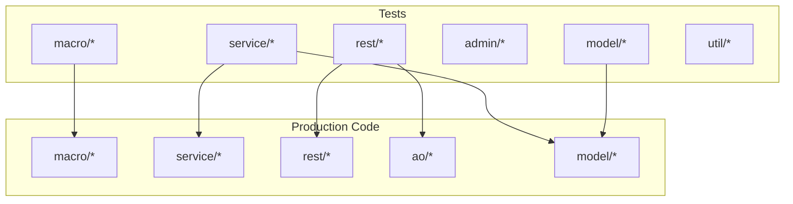
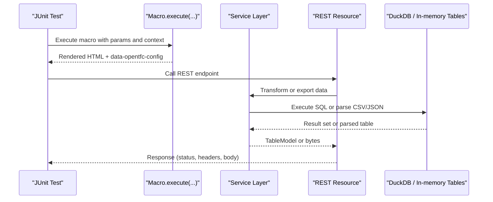
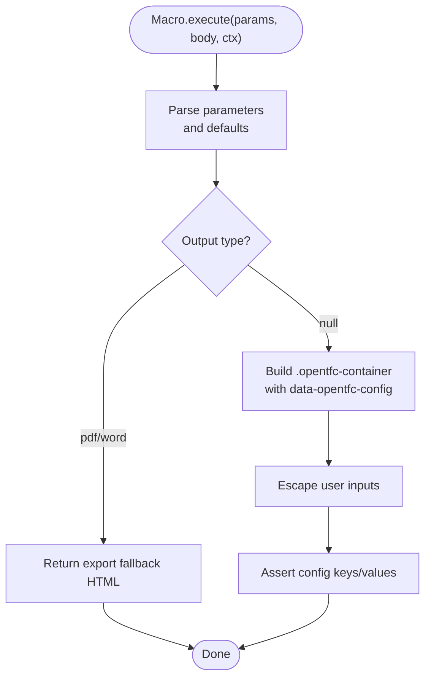
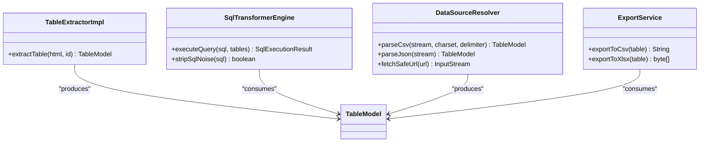
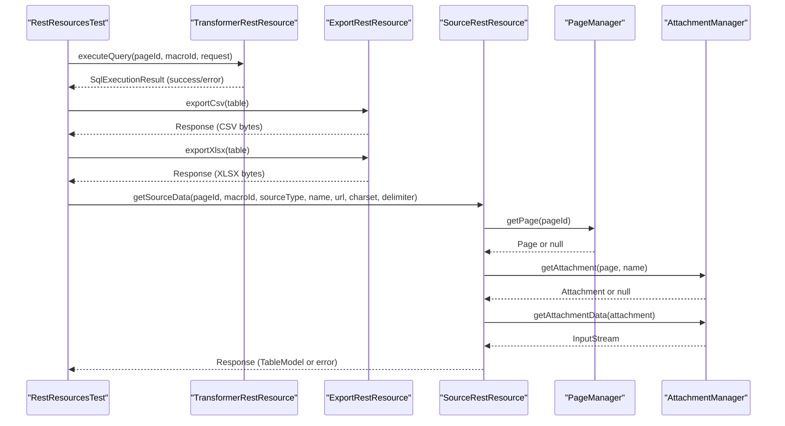
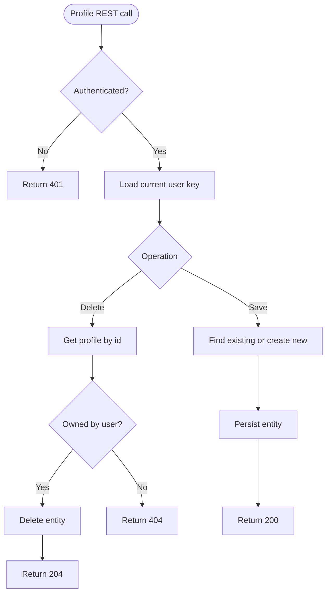
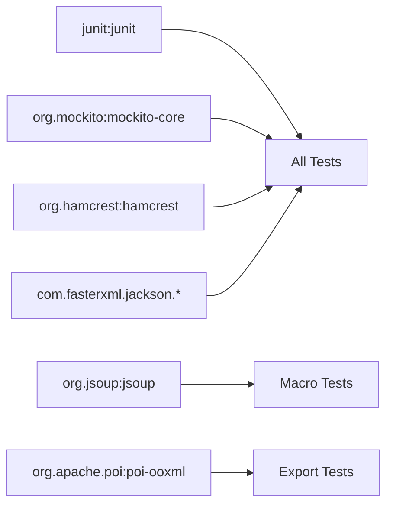

# Testing Framework

<cite>
**Referenced Files in This Document**
- [pom.xml](file://pom.xml)
- [ci.yml](file://.github/workflows/ci.yml)
- [MacroRenderTests.java](file://src/test/java/org/opentfc/macro/MacroRenderTests.java)
- [MacroAdditionalTests.java](file://src/test/java/org/opentfc/macro/MacroAdditionalTests.java)
- [RestResourcesTest.java](file://src/test/java/org/opentfc/rest/RestResourcesTest.java)
- [ProfileRestResourceTest.java](file://src/test/java/org/opentfc/rest/ProfileRestResourceTest.java)
- [TableExtractorTest.java](file://src/test/java/org/opentfc/service/TableExtractorTest.java)
- [ExportServiceTest.java](file://src/test/java/org/opentfc/service/ExportServiceTest.java)
- [SqlTransformerEngineTest.java](file://src/test/java/org/opentfc/service/SqlTransformerEngineTest.java)
- [DataSourceResolverTest.java](file://src/test/java/org/opentfc/service/DataSourceResolverTest.java)
- [AdminActionTest.java](file://src/test/java/org/opentfc/admin/AdminActionTest.java)
- [ModelTest.java](file://src/test/java/org/opentfc/model/ModelTest.java)
- [I18nKeysTest.java](file://src/test/java/org/opentfc/util/I18nKeysTest.java)
</cite>

## Table of Contents
1. [Introduction](#introduction)
2. [Project Structure](#project-structure)
3. [Core Components](#core-components)
4. [Architecture Overview](#architecture-overview)
5. [Detailed Component Analysis](#detailed-component-analysis)
6. [Dependency Analysis](#dependency-analysis)
7. [Performance Considerations](#performance-considerations)
8. [Troubleshooting Guide](#troubleshooting-guide)
9. [Conclusion](#conclusion)
10. [Appendices](#appendices)

## Introduction
This document explains the testing framework for OpenTFC, covering unit tests, integration-style tests, and test utilities. It focuses on JUnit-based tests for Java backend components: macro rendering, service layer logic, REST endpoints, model contracts, admin configuration, and i18n resource validation. It also documents how to run tests with Maven, how CI executes them, and provides guidelines for writing effective tests for macros, services, and REST resources.

## Project Structure
OpenTFC uses a standard Maven layout with tests under src/test/java. The project is an Atlassian Confluence plugin packaged as atlassian-plugin. Tests are organized by feature area:
- Macro tests validate HTML output, parameter mapping, XSS handling, and export fallbacks.
- Service tests validate data extraction, SQL transformation, CSV/JSON parsing, and export formats.
- REST tests validate response codes, headers, payloads, SSRF protection, and ActiveObjects interactions.
- Model tests validate value objects and JSON contract between backend and frontend.
- Admin action tests validate settings persistence via PluginSettings.
- I18n tests validate key consistency across locales.

**Diagram sources**
- [pom.xml:106-234](file://pom.xml#L106-L234)

**Section sources**
- [pom.xml:1-309](file://pom.xml#L1-L309)

## Core Components
The testing stack relies on:
- JUnit 4 for test execution and assertions.
- Mockito for mocking external dependencies (Confluence APIs, ActiveObjects, PageManager, AttachmentManager).
- Jsoup for parsing rendered HTML from macro outputs.
- Jackson ObjectMapper for validating JSON payloads and config attributes.
- Apache POI for verifying XLSX exports.
- Hamcrest for additional matchers.

Key responsibilities:
- Macro tests assert container structure, parameter mapping into data-opentfc-config, HTML escaping, and export-mode behavior.
- Service tests assert table extraction, SQL query execution, CSV/JSON parsing, and export generation.
- REST tests assert HTTP responses, headers, payload shapes, and security guards (SSRF, DDL/DML rejection).
- Model tests assert value object behavior and JSON serialization contract.
- Admin tests assert settings round-trip through PluginSettings.
- I18n tests assert key presence and translation quality.

**Section sources**
- [pom.xml:209-234](file://pom.xml#L209-L234)
- [MacroRenderTests.java:1-194](file://src/test/java/org/opentfc/macro/MacroRenderTests.java#L1-L194)
- [MacroAdditionalTests.java:1-206](file://src/test/java/org/opentfc/macro/MacroAdditionalTests.java#L1-L206)
- [RestResourcesTest.java:1-268](file://src/test/java/org/opentfc/rest/RestResourcesTest.java#L1-L268)
- [ProfileRestResourceTest.java:1-178](file://src/test/java/org/opentfc/rest/ProfileRestResourceTest.java#L1-L178)
- [TableExtractorTest.java:1-133](file://src/test/java/org/opentfc/service/TableExtractorTest.java#L1-L133)
- [ExportServiceTest.java:1-89](file://src/test/java/org/opentfc/service/ExportServiceTest.java#L1-L89)
- [SqlTransformerEngineTest.java:1-217](file://src/test/java/org/opentfc/service/SqlTransformerEngineTest.java#L1-L217)
- [DataSourceResolverTest.java:1-141](file://src/test/java/org/opentfc/service/DataSourceResolverTest.java#L1-L141)
- [AdminActionTest.java:1-88](file://src/test/java/org/opentfc/admin/AdminActionTest.java#L1-L88)
- [ModelTest.java:1-172](file://src/test/java/org/opentfc/model/ModelTest.java#L1-L172)
- [I18nKeysTest.java:1-97](file://src/test/java/org/opentfc/util/I18nKeysTest.java#L1-L97)

## Architecture Overview
The test suite exercises three main layers:
- Macro rendering layer: validates HTML output and client-facing configuration.
- Service layer: validates data processing, SQL execution, and file export.
- REST layer: validates API contracts and security controls.

**Diagram sources**
- [MacroRenderTests.java:48-146](file://src/test/java/org/opentfc/macro/MacroRenderTests.java#L48-L146)
- [RestResourcesTest.java:51-136](file://src/test/java/org/opentfc/rest/RestResourcesTest.java#L51-L136)
- [SqlTransformerEngineTest.java:56-100](file://src/test/java/org/opentfc/service/SqlTransformerEngineTest.java#L56-L100)

## Detailed Component Analysis

### Macro Rendering Tests
Macro tests verify:
- Default and custom macroId generation.
- Parameter mapping into data-opentfc-config JSON.
- Export mode returns static placeholders without interactive containers.
- HTML escaping prevents XSS in titles and macroId values.
- Attachment listing renders headers and filters correctly.

**Diagram sources**
- [MacroRenderTests.java:29-46](file://src/test/java/org/opentfc/macro/MacroRenderTests.java#L29-L46)
- [MacroRenderTests.java:48-146](file://src/test/java/org/opentfc/macro/MacroRenderTests.java#L48-L146)
- [MacroAdditionalTests.java:31-47](file://src/test/java/org/opentfc/macro/MacroAdditionalTests.java#L31-L47)

**Section sources**
- [MacroRenderTests.java:48-146](file://src/test/java/org/opentfc/macro/MacroRenderTests.java#L48-L146)
- [MacroAdditionalTests.java:49-112](file://src/test/java/org/opentfc/macro/MacroAdditionalTests.java#L49-L112)

### Service Layer Tests
Service tests cover:
- HTML table extraction and column type inference.
- SQL transformation engine including joins, aggregations, window functions, unions, and security checks.
- CSV/JSON parsing with encodings and delimiters.
- Export to CSV and XLSX with round-trip verification.

**Diagram sources**
- [TableExtractorTest.java:14-42](file://src/test/java/org/opentfc/service/TableExtractorTest.java#L14-L42)
- [SqlTransformerEngineTest.java:15-100](file://src/test/java/org/opentfc/service/SqlTransformerEngineTest.java#L15-L100)
- [DataSourceResolverTest.java:18-69](file://src/test/java/org/opentfc/service/DataSourceResolverTest.java#L18-L69)
- [ExportServiceTest.java:15-76](file://src/test/java/org/opentfc/service/ExportServiceTest.java#L15-L76)

**Section sources**
- [TableExtractorTest.java:19-131](file://src/test/java/org/opentfc/service/TableExtractorTest.java#L19-L131)
- [SqlTransformerEngineTest.java:56-215](file://src/test/java/org/opentfc/service/SqlTransformerEngineTest.java#L56-L215)
- [DataSourceResolverTest.java:27-139](file://src/test/java/org/opentfc/service/DataSourceResolverTest.java#L27-L139)
- [ExportServiceTest.java:32-87](file://src/test/java/org/opentfc/service/ExportServiceTest.java#L32-L87)

### REST Endpoint Tests
REST tests validate:
- Config endpoint returns feature flags and limits.
- Transformer endpoint rejects null/missing SQL and blocks DDL/DML.
- Export endpoints return correct Content-Disposition and payloads.
- Source endpoint loads CSV/JSON attachments, respects delimiters and encoding, handles missing resources, and blocks SSRF attempts.

**Diagram sources**
- [RestResourcesTest.java:51-136](file://src/test/java/org/opentfc/rest/RestResourcesTest.java#L51-L136)
- [RestResourcesTest.java:140-241](file://src/test/java/org/opentfc/rest/RestResourcesTest.java#L140-L241)

**Section sources**
- [RestResourcesTest.java:51-136](file://src/test/java/org/opentfc/rest/RestResourcesTest.java#L51-L136)
- [RestResourcesTest.java:140-241](file://src/test/java/org/opentfc/rest/RestResourcesTest.java#L140-L241)

### Profile REST Resource Tests
Profile tests validate:
- Unauthenticated reads allowed but filtered by anonymous user.
- Authenticated saves create or update profiles.
- Anonymous users cannot save or delete profiles.
- Delete enforces ownership and returns 404 for missing entities.

**Diagram sources**
- [ProfileRestResourceTest.java:61-176](file://src/test/java/org/opentfc/rest/ProfileRestResourceTest.java#L61-L176)

**Section sources**
- [ProfileRestResourceTest.java:61-176](file://src/test/java/org/opentfc/rest/ProfileRestResourceTest.java#L61-L176)

### Admin Action and Model Tests
Admin action tests validate default values and settings round-trip using a minimal PluginSettings implementation. Model tests validate value object accessors and the JSON contract used by the frontend bundle.

**Section sources**
- [AdminActionTest.java:55-86](file://src/test/java/org/opentfc/admin/AdminActionTest.java#L55-L86)
- [ModelTest.java:19-170](file://src/test/java/org/opentfc/model/ModelTest.java#L19-L170)

### I18n Keys Tests
I18n tests ensure:
- All keys referenced in the plugin descriptor exist in all locale bundles.
- Key sets are identical across locales.
- No empty or whitespace-only values.
- Russian translations differ from English.

**Section sources**
- [I18nKeysTest.java:23-95](file://src/test/java/org/opentfc/util/I18nKeysTest.java#L23-L95)

## Dependency Analysis
Testing dependencies are declared in the Maven POM:
- JUnit 4 for test execution.
- Mockito for mocking.
- Hamcrest for assertions.
- Jackson for JSON handling.
- Jsoup for HTML parsing.
- Apache POI for XLSX verification.

**Diagram sources**
- [pom.xml:209-234](file://pom.xml#L209-L234)

**Section sources**
- [pom.xml:209-234](file://pom.xml#L209-L234)

## Performance Considerations
- Keep macro tests focused on rendering and configuration; avoid heavy I/O.
- Use small datasets in SQL transformer tests to keep execution time low.
- Mock external systems (Confluence APIs, ActiveObjects) to avoid slow network or database calls.
- Reuse shared helpers (e.g., sample tables) to reduce duplication and setup cost.

[No sources needed since this section provides general guidance]

## Troubleshooting Guide
Common issues and resolutions:
- Missing .opentfc-container in macro output: Ensure macro renders the expected container and that tests parse it correctly.
- Export mode still includes interactive config: Verify output type detection and fallback branches.
- SSRF errors returning internal details: Confirm generic error messages and status codes in REST tests.
- Invalid charset handling: Validate fallback to UTF-8 and successful parsing when charset is unknown.
- ActiveObjects interactions not verified: Use verify() and verifyNoInteractions() to ensure correct DAO usage.

**Section sources**
- [MacroRenderTests.java:82-115](file://src/test/java/org/opentfc/macro/MacroRenderTests.java#L82-L115)
- [RestResourcesTest.java:230-265](file://src/test/java/org/opentfc/rest/RestResourcesTest.java#L230-L265)
- [ProfileRestResourceTest.java:127-176](file://src/test/java/org/opentfc/rest/ProfileRestResourceTest.java#L127-L176)

## Conclusion
OpenTFC’s test suite provides comprehensive coverage across macro rendering, service logic, REST APIs, models, admin configuration, and i18n resources. It leverages JUnit, Mockito, Jsoup, Jackson, and Apache POI to validate behavior, security, and contracts. Following the patterns shown here will help maintain reliability and clarity as the codebase evolves.

[No sources needed since this section summarizes without analyzing specific files]

## Appendices

### Running Tests with Maven
- Run all tests: mvn -B -ntp verify
- Run only unit tests: mvn -B -ntp test
- Skip tests: mvn -B -ntp package -DskipTests

CI pipeline runs frontend checks and backend tests:
- Frontend: npm ci, npm run check, npm run build
- Backend: mvn -B -ntp verify

**Section sources**
- [ci.yml:1-39](file://.github/workflows/ci.yml#L1-L39)

### Guidelines for Writing Effective Tests
- Macros:
  - Assert presence of .opentfc-container and data-opentfc-config.
  - Validate default and provided parameters.
  - Verify HTML escaping and export fallback behavior.
- Services:
  - Provide small, deterministic datasets.
  - Cover normal paths and edge cases (empty input, missing cells, invalid SQL).
  - Verify security constraints (DDL/DML rejection, SSRF blocking).
- REST:
  - Assert status codes, headers, and payload shapes.
  - Mock collaborators (PageManager, AttachmentManager, ActiveObjects).
  - Include negative tests for missing resources and invalid inputs.
- Models:
  - Validate accessors, mutators, and JSON serialization/deserialization.
  - Ensure backward compatibility with unknown fields.
- Admin and I18n:
  - Validate defaults and round-trips.
  - Ensure key parity and non-empty translations.

**Section sources**
- [MacroRenderTests.java:48-146](file://src/test/java/org/opentfc/macro/MacroRenderTests.java#L48-L146)
- [SqlTransformerEngineTest.java:136-215](file://src/test/java/org/opentfc/service/SqlTransformerEngineTest.java#L136-L215)
- [RestResourcesTest.java:51-136](file://src/test/java/org/opentfc/rest/RestResourcesTest.java#L51-L136)
- [ModelTest.java:143-170](file://src/test/java/org/opentfc/model/ModelTest.java#L143-L170)
- [AdminActionTest.java:55-86](file://src/test/java/org/opentfc/admin/AdminActionTest.java#L55-L86)
- [I18nKeysTest.java:47-95](file://src/test/java/org/opentfc/util/I18nKeysTest.java#L47-L95)