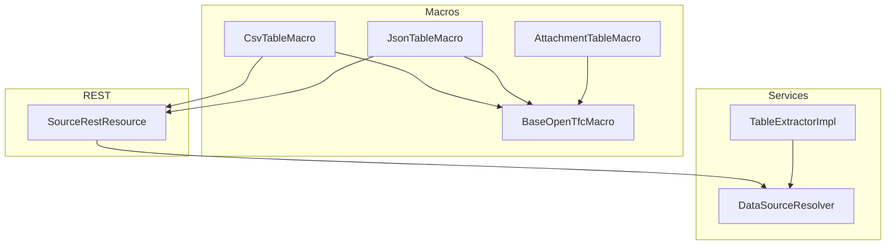
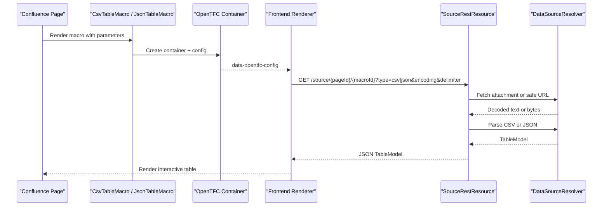
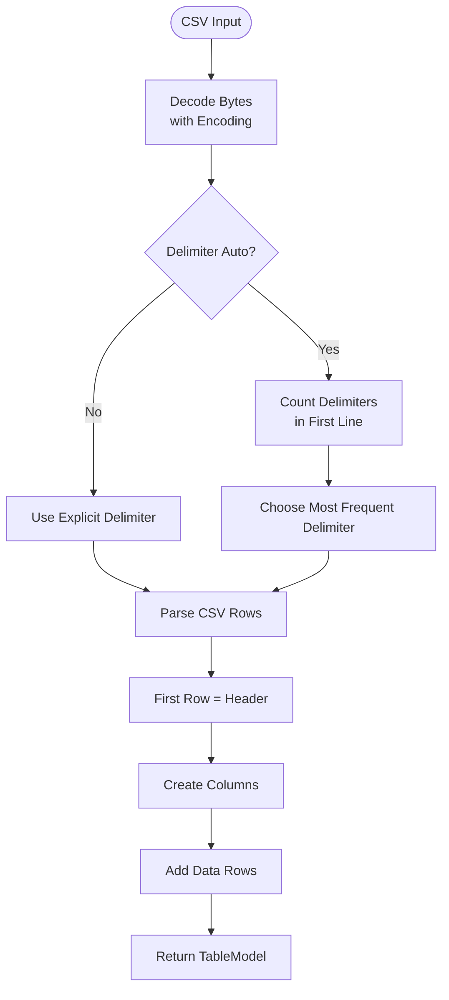
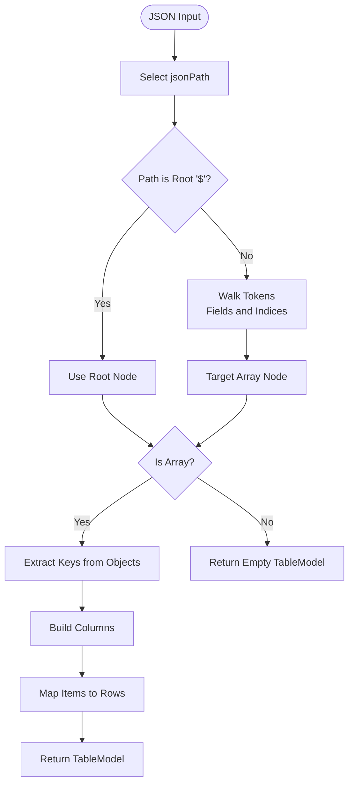
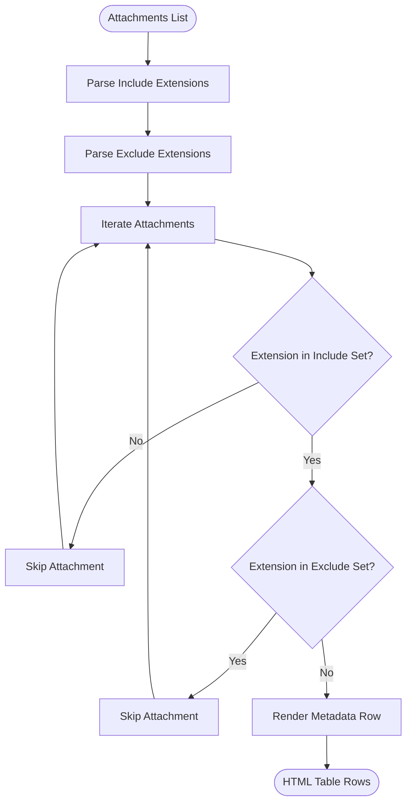
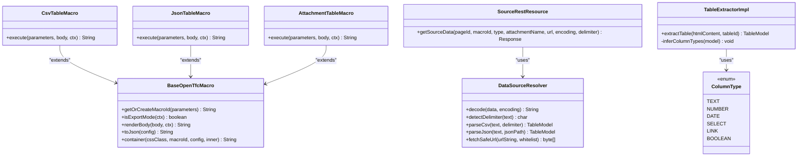

# Data Source Macros

<cite>
**Referenced Files in This Document**
- [README.md](file://README.md)
- [USER_GUIDE.md](file://USER_GUIDE.md)
- [BaseOpenTfcMacro.java](file://src/main/java/org/opentfc/macro/BaseOpenTfcMacro.java)
- [CsvTableMacro.java](file://src/main/java/org/opentfc/macro/CsvTableMacro.java)
- [JsonTableMacro.java](file://src/main/java/org/opentfc/macro/JsonTableMacro.java)
- [AttachmentTableMacro.java](file://src/main/java/org/opentfc/macro/AttachmentTableMacro.java)
- [SourceRestResource.java](file://src/main/java/org/opentfc/rest/SourceRestResource.java)
- [DataSourceResolver.java](file://src/main/java/org/opentfc/service/DataSourceResolver.java)
- [TableExtractorImpl.java](file://src/main/java/org/opentfc/service/TableExtractorImpl.java)
- [ColumnType.java](file://src/main/java/org/opentfc/model/ColumnType.java)
- [MacroRenderTests.java](file://src/test/java/org/opentfc/macro/MacroRenderTests.java)
- [MacroAdditionalTests.java](file://src/test/java/org/opentfc/macro/MacroAdditionalTests.java)
</cite>

## Table of Contents
1. [Introduction](#introduction)
2. [Project Structure](#project-structure)
3. [Core Components](#core-components)
4. [Architecture Overview](#architecture-overview)
5. [Detailed Component Analysis](#detailed-component-analysis)
6. [Dependency Analysis](#dependency-analysis)
7. [Performance Considerations](#performance-considerations)
8. [Troubleshooting Guide](#troubleshooting-guide)
9. [Conclusion](#conclusion)

## Introduction
This document explains the OpenTFC data source macros that provide flexible input methods for tables:
- CSV Table Macro for loading comma-separated or tab-separated values.
- JSON Table Macro for converting structured JSON into a table.
- Attachment Table Macro for listing and filtering page attachments as a table.

These macros are part of the OpenTFC Confluence plugin, which also provides filtering, charts, pivot tables, spreadsheets, and SQL transformation capabilities. The data source macros focus on ingestion and initial presentation; downstream OpenTFC features can consume their output through shared container elements and REST-backed data resolution.

The documentation covers configuration parameters, security restrictions, performance characteristics, error handling, and practical examples for common sources such as exported reports, API responses, and external feeds.

## Project Structure
The data source functionality is implemented primarily in three macro classes under `org.opentfc.macro`, with supporting services under `org.opentfc.service` and a REST endpoint under `org.opentfc.rest`. Tests validate parameter propagation, defaults, attachment filtering, and rendering behavior.

**Diagram sources**
- [CsvTableMacro.java:14-46](file://src/main/java/org/opentfc/macro/CsvTableMacro.java#L14-L46)
- [JsonTableMacro.java:14-46](file://src/main/java/org/opentfc/macro/JsonTableMacro.java#L14-L46)
- [AttachmentTableMacro.java:29-118](file://src/main/java/org/opentfc/macro/AttachmentTableMacro.java#L29-L118)
- [BaseOpenTfcMacro.java:21-103](file://src/main/java/org/opentfc/macro/BaseOpenTfcMacro.java#L21-L103)
- [SourceRestResource.java:25-111](file://src/main/java/org/opentfc/rest/SourceRestResource.java#L25-L111)
- [DataSourceResolver.java:37-289](file://src/main/java/org/opentfc/service/DataSourceResolver.java#L37-L289)
- [TableExtractorImpl.java:19-165](file://src/main/java/org/opentfc/service/TableExtractorImpl.java#L19-L165)

**Section sources**
- [README.md:46-50](file://README.md#L46-L50)
- [USER_GUIDE.md:43-50](file://USER_GUIDE.md#L43-L50)

## Core Components
- CsvTableMacro: Renders a container for CSV/TSV data from page attachments, inline text, or whitelisted URLs. It passes parameters like source type, delimiter, encoding, and inline content to the frontend via a configuration object.
- JsonTableMacro: Renders a container for JSON data from attachments, inline text, or whitelisted URLs. It supports a JSONPath selector and forwards it to the frontend.
- AttachmentTableMacro: Generates an HTML table listing current page attachments with metadata (name, size, creator, modified date, comment), optionally filtered by file extensions.
- BaseOpenTfcMacro: Provides shared helpers for macro IDs, export mode detection, body rendering, JSON serialization, HTML escaping, and standard container wrapping.
- SourceRestResource: Exposes `/source/{pageId}/{macroId}` to fetch CSV or JSON data for macros when needed.
- DataSourceResolver: Handles decoding, delimiter detection, CSV parsing, JSON parsing, safe URL fetching with SSRF protection, and stream size limits.
- TableExtractorImpl: Parses HTML tables and infers column types (text, number, date, select).
- ColumnType: Enumerates supported column types used across models.

**Section sources**
- [CsvTableMacro.java:11-46](file://src/main/java/org/opentfc/macro/CsvTableMacro.java#L11-L46)
- [JsonTableMacro.java:11-46](file://src/main/java/org/opentfc/macro/JsonTableMacro.java#L11-L46)
- [AttachmentTableMacro.java:25-118](file://src/main/java/org/opentfc/macro/AttachmentTableMacro.java#L25-L118)
- [BaseOpenTfcMacro.java:18-103](file://src/main/java/org/opentfc/macro/BaseOpenTfcMacro.java#L18-L103)
- [SourceRestResource.java:22-111](file://src/main/java/org/opentfc/rest/SourceRestResource.java#L22-L111)
- [DataSourceResolver.java:37-289](file://src/main/java/org/opentfc/service/DataSourceResolver.java#L37-L289)
- [TableExtractorImpl.java:16-165](file://src/main/java/org/opentfc/service/TableExtractorImpl.java#L16-L165)
- [ColumnType.java:1-13](file://src/main/java/org/opentfc/model/ColumnType.java#L1-L13)

## Architecture Overview
The data source macros follow a consistent pattern:
1. The macro renders a container element with a stable ID and serialized configuration.
2. For CSV/JSON macros, the frontend may call the `/source` REST endpoint to load data from attachments or whitelisted URLs.
3. The REST endpoint uses `DataSourceResolver` to decode, parse, and return a `TableModel`.
4. Downstream OpenTFC components (filter, chart, pivot, transformer) consume the resulting table model.

**Diagram sources**
- [CsvTableMacro.java:30-46](file://src/main/java/org/opentfc/macro/CsvTableMacro.java#L30-L46)
- [JsonTableMacro.java:30-46](file://src/main/java/org/opentfc/macro/JsonTableMacro.java#L30-L46)
- [SourceRestResource.java:61-111](file://src/main/java/org/opentfc/rest/SourceRestResource.java#L61-L111)
- [DataSourceResolver.java:97-187](file://src/main/java/org/opentfc/service/DataSourceResolver.java#L97-L187)

## Detailed Component Analysis

### CSV Table Macro
Purpose:
- Load tabular data from page attachments, inline text, or external URLs.
- Support configurable delimiter, encoding, and inline content.

Key configuration parameters:
- `sourceType`: `attachment` or `url`. Default is `attachment`.
- `attachmentName`: Name of the attached CSV/TSV file.
- `url`: External URL to fetch CSV data from.
- `delimiter`: Auto-detection or explicit character (`comma`, `semicolon`, `tab`, `pipe`). Default is auto-detection.
- `encoding`: Character set for decoding. Defaults to UTF-8.
- `inline`: Inline CSV/TSV content when no attachment or URL is provided.

Behavior:
- Renders a container with class markers for CSV processing and a placeholder message while data loads.
- Passes all relevant parameters to the frontend via serialized configuration.

Common use cases:
- Imported CSV reports from systems like ERP or CRM.
- Tab-separated exports from analytics tools.
- Inline small datasets for quick demos.

Security and constraints:
- When using `url`, access is controlled by the REST layer and SSRF protections.
- File size is limited during fetch and read operations.

Error handling:
- If the attachment is missing or the URL is invalid, the REST endpoint returns a not found or server error response.
- Malformed CSV is handled by the parser; empty lines are ignored.

**Section sources**
- [CsvTableMacro.java:11-46](file://src/main/java/org/opentfc/macro/CsvTableMacro.java#L11-L46)
- [SourceRestResource.java:61-111](file://src/main/java/org/opentfc/rest/SourceRestResource.java#L61-L111)
- [DataSourceResolver.java:48-137](file://src/main/java/org/opentfc/service/DataSourceResolver.java#L48-L137)
- [MacroRenderTests.java:167-181](file://src/test/java/org/opentfc/macro/MacroRenderTests.java#L167-L181)

#### CSV Parsing Flow

**Diagram sources**
- [DataSourceResolver.java:48-137](file://src/main/java/org/opentfc/service/DataSourceResolver.java#L48-L137)

### JSON Table Macro
Purpose:
- Convert arrays of JSON objects or arrays into a table.
- Support selecting a specific path within nested JSON structures.

Key configuration parameters:
- `sourceType`: `attachment` or `url`. Default is `attachment`.
- `attachmentName`: Name of the attached JSON file.
- `url`: External URL to fetch JSON data from.
- `jsonPath`: Path to the target array (e.g., `$.data.items[*]`). Default is root `$`.
- `inline`: Inline JSON content when no attachment or URL is provided.

Behavior:
- Renders a container with class markers for JSON processing and a placeholder message while data loads.
- Serializes configuration including `jsonPath` for the frontend.

Common use cases:
- API responses returning arrays of records.
- Nested JSON where only a subset needs to be displayed.
- Inline JSON snippets for testing or documentation.

Security and constraints:
- When using `url`, access is controlled by the REST layer and SSRF protections.
- File size is limited during fetch and read operations.

Error handling:
- Invalid JSON results in an empty table model.
- Missing attachment or blocked URL triggers appropriate REST errors.

**Section sources**
- [JsonTableMacro.java:11-46](file://src/main/java/org/opentfc/macro/JsonTableMacro.java#L11-L46)
- [SourceRestResource.java:61-111](file://src/main/java/org/opentfc/rest/SourceRestResource.java#L61-L111)
- [DataSourceResolver.java:139-210](file://src/main/java/org/opentfc/service/DataSourceResolver.java#L139-L210)
- [MacroAdditionalTests.java:49-83](file://src/test/java/org/opentfc/macro/MacroAdditionalTests.java#L49-L83)

#### JSON Selection Flow

**Diagram sources**
- [DataSourceResolver.java:139-210](file://src/main/java/org/opentfc/service/DataSourceResolver.java#L139-L210)

### Attachment Table Macro
Purpose:
- Generate a table listing all attachments of the current page.
- Filter by file extensions and display metadata.

Key configuration parameters:
- `includeExtensions`: Comma-, semicolon-, or space-separated list of allowed extensions (e.g., `pdf, xlsx, docx`).
- `excludeExtensions`: Extensions to exclude from the list.

Behavior:
- Builds an HTML table with columns for file name, size, creator, modified date, and comment.
- Applies include and exclude filters based on file extension.
- Escapes user-provided values to prevent XSS.

Common use cases:
- Quick inventory of page documents.
- Filtering large sets of attachments by type.
- Wrapping the attachment table in OpenTFC filter for search and sorting.

Security and constraints:
- Uses Confluence’s attachment manager to access files safely.
- All rendered text is HTML-escaped.

Error handling:
- Null creators or comments render as empty cells.
- Null modification dates fall back to current time.

**Section sources**
- [AttachmentTableMacro.java:25-118](file://src/main/java/org/opentfc/macro/AttachmentTableMacro.java#L25-L118)
- [MacroAdditionalTests.java:136-205](file://src/test/java/org/opentfc/macro/MacroAdditionalTests.java#L136-L205)

#### Attachment Filtering Flow

**Diagram sources**
- [AttachmentTableMacro.java:72-118](file://src/main/java/org/opentfc/macro/AttachmentTableMacro.java#L72-L118)
- [AttachmentTableMacro.java:130-143](file://src/main/java/org/opentfc/macro/AttachmentTableMacro.java#L130-L143)

### Base Macro Infrastructure
Shared responsibilities:
- Stable macro ID generation or reuse.
- Export mode detection for PDF/Word/email rendering.
- Rich body rendering fallback.
- JSON serialization of macro configuration.
- HTML escaping and standard container wrapping.

This infrastructure ensures consistent behavior across CSV, JSON, and other OpenTFC macros.

**Section sources**
- [BaseOpenTfcMacro.java:18-103](file://src/main/java/org/opentfc/macro/BaseOpenTfcMacro.java#L18-L103)

## Dependency Analysis
The data source macros depend on:
- Confluence APIs for page and attachment management.
- REST endpoint for fetching external data securely.
- Service layer for decoding, parsing, and SSRF-safe network access.
- Models for representing tables, rows, cells, and column types.

**Diagram sources**
- [CsvTableMacro.java:14-46](file://src/main/java/org/opentfc/macro/CsvTableMacro.java#L14-L46)
- [JsonTableMacro.java:14-46](file://src/main/java/org/opentfc/macro/JsonTableMacro.java#L14-L46)
- [AttachmentTableMacro.java:29-118](file://src/main/java/org/opentfc/macro/AttachmentTableMacro.java#L29-L118)
- [BaseOpenTfcMacro.java:21-103](file://src/main/java/org/opentfc/macro/BaseOpenTfcMacro.java#L21-L103)
- [SourceRestResource.java:25-111](file://src/main/java/org/opentfc/rest/SourceRestResource.java#L25-L111)
- [DataSourceResolver.java:37-289](file://src/main/java/org/opentfc/service/DataSourceResolver.java#L37-L289)
- [TableExtractorImpl.java:19-165](file://src/main/java/org/opentfc/service/TableExtractorImpl.java#L19-L165)
- [ColumnType.java:1-13](file://src/main/java/org/opentfc/model/ColumnType.java#L1-L13)

**Section sources**
- [SourceRestResource.java:25-111](file://src/main/java/org/opentfc/rest/SourceRestResource.java#L25-L111)
- [DataSourceResolver.java:37-289](file://src/main/java/org/opentfc/service/DataSourceResolver.java#L37-L289)
- [TableExtractorImpl.java:19-165](file://src/main/java/org/opentfc/service/TableExtractorImpl.java#L19-L165)

## Performance Considerations
- Large datasets:
  - Network fetches are capped at a maximum size to avoid memory exhaustion.
  - CSV and JSON parsers process streams incrementally and ignore empty lines.
- Delimiter detection:
  - Scans only the first line to choose the most frequent delimiter among comma, semicolon, tab, and pipe.
- Type inference:
  - HTML table extraction infers numeric, date, and select types based on thresholds and unique value counts.
- Rendering:
  - Export modes disable JavaScript-heavy features and render static content for PDF/Word/email.

Recommendations:
- Prefer attachments for internal data to avoid network overhead.
- Use explicit delimiters for known formats to reduce detection cost.
- Keep JSON payloads focused on the required array to minimize parsing work.
- Wrap large tables with pagination or transformers to limit visible rows.

[No sources needed since this section provides general guidance]

## Troubleshooting Guide
Common issues and resolutions:
- Attachment not found:
  - Verify `attachmentName` matches the exact file name.
  - Ensure the page has the expected attachment version.
- URL access blocked:
  - Confirm the host is included in the OpenTFC URL whitelist.
  - Ensure the protocol is HTTP or HTTPS.
  - Avoid internal or private IP addresses due to SSRF protection.
- Encoding problems:
  - Set `encoding` explicitly if the file is not UTF-8.
  - Auto-decoding falls back to Windows-1251 when UTF-8 decoding fails.
- Malformed CSV:
  - Check delimiter settings; use auto-detection or specify explicitly.
  - Ensure headers exist in the first row.
- Malformed JSON:
  - Validate JSON structure and ensure the selected path points to an array.
  - Use simple paths like `$.items[*]` for nested structures.
- Connectivity timeouts:
  - Remote servers must respond within configured connect and read timeouts.
  - Redirects are disabled; ensure the final URL is direct.

Operational checks:
- Review server logs for REST source load failures.
- Use diagnostics endpoints to verify macro rendering and configuration.

**Section sources**
- [SourceRestResource.java:90-111](file://src/main/java/org/opentfc/rest/SourceRestResource.java#L90-L111)
- [DataSourceResolver.java:48-75](file://src/main/java/org/opentfc/service/DataSourceResolver.java#L48-L75)
- [DataSourceResolver.java:217-258](file://src/main/java/org/opentfc/service/DataSourceResolver.java#L217-L258)

## Conclusion
The OpenTFC data source macros provide robust, secure, and flexible ways to ingest tabular data from attachments, inline content, and external URLs. CSV and JSON macros share a consistent configuration model and rely on a secure REST layer for data retrieval. The attachment macro offers a straightforward listing and filtering mechanism for page documents. Together with downstream OpenTFC features, these macros enable powerful analysis workflows while maintaining safety and performance.

[No sources needed since this section summarizes without analyzing specific files]