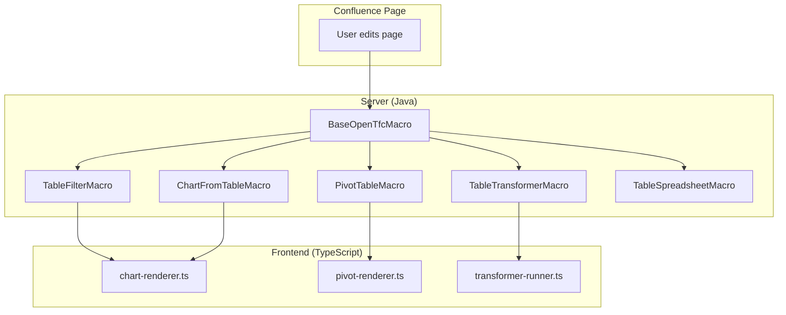
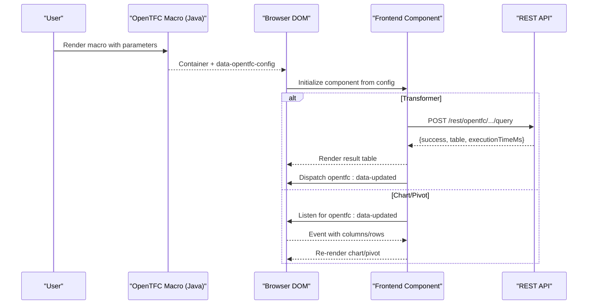
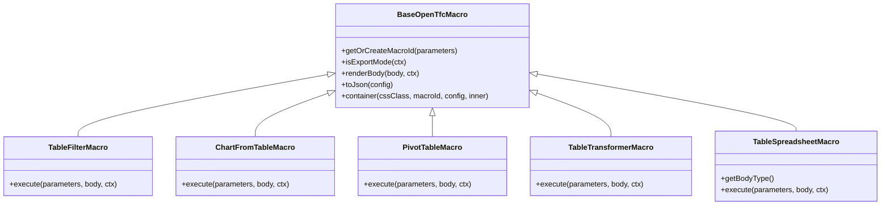

# Features Documentation

<cite>
**Referenced Files in This Document**
- [README.md](file://README.md)
- [USER_GUIDE.md](file://USER_GUIDE.md)
- [BaseOpenTfcMacro.java](file://src/main/java/org/opentfc/macro/BaseOpenTfcMacro.java)
- [TableFilterMacro.java](file://src/main/java/org/opentfc/macro/TableFilterMacro.java)
- [ChartFromTableMacro.java](file://src/main/java/org/opentfc/macro/ChartFromTableMacro.java)
- [PivotTableMacro.java](file://src/main/java/org/opentfc/macro/PivotTableMacro.java)
- [TableTransformerMacro.java](file://src/main/java/org/opentfc/macro/TableTransformerMacro.java)
- [TableSpreadsheetMacro.java](file://src/main/java/org/opentfc/macro/TableSpreadsheetMacro.java)
- [chart-renderer.ts](file://src/main/frontend/src/chart/chart-renderer.ts)
- [pivot-renderer.ts](file://src/main/frontend/src/pivot/pivot-renderer.ts)
- [transformer-runner.ts](file://src/main/frontend/src/transformer/transformer-runner.ts)
</cite>

## Table of Contents
1. Introduction
2. Project Structure
3. Core Components
4. Architecture Overview
5. Detailed Component Analysis
6. Dependency Analysis
7. Performance Considerations
8. Troubleshooting Guide
9. Conclusion

## Introduction
This document provides comprehensive feature documentation for OpenTFC, covering the following major capabilities:
- Open Table Filter
- Open Chart from Table
- Open Pivot Table
- Open Table Transformer
- Open Table Spreadsheet

For each feature, you will find purpose, configuration options, parameters, usage patterns, UI elements, interaction patterns, customization options, performance considerations, limitations, and best practices. Practical examples are included to demonstrate common use cases, advanced configurations, and integration scenarios.

## Project Structure
OpenTFC is a Confluence Data Center / Server plugin that combines server-side macro rendering with client-side JavaScript components. The key parts relevant to features are:
- Java macros that render HTML containers and pass configuration to the frontend
- TypeScript front-end modules that implement interactive behaviors (filtering, charting, pivoting, SQL transformation, spreadsheet editing)
- REST endpoints used by the transformer runner to execute queries server-side

**Diagram sources**
- [BaseOpenTfcMacro.java:1-115](file://src/main/java/org/opentfc/macro/BaseOpenTfcMacro.java#L1-L115)
- [TableFilterMacro.java:1-86](file://src/main/java/org/opentfc/macro/TableFilterMacro.java#L1-L86)
- [ChartFromTableMacro.java:1-55](file://src/main/java/org/opentfc/macro/ChartFromTableMacro#L1-L55)
- [PivotTableMacro.java:1-47](file://src/main/java/org/opentfc/macro/PivotTableMacro.java#L1-L47)
- [TableTransformerMacro.java:1-45](file://src/main/java/org/opentfc/macro/TableTransformerMacro.java#L1-L45)
- [TableSpreadsheetMacro.java:1-51](file://src/main/java/org/opentfc/macro/TableSpreadsheetMacro.java#L1-L51)
- [chart-renderer.ts:1-283](file://src/main/frontend/src/chart/chart-renderer.ts#L1-L283)
- [pivot-renderer.ts:1-228](file://src/main/frontend/src/pivot/pivot-renderer.ts#L1-L228)
- [transformer-runner.ts:1-173](file://src/main/frontend/src/transformer/transformer-runner.ts#L1-L173)

**Section sources**
- [README.md:15-50](file://README.md#L15-L50)
- [USER_GUIDE.md:31-51](file://USER_GUIDE.md#L31-L51)

## Core Components
OpenTFC exposes several macros that wrap or generate tables and provide rich interactivity:
- BaseOpenTfcMacro: shared logic for parameter handling, body rendering, export mode detection, JSON config serialization, and container wrapping.
- TableFilterMacro: renders an interactive filterable/sortable table with toolbar, pagination, totals, and column visibility controls.
- ChartFromTableMacro: renders an Apache ECharts-based chart with dynamic updates when upstream data changes.
- PivotTableMacro: renders a pivot grid with row/column/value selection and aggregation functions.
- TableTransformerMacro: executes DuckDB SQL over one or more source tables and emits results as a new table; supports chaining to downstream macros.
- TableSpreadsheetMacro: renders an editable spreadsheet persisted as a JSON attachment on the page.

Key responsibilities:
- Macro execution parses parameters and builds a configuration object serialized into a data attribute.
- In export modes (PDF/Word/email), macros return static fallback markup without JS-dependent UI.
- Frontend components read the configuration and initialize their respective UIs.

**Section sources**
- [BaseOpenTfcMacro.java:35-103](file://src/main/java/org/opentfc/macro/BaseOpenTfcMacro.java#L35-L103)
- [TableFilterMacro.java:24-83](file://src/main/java/org/opentfc/macro/TableFilterMacro.java#L24-L83)
- [ChartFromTableMacro.java:24-52](file://src/main/java/org/opentfc/macro/ChartFromTableMacro.java#L24-L52)
- [PivotTableMacro.java:24-44](file://src/main/java/org/opentfc/macro/PivotTableMacro.java#L24-L44)
- [TableTransformerMacro.java:24-42](file://src/main/java/org/opentfc/macro/TableTransformerMacro.java#L24-L42)
- [TableSpreadsheetMacro.java:24-48](file://src/main/java/org/opentfc/macro/TableSpreadsheetMacro.java#L24-L48)

## Architecture Overview
The system follows a macro-driven architecture where server-side macros produce lightweight HTML containers with embedded configuration. Client-side components then hydrate these containers to deliver interactive experiences.

**Diagram sources**
- [BaseOpenTfcMacro.java:98-103](file://src/main/java/org/opentfc/macro/BaseOpenTfcMacro.java#L98-L103)
- [transformer-runner.ts:94-160](file://src/main/frontend/src/transformer/transformer-runner.ts#L94-L160)
- [chart-renderer.ts:99-106](file://src/main/frontend/src/chart/chart-renderer.ts#L99-L106)
- [pivot-renderer.ts:54-61](file://src/main/frontend/src/pivot/pivot-renderer.ts#L54-L61)

## Detailed Component Analysis

### Open Table Filter
Purpose:
- Turns a static Confluence table into an interactive grid with search, filters, sorting, pagination, totals, and column visibility controls. It also supports saving personal views.

Configuration options and parameters:
- showSearchBox: toggle global search box
- showColumnFilters: toggle per-column filters
- stickyHeader: freeze header while scrolling
- freezeColumns: number of leftmost columns to freeze
- showTotals: enable totals row (SUM, AVG, MIN, MAX, COUNT)
- allowHideColumns: enable column visibility toggles
- showExportButtons: enable CSV/XLSX export buttons
- pageSize: rows per page (e.g., 10, 25, 50, 100, All)
- enablePagination: control pagination bar presence

UI elements and interactions:
- Toolbar with global search, column filters, export, and view controls
- Sticky header and frozen columns for large datasets
- Totals row at the bottom
- Pagination bar for navigating pages
- Column visibility dropdown

Usage patterns:
- Wrap any Confluence table inside the macro to activate filtering/sorting.
- Combine with other macros (e.g., Chart from Table) so charts update when filters change.

Advanced configurations:
- Use legacy keys for compatibility (freezeHeader, filterStatus, totalsRow).
- Persist custom views per user via Active Objects.

Performance considerations:
- Large tables benefit from pagination and selective column visibility.
- Freezing many columns can impact layout performance; keep it minimal.

Limitations:
- Export mode returns static markup without interactive controls.

Best practices:
- Enable only necessary features (e.g., disable showColumnFilters if not needed).
- Use showTotals judiciously on numeric columns.
- Prefer smaller page sizes for very wide tables.

**Section sources**
- [TableFilterMacro.java:24-83](file://src/main/java/org/opentfc/macro/TableFilterMacro.java#L24-L83)
- [USER_GUIDE.md:68-106](file://USER_GUIDE.md#L68-L106)
- [README.md:15-26](file://README.md#L15-L26)

### Open Chart from Table
Purpose:
- Renders interactive charts from table data using Apache ECharts. Charts dynamically update when upstream data changes (e.g., from a filter).

Supported chart types:
- Column, Stacked Column, Bar, Line, Area, Pie, Donut, Scatter, Radar, Funnel, Gantt

Configuration options and parameters:
- chartType: select chart type
- xAxisColumn / yAxisColumns: map columns to axes
- aggregation: SUM, AVG, COUNT, MIN, MAX, NONE
- height: chart height in pixels
- chartTitle: title displayed above the chart

UI elements and interactions:
- Toolbar with chart type selector and PNG export button
- Canvas area for rendering
- Source table hidden but used for data binding

Usage patterns:
- Place inside Open Table Filter to reflect filtered data in real time.
- Bind to upstream macro via sourceMacroId to react to data updates.

Advanced configurations:
- For Gantt, supply task names, start dates, and end dates in the expected order.
- For Radar, ensure multiple value columns represent dimensions.

Performance considerations:
- Avoid extremely large datasets in pie/funnel/radar charts.
- Resize events trigger re-layout; consider limiting frequent window resizes during heavy operations.

Limitations:
- Export mode shows static fallback content instead of the chart.

Best practices:
- Choose appropriate chart types for your data distribution.
- Keep series count reasonable for readability.

**Section sources**
- [ChartFromTableMacro.java:24-52](file://src/main/java/org/opentfc/macro/ChartFromTableMacro.java#L24-L52)
- [chart-renderer.ts:1-283](file://src/main/frontend/src/chart/chart-renderer.ts#L1-L283)
- [USER_GUIDE.md:109-134](file://USER_GUIDE.md#L109-L134)
- [README.md:27-31](file://README.md#L27-L31)

### Open Pivot Table
Purpose:
- Creates analytical pivot tables from flat lists directly within Confluence, supporting multi-level grouping and aggregation.

Configuration options and parameters:
- rowFields: columns for vertical grouping
- columnFields: columns for horizontal grouping
- valueFields: numeric column(s) to aggregate
- aggregateFunction: SUM, COUNT, AVG, MIN, MAX

UI elements and interactions:
- Controls panel to select row fields, value fields, and aggregation function
- Pivot grid showing grouped results with totals
- CSV export button

Usage patterns:
- Wrap a flat dataset and configure row/value fields to summarize metrics quickly.

Advanced configurations:
- Switch aggregation functions to compare different summaries (e.g., average vs sum).

Performance considerations:
- Aggregation runs client-side; avoid excessively large datasets.

Limitations:
- Current implementation focuses on single-row field selection and basic aggregation.

Best practices:
- Normalize data before pivoting (consistent categories, numeric values).
- Use CSV export for further analysis in external tools.

**Section sources**
- [PivotTableMacro.java:24-44](file://src/main/java/org/opentfc/macro/PivotTableMacro.java#L24-L44)
- [pivot-renderer.ts:1-228](file://src/main/frontend/src/pivot/pivot-renderer.ts#L1-L228)
- [USER_GUIDE.md:137-153](file://USER_GUIDE.md#L137-L153)
- [README.md:32-35](file://README.md#L32-L35)

### Open Table Transformer
Purpose:
- Executes SQL queries against one or more tables (T1..Tn) using an in-memory DuckDB engine. Supports JOIN, UNION, PIVOT, window functions, and computed fields. Provides a sandboxed environment blocking DDL/DML and file I/O.

Configuration options and parameters:
- sqlQuery: SQL statement to execute
- preset: optional preset name for quick templates
- sourceMacroIds: IDs of upstream macros whose data can be referenced

UI elements and interactions:
- SQL editor with presets and run button
- Result grid displaying query output with metadata (execution time, row count)
- Emits data-updated event for downstream macros

Usage patterns:
- Chain transformer output into filters, charts, or pivots for end-to-end pipelines.
- Use T1, T2, etc., to reference nested tables; quote column names with spaces or non-ASCII characters.

Advanced configurations:
- Use CASE expressions, GROUP BY, ORDER BY, and window functions for complex analytics.
- Combine multiple tables with JOIN or UNION ALL.

Performance considerations:
- Queries run server-side; keep result sets reasonable.
- Avoid expensive operations on very large tables; pre-aggregate upstream if possible.

Limitations:
- Read-only sandbox; DDL/DML and filesystem access are blocked.

Best practices:
- Validate SQL syntax and test small subsets first.
- Use indexes conceptually by filtering early and aggregating efficiently.

**Section sources**
- [TableTransformerMacro.java:24-42](file://src/main/java/org/opentfc/macro/TableTransformerMacro.java#L24-L42)
- [transformer-runner.ts:1-173](file://src/main/frontend/src/transformer/transformer-runner.ts#L1-L173)
- [USER_GUIDE.md:156-216](file://USER_GUIDE.md#L156-L216)
- [README.md:36-40](file://README.md#L36-L40)

### Open Table Spreadsheet
Purpose:
- Provides an Excel-like spreadsheet experience directly on Confluence pages, with formulas, styling, number formats, and persistence as XLSX attachments with versioning.

Configuration options and parameters:
- attachmentName: name of the JSON attachment storing spreadsheet state
- readOnly: toggle editability
- height: viewport height for the spreadsheet

UI elements and interactions:
- Toolbar for spreadsheet actions
- Editable grid viewport with formula support and formatting
- Soft session locking to prevent conflicts

Usage patterns:
- Create planning sheets, trackers, or calculators that persist automatically.
- Embed existing spreadsheets via include macros (separate feature).

Advanced configurations:
- Use formulas like SUM, AVERAGE, COUNT, IF, VLOOKUP, CONCATENATE.
- Apply cell styles, number formats, and merge cells.

Performance considerations:
- Very large sheets may slow down rendering; split into multiple sheets or pages.

Limitations:
- Export mode returns placeholder text rather than full spreadsheet content.

Best practices:
- Organize related data into separate sheets.
- Leverage versioning history to track changes safely.

**Section sources**
- [TableSpreadsheetMacro.java:24-48](file://src/main/java/org/opentfc/macro/TableSpreadsheetMacro.java#L24-L48)
- [USER_GUIDE.md:219-230](file://USER_GUIDE.md#L219-L230)
- [README.md:41-45](file://README.md#L41-L45)

## Dependency Analysis
The macros depend on BaseOpenTfcMacro for shared functionality and serialize configuration objects consumed by frontend components. Frontend components listen for data-updated events to synchronize across macros.

**Diagram sources**
- [BaseOpenTfcMacro.java:21-115](file://src/main/java/org/opentfc/macro/BaseOpenTfcMacro.java#L21-L115)
- [TableFilterMacro.java:14-83](file://src/main/java/org/opentfc/macro/TableFilterMacro.java#L14-L83)
- [ChartFromTableMacro.java:14-52](file://src/main/java/org/opentfc/macro/ChartFromTableMacro.java#L14-L52)
- [PivotTableMacro.java:14-44](file://src/main/java/org/opentfc/macro/PivotTableMacro.java#L14-L44)
- [TableTransformerMacro.java:14-42](file://src/main/java/org/opentfc/macro/TableTransformerMacro.java#L14-L42)
- [TableSpreadsheetMacro.java:14-48](file://src/main/java/org/opentfc/macro/TableSpreadsheetMacro.java#L14-L48)

**Section sources**
- [BaseOpenTfcMacro.java:35-103](file://src/main/java/org/opentfc/macro/BaseOpenTfcMacro.java#L35-L103)

## Performance Considerations
- Pagination and selective column visibility reduce DOM size in large tables.
- Limit frozen columns to essential identifiers to improve layout performance.
- Chart types like pie/funnel/radar can be heavy with many series; prefer aggregated data.
- Transformer queries should be optimized (filters early, avoid unnecessary joins).
- Spreadsheet size impacts rendering; split into multiple sheets or pages.
- Export mode avoids JS-heavy rendering, improving PDF/Word generation speed.

[No sources needed since this section provides general guidance]

## Troubleshooting Guide
Common issues and resolutions:
- “No macro metadata” errors on Confluence 8.5: ensure the latest plugin version is installed and check diagnostics endpoint for activation events.
- Personal views not saved: verify Active Objects storage and permissions; views are stored per user and page ID.
- SQL sandbox errors: confirm queries are SELECT-only; DDL/DML and file I/O are blocked.
- Charts not updating: ensure upstream macro emits data-updated events and chart binds to correct sourceMacroId.
- Spreadsheet conflicts: soft session locking warns other users; coordinate edits to avoid conflicts.

**Section sources**
- [USER_GUIDE.md:339-352](file://USER_GUIDE.md#L339-L352)

## Conclusion
OpenTFC delivers a robust, extensible toolkit for working with tabular data in Confluence. Its macro-driven architecture enables powerful combinations—filtering, visualizing, pivoting, transforming, and editing data—all within familiar Confluence pages. By following the configuration guidelines, interaction patterns, and best practices outlined here, teams can build efficient, maintainable data workflows tailored to their needs.

[No sources needed since this section summarizes without analyzing specific files]