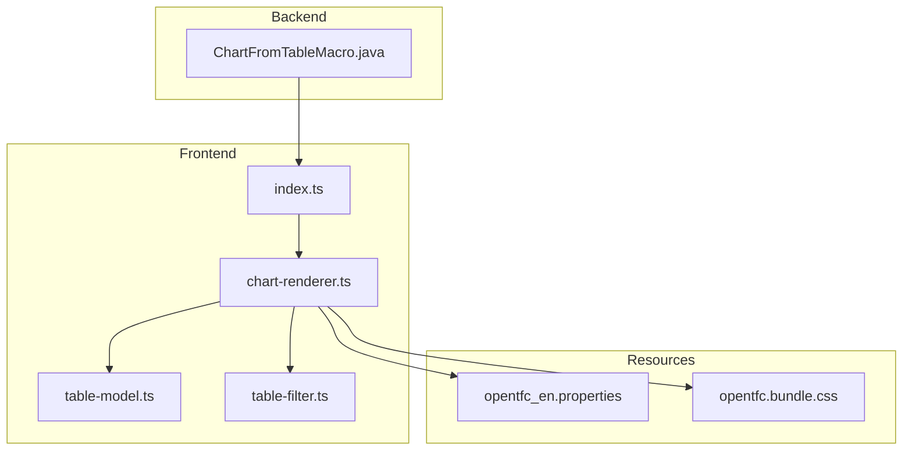
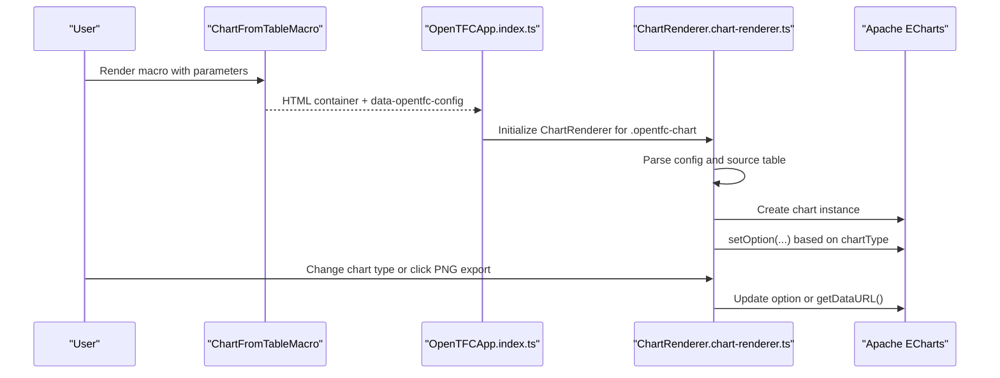
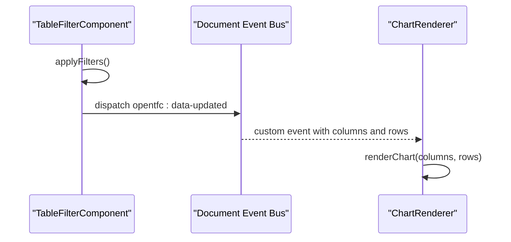

# Open Chart from Table

<cite>
**Referenced Files in This Document**
- [README.md](file://README.md)
- [USER_GUIDE.md](file://USER_GUIDE.md)
- [ChartFromTableMacro.java](file://src/main/java/org/opentfc/macro/ChartFromTableMacro.java)
- [chart-renderer.ts](file://src/main/frontend/src/chart/chart-renderer.ts)
- [table-model.ts](file://src/main/frontend/src/core/table-model.ts)
- [table-filter.ts](file://src/main/frontend/src/filter/table-filter.ts)
- [index.ts](file://src/main/frontend/src/index.ts)
- [opentfc_en.properties](file://src/main/resources/i18n/opentfc_en.properties)
- [opentfc.bundle.css](file://src/main/resources/css/opentfc.bundle.css)
</cite>

## Table of Contents
1. [Introduction](#introduction)
2. [Project Structure](#project-structure)
3. [Core Components](#core-components)
4. [Architecture Overview](#architecture-overview)
5. [Detailed Component Analysis](#detailed-component-analysis)
6. [Supported Chart Types and Configuration](#supported-chart-types-and-configuration)
7. [Dynamic Updates and Integration with OpenTFC](#dynamic-updates-and-integration-with-opentfc)
8. [Export Capabilities](#export-capabilities)
9. [Performance Considerations](#performance-considerations)
10. [Styling and CSS Variables](#styling-and-css-variables)
11. [Accessibility Considerations](#accessibility-considerations)
12. [Troubleshooting Guide](#troubleshooting-guide)
13. [Conclusion](#conclusion)

## Introduction
Open Chart from Table is an OpenTFC feature that converts Confluence table data into interactive charts powered by Apache ECharts. It supports multiple chart types, dynamic updates when underlying tables change, and export to PNG images. The macro renders a lightweight container on the page; the frontend then initializes the chart, parses the source table, and binds it to ECharts.

The feature integrates tightly with other OpenTFC components:
- It can visualize filtered or transformed data from Open Table Filter, Open Pivot Table, and Open Table Transformer.
- It participates in the same initialization lifecycle as other OpenTFC macros.
- In export mode, it falls back to showing the source table instead of the interactive chart.

**Section sources**
- [README.md:27-31](file://README.md#L27-L31)
- [USER_GUIDE.md:109-134](file://USER_GUIDE.md#L109-L134)

## Project Structure
The Open Chart from Table feature spans backend macro rendering and frontend chart rendering:

**Diagram sources**
- [ChartFromTableMacro.java:24-52](file://src/main/java/org/opentfc/macro/ChartFromTableMacro.java#L24-L52)
- [index.ts:10-26](file://src/main/frontend/src/index.ts#L10-L26)
- [chart-renderer.ts:1-30](file://src/main/frontend/src/chart/chart-renderer.ts#L1-L30)
- [table-model.ts:1-36](file://src/main/frontend/src/core/table-model.ts#L1-L36)
- [table-filter.ts:1-73](file://src/main/frontend/src/filter/table-filter.ts#L1-L73)
- [opentfc_en.properties:88-100](file://src/main/resources/i18n/opentfc_en.properties#L88-L100)
- [opentfc.bundle.css:485-492](file://src/main/resources/css/opentfc.bundle.css#L485-L492)

**Section sources**
- [ChartFromTableMacro.java:24-52](file://src/main/java/org/opentfc/macro/ChartFromTableMacro.java#L24-L52)
- [index.ts:10-26](file://src/main/frontend/src/index.ts#L10-L26)
- [chart-renderer.ts:1-30](file://src/main/frontend/src/chart/chart-renderer.ts#L1-L30)

## Core Components
- Backend macro: Renders the chart container, configuration, and hidden source table. It also handles export-mode fallback behavior.
- Frontend renderer: Initializes Apache ECharts, builds the toolbar, parses inline table data, listens for upstream data updates, and renders different chart types.
- Data model: Defines shared TypeScript interfaces for columns, rows, and cell data used by both filter and chart logic.
- Initialization entry point: Boots all OpenTFC features, including charts, after DOM readiness.

Key responsibilities:
- Macro prepares `data-opentfc-config` and markup for the chart canvas and source table.
- Renderer reads configuration, sets up ECharts, and maps table columns and rows to chart series.
- Filter component emits a global data-updated event that the chart listens to for live updates.

**Section sources**
- [ChartFromTableMacro.java:24-52](file://src/main/java/org/opentfc/macro/ChartFromTableMacro.java#L24-L52)
- [chart-renderer.ts:12-30](file://src/main/frontend/src/chart/chart-renderer.ts#L12-L30)
- [table-model.ts:1-36](file://src/main/frontend/src/core/table-model.ts#L1-L36)
- [index.ts:10-26](file://src/main/frontend/src/index.ts#L10-L26)

## Architecture Overview
The Open Chart from Table flow connects macro rendering, frontend bootstrapping, and ECharts rendering:

**Diagram sources**
- [ChartFromTableMacro.java:24-52](file://src/main/java/org/opentfc/macro/ChartFromTableMacro.java#L24-L52)
- [index.ts:20-26](file://src/main/frontend/src/index.ts#L20-L26)
- [chart-renderer.ts:12-30](file://src/main/frontend/src/chart/chart-renderer.ts#L12-L30)
- [chart-renderer.ts:108-226](file://src/main/frontend/src/chart/chart-renderer.ts#L108-L226)

## Detailed Component Analysis

### Backend Macro: ChartFromTableMacro
Responsibilities:
- Render the body content and detect export mode.
- Build a configuration map with macro ID, source macro ID, chart type, axis columns, aggregation, title, and height.
- Output a container with:
  - A toolbar placeholder.
  - A canvas div sized by configured height.
  - A hidden source div containing the original table.
- In export mode, return a fallback structure that shows the source table instead of JS-driven chart.

Important behaviors:
- Export mode returns static HTML with the chart title and rendered body.
- Height is sanitized before being injected into inline styles.
- Source macro ID enables binding to upstream data changes.

**Section sources**
- [ChartFromTableMacro.java:24-52](file://src/main/java/org/opentfc/macro/ChartFromTableMacro.java#L24-L52)

### Frontend Entry Point: OpenTFCApp
Responsibilities:
- Import CSS and feature modules.
- Query DOM nodes for each OpenTFC feature.
- Initialize ChartRenderer for `.opentfc-chart` elements once per element.
- Expose global objects for Confluence integration.

Initialization timing:
- Uses Confluence AJS hooks when available.
- Falls back to standard DOMContentLoaded if AJS is not present.

**Section sources**
- [index.ts:1-8](file://src/main/frontend/src/index.ts#L1-L8)
- [index.ts:10-26](file://src/main/frontend/src/index.ts#L10-L26)
- [index.ts:54-78](file://src/main/frontend/src/index.ts#L54-L78)

### Chart Renderer: ChartRenderer
Responsibilities:
- Read configuration from `data-opentfc-config`.
- Initialize ECharts instance inside the canvas element.
- Add responsive resize handling.
- Build a toolbar with:
  - Chart title display.
  - Chart type selector.
  - PNG export button.
- Parse inline source table into column definitions and row data.
- Bind to upstream data-updated events to re-render when filters or transformers change data.
- Implement rendering logic for:
  - Gantt chart.
  - Pie and donut charts.
  - Funnel chart.
  - Radar chart.
  - Standard grid charts: column, stacked column, bar, line, area.

Data mapping:
- First column is treated as category labels for most grid charts.
- Remaining numeric columns become series values.
- Non-numeric values are coerced to numbers where possible.

**Section sources**
- [chart-renderer.ts:12-30](file://src/main/frontend/src/chart/chart-renderer.ts#L12-L30)
- [chart-renderer.ts:32-74](file://src/main/frontend/src/chart/chart-renderer.ts#L32-L74)
- [chart-renderer.ts:76-97](file://src/main/frontend/src/chart/chart-renderer.ts#L76-L97)
- [chart-renderer.ts:99-106](file://src/main/frontend/src/chart/chart-renderer.ts#L99-L106)
- [chart-renderer.ts:108-226](file://src/main/frontend/src/chart/chart-renderer.ts#L108-L226)
- [chart-renderer.ts:228-281](file://src/main/frontend/src/chart/chart-renderer.ts#L228-L281)

### Shared Data Model: ColumnDef, RowData, CellData
Purpose:
- Provide consistent TypeScript types for columns, rows, and cells across OpenTFC features.
- Support column metadata such as index, name, type, options, visibility, and cell value plus optional HTML.

Relevance to charts:
- ChartRenderer uses these types to interpret parsed table data.
- TableFilterComponent uses them to build filters and emit updated data.

**Section sources**
- [table-model.ts:1-36](file://src/main/frontend/src/core/table-model.ts#L1-L36)

### Upstream Data Binding: TableFilterComponent
Responsibilities relevant to charts:
- Parses the table into structured data.
- Applies filters, sorts, pagination, and frozen columns.
- Emits a global `opentfc:data-updated` event with columns and rows.
- ChartRenderer listens for this event and re-renders when the source macro ID matches.

This mechanism enables real-time chart updates when users apply filters or sorting.

**Section sources**
- [table-filter.ts:697-797](file://src/main/frontend/src/filter/table-filter.ts#L697-L797)
- [chart-renderer.ts:99-106](file://src/main/frontend/src/chart/chart-renderer.ts#L99-L106)

## Supported Chart Types and Configuration

### Supported Chart Types
- Column
- Stacked Column
- Bar
- Line
- Area
- Pie
- Donut
- Scatter
- Radar
- Funnel
- Gantt

These types are exposed through the chart type selector and mapped to specific ECharts configurations.

**Section sources**
- [chart-renderer.ts:36-52](file://src/main/frontend/src/chart/chart-renderer.ts#L36-L52)
- [chart-renderer.ts:117-226](file://src/main/frontend/src/chart/chart-renderer.ts#L117-L226)
- [chart-renderer.ts:228-281](file://src/main/frontend/src/chart/chart-renderer.ts#L228-L281)

### Macro Parameters
| Parameter | Description | Notes |
|---|---|---|
| `macroId` | Unique identifier for the chart macro instance | Generated by base macro infrastructure |
| `sourceMacroId` | Identifier of the upstream macro whose data should drive the chart | Enables live updates when upstream data changes |
| `chartType` | Selected chart type | Defaults to `column`; supported values include column, stacked-column, bar, line, area, pie, donut, scatter, radar, funnel, gantt |
| `xAxisColumn` | X-axis column name | Used by macro metadata; runtime mapping currently relies on first column as category |
| `yAxisColumns` | Y-axis column names | Used by macro metadata; runtime mapping treats remaining columns as series |
| `aggregation` | Aggregation strategy | Values include SUM, AVG, COUNT, MIN, MAX, NONE; current renderer does not perform server-side aggregation |
| `chartTitle` | Chart title displayed in toolbar and ECharts title | Sanitized and passed to ECharts |
| `height` | Chart height in pixels or CSS units | Default is `400px`; sanitized before use |

Internationalized parameter labels are defined for the chart macro.

**Section sources**
- [ChartFromTableMacro.java:39-47](file://src/main/java/org/opentfc/macro/ChartFromTableMacro.java#L39-L47)
- [opentfc_en.properties:88-100](file://src/main/resources/i18n/opentfc_en.properties#L88-L100)

### Chart-Specific Behavior

#### Column, Stacked Column, Bar, Line, Area
- First column becomes category labels.
- Remaining columns become series.
- Stacked column uses ECharts stack grouping.
- Line and area share similar series configuration; area adds semi-transparent fill.
- Tooltip triggers on axis.
- Legend lists series names.

#### Pie and Donut
- First column is segment name.
- Second column is numeric value.
- Donut uses inner radius to create a ring shape.
- Tooltip shows segment name, value, and percentage.
- Legend is vertical on the left.

#### Funnel
- First column is stage name.
- Second column is numeric value.
- Series is sorted descending by value.
- Tooltip displays item details.

#### Radar
- First column defines indicator names.
- Remaining columns define series values.
- Maximum indicator value is computed dynamically.
- Legend lists series names.

#### Gantt
- First column is task name.
- Second column is start date.
- Third column is end date.
- Uses two-bar technique: offset bar and duration bar.
- Tooltip shows task name, start date, and duration in days.

**Section sources**
- [chart-renderer.ts:117-226](file://src/main/frontend/src/chart/chart-renderer.ts#L117-L226)
- [chart-renderer.ts:228-281](file://src/main/frontend/src/chart/chart-renderer.ts#L228-L281)

## Dynamic Updates and Integration with OpenTFC

### Live Updates from Filters
When Open Table Filter changes its data, it emits a global `opentfc:data-updated` event. ChartRenderer listens for this event and re-renders only when the event’s macro ID matches the chart’s configured source macro ID.

This allows charts to reflect filtered, sorted, or paginated results without manual refresh.

**Diagram sources**
- [table-filter.ts:697-797](file://src/main/frontend/src/filter/table-filter.ts#L697-L797)
- [chart-renderer.ts:99-106](file://src/main/frontend/src/chart/chart-renderer.ts#L99-L106)

### Integration with Other OpenTFC Features
- **Open Table Filter:** Charts update automatically when filters change.
- **Open Pivot Table:** Pivot output can be consumed by charts if the pivot macro exposes compatible data and the chart binds to its macro ID.
- **Open Table Transformer:** SQL-transformed tables can feed charts similarly, provided the transformer emits compatible data and the chart binds to the correct source macro ID.
- **Open Spreadsheet:** Spreadsheets are separate from the chart pipeline but can be combined via macros that produce tables consumable by charts.

**Section sources**
- [USER_GUIDE.md:283-313](file://USER_GUIDE.md#L283-L313)
- [chart-renderer.ts:99-106](file://src/main/frontend/src/chart/chart-renderer.ts#L99-L106)

## Export Capabilities

### PNG Export
The chart toolbar includes a PNG export button. When clicked:
- The renderer calls ECharts `getDataURL` with PNG format.
- A high pixel ratio is used for better image quality.
- A white background is applied.
- The browser downloads a file named using the macro ID.

### PDF Export
There is no dedicated client-side PDF export button in the chart renderer. However:
- During Confluence page export to PDF or Word, the macro detects export mode.
- In export mode, it returns a fallback structure that shows the chart title and the source table instead of the interactive chart.
- This ensures printable content even though the chart itself requires JavaScript.

For PDF exports of charts, users should rely on Confluence’s page export behavior or capture the PNG image separately.

**Section sources**
- [chart-renderer.ts:65-73](file://src/main/frontend/src/chart/chart-renderer.ts#L65-L73)
- [ChartFromTableMacro.java:30-34](file://src/main/java/org/opentfc/macro/ChartFromTableMacro.java#L30-L34)

## Performance Considerations

### Large Datasets
- ChartRenderer maps every row into series arrays. For very large tables, this increases memory usage and rendering time.
- ECharts can handle substantial datasets, but performance depends on:
  - Number of rows.
  - Number of series.
  - Chart type complexity (radar and funnel require additional processing).
  - Browser hardware acceleration.

Recommendations:
- Use aggregation at the source level when possible.
- Limit visible rows through filtering or pagination before visualization.
- Avoid too many series; group categories where appropriate.
- Prefer simpler chart types for very large datasets.

### Responsive Resizing
- The renderer attaches a window resize listener and calls ECharts resize.
- This helps charts adapt to container size changes, but frequent resizing can cause reflows.

Optimization tips:
- Avoid excessive nested containers that trigger layout thrashing.
- Defer heavy chart updates until after user interactions settle.

**Section sources**
- [chart-renderer.ts:22-25](file://src/main/frontend/src/chart/chart-renderer.ts#L22-L25)
- [chart-renderer.ts:108-226](file://src/main/frontend/src/chart/chart-renderer.ts#L108-L226)

## Styling and CSS Variables
The chart canvas and related UI elements use Confluence Design System CSS variables:
- Border color uses `--ds-border`.
- Background uses `--ds-surface`.
- Toolbar surface uses `--ds-surface-sunken`.

This allows charts to blend with Confluence themes while keeping styling centralized.

Customization approach:
- Override CSS variables in your site stylesheet to adjust borders, backgrounds, and surfaces.
- Extend `.opentfc-chart-canvas` styles for additional visual customization.
- Avoid overriding internal ECharts colors directly unless necessary; prefer theme-level variables.

**Section sources**
- [opentfc.bundle.css:485-492](file://src/main/resources/css/opentfc.bundle.css#L485-L492)
- [chart-renderer.ts:36-38](file://src/main/frontend/src/chart/chart-renderer.ts#L36-L38)

## Accessibility Considerations

### Current State
- Tooltips provide hover-based information for most chart types.
- Legends allow toggling series visibility.
- The chart toolbar includes buttons and a select control.
- No explicit ARIA roles or screen-reader-specific descriptions are added around the ECharts canvas.

### Recommendations
- Add descriptive `aria-label` attributes to the chart container to identify chart purpose.
- Provide keyboard navigation for the chart type selector and export button.
- Ensure tooltip text is meaningful for screen readers, especially for complex series.
- Consider exposing chart data in a hidden accessible table when exporting or printing.

These improvements would enhance accessibility beyond the current implementation.

**Section sources**
- [chart-renderer.ts:36-74](file://src/main/frontend/src/chart/chart-renderer.ts#L36-L74)
- [chart-renderer.ts:130-142](file://src/main/frontend/src/chart/chart-renderer.ts#L130-L142)

## Troubleshooting Guide

### Chart Does Not Render
Possible causes:
- Missing `.opentfc-chart` container.
- Invalid or missing `data-opentfc-config`.
- Empty source table.
- JavaScript not loaded or blocked.

Checks:
- Verify the macro renders a container with class `opentfc-chart`.
- Confirm `data-opentfc-config` contains valid JSON.
- Ensure the source table exists inside `.opentfc-chart-source`.
- Check browser console for JavaScript errors.

**Section sources**
- [ChartFromTableMacro.java:49-52](file://src/main/java/org/opentfc/macro/ChartFromTableMacro.java#L49-L52)
- [chart-renderer.ts:12-30](file://src/main/frontend/src/chart/chart-renderer.ts#L12-L30)
- [chart-renderer.ts:76-97](file://src/main/frontend/src/chart/chart-renderer.ts#L76-L97)

### Chart Does Not Update When Filters Change
Possible causes:
- Source macro ID mismatch.
- Upstream macro did not emit `opentfc:data-updated`.
- Chart initialized after data event was emitted.

Checks:
- Ensure the chart’s `sourceMacroId` matches the upstream macro ID.
- Confirm the upstream macro emits the data-updated event with columns and rows.
- Reinitialize the chart after dynamic content changes.

**Section sources**
- [chart-renderer.ts:99-106](file://src/main/frontend/src/chart/chart-renderer.ts#L99-L106)
- [table-filter.ts:697-797](file://src/main/frontend/src/filter/table-filter.ts#L697-L797)

### Export Button Does Not Download PNG
Possible causes:
- ECharts instance not created.
- Canvas element missing.
- Browser blocking download or popup-like behavior.

Checks:
- Verify ECharts is loaded.
- Confirm the canvas element exists.
- Check browser security settings for automatic downloads.

**Section sources**
- [chart-renderer.ts:65-73](file://src/main/frontend/src/chart/chart-renderer.ts#L65-L73)

### Export Mode Shows Table Instead of Chart
This is expected behavior. In export mode, the macro returns a fallback structure that displays the source table because interactive charts require JavaScript.

**Section sources**
- [ChartFromTableMacro.java:30-34](file://src/main/java/org/opentfc/macro/ChartFromTableMacro.java#L30-L34)

## Conclusion
Open Chart from Table provides a practical bridge between Confluence tables and Apache ECharts. It supports a wide range of chart types, integrates with OpenTFC’s filtering and transformation pipelines, and offers PNG export. While it lacks built-in PDF export for charts, Confluence’s page export mode provides a printable fallback. For production use, consider extending accessibility, adding more granular configuration controls, and optimizing performance for large datasets.