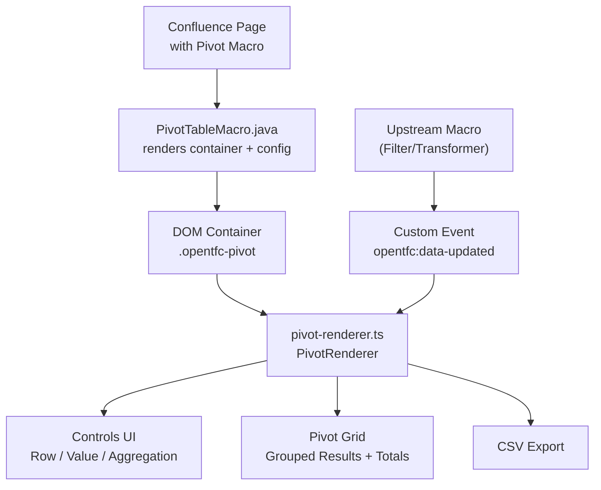
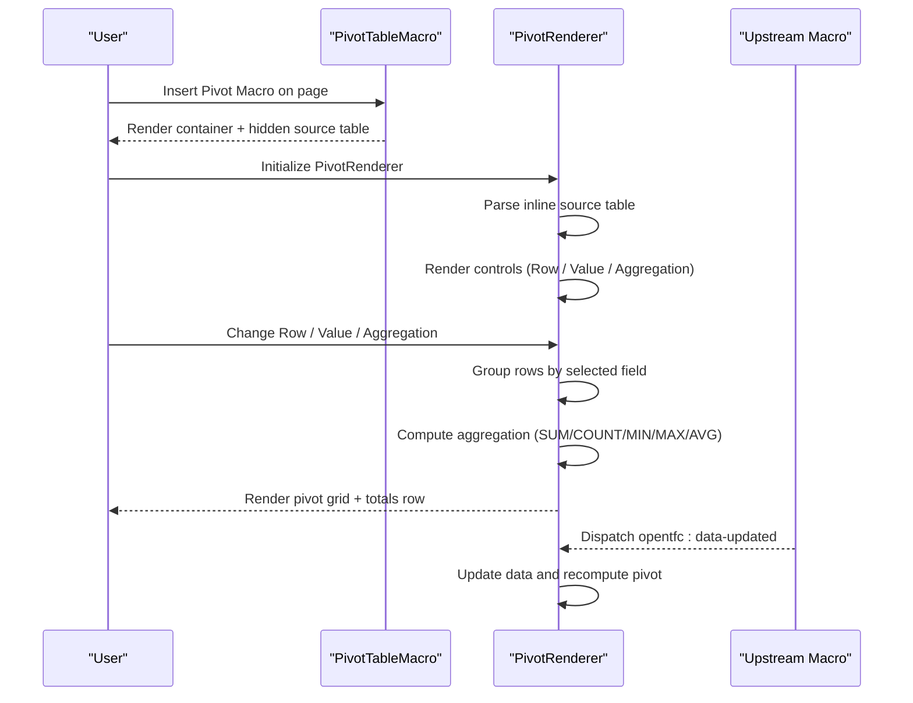
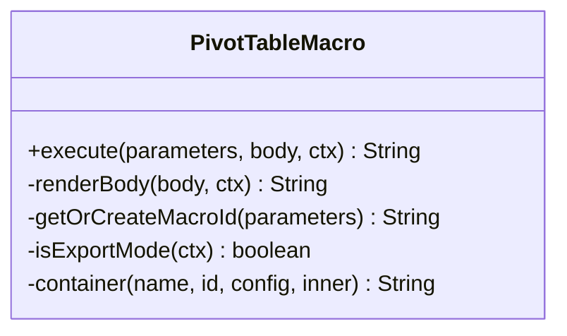
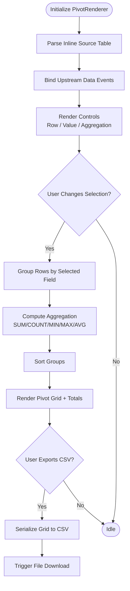
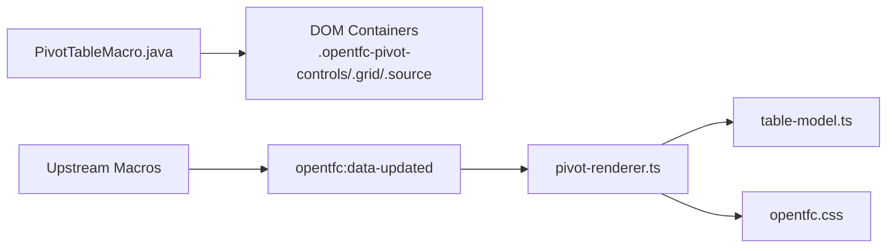

# Open Pivot Table

<cite>
**Referenced Files in This Document**
- [README.md](file://README.md)
- [USER_GUIDE.md](file://USER_GUIDE.md)
- [PivotTableMacro.java](file://src/main/java/org/opentfc/macro/PivotTableMacro.java)
- [pivot-renderer.ts](file://src/main/frontend/src/pivot/pivot-renderer.ts)
- [table-model.ts](file://src/main/frontend/src/core/table-model.ts)
- [opentfc_en.properties](file://src/main/resources/i18n/opentfc_en.properties)
- [opentfc.css](file://src/main/frontend/src/css/opentfc.css)
</cite>

## Table of Contents
1. [Introduction](#introduction)
2. [Project Structure](#project-structure)
3. [Core Components](#core-components)
4. [Architecture Overview](#architecture-overview)
5. [Detailed Component Analysis](#detailed-component-analysis)
6. [Dependency Analysis](#dependency-analysis)
7. [Performance Considerations](#performance-considerations)
8. [Troubleshooting Guide](#troubleshooting-guide)
9. [Conclusion](#conclusion)

## Introduction
Open Pivot Table is an interactive pivot table macro for Confluence that enables multi-dimensional data analysis directly on pages. It groups and aggregates flat tabular data using a simple interface with row, column, and value configuration, plus aggregation selection. The feature supports common analytical workflows such as sales by region and product category, or performance metrics across time periods.

Key capabilities:
- Aggregation functions: SUM, COUNT, MIN, MAX, AVG
- Row grouping via a selected field
- Value column selection
- CSV export of the resulting pivot grid
- Integration with upstream macros through a data-updated event

The implementation consists of a Java macro that renders a container and configuration, and a TypeScript renderer that parses source data, builds controls, computes aggregations, and renders the result table.

**Section sources**
- [README.md:32-35](file://README.md#L32-L35)
- [USER_GUIDE.md:137-153](file://USER_GUIDE.md#L137-L153)

## Project Structure
Open Pivot Table spans both backend (Java macro) and frontend (TypeScript renderer):

- Backend macro:
  - Renders a container with hidden source table and two empty divs for controls and grid
  - Passes macro configuration including macro ID, optional source macro ID, row/column/value fields, and aggregate function

- Frontend renderer:
  - Parses inline HTML table into typed columns and rows
  - Binds to upstream data events to refresh pivot results
  - Renders control panel with selectors for row field, value field, and aggregation
  - Computes grouped aggregations and renders a totals row
  - Exports the pivot grid to CSV

**Diagram sources**
- [PivotTableMacro.java:24-45](file://src/main/java/org/opentfc/macro/PivotTableMacro.java#L24-L45)
- [pivot-renderer.ts:16-29](file://src/main/frontend/src/pivot/pivot-renderer.ts#L16-L29)
- [pivot-renderer.ts:54-60](file://src/main/frontend/src/pivot/pivot-renderer.ts#L54-L60)
- [pivot-renderer.ts:73-126](file://src/main/frontend/src/pivot/pivot-renderer.ts#L73-L126)
- [pivot-renderer.ts:128-195](file://src/main/frontend/src/pivot/pivot-renderer.ts#L128-L195)
- [pivot-renderer.ts:197-216](file://src/main/frontend/src/pivot/pivot-renderer.ts#L197-L216)

**Section sources**
- [PivotTableMacro.java:24-45](file://src/main/java/org/opentfc/macro/PivotTableMacro.java#L24-L45)
- [pivot-renderer.ts:16-29](file://src/main/frontend/src/pivot/pivot-renderer.ts#L16-L29)

## Core Components
- PivotTableMacro (Java):
  - Renders the pivot container and passes parameters like macroId, sourceMacroId, rowFields, columnFields, valueFields, aggregateFunction
  - In export mode, wraps content in a dedicated export wrapper

- PivotRenderer (TypeScript):
  - Parses inline source table into ColumnDef[] and RowData[]
  - Listens to opentfc:data-updated to receive updated columns and rows from upstream macros
  - Renders controls for selecting row field, value field, and aggregation function
  - Computes grouped aggregations and renders a totals row
  - Exports the pivot grid to CSV

- Data model:
  - ColumnDef defines index, name, type, options, visibility
  - RowData contains cells with values and types

- Internationalization:
  - Pivot macro labels and parameter names are defined in i18n properties

**Section sources**
- [PivotTableMacro.java:24-45](file://src/main/java/org/opentfc/macro/PivotTableMacro.java#L24-L45)
- [pivot-renderer.ts:1-29](file://src/main/frontend/src/pivot/pivot-renderer.ts#L1-L29)
- [pivot-renderer.ts:31-71](file://src/main/frontend/src/pivot/pivot-renderer.ts#L31-L71)
- [table-model.ts:1-26](file://src/main/frontend/src/core/table-model.ts#L1-L26)
- [opentfc_en.properties:102-112](file://src/main/resources/i18n/opentfc_en.properties#L102-L112)

## Architecture Overview
The pivot workflow combines server-side rendering and client-side interactivity:

1. Server renders the macro container and hides the original table inside the DOM.
2. Client initializes PivotRenderer, which reads the hidden source table and converts it into typed columns and rows.
3. Controls are rendered to select row field, value field, and aggregation function.
4. On change, the renderer groups rows by the selected row field, computes the chosen aggregation over the selected value column, sorts groups, and renders the pivot grid with a totals row.
5. Users can export the pivot grid to CSV.
6. If an upstream macro emits opentfc:data-updated, the renderer updates its data and recomputes the pivot.

**Diagram sources**
- [PivotTableMacro.java:24-45](file://src/main/java/org/opentfc/macro/PivotTableMacro.java#L24-L45)
- [pivot-renderer.ts:31-71](file://src/main/frontend/src/pivot/pivot-renderer.ts#L31-L71)
- [pivot-renderer.ts:73-126](file://src/main/frontend/src/pivot/pivot-renderer.ts#L73-L126)
- [pivot-renderer.ts:128-195](file://src/main/frontend/src/pivot/pivot-renderer.ts#L128-L195)
- [pivot-renderer.ts:54-60](file://src/main/frontend/src/pivot/pivot-renderer.ts#L54-L60)

## Detailed Component Analysis

### PivotTableMacro (Server-Side Rendering)
Responsibilities:
- Render body content and wrap it in a pivot container
- Provide configuration object with macroId, sourceMacroId, rowFields, columnFields, valueFields, aggregateFunction
- Support export mode by wrapping output in a specific class

Implementation highlights:
- Uses base macro utilities to render nested content
- Builds a LinkedHashMap configuration and injects it into the container
- Creates three DOM elements: controls placeholder, grid placeholder, and hidden source container

**Diagram sources**
- [PivotTableMacro.java:24-45](file://src/main/java/org/opentfc/macro/PivotTableMacro.java#L24-L45)

**Section sources**
- [PivotTableMacro.java:24-45](file://src/main/java/org/opentfc/macro/PivotTableMacro.java#L24-L45)

### PivotRenderer (Client-Side Logic)
Responsibilities:
- Parse inline source table into typed columns and rows
- Bind to upstream data-updated events
- Render controls for row field, value field, and aggregation
- Compute grouped aggregations and render pivot grid
- Export pivot grid to CSV

Key methods and flows:
- parseInlineSource(): Reads .opentfc-pivot-source table and constructs ColumnDef[] and RowData[]
- bindUpstream(): Listens to opentfc:data-updated and calls setData with new columns and rows
- renderControls(): Generates selects for row field, value field, and aggregation; wires change handlers
- computeAndRenderPivot(): Groups rows by selected row field, computes aggregation, sorts groups, renders table with totals
- exportPivotCsv(): Serializes pivot grid to CSV and triggers download

**Diagram sources**
- [pivot-renderer.ts:31-71](file://src/main/frontend/src/pivot/pivot-renderer.ts#L31-L71)
- [pivot-renderer.ts:73-126](file://src/main/frontend/src/pivot/pivot-renderer.ts#L73-L126)
- [pivot-renderer.ts:128-195](file://src/main/frontend/src/pivot/pivot-renderer.ts#L128-L195)
- [pivot-renderer.ts:197-216](file://src/main/frontend/src/pivot/pivot-renderer.ts#L197-L216)

**Section sources**
- [pivot-renderer.ts:31-71](file://src/main/frontend/src/pivot/pivot-renderer.ts#L31-L71)
- [pivot-renderer.ts:73-126](file://src/main/frontend/src/pivot/pivot-renderer.ts#L73-L126)
- [pivot-renderer.ts:128-195](file://src/main/frontend/src/pivot/pivot-renderer.ts#L128-L195)
- [pivot-renderer.ts:197-216](file://src/main/frontend/src/pivot/pivot-renderer.ts#L197-L216)

### Data Model and Types
- ColumnDef: Represents a column with index, name, type, options, and visibility
- RowData: Represents a row with an array of CellData
- CellData: Holds cell value, optional HTML, and type
- ColumnType: Enumerates supported types (TEXT, NUMBER, DATE, SELECT, LINK, BOOLEAN)

These types ensure consistent parsing and rendering of pivot inputs and outputs.

**Section sources**
- [table-model.ts:1-26](file://src/main/frontend/src/core/table-model.ts#L1-L26)

### Internationalization and Labels
- Pivot macro label, title, description, and parameter labels are defined in i18n properties
- Parameter keys include macroId, sourceMacroId, rowFields, columnFields, valueFields, aggregateFunction

This allows consistent labeling in the editor and UI.

**Section sources**
- [opentfc_en.properties:102-112](file://src/main/resources/i18n/opentfc_en.properties#L102-L112)

## Dependency Analysis
Component relationships:
- PivotTableMacro depends on base macro utilities to render body and container
- PivotRenderer depends on:
  - DOM elements (.opentfc-pivot-controls, .opentfc-pivot-grid, .opentfc-pivot-source)
  - Global custom event opentfc:data-updated
  - Data model types from table-model.ts

External integrations:
- Upstream macros (e.g., Filter, Transformer) can emit opentfc:data-updated to refresh pivot data
- CSS classes from opentfc.css style the pivot grid and controls

**Diagram sources**
- [PivotTableMacro.java:24-45](file://src/main/java/org/opentfc/macro/PivotTableMacro.java#L24-L45)
- [pivot-renderer.ts:54-60](file://src/main/frontend/src/pivot/pivot-renderer.ts#L54-L60)
- [table-model.ts:1-26](file://src/main/frontend/src/core/table-model.ts#L1-L26)
- [opentfc.css:484-491](file://src/main/frontend/src/css/opentfc.css#L484-L491)

**Section sources**
- [PivotTableMacro.java:24-45](file://src/main/java/org/opentfc/macro/PivotTableMacro.java#L24-L45)
- [pivot-renderer.ts:54-60](file://src/main/frontend/src/pivot/pivot-renderer.ts#L54-L60)
- [table-model.ts:1-26](file://src/main/frontend/src/core/table-model.ts#L1-L26)
- [opentfc.css:484-491](file://src/main/frontend/src/css/opentfc.css#L484-L491)

## Performance Considerations
Current implementation characteristics:
- Aggregation computation runs in-memory per group using JavaScript arrays
- Grouping uses a Map keyed by string representation of the row field value
- Sorting is performed by localeCompare on group keys
- CSV export serializes the entire pivot grid into memory before download

Recommendations for large datasets:
- Prefer pre-aggregated or filtered source data via upstream macros (e.g., Open Table Transformer with DuckDB SQL) to reduce in-browser workload
- Limit the number of unique row groups to avoid excessive DOM nodes and sorting overhead
- Use pagination or filtering at the source level when possible
- Avoid extremely high-cardinality dimensions in the row field; consider hierarchical grouping via multiple steps if needed
- Monitor browser memory usage when exporting large pivots; consider chunked export strategies if extended later

[No sources needed since this section provides general guidance]

## Troubleshooting Guide
Common issues and resolutions:
- Pivot grid not rendering:
  - Ensure the macro has a valid inline source table or receives data via opentfc:data-updated
  - Verify that the selected row field exists in the parsed columns
  - Check that the selected value field exists and contains numeric-like strings

- Aggregation results incorrect:
  - Confirm the value column contains numbers or numeric-like strings; non-numeric values are coerced to zero
  - Validate the chosen aggregation function matches the intended calculation

- CSV export fails:
  - Ensure the pivot grid has been rendered before export
  - Check that the browser allows file downloads from the page context

- Upstream data not refreshing:
  - Confirm the upstream macro dispatches opentfc:data-updated with correct detail structure (columns and rows)
  - Verify the macro IDs match if sourceMacroId is configured

**Section sources**
- [pivot-renderer.ts:31-71](file://src/main/frontend/src/pivot/pivot-renderer.ts#L31-L71)
- [pivot-renderer.ts:128-195](file://src/main/frontend/src/pivot/pivot-renderer.ts#L128-L195)
- [pivot-renderer.ts:197-216](file://src/main/frontend/src/pivot/pivot-renderer.ts#L197-L216)

## Conclusion
Open Pivot Table provides a straightforward, client-side pivot experience within Confluence. It supports essential aggregation functions and integrates with upstream macros for dynamic data updates. While the current implementation focuses on single-row-field grouping and basic aggregation, it offers a solid foundation for building richer multi-dimensional pivots, calculated fields, conditional formatting, and drill-down features in future iterations. For optimal performance with large datasets, leverage upstream transformation and filtering to minimize in-browser processing.

[No sources needed since this section summarizes without analyzing specific files]