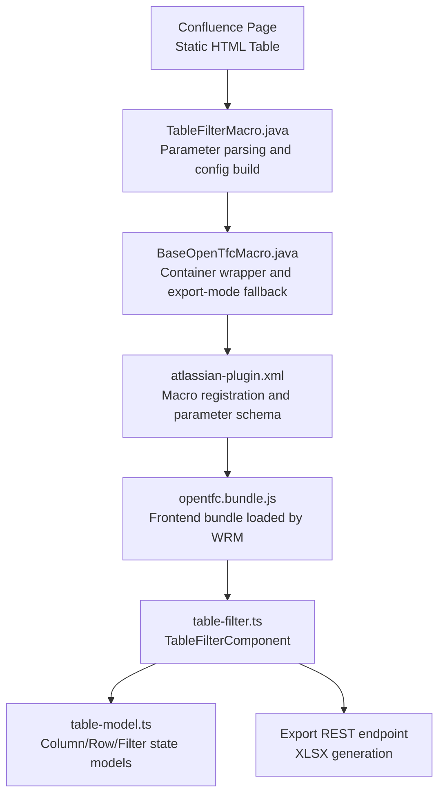
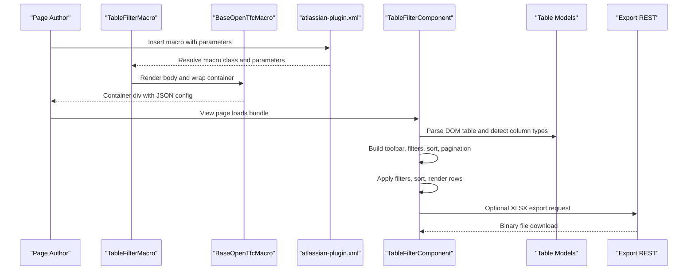
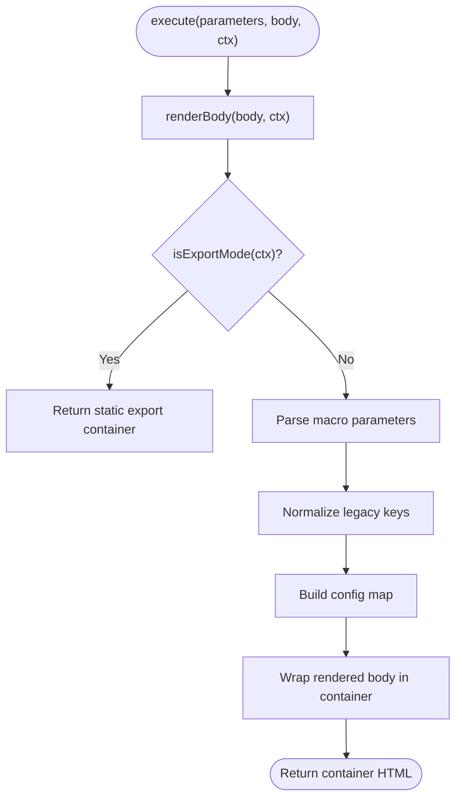
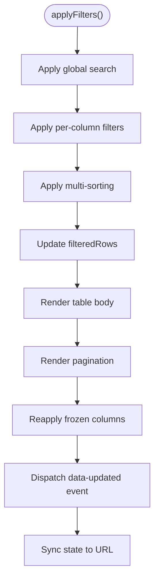
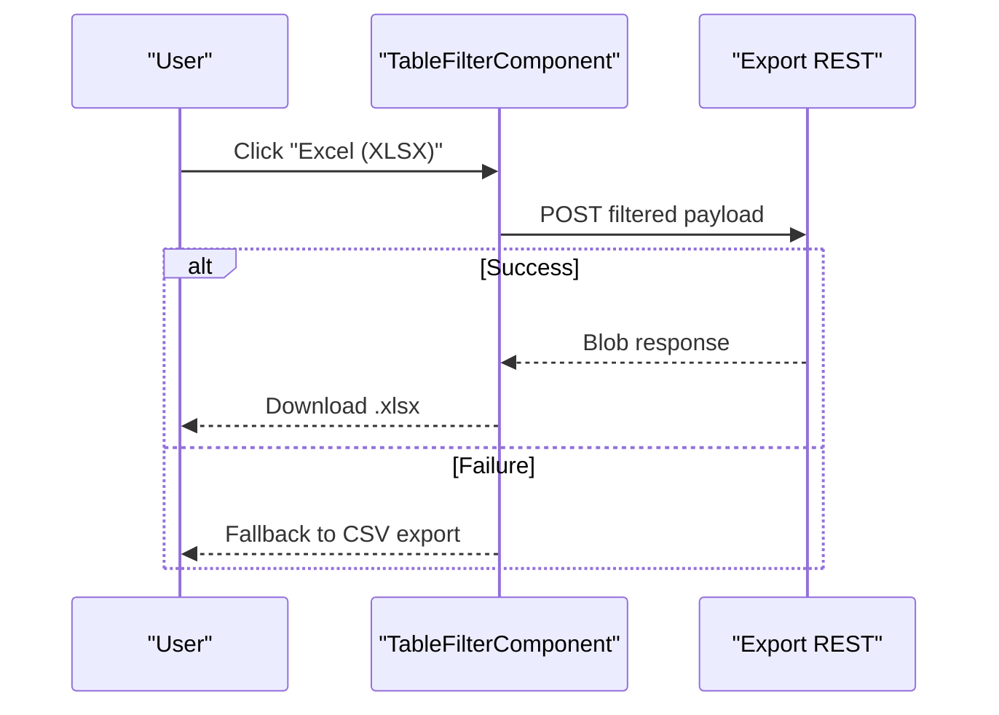
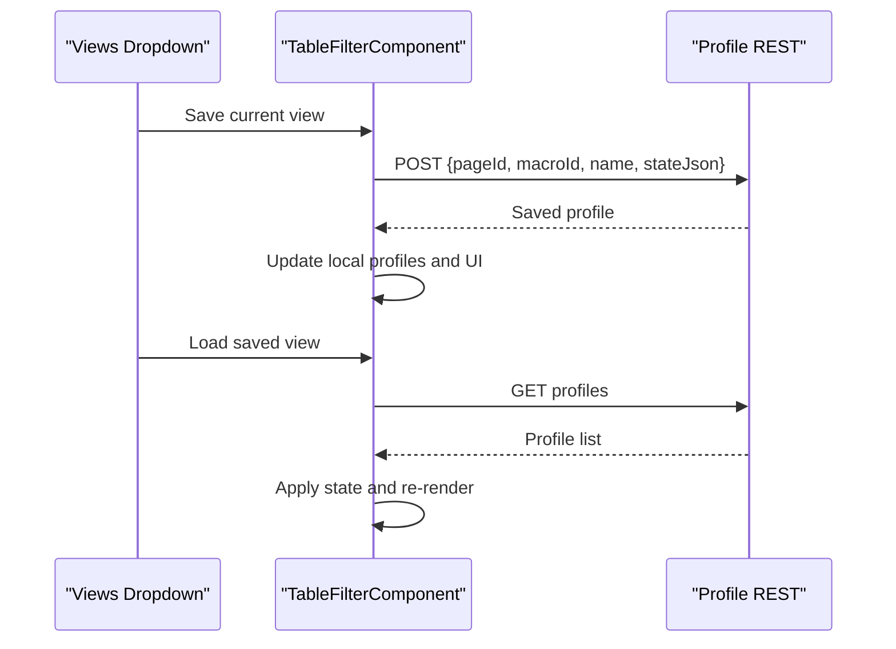
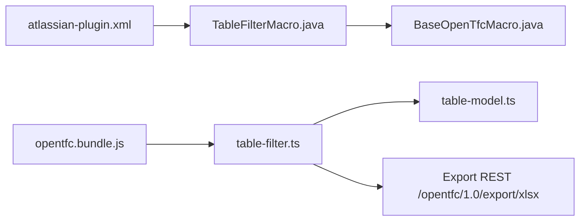

# Open Table Filter

<cite>
**Referenced Files in This Document**
- [README.md](file://README.md)
- [USER_GUIDE.md](file://USER_GUIDE.md)
- [atlassian-plugin.xml](file://src/main/resources/atlassian-plugin.xml)
- [BaseOpenTfcMacro.java](file://src/main/java/org/opentfc/macro/BaseOpenTfcMacro.java)
- [TableFilterMacro.java](file://src/main/java/org/opentfc/macro/TableFilterMacro.java)
- [table-model.ts](file://src/main/frontend/src/core/table-model.ts)
- [table-filter.ts](file://src/main/frontend/src/filter/table-filter.ts)
- [opentfc_en.properties](file://src/main/resources/i18n/opentfc_en.properties)
</cite>

## Table of Contents
1. [Introduction](#introduction)
2. [Project Structure](#project-structure)
3. [Core Components](#core-components)
4. [Architecture Overview](#architecture-overview)
5. [Detailed Component Analysis](#detailed-component-analysis)
6. [Dependency Analysis](#dependency-analysis)
7. [Performance Considerations](#performance-considerations)
8. [Troubleshooting Guide](#troubleshooting-guide)
9. [Conclusion](#conclusion)
10. [Appendices](#appendices)

## Introduction
Open Table Filter is the interactive data-grid macro that transforms static Confluence tables into filterable, sortable, and exportable grids. It supports global search, per-column filters, sticky headers, frozen columns, column visibility controls, totals rows, pagination, saved user profiles, and CSV/XLSX export. The feature is implemented as a Confluence macro on the backend and a TypeScript client component on the frontend.

Key capabilities include:
- Global text search across all visible cells.
- Per-column filters for text, numeric ranges, date ranges, and multi-select lists.
- Single and multi-column sorting with ascending/descending direction.
- Sticky header and frozen left columns for large horizontal datasets.
- Column show/hide menu.
- Totals row with sum and average for numeric columns.
- Pagination with configurable page size.
- Export to CSV (client-side) and XLSX (server-assisted).
- Saved view profiles stored per page and macro instance.

**Section sources**
- [README.md:17-25](file://README.md#L17-L25)
- [USER_GUIDE.md:68-106](file://USER_GUIDE.md#L68-L106)

## Project Structure
Open Table Filter spans backend macro registration, parameter handling, and frontend rendering logic:

- Backend macro definition and parameters are declared in the plugin descriptor.
- The Java macro class parses parameters, builds a configuration object, and wraps the rendered table body.
- The frontend TypeScript component reads the configuration from a data attribute, parses the DOM table, detects column types, and renders the interactive UI.

**Diagram sources**
- [atlassian-plugin.xml:72-107](file://src/main/resources/atlassian-plugin.xml#L72-L107)
- [TableFilterMacro.java:24-83](file://src/main/java/org/opentfc/macro/TableFilterMacro.java#L24-L83)
- [BaseOpenTfcMacro.java:44-103](file://src/main/java/org/opentfc/macro/BaseOpenTfcMacro.java#L44-L103)
- [table-filter.ts:15-73](file://src/main/frontend/src/filter/table-filter.ts#L15-L73)
- [table-model.ts:1-36](file://src/main/frontend/src/core/table-model.ts#L1-L36)

**Section sources**
- [atlassian-plugin.xml:72-107](file://src/main/resources/atlassian-plugin.xml#L72-L107)
- [TableFilterMacro.java:24-83](file://src/main/java/org/opentfc/macro/TableFilterMacro.java#L24-L83)
- [BaseOpenTfcMacro.java:44-103](file://src/main/java/org/opentfc/macro/BaseOpenTfcMacro.java#L44-L103)
- [table-filter.ts:15-73](file://src/main/frontend/src/filter/table-filter.ts#L15-L73)
- [table-model.ts:1-36](file://src/main/frontend/src/core/table-model.ts#L1-L36)

## Core Components
This section documents the macro parameters, default behavior, and how they map to the user interface.

### Macro Parameters
| Parameter | Type | Default | Behavior |
|---|---|---:|---|
| `showSearchBox` | boolean | `true` | Shows or hides the global search input in the toolbar. |
| `showColumnFilters` | boolean | `true` | Shows or hides the secondary filter row with per-column controls. |
| `stickyHeader` | boolean | `true` | Adds sticky-header styling so the table header remains visible while scrolling vertically. |
| `freezeColumns` | integer | `0` | Number of leftmost visible columns to freeze horizontally; non-negative values only. |
| `showTotals` | boolean | `false` | Renders a totals row below the table with count and numeric aggregations. |
| `allowHideColumns` | boolean | `true` | Enables the column visibility dropdown menu. |
| `showExportButtons` | boolean | `true` | Shows export buttons for CSV and XLSX. |
| `pageSize` | enum | `25` | Allowed values: `10`, `25`, `50`, `100`, `all`. Controls initial page size selection. |
| `enablePagination` | boolean | `true` | Enables or disables the pagination bar and paging logic. |

Legacy compatibility keys supported by the macro include:
- `freezeHeader` maps to `stickyHeader`.
- `filterStatus` maps to `showColumnFilters`.
- `totalsRow` maps to `showTotals`.
- `hideableColumns` is passed through for backward compatibility.

These defaults and aliases are parsed in the macro and normalized again in the frontend component.

**Section sources**
- [atlassian-plugin.xml:84-106](file://src/main/resources/atlassian-plugin.xml#L84-L106)
- [TableFilterMacro.java:36-78](file://src/main/java/org/opentfc/macro/TableFilterMacro.java#L36-L78)
- [table-filter.ts:38-54](file://src/main/frontend/src/filter/table-filter.ts#L38-L54)
- [opentfc_en.properties:77-82](file://src/main/resources/i18n/opentfc_en.properties#L77-L82)

### User Interface Elements
- **Global Search Box**: Debounced text search across all cell values. Resets to page 1 when changed.
- **Column Filters Row**:
  - Text columns: substring search.
  - Numeric columns: min/max range inputs.
  - Date columns: from/to date inputs.
  - Select columns: multi-select checkboxes with select-all/clear actions.
- **Sorting Controls**: Clicking a header sorts ascending/descending; Shift+click adds multi-sort priorities.
- **Column Visibility Menu**: Checkboxes to show/hide columns, plus “Show All” and “Reset”.
- **Export Buttons**:
  - CSV: generated client-side from filtered visible rows.
  - XLSX: sent to server endpoint; falls back to CSV if the request fails.
- **Saved Views Menu**: Load, save, and delete user-specific filter profiles per page and macro instance.
- **Pagination Bar**: Shows total filtered rows, current page, previous/next navigation, and page-size selector.

**Section sources**
- [table-filter.ts:183-335](file://src/main/frontend/src/filter/table-filter.ts#L183-L335)
- [table-filter.ts:355-586](file://src/main/frontend/src/filter/table-filter.ts#L355-L586)
- [table-filter.ts:646-695](file://src/main/frontend/src/filter/table-filter.ts#L646-L695)
- [table-filter.ts:894-954](file://src/main/frontend/src/filter/table-filter.ts#L894-L954)
- [table-filter.ts:1183-1232](file://src/main/frontend/src/filter/table-filter.ts#L1183-L1232)
- [table-filter.ts:963-1134](file://src/main/frontend/src/filter/table-filter.ts#L963-L1134)

## Architecture Overview
The Open Table Filter pipeline converts a static Confluence table into an interactive grid:

**Diagram sources**
- [atlassian-plugin.xml:72-107](file://src/main/resources/atlassian-plugin.xml#L72-L107)
- [TableFilterMacro.java:24-83](file://src/main/java/org/opentfc/macro/TableFilterMacro.java#L24-L83)
- [BaseOpenTfcMacro.java:52-103](file://src/main/java/org/opentfc/macro/BaseOpenTfcMacro.java#L52-L103)
- [table-filter.ts:15-73](file://src/main/frontend/src/filter/table-filter.ts#L15-L73)
- [table-filter.ts:1198-1232](file://src/main/frontend/src/filter/table-filter.ts#L1198-L1232)

## Detailed Component Analysis

### Backend Macro: TableFilterMacro
Responsibilities:
- Render the macro body using the base helper.
- Detect export mode and return a static container for PDF/Word/email exports.
- Parse macro parameters and normalize legacy keys.
- Build a configuration map including macro ID, page ID, and all UI toggles.
- Wrap the rendered table in a container with toolbar and optional pagination bar.

Important behaviors:
- `freezeColumns` is clamped to non-negative values.
- Legacy keys (`freezeHeader`, `filterStatus`, `totalsRow`) are mapped to modern keys.
- In export mode, the macro returns a simple styled container around the table without JS-dependent features.

**Diagram sources**
- [TableFilterMacro.java:24-83](file://src/main/java/org/opentfc/macro/TableFilterMacro.java#L24-L83)
- [BaseOpenTfcMacro.java:44-103](file://src/main/java/org/opentfc/macro/BaseOpenTfcMacro.java#L44-L103)

**Section sources**
- [TableFilterMacro.java:24-83](file://src/main/java/org/opentfc/macro/TableFilterMacro.java#L24-L83)
- [BaseOpenTfcMacro.java:44-103](file://src/main/java/org/opentfc/macro/BaseOpenTfcMacro.java#L44-L103)

### Frontend Component: TableFilterComponent
Responsibilities:
- Read configuration from the container’s data attribute.
- Normalize defaults and legacy keys.
- Parse the DOM table into a typed model.
- Detect column types: text, number, date, or select list.
- Initialize UI elements: toolbar, column filters, sort handlers, pagination.
- Apply global search, column filters, and multi-sorting.
- Render visible rows, totals row, and pagination controls.
- Persist and restore saved view profiles via REST.
- Export filtered data to CSV or XLSX.

```mermaid
classDiagram
class TableFilterComponent {
+constructor(container)
-parseDOMTable()
-detectColumnTypes(columns, rows)
-initUI()
-renderColumnFilterControls()
-applyFrozenColumns()
-bindHeaderSorts()
-handleHeaderClick(columnIndex, isMulti)
+applyFilters()
-renderTableBody()
-renderTotalsRow(tbody)
-renderPagination()
-loadProfiles()
-saveProfile(name, overlay)
-exportCsv()
-exportXlsx()
}
class TableData {
+string id
+ColumnDef[] columns
+RowData[] rows
+number totalRows
}
class FilterState {
+string globalSearch
+Record~number, string|object|string[]~ columnFilters
+sorts[]
+number[] hiddenColumns
+number currentPage
+number|string pageSize
}
TableFilterComponent --> TableData : "parses"
TableFilterComponent --> FilterState : "manages"
```

**Diagram sources**
- [table-filter.ts:15-73](file://src/main/frontend/src/filter/table-filter.ts#L15-L73)
- [table-filter.ts:75-181](file://src/main/frontend/src/filter/table-filter.ts#L75-L181)
- [table-filter.ts:697-797](file://src/main/frontend/src/filter/table-filter.ts#L697-L797)
- [table-model.ts:1-36](file://src/main/frontend/src/core/table-model.ts#L1-L36)

**Section sources**
- [table-filter.ts:15-73](file://src/main/frontend/src/filter/table-filter.ts#L15-L73)
- [table-filter.ts:75-181](file://src/main/frontend/src/filter/table-filter.ts#L75-L181)
- [table-filter.ts:697-797](file://src/main/frontend/src/filter/table-filter.ts#L697-L797)
- [table-model.ts:1-36](file://src/main/frontend/src/core/table-model.ts#L1-L36)

### Data Models
The frontend uses lightweight TypeScript models to represent table structure and filter state:

- `ColumnType`: `TEXT`, `NUMBER`, `DATE`, `SELECT`, `LINK`, `BOOLEAN`.
- `ColumnDef`: column index, name, type, options for select columns, visibility flag.
- `CellData`: raw value, optional HTML, optional type hint.
- `RowData`: array of cell data.
- `TableData`: table identity, columns, rows, total row count.
- `FilterState`: global search query, per-column filters, sort definitions, hidden columns, current page, and page size.

These models ensure consistent filtering, sorting, and rendering logic.

**Section sources**
- [table-model.ts:1-36](file://src/main/frontend/src/core/table-model.ts#L1-L36)

### Filtering and Sorting Flow
The core filtering and sorting algorithm applies transformations in this order:
1. Global search across all cell values.
2. Per-column filters:
   - Multi-select lists.
   - Text substring match.
   - Numeric range.
   - Date range.
3. Multi-sorting by configured columns and directions.
4. Rendering of filtered results and updating pagination.

**Diagram sources**
- [table-filter.ts:697-797](file://src/main/frontend/src/filter/table-filter.ts#L697-L797)
- [table-filter.ts:815-841](file://src/main/frontend/src/filter/table-filter.ts#L815-L841)
- [table-filter.ts:894-954](file://src/main/frontend/src/filter/table-filter.ts#L894-L954)
- [table-filter.ts:1234-1244](file://src/main/frontend/src/filter/table-filter.ts#L1234-L1244)
- [table-filter.ts:1152-1181](file://src/main/frontend/src/filter/table-filter.ts#L1152-L1181)

**Section sources**
- [table-filter.ts:697-797](file://src/main/frontend/src/filter/table-filter.ts#L697-L797)

### Export Functionality
Two export paths are implemented:

- **CSV Export**: Client-side generation from filtered visible rows. Uses a UTF-8 BOM and escaped values.
- **XLSX Export**: Sends filtered visible columns and rows to a server endpoint and downloads the returned blob. If the server call fails, it falls back to CSV.

**Diagram sources**
- [table-filter.ts:1198-1232](file://src/main/frontend/src/filter/table-filter.ts#L1198-L1232)

**Section sources**
- [table-filter.ts:1183-1232](file://src/main/frontend/src/filter/table-filter.ts#L1183-L1232)

### Saved View Profiles
Users can save their current filter, sort, and column visibility state as named profiles. Profiles are scoped by page ID and macro ID and persisted via REST. The component:
- Loads available profiles on initialization.
- Renders them in a dropdown menu.
- Applies a selected profile to the current state.
- Saves new profiles with a modal prompt.
- Deletes profiles on user confirmation.

**Diagram sources**
- [table-filter.ts:963-1134](file://src/main/frontend/src/filter/table-filter.ts#L963-L1134)

**Section sources**
- [table-filter.ts:963-1134](file://src/main/frontend/src/filter/table-filter.ts#L963-L1134)

## Dependency Analysis
Open Table Filter has clear separation between backend macro registration, runtime parameter handling, and frontend interactivity:

- `atlassian-plugin.xml` registers the macro and defines its parameter schema.
- `TableFilterMacro` depends on `BaseOpenTfcMacro` for body rendering, export-mode detection, and container wrapping.
- The frontend bundle is loaded by web resources and initialized by `TableFilterComponent`.
- `TableFilterComponent` depends on `table-model.ts` for type-safe data structures.
- Export functionality integrates with a REST endpoint for XLSX generation.

**Diagram sources**
- [atlassian-plugin.xml:72-107](file://src/main/resources/atlassian-plugin.xml#L72-L107)
- [TableFilterMacro.java:24-83](file://src/main/java/org/opentfc/macro/TableFilterMacro.java#L24-L83)
- [BaseOpenTfcMacro.java:44-103](file://src/main/java/org/opentfc/macro/BaseOpenTfcMacro.java#L44-L103)
- [table-filter.ts:1198-1232](file://src/main/frontend/src/filter/table-filter.ts#L1198-L1232)

**Section sources**
- [atlassian-plugin.xml:72-107](file://src/main/resources/atlassian-plugin.xml#L72-L107)
- [TableFilterMacro.java:24-83](file://src/main/java/org/opentfc/macro/TableFilterMacro.java#L24-L83)
- [BaseOpenTfcMacro.java:44-103](file://src/main/java/org/opentfc/macro/BaseOpenTfcMacro.java#L44-L103)
- [table-filter.ts:1198-1232](file://src/main/frontend/src/filter/table-filter.ts#L1198-L1232)

## Performance Considerations
For large datasets, consider these practices:

- Use pagination:
  - Enable `enablePagination=true` and choose a reasonable `pageSize` such as `25` or `50`.
  - Avoid `pageSize=all` for very large tables because it renders all rows at once.
- Limit heavy UI features:
  - Disable `showColumnFilters` if you do not need per-column filters.
  - Disable `showSearchBox` if global search is unnecessary.
  - Disable `showTotals` for extremely large tables since totals calculation scans filtered rows.
- Reduce frozen columns:
  - Keep `freezeColumns` small to avoid complex layout recalculations.
- Prefer structured data:
  - Ensure numeric columns contain parseable numbers.
  - Use consistent date formats recognized by the detector.
  - For categorical columns with many unique values, consider pre-aggregating data before rendering.
- Minimize DOM complexity:
  - Avoid deeply nested HTML inside cells; keep cell content flat where possible.
- Use saved views:
  - Predefined profiles reduce repeated manual filtering and improve workflow efficiency.

[No sources needed since this section provides general guidance]

## Troubleshooting Guide

### Table Parsing Issues
Symptoms:
- No filters appear.
- Columns are missing or mislabeled.
- Totals row does not compute correctly.

Checks:
- Ensure the macro wraps a valid HTML table.
- Verify the first row contains headers.
- Confirm that each row has the expected number of cells.
- Inspect the parsed model by checking whether column names and row counts are populated.

Likely causes:
- Missing `<thead>` or inconsistent row lengths.
- Empty or malformed cells.
- Nested macros inside cells interfering with DOM parsing.

**Section sources**
- [table-filter.ts:75-123](file://src/main/frontend/src/filter/table-filter.ts#L75-L123)

### Filter Performance Degradation
Symptoms:
- Typing in global search feels slow.
- Changing per-column filters causes noticeable lag.

Mitigations:
- Rely on debounced input handlers already present for search and text filters.
- Reduce dataset size using pagination.
- Disable unnecessary filters or totals.
- Avoid extremely high cardinality select columns; pre-aggregate or limit options.

**Section sources**
- [table-filter.ts:248-258](file://src/main/frontend/src/filter/table-filter.ts#L248-L258)
- [table-filter.ts:567-580](file://src/main/frontend/src/filter/table-filter.ts#L567-L580)
- [table-filter.ts:697-797](file://src/main/frontend/src/filter/table-filter.ts#L697-L797)

### Browser Compatibility
Symptoms:
- Export fails or triggers fallback.
- Sticky header or frozen columns behave unexpectedly.
- Saved views cannot be saved or loaded.

Checks:
- Confirm the frontend bundle is loaded in the page context.
- Verify network access to `/rest/opentfc/1.0/export/xlsx` and profile endpoints.
- Test in supported browsers used by your Confluence environment.
- Check for console errors related to fetch, Blob, or URL APIs.

Notes:
- XLSX export falls back to CSV if the server request fails.
- Export mode in PDF/Word/email bypasses JavaScript and returns static markup.

**Section sources**
- [table-filter.ts:1198-1232](file://src/main/frontend/src/filter/table-filter.ts#L1198-L1232)
- [BaseOpenTfcMacro.java:44-50](file://src/main/java/org/opentfc/macro/BaseOpenTfcMacro.java#L44-L50)
- [TableFilterMacro.java:29-32](file://src/main/java/org/opentfc/macro/TableFilterMacro.java#L29-L32)

### Macro Registration and Metadata
Symptoms:
- Macro not found in editor.
- “No macro metadata” warnings in older Confluence versions.

Checks:
- Confirm the plugin is installed and enabled.
- Verify the macro key and alias are registered.
- Ensure the correct version of the plugin is deployed.

**Section sources**
- [atlassian-plugin.xml:72-107](file://src/main/resources/atlassian-plugin.xml#L72-L107)
- [README.md:99-104](file://README.md#L99-L104)

## Conclusion
Open Table Filter turns ordinary Confluence tables into powerful analytical grids. Its backend macro defines a clean parameter contract, while the frontend component delivers rich interactivity including search, filtering, sorting, pagination, column visibility, totals, saved views, and export. By tuning parameters and following best practices for table structure and dataset size, teams can achieve responsive, accessible, and maintainable data presentations within Confluence pages.

[No sources needed since this section summarizes without analyzing specific files]

## Appendices

### Practical Usage Examples

#### Basic Usage
- Wrap a standard Confluence table with the Open Table Filter macro.
- Leave defaults enabled to get global search, column filters, sorting, and pagination.

Recommended starting point:
- `showSearchBox=true`
- `showColumnFilters=true`
- `stickyHeader=true`
- `freezeColumns=0`
- `showTotals=false`
- `allowHideColumns=true`
- `showExportButtons=true`
- `pageSize=25`
- `enablePagination=true`

**Section sources**
- [USER_GUIDE.md:86-94](file://USER_GUIDE.md#L86-L94)
- [atlassian-plugin.xml:84-106](file://src/main/resources/atlassian-plugin.xml#L84-L106)

#### Advanced Configuration
- Freeze left identifiers:
  - Set `freezeColumns=1` or `2` to keep ID or category columns fixed during horizontal scroll.
- Show totals for financial reports:
  - Set `showTotals=true` to display sums and averages for numeric columns.
- Disable pagination for small tables:
  - Set `enablePagination=false` to render all rows without a pagination bar.
- Hide column filters for read-only dashboards:
  - Set `showColumnFilters=false` to simplify the toolbar.

**Section sources**
- [TableFilterMacro.java:44-72](file://src/main/java/org/opentfc/macro/TableFilterMacro.java#L44-L72)
- [table-filter.ts:588-644](file://src/main/frontend/src/filter/table-filter.ts#L588-L644)
- [table-filter.ts:838-883](file://src/main/frontend/src/filter/table-filter.ts#L838-L883)

#### Integration Scenarios
- Combine with charts:
  - Place an Open Chart macro inside Open Table Filter so charts update when filters change.
- Combine with SQL transformer:
  - Wrap an Open Table Transformer result with Open Table Filter to add search, sort, and export.
- Combine with CSV/JSON sources:
  - Use Open CSV Table or Open JSON Table as the source and wrap with Open Table Filter for interactive analysis.

**Section sources**
- [USER_GUIDE.md:283-313](file://USER_GUIDE.md#L283-L313)