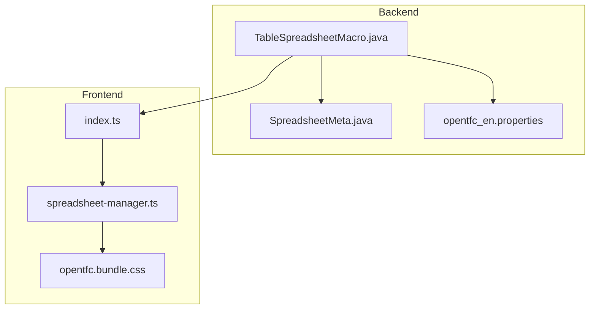
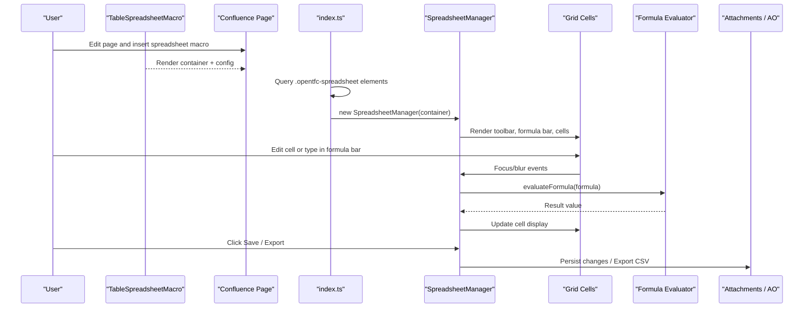
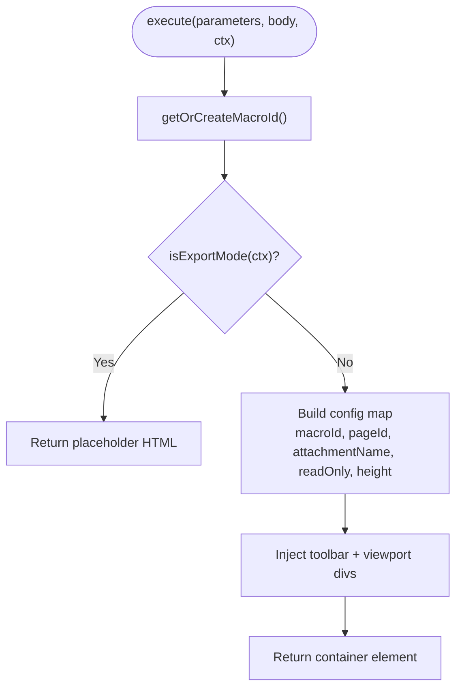
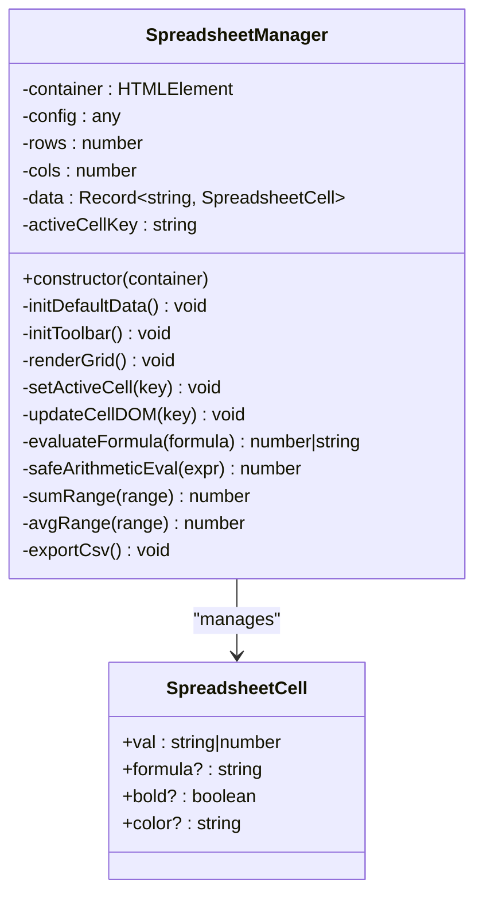
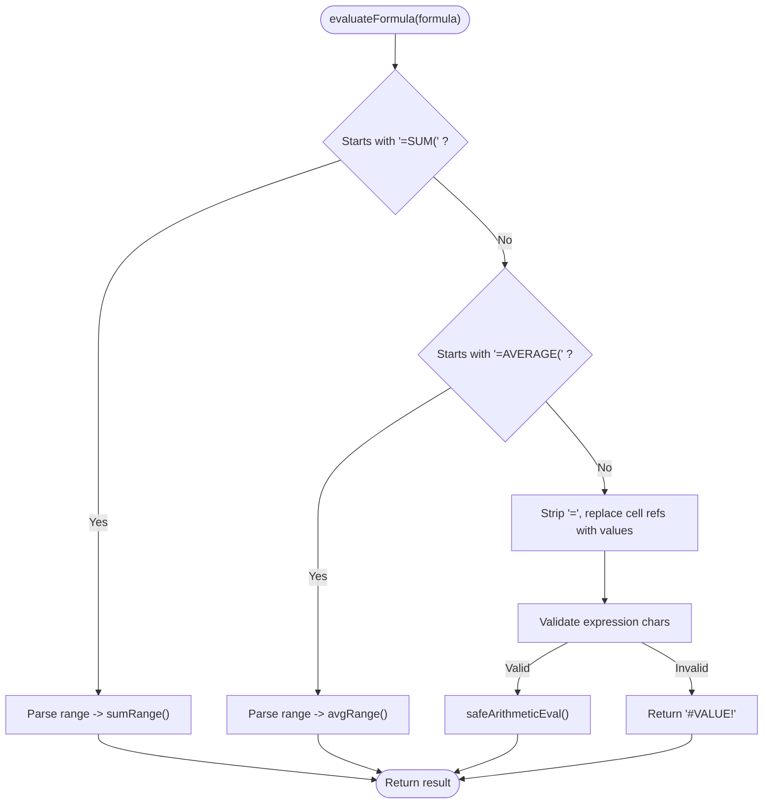
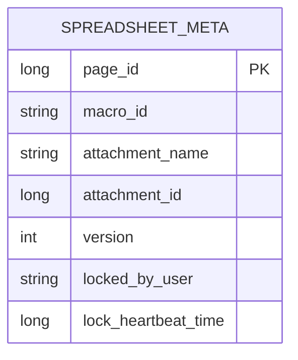
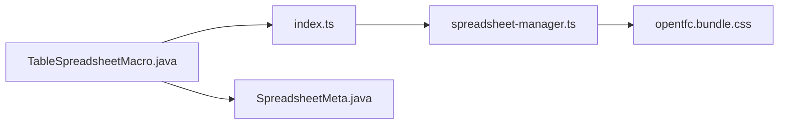

# Open Table Spreadsheet

<cite>
**Referenced Files in This Document**
- [README.md](file://README.md)
- [USER_GUIDE.md](file://USER_GUIDE.md)
- [TableSpreadsheetMacro.java](file://src/main/java/org/opentfc/macro/TableSpreadsheetMacro.java)
- [spreadsheet-manager.ts](file://src/main/frontend/src/spreadsheet/spreadsheet-manager.ts)
- [SpreadsheetMeta.java](file://src/main/java/org/opentfc/ao/SpreadsheetMeta.java)
- [opentfc_en.properties](file://src/main/resources/i18n/opentfc_en.properties)
- [index.ts](file://src/main/frontend/src/index.ts)
- [opentfc.bundle.css](file://src/main/resources/css/opentfc.bundle.css)
</cite>

## Table of Contents
1. [Introduction](#introduction)
2. [Project Structure](#project-structure)
3. [Core Components](#core-components)
4. [Architecture Overview](#architecture-overview)
5. [Detailed Component Analysis](#detailed-component-analysis)
6. [Dependency Analysis](#dependency-analysis)
7. [Performance Considerations](#performance-considerations)
8. [Troubleshooting Guide](#troubleshooting-guide)
9. [Conclusion](#conclusion)
10. [Appendices](#appendices)

## Introduction
Open Table Spreadsheet provides full-featured spreadsheet capabilities directly inside Confluence pages. It offers a familiar Excel-like interface with a toolbar, formula bar, cell editing, and range selection. The feature supports formulas and cell calculations, persists spreadsheets as attachments (with versioning), and includes soft session locking to prevent concurrent edits. It integrates with other OpenTFC macros for filtering, charting, pivoting, and SQL transformations, enabling powerful data workflows such as financial models, analysis templates, and automated reports.

Key capabilities:
- In-page editable spreadsheet with toolbar and formula bar
- Formula evaluation including SUM, AVERAGE, and basic arithmetic expressions
- CSV export from the client-side grid
- Attachment-based persistence with Confluence versioning
- Soft session locking metadata for collaboration safety
- Integration points with other OpenTFC features via macro composition

**Section sources**
- [README.md:41-45](file://README.md#L41-L45)
- [USER_GUIDE.md:219-229](file://USER_GUIDE.md#L219-L229)

## Project Structure
The spreadsheet feature spans backend macro rendering, frontend manager logic, UI styling, and metadata storage:
- Backend macro renders the spreadsheet container and configuration
- Frontend initializes the spreadsheet manager and binds interactions
- CSS styles define the spreadsheet viewport and related UI elements
- Active Objects schema defines metadata for attachment tracking, versioning, and locking

**Diagram sources**
- [TableSpreadsheetMacro.java:30-48](file://src/main/java/org/opentfc/macro/TableSpreadsheetMacro.java#L30-L48)
- [index.ts:45-46](file://src/main/frontend/src/index.ts#L45-L46)
- [spreadsheet-manager.ts:8-28](file://src/main/frontend/src/spreadsheet/spreadsheet-manager.ts#L8-L28)
- [opentfc.bundle.css:488-492](file://src/main/resources/css/opentfc.bundle.css#L488-L492)
- [SpreadsheetMeta.java:11-38](file://src/main/java/org/opentfc/ao/SpreadsheetMeta.java#L11-L38)
- [opentfc_en.properties:124-132](file://src/main/resources/i18n/opentfc_en.properties#L124-L132)

**Section sources**
- [TableSpreadsheetMacro.java:30-48](file://src/main/java/org/opentfc/macro/TableSpreadsheetMacro.java#L30-L48)
- [index.ts:45-46](file://src/main/frontend/src/index.ts#L45-L46)
- [spreadsheet-manager.ts:8-28](file://src/main/frontend/src/spreadsheet/spreadsheet-manager.ts#L8-L28)
- [opentfc.bundle.css:488-492](file://src/main/resources/css/opentfc.bundle.css#L488-L492)
- [SpreadsheetMeta.java:11-38](file://src/main/java/org/opentfc/ao/SpreadsheetMeta.java#L11-L38)
- [opentfc_en.properties:124-132](file://src/main/resources/i18n/opentfc_en.properties#L124-L132)

## Core Components
- TableSpreadsheetMacro: Renders the spreadsheet container, height, read-only mode, and attachment name; injects toolbar and viewport DOM nodes.
- SpreadsheetManager: Initializes default data, builds toolbar, handles cell focus/blur, evaluates formulas, and exports CSV.
- SpreadsheetMeta: Defines Active Objects fields for page ID, macro ID, attachment name/ID, version, lock owner, and heartbeat timestamp.
- i18n labels: Provide user-facing strings for spreadsheet parameters and include macro options.

**Section sources**
- [TableSpreadsheetMacro.java:30-48](file://src/main/java/org/opentfc/macro/TableSpreadsheetMacro.java#L30-L48)
- [spreadsheet-manager.ts:8-28](file://src/main/frontend/src/spreadsheet/spreadsheet-manager.ts#L8-L28)
- [SpreadsheetMeta.java:11-38](file://src/main/java/org/opentfc/ao/SpreadsheetMeta.java#L11-L38)
- [opentfc_en.properties:124-142](file://src/main/resources/i18n/opentfc_en.properties#L124-L142)

## Architecture Overview
The spreadsheet workflow starts with the macro rendering a container and configuration attributes. The frontend index locates all spreadsheet containers and instantiates SpreadsheetManager, which sets up the toolbar, formula bar, grid, and event bindings. Formulas are evaluated client-side using a safe arithmetic parser and range functions. Persistence is intended to be attachment-based with versioning, while collaboration uses soft session locking tracked by SpreadsheetMeta.

**Diagram sources**
- [TableSpreadsheetMacro.java:30-48](file://src/main/java/org/opentfc/macro/TableSpreadsheetMacro.java#L30-L48)
- [index.ts:45-46](file://src/main/frontend/src/index.ts#L45-L46)
- [spreadsheet-manager.ts:50-96](file://src/main/frontend/src/spreadsheet/spreadsheet-manager.ts#L50-L96)
- [spreadsheet-manager.ts:169-191](file://src/main/frontend/src/spreadsheet/spreadsheet-manager.ts#L169-L191)
- [spreadsheet-manager.ts:288-304](file://src/main/frontend/src/spreadsheet/spreadsheet-manager.ts#L288-L304)

## Detailed Component Analysis

### Spreadsheet Macro Rendering
- Purpose: Create the spreadsheet container, compute macro ID, set page context, configure attachment name, read-only flag, and height.
- Behavior: In export mode, returns a placeholder; otherwise, injects toolbar and viewport divs and wraps them in a container element.

**Diagram sources**
- [TableSpreadsheetMacro.java:30-48](file://src/main/java/org/opentfc/macro/TableSpreadsheetMacro.java#L30-L48)

**Section sources**
- [TableSpreadsheetMacro.java:30-48](file://src/main/java/org/opentfc/macro/TableSpreadsheetMacro.java#L30-L48)

### SpreadsheetManager Interface and Toolbar
- Toolbar elements: Bold toggle, active cell label, formula bar input, save button, CSV export button.
- Event handling:
  - Formula bar input updates current cell value/formula and re-evaluates if it starts with “=”.
  - Bold toggle toggles bold style on the active cell.
  - Save triggers persistence flow (placeholder alert in current implementation).
  - CSV export generates and downloads a CSV file.

**Diagram sources**
- [spreadsheet-manager.ts:1-6](file://src/main/frontend/src/spreadsheet/spreadsheet-manager.ts#L1-L6)
- [spreadsheet-manager.ts:8-28](file://src/main/frontend/src/spreadsheet/spreadsheet-manager.ts#L8-L28)
- [spreadsheet-manager.ts:50-96](file://src/main/frontend/src/spreadsheet/spreadsheet-manager.ts#L50-L96)
- [spreadsheet-manager.ts:169-191](file://src/main/frontend/src/spreadsheet/spreadsheet-manager.ts#L169-L191)
- [spreadsheet-manager.ts:240-286](file://src/main/frontend/src/spreadsheet/spreadsheet-manager.ts#L240-L286)
- [spreadsheet-manager.ts:288-304](file://src/main/frontend/src/spreadsheet/spreadsheet-manager.ts#L288-L304)

**Section sources**
- [spreadsheet-manager.ts:50-96](file://src/main/frontend/src/spreadsheet/spreadsheet-manager.ts#L50-L96)
- [spreadsheet-manager.ts:288-304](file://src/main/frontend/src/spreadsheet/spreadsheet-manager.ts#L288-L304)

### Cell Editing, Range Selection, and Formula Evaluation
- Cell editing:
  - Focus sets active cell and populates formula bar with stored formula or displayed value.
  - Blur parses input into value or formula; numeric values are coerced to numbers.
- Range selection:
  - Range syntax “A1:B2” is supported for SUM and AVERAGE.
- Formula evaluation:
  - Recognizes =SUM(range) and =AVERAGE(range).
  - Supports basic arithmetic expressions like =B2*C2 with a safe recursive-descent parser that avoids eval/Function.

**Diagram sources**
- [spreadsheet-manager.ts:169-191](file://src/main/frontend/src/spreadsheet/spreadsheet-manager.ts#L169-L191)
- [spreadsheet-manager.ts:199-238](file://src/main/frontend/src/spreadsheet/spreadsheet-manager.ts#L199-L238)
- [spreadsheet-manager.ts:240-286](file://src/main/frontend/src/spreadsheet/spreadsheet-manager.ts#L240-L286)

**Section sources**
- [spreadsheet-manager.ts:169-191](file://src/main/frontend/src/spreadsheet/spreadsheet-manager.ts#L169-L191)
- [spreadsheet-manager.ts:199-238](file://src/main/frontend/src/spreadsheet/spreadsheet-manager.ts#L199-L238)
- [spreadsheet-manager.ts:240-286](file://src/main/frontend/src/spreadsheet/spreadsheet-manager.ts#L240-L286)

### XLSX Import/Export and Persistence
- Current implementation:
  - Client-side CSV export is implemented and functional.
  - Save action is present but currently shows an alert placeholder; actual XLSX persistence is not implemented in the provided code paths.
- Intended behavior per documentation:
  - Spreadsheets persist as standard .xlsx files attached to the page.
  - Each save creates a new version in Confluence’s page version history.
- Recommendation:
  - Implement server-side XLSX write/update using Apache POI and attach to the page, incrementing version and updating SpreadsheetMeta.

**Section sources**
- [spreadsheet-manager.ts:89-95](file://src/main/frontend/src/spreadsheet/spreadsheet-manager.ts#L89-L95)
- [spreadsheet-manager.ts:288-304](file://src/main/frontend/src/spreadsheet/spreadsheet-manager.ts#L288-L304)
- [USER_GUIDE.md:228-229](file://USER_GUIDE.md#L228-L229)

### Version Management and Collaboration Locking
- Version management:
  - SpreadsheetMeta tracks attachment ID and version number alongside page and macro identifiers.
- Collaboration:
  - Soft session locking is represented by lockedByUser and lockHeartbeatTime fields.
  - Implementation should update these fields when a user begins editing and clear or refresh heartbeat periodically.

**Diagram sources**
- [SpreadsheetMeta.java:11-38](file://src/main/java/org/opentfc/ao/SpreadsheetMeta.java#L11-L38)

**Section sources**
- [SpreadsheetMeta.java:11-38](file://src/main/java/org/opentfc/ao/SpreadsheetMeta.java#L11-L38)

### Supported Formulas and Calculation Engine
- Supported functions:
  - SUM(range)
  - AVERAGE(range)
- Expression support:
  - Basic arithmetic expressions with operators +, -, *, / and parentheses.
- Engine characteristics:
  - Safe recursive-descent parser prevents arbitrary code execution.
  - Cell references are resolved to numeric values before evaluation.

**Section sources**
- [spreadsheet-manager.ts:169-191](file://src/main/frontend/src/spreadsheet/spreadsheet-manager.ts#L169-L191)
- [spreadsheet-manager.ts:199-238](file://src/main/frontend/src/spreadsheet/spreadsheet-manager.ts#L199-L238)

### Spreadsheet Include Macro
- Purpose: Render a specific sheet or cell range from an attached .xlsx file on another page.
- Parameters:
  - macroId, pageId, sheetName, range.

**Section sources**
- [opentfc_en.properties:134-142](file://src/main/resources/i18n/opentfc_en.properties#L134-L142)
- [USER_GUIDE.md:233-242](file://USER_GUIDE.md#L233-L242)

### Styling and UI Layout
- Spreadsheet viewport styling ensures consistent borders, background, and rounded corners.
- Toolbar and formula bar are rendered inline within the container.

**Section sources**
- [opentfc.bundle.css:488-492](file://src/main/resources/css/opentfc.bundle.css#L488-L492)
- [spreadsheet-manager.ts:50-96](file://src/main/frontend/src/spreadsheet/spreadsheet-manager.ts#L50-L96)

## Dependency Analysis
- Macro depends on base macro utilities to generate IDs and render containers.
- Frontend index discovers spreadsheet containers and initializes managers.
- SpreadsheetManager depends on DOM APIs and local state; no direct backend calls in current implementation except placeholders.
- Metadata model (SpreadsheetMeta) is independent of the client-side manager but intended to coordinate persistence and locking.

**Diagram sources**
- [TableSpreadsheetMacro.java:30-48](file://src/main/java/org/opentfc/macro/TableSpreadsheetMacro.java#L30-L48)
- [index.ts:45-46](file://src/main/frontend/src/index.ts#L45-L46)
- [spreadsheet-manager.ts:8-28](file://src/main/frontend/src/spreadsheet/spreadsheet-manager.ts#L8-L28)
- [opentfc.bundle.css:488-492](file://src/main/resources/css/opentfc.bundle.css#L488-L492)
- [SpreadsheetMeta.java:11-38](file://src/main/java/org/opentfc/ao/SpreadsheetMeta.java#L11-L38)

**Section sources**
- [TableSpreadsheetMacro.java:30-48](file://src/main/java/org/opentfc/macro/TableSpreadsheetMacro.java#L30-L48)
- [index.ts:45-46](file://src/main/frontend/src/index.ts#L45-L46)
- [spreadsheet-manager.ts:8-28](file://src/main/frontend/src/spreadsheet/spreadsheet-manager.ts#L8-L28)
- [opentfc.bundle.css:488-492](file://src/main/resources/css/opentfc.bundle.css#L488-L492)
- [SpreadsheetMeta.java:11-38](file://src/main/java/org/opentfc/ao/SpreadsheetMeta.java#L11-L38)

## Performance Considerations
- Large spreadsheets:
  - The grid renders a fixed number of rows and columns; consider limiting defaults or implementing virtualization for very large datasets.
- Formula optimization:
  - Prefer simple arithmetic and range functions over complex nested expressions.
  - Avoid circular dependencies between cells to prevent repeated recalculations.
- Memory management:
  - Keep the in-memory data structure small by pruning unused cells.
  - Debounce heavy operations (e.g., saving/exporting) to avoid blocking the UI thread.

[No sources needed since this section provides general guidance]

## Troubleshooting Guide
- Save does not persist:
  - The save button currently shows an alert placeholder; implement server-side XLSX persistence and update SpreadsheetMeta accordingly.
- Formulas return #VALUE!:
  - Ensure the expression contains only allowed characters and valid cell references.
  - Verify referenced cells contain numeric values.
- CSV export issues:
  - Confirm the browser allows file downloads and check the generated filename.
- Collaboration conflicts:
  - Implement heartbeat checks against SpreadsheetMeta.lockedByUser and lockHeartbeatTime to warn users about active editors.

**Section sources**
- [spreadsheet-manager.ts:89-95](file://src/main/frontend/src/spreadsheet/spreadsheet-manager.ts#L89-L95)
- [spreadsheet-manager.ts:169-191](file://src/main/frontend/src/spreadsheet/spreadsheet-manager.ts#L169-L191)
- [spreadsheet-manager.ts:288-304](file://src/main/frontend/src/spreadsheet/spreadsheet-manager.ts#L288-L304)
- [SpreadsheetMeta.java:30-38](file://src/main/java/org/opentfc/ao/SpreadsheetMeta.java#L30-L38)

## Conclusion
Open Table Spreadsheet delivers a practical, in-page spreadsheet experience with a toolbar, formula bar, cell editing, and range-based calculations. While CSV export is fully implemented, XLSX persistence and collaboration locking require additional server-side integration using Apache POI and Active Objects. With careful performance tuning and formula design, the feature can power financial models, analytical templates, and automated reporting workflows within Confluence.

[No sources needed since this section summarizes without analyzing specific files]

## Appendices

### Configuration Parameters
- Spreadsheet macro parameters:
  - macroId, attachmentName, readOnly, height
- Spreadsheet include macro parameters:
  - macroId, pageId, sheetName, range

**Section sources**
- [opentfc_en.properties:124-142](file://src/main/resources/i18n/opentfc_en.properties#L124-L142)