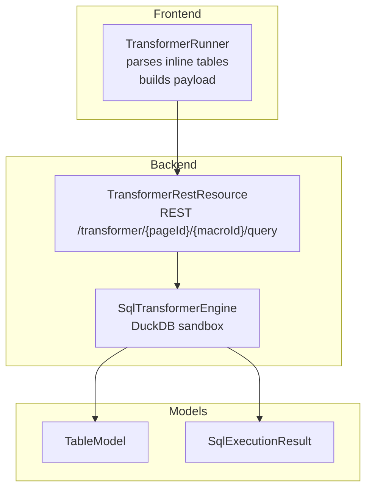
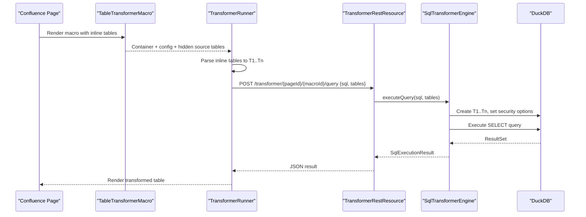
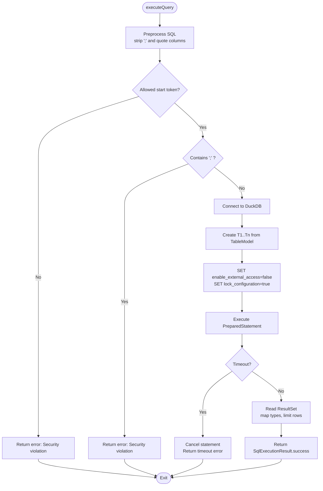
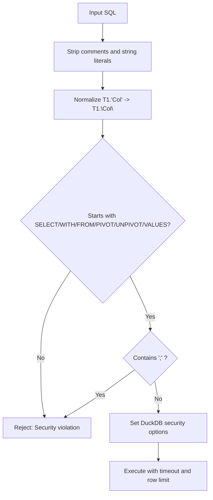

# Open Table Transformer

<cite>
**Referenced Files in This Document**
- [SqlTransformerEngine.java](file://src/main/java/org/opentfc/service/SqlTransformerEngine.java)
- [TableTransformerMacro.java](file://src/main/java/org/opentfc/macro/TableTransformerMacro.java)
- [TransformerRestResource.java](file://src/main/java/org/opentfc/rest/TransformerRestResource.java)
- [transformer-runner.ts](file://src/main/frontend/src/transformer/transformer-runner.ts)
- [TableModel.java](file://src/main/java/org/opentfc/model/TableModel.java)
- [SqlExecutionResult.java](file://src/main/java/org/opentfc/model/SqlExecutionResult.java)
- [SqlTransformerEngineTest.java](file://src/test/java/org/opentfc/service/SqlTransformerEngineTest.java)
- [README.md](file://README.md)
</cite>

## Table of Contents
1. [Introduction](#introduction)
2. [Project Structure](#project-structure)
3. [Core Components](#core-components)
4. [Architecture Overview](#architecture-overview)
5. [Detailed Component Analysis](#detailed-component-analysis)
6. [Supported SQL Syntax and Examples](#supported-sql-syntax-and-examples)
7. [Security Sandboxing and Query Validation](#security-sandboxing-and-query-validation)
8. [Error Handling, Validation, and Debugging](#error-handling-validation-and-debugging)
9. [Performance Tuning and Best Practices](#performance-tuning-and-best-practices)
10. [Troubleshooting Guide](#troubleshooting-guide)
11. [Conclusion](#conclusion)

## Introduction
Open Table Transformer is a Confluence macro that lets you transform one or more tables on a page using SQL executed server-side by the DuckDB in-memory engine. Tables embedded in the macro body are exposed as T1, T2, ..., Tn. You write a single SELECT query to filter, join, aggregate, pivot, union, or window over those tables. The result is rendered back into the page as a table and can be consumed by other macros.

The feature emphasizes safety: only read-only queries are allowed, external access is disabled, configuration is locked, and execution time is bounded.

## Project Structure
The transformer spans frontend and backend layers:
- Frontend parses inline tables from the macro body, builds a JSON payload, and calls a REST endpoint with the SQL query.
- Backend exposes a REST resource that delegates to a sandboxed DuckDB engine.
- The engine creates temporary tables T1..Tn, executes the query, and returns a typed table model.

**Diagram sources**
- [transformer-runner.ts:22-49](file://src/main/frontend/src/transformer/transformer-runner.ts#L22-L49)
- [transformer-runner.ts:94-160](file://src/main/frontend/src/transformer/transformer-runner.ts#L94-L160)
- [TransformerRestResource.java:32-52](file://src/main/java/org/opentfc/rest/TransformerRestResource.java#L32-L52)
- [SqlTransformerEngine.java:96-148](file://src/main/java/org/opentfc/service/SqlTransformerEngine.java#L96-L148)
- [TableModel.java:12-75](file://src/main/java/org/opentfc/model/TableModel.java#L12-L75)
- [SqlExecutionResult.java:11-75](file://src/main/java/org/opentfc/model/SqlExecutionResult.java#L11-L75)

**Section sources**
- [TableTransformerMacro.java:24-43](file://src/main/java/org/opentfc/macro/TableTransformerMacro.java#L24-L43)
- [transformer-runner.ts:22-49](file://src/main/frontend/src/transformer/transformer-runner.ts#L22-L49)
- [TransformerRestResource.java:32-52](file://src/main/java/org/opentfc/rest/TransformerRestResource.java#L32-L52)
- [SqlTransformerEngine.java:96-148](file://src/main/java/org/opentfc/service/SqlTransformerEngine.java#L96-L148)

## Core Components
- SqlTransformerEngine: Creates an in-memory DuckDB instance, registers source tables as T1..Tn, enforces security constraints, executes the user query, and maps results to a typed table model.
- TableTransformerMacro: Renders the macro container, passes parameters (including sqlQuery), and embeds source tables for the frontend to parse.
- TransformerRestResource: Validates request presence and forwards it to the engine.
- TransformerRunner (frontend): Parses inline HTML tables into structured data, sends the query via REST, and renders the result.
- TableModel and SqlExecutionResult: Shared data contracts between frontend and backend.

Key responsibilities:
- Source table exposure: T1..Tn mapping.
- Query preprocessing and validation.
- Secure execution environment.
- Result typing and row limiting.

**Section sources**
- [SqlTransformerEngine.java:32-67](file://src/main/java/org/opentfc/service/SqlTransformerEngine.java#L32-L67)
- [TableTransformerMacro.java:24-43](file://src/main/java/org/opentfc/macro/TableTransformerMacro.java#L24-L43)
- [TransformerRestResource.java:32-52](file://src/main/java/org/opentfc/rest/TransformerRestResource.java#L32-L52)
- [transformer-runner.ts:22-49](file://src/main/frontend/src/transformer/transformer-runner.ts#L22-L49)
- [TableModel.java:12-75](file://src/main/java/org/opentfc/model/TableModel.java#L12-L75)
- [SqlExecutionResult.java:11-75](file://src/main/java/org/opentfc/model/SqlExecutionResult.java#L11-L75)

## Architecture Overview
End-to-end flow from macro rendering to result display:

**Diagram sources**
- [TableTransformerMacro.java:24-43](file://src/main/java/org/opentfc/macro/TableTransformerMacro.java#L24-L43)
- [transformer-runner.ts:22-49](file://src/main/frontend/src/transformer/transformer-runner.ts#L22-L49)
- [transformer-runner.ts:94-160](file://src/main/frontend/src/transformer/transformer-runner.ts#L94-L160)
- [TransformerRestResource.java:32-52](file://src/main/java/org/opentfc/rest/TransformerRestResource.java#L32-L52)
- [SqlTransformerEngine.java:96-148](file://src/main/java/org/opentfc/service/SqlTransformerEngine.java#L96-L148)

## Detailed Component Analysis

### SqlTransformerEngine
Responsibilities:
- Preprocess SQL: strip trailing semicolons, normalize quoted column references like T1.'Column Name' to T1."Column Name".
- Validate query start tokens and reject multi-statement inputs.
- Create and populate temporary tables T1..Tn from provided TableModel instances.
- Lock DuckDB configuration and disable external access.
- Execute the query with a timeout and row limit.
- Map JDBC types to internal ColumnType and normalize numeric values.

Important behaviors:
- Allowed query starts: SELECT, WITH, FROM, PIVOT, UNPIVOT, VALUES.
- Multi-statement detection rejects semicolons anywhere in the processed query.
- Timeouts cancel the statement and return a clear error.
- Errors are logged and wrapped with stable error codes.

**Diagram sources**
- [SqlTransformerEngine.java:79-148](file://src/main/java/org/opentfc/service/SqlTransformerEngine.java#L79-L148)

**Section sources**
- [SqlTransformerEngine.java:32-67](file://src/main/java/org/opentfc/service/SqlTransformerEngine.java#L32-L67)
- [SqlTransformerEngine.java:79-148](file://src/main/java/org/opentfc/service/SqlTransformerEngine.java#L79-L148)
- [SqlTransformerEngine.java:150-180](file://src/main/java/org/opentfc/service/SqlTransformerEngine.java#L150-L180)
- [SqlTransformerEngine.java:182-254](file://src/main/java/org/opentfc/service/SqlTransformerEngine.java#L182-L254)
- [SqlTransformerEngine.java:272-284](file://src/main/java/org/opentfc/service/SqlTransformerEngine.java#L272-L284)

### TableTransformerMacro
- Renders a container div with configuration including macroId, pageId, sourceMacroIds, sqlQuery, and preset.
- Embeds the original body inside a hidden container so the frontend can parse inline tables.
- In export mode, wraps the body for downstream processing.

**Section sources**
- [TableTransformerMacro.java:24-43](file://src/main/java/org/opentfc/macro/TableTransformerMacro.java#L24-L43)

### TransformerRestResource
- Accepts POST requests at /transformer/{pageId}/{macroId}/query.
- Validates that the SQL body is present.
- Logs request details and forwards to SqlTransformerEngine.
- Returns SqlExecutionResult as JSON.

**Section sources**
- [TransformerRestResource.java:32-52](file://src/main/java/org/opentfc/rest/TransformerRestResource.java#L32-L52)

### TransformerRunner (Frontend)
- Parses inline HTML tables into structured TableData objects with id T1..Tn.
- Provides UI presets for common queries.
- Sends the payload to the REST endpoint and renders the result table.
- Emits a custom event with the transformed data for downstream consumers.

**Section sources**
- [transformer-runner.ts:22-49](file://src/main/frontend/src/transformer/transformer-runner.ts#L22-L49)
- [transformer-runner.ts:51-92](file://src/main/frontend/src/transformer/transformer-runner.ts#L51-L92)
- [transformer-runner.ts:94-160](file://src/main/frontend/src/transformer/transformer-runner.ts#L94-L160)

### Data Models
- TableModel: Represents a table with id, columns, rows, and totalRows. Used across REST and engine boundaries.
- SqlExecutionResult: Wraps success/failure, table payload, execution time, and error message.

**Section sources**
- [TableModel.java:12-75](file://src/main/java/org/opentfc/model/TableModel.java#L12-L75)
- [SqlExecutionResult.java:11-75](file://src/main/java/org/opentfc/model/SqlExecutionResult.java#L11-L75)

## Supported SQL Syntax and Examples
The engine uses DuckDB and supports standard SQL features available in DuckDB. The implementation explicitly allows SELECT, WITH, FROM, PIVOT, UNPIVOT, and VALUES as query starters. Tests demonstrate JOIN, GROUP BY aggregation, UNION ALL, window functions, and quoting rules.

Common scenarios:
- Select and cast columns
- Join two tables
- Group by and aggregate
- Window functions such as ROW_NUMBER()
- Union multiple tables
- Quoted identifiers with spaces

Examples (described without code content):
- Select and cast: project columns from T1 and cast numeric strings to integers.
- Join: match employees to departments on a shared key.
- Aggregation: compute totals per department.
- Window function: rank rows by salary descending.
- Union: combine two similarly shaped tables.
- Quoted identifiers: reference columns with spaces using double quotes.

These patterns are validated by unit tests covering successful execution paths and edge cases.

**Section sources**
- [SqlTransformerEngine.java:50-54](file://src/main/java/org/opentfc/service/SqlTransformerEngine.java#L50-L54)
- [SqlTransformerEngineTest.java:56-100](file://src/test/java/org/opentfc/service/SqlTransformerEngineTest.java#L56-L100)
- [SqlTransformerEngineTest.java:102-134](file://src/test/java/org/opentfc/service/SqlTransformerEngineTest.java#L102-L134)

## Security Sandboxing and Query Validation
Security controls:
- Allowed query starters: SELECT, WITH, FROM, PIVOT, UNPIVOT, VALUES. Any other starting command is rejected.
- Multi-statement protection: any semicolon in the processed query is rejected.
- Comment and string literal stripping before validation prevents bypasses through comments or literals.
- External access disabled: enable_external_access=false.
- Configuration locked: lock_configuration=true.
- Execution timeout: configurable; default seconds enforced via Future.get().
- Row limit: maxResultRows caps output size to prevent memory spikes.

Validation pipeline:
1. Strip comments and string literals.
2. Normalize quoted column references.
3. Reject if not starting with an allowed token or contains ';'.
4. Execute within a fixed thread pool and enforce timeout.

**Diagram sources**
- [SqlTransformerEngine.java:69-119](file://src/main/java/org/opentfc/service/SqlTransformerEngine.java#L69-L119)

**Section sources**
- [SqlTransformerEngine.java:69-119](file://src/main/java/org/opentfc/service/SqlTransformerEngine.java#L69-L119)
- [SqlTransformerEngineTest.java:136-186](file://src/test/java/org/opentfc/service/SqlTransformerEngineTest.java#L136-L186)

## Error Handling, Validation, and Debugging
Error handling:
- Empty or null SQL returns a clear error response.
- Security violations return descriptive messages.
- SQL syntax errors are caught and returned without throwing exceptions to the caller.
- Timeout errors cancel the statement and report elapsed time.
- Unexpected failures are logged and surfaced as generic errors.

Debugging techniques:
- Use the macro’s UI to edit the SQL query and run it interactively.
- Inspect execution time and row count in the rendered result header.
- Review server logs for “sql-engine” entries containing error codes and first-line messages.
- For complex queries, simplify incrementally and validate each step.

**Section sources**
- [SqlTransformerEngine.java:96-148](file://src/main/java/org/opentfc/service/SqlTransformerEngine.java#L96-L148)
- [TransformerRestResource.java:32-52](file://src/main/java/org/opentfc/rest/TransformerRestResource.java#L32-L52)
- [transformer-runner.ts:94-160](file://src/main/frontend/src/transformer/transformer-runner.ts#L94-L160)

## Performance Tuning and Best Practices
- Limit result sets: use LIMIT where appropriate to avoid large outputs.
- Prefer indexed-like operations: filter early with WHERE to reduce intermediate sizes.
- Avoid unnecessary joins: join only required columns and rows.
- Use aggregations wisely: GROUP BY should target selective keys.
- Be mindful of window functions: they can be expensive on large datasets.
- Keep queries simple: break complex transformations into multiple steps if needed.
- Monitor execution time: tune timeout and maxResultRows based on workload.
- Reuse source tables: avoid duplicating data across T1..Tn when possible.

Memory optimization:
- The engine normalizes numbers and converts non-numeric values to strings, which reduces type ambiguity but may increase memory usage for very large tables.
- Numeric detection scans all rows; ensure columns intended as numeric contain valid numeric text.

Best practices:
- Use explicit casts for clarity (e.g., CAST(... AS INTEGER)).
- Quote identifiers with spaces using double quotes.
- Avoid multi-statement queries; stick to a single SELECT.
- Test queries against small subsets first.

[No sources needed since this section provides general guidance]

## Troubleshooting Guide
Common issues and resolutions:
- Security violation errors:
  - Cause: Query does not start with an allowed token or contains ';'.
  - Fix: Ensure the query begins with SELECT/WITH/FROM/PIVOT/UNPIVOT/VALUES and remove semicolons.
- Query timeout:
  - Cause: Query exceeds configured timeout.
  - Fix: Optimize query, add filters, or increase timeout cautiously.
- Empty results:
  - Cause: No matching rows or incorrect column names.
  - Fix: Verify column names and quoting; check input tables.
- Type mismatches:
  - Cause: Non-numeric text in numeric columns.
  - Fix: Clean data or cast explicitly in SQL.
- Multi-statement rejection:
  - Cause: Semicolon in query.
  - Fix: Split logic into separate queries if necessary.

Validation checks:
- Confirm the REST endpoint receives the correct pageId and macroId.
- Verify the payload includes both sql and tables arrays.
- Inspect the rendered result header for execution time and row count.

**Section sources**
- [SqlTransformerEngineTest.java:136-215](file://src/test/java/org/opentfc/service/SqlTransformerEngineTest.java#L136-L215)
- [TransformerRestResource.java:32-52](file://src/main/java/org/opentfc/rest/TransformerRestResource.java#L32-L52)

## Conclusion
Open Table Transformer provides a safe, powerful way to transform Confluence tables using SQL backed by DuckDB. It exposes inline tables as T1..Tn, enforces strict security constraints, and returns typed results suitable for further visualization. By following the best practices and troubleshooting tips above, you can build efficient, reliable transformations while staying within the sandboxed environment.

[No sources needed since this section summarizes without analyzing specific files]