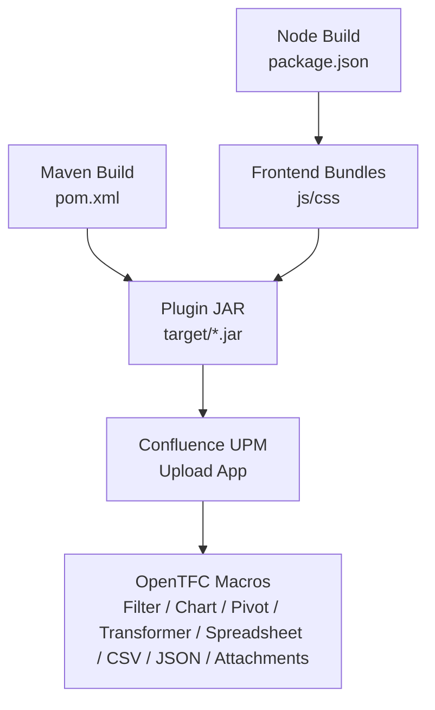
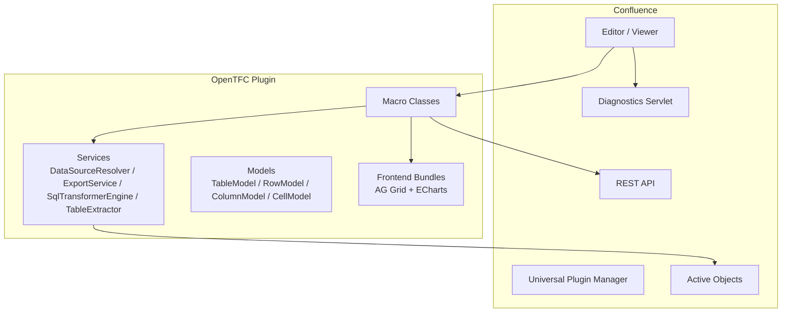
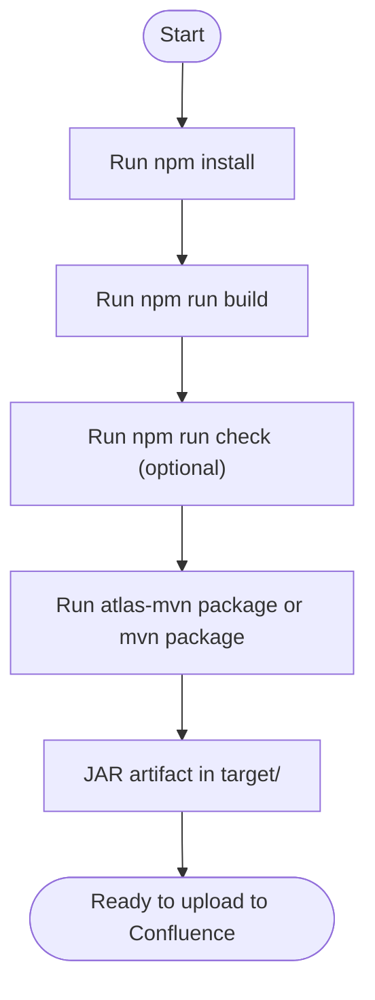
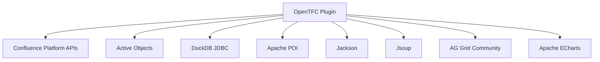

# Getting Started

<cite>
**Referenced Files in This Document**
- [README.md](file://README.md)
- [INSTALL.md](file://INSTALL.md)
- [USER_GUIDE.md](file://USER_GUIDE.md)
- [package.json](file://package.json)
- [pom.xml](file://pom.xml)
- [atlassian-plugin.xml](file://src/main/resources/atlassian-plugin.xml)
</cite>

## Table of Contents
1. [Introduction](#introduction)
2. [Project Structure](#project-structure)
3. [Core Components](#core-components)
4. [Architecture Overview](#architecture-overview)
5. [Detailed Component Analysis](#detailed-component-analysis)
6. [Dependency Analysis](#dependency-analysis)
7. [Performance Considerations](#performance-considerations)
8. [Troubleshooting Guide](#troubleshooting-guide)
9. [Conclusion](#conclusion)
10. [Appendices](#appendices)

## Introduction
OpenTFC is an open-source alternative to the commercial Table Filter, Charts & Spreadsheets plugin for Atlassian Confluence Data Center and Server. It provides a complete set of macros for table filtering, chart visualization, pivot tables, SQL transformations, spreadsheets, and data source macros. The project targets Confluence 8.5 LTS through 9.x and is built with Java 17 on the backend and TypeScript/webpack on the frontend.

Key capabilities include:
- Interactive table filtering, sorting, column hiding, totals, pagination, and export to CSV/XLSX.
- Chart rendering from table data using Apache ECharts with dynamic updates when combined with filters.
- Pivot tables with multi-field grouping and aggregation functions.
- In-memory SQL transformations powered by DuckDB JDBC with sandboxing and timeouts.
- Spreadsheet-like editing with formulas and XLSX persistence in page attachments.
- Data source macros for CSV, JSON, and page attachments.

**Section sources**
- [README.md:1-10](file://README.md#L1-L10)
- [README.md:15-50](file://README.md#L15-L50)
- [USER_GUIDE.md:1-7](file://USER_GUIDE.md#L1-L7)

## Project Structure
The repository is a standard Atlassian Plugin (AMPS) project with:
- Backend code under `src/main/java/org/opentfc` (macros, services, REST, admin, diagnostics).
- Frontend assets under `src/main/frontend/src` compiled into bundles consumed by Confluence.
- Maven configuration (`pom.xml`) for building the plugin JAR.
- Node.js configuration (`package.json`) for building frontend bundles.
- Plugin descriptor (`atlassian-plugin.xml`) registering macros, REST endpoints, web resources, and admin actions.

**Diagram sources**
- [pom.xml:1-30](file://pom.xml#L1-L30)
- [package.json:1-26](file://package.json#L1-L26)
- [atlassian-plugin.xml:1-43](file://src/main/resources/atlassian-plugin.xml#L1-L43)

**Section sources**
- [pom.xml:1-30](file://pom.xml#L1-L30)
- [package.json:1-26](file://package.json#L1-L26)
- [atlassian-plugin.xml:1-43](file://src/main/resources/atlassian-plugin.xml#L1-L43)

## Core Components
OpenTFC exposes nine macros that fall into two categories:

- Container macros (process nested tables or other OpenTFC macros):
  - Open Table Filter
  - Open Chart from Table
  - Open Pivot Table
  - Open Table Transformer

- Data generator macros (create tables from various sources):
  - Open Table Spreadsheet
  - Open Spreadsheet Include
  - Open Attachment Table
  - Open CSV Table
  - Open JSON Table

These macros are registered in the plugin descriptor and expose parameters for configuration. They integrate with Active Objects for user profiles/settings, REST APIs for advanced operations, and web resources for frontend assets.

**Section sources**
- [USER_GUIDE.md:31-51](file://USER_GUIDE.md#L31-L51)
- [atlassian-plugin.xml:70-286](file://src/main/resources/atlassian-plugin.xml#L70-L286)

## Architecture Overview
At a high level, OpenTFC integrates with Confluence via:
- Macro rendering classes bound to XHTML macro descriptors.
- Web Resources for JavaScript/CSS bundles loaded in editor/viewer contexts.
- REST endpoints for configuration, export, profiles, sources, and transformer execution.
- Active Objects for storing filter profiles and spreadsheet metadata.
- Diagnostics servlets for browser-visible logs and plugin lifecycle events.

**Diagram sources**
- [atlassian-plugin.xml:15-27](file://src/main/resources/atlassian-plugin.xml#L15-L27)
- [atlassian-plugin.xml:29-43](file://src/main/resources/atlassian-plugin.xml#L29-L43)
- [atlassian-plugin.xml:64-68](file://src/main/resources/atlassian-plugin.xml#L64-L68)

**Section sources**
- [atlassian-plugin.xml:15-68](file://src/main/resources/atlassian-plugin.xml#L15-L68)

## Detailed Component Analysis

### Installation Requirements
- Confluence Data Center/Server versions: 8.5 LTS – 9.x
- JDK: 17
- Node.js: 18+ with npm
- Atlassian Plugin SDK (`atlas-mvn`) or Maven 3.8+

These requirements ensure compatibility with the Confluence platform APIs and allow building both frontend bundles and the plugin artifact.

**Section sources**
- [INSTALL.md:9-13](file://INSTALL.md#L9-L13)
- [README.md:61-67](file://README.md#L61-L67)
- [pom.xml:15-28](file://pom.xml#L15-L28)

### Build Process
1. Install frontend dependencies and build bundles:
   - Run `npm install`
   - Run `npm run build`
2. Verify TypeScript types (optional but recommended):
   - Run `npm run check`
3. Build the plugin artifact:
   - Run `atlas-mvn package` or `mvn package`
   - The resulting JAR appears under `target/`.

The frontend build compiles TypeScript and CSS into production bundles consumed by the plugin. The Maven build packages the plugin with AMPS and validates OBR and manifest integrity.

**Diagram sources**
- [package.json:6-10](file://package.json#L6-L10)
- [README.md:68-85](file://README.md#L68-L85)
- [INSTALL.md:17-43](file://INSTALL.md#L17-L43)

**Section sources**
- [README.md:61-97](file://README.md#L61-L97)
- [INSTALL.md:17-43](file://INSTALL.md#L17-L43)
- [package.json:1-26](file://package.json#L1-L26)

### Basic Usage Examples

#### Add Filtering to Tables
- Insert the Open Table Filter macro around an existing Confluence table.
- Enable global search, column filters, sticky headers, frozen columns, totals row, column visibility controls, and export buttons via macro parameters.
- Use text search, dropdown filters, numeric ranges, date ranges, and multi-sorting (Shift+click).
- Save personalized filter profiles per user.

This transforms static tables into interactive analysis tools with export options.

**Section sources**
- [USER_GUIDE.md:68-106](file://USER_GUIDE.md#L68-L106)
- [atlassian-plugin.xml:72-107](file://src/main/resources/atlassian-plugin.xml#L72-L107)

#### Create Charts
- Insert the Open Chart from Table macro around a table.
- Choose chart type (column, bar, line, area, pie, donut, scatter, radar, funnel, gantt).
- Configure category/value columns and aggregation function.
- Combine charts with filters so they update dynamically as users apply filters.

Charts render using Apache ECharts and support export to PNG/SVG.

**Section sources**
- [USER_GUIDE.md:109-134](file://USER_GUIDE.md#L109-L134)
- [atlassian-plugin.xml:109-148](file://src/main/resources/atlassian-plugin.xml#L109-L148)

#### Use Pivot Tables
- Wrap a table with the Open Pivot Table macro.
- Specify row fields, column fields, value fields, and aggregation function (SUM, COUNT, AVG, MIN, MAX).
- Collapse/expand grouped levels in viewer mode.

Pivot tables enable quick analytical summaries directly within Confluence pages.

**Section sources**
- [USER_GUIDE.md:137-153](file://USER_GUIDE.md#L137-L153)
- [atlassian-plugin.xml:150-174](file://src/main/resources/atlassian-plugin.xml#L150-L174)

#### SQL Transformations
- Use the Open Table Transformer macro to write SQL against one or more tables referenced as T1, T2, etc.
- Supported features include JOIN, UNION, PIVOT, window functions, computed fields, and conditional logic.
- Queries execute in a sandboxed in-memory engine with read-only protection and timeouts.

This macro is ideal for complex data manipulation without leaving Confluence.

**Section sources**
- [USER_GUIDE.md:156-216](file://USER_GUIDE.md#L156-L216)
- [atlassian-plugin.xml:176-192](file://src/main/resources/atlassian-plugin.xml#L176-L192)

#### Spreadsheets
- Use the Open Table Spreadsheet macro to create editable sheets with formulas and styling.
- Data persists as XLSX files attached to the page, with versioning and soft session locking.
- Use Open Spreadsheet Include to embed ranges or sheets from another page’s Excel attachment.

Spreadsheets provide familiar Excel-like functionality inside Confluence.

**Section sources**
- [USER_GUIDE.md:219-243](file://USER_GUIDE.md#L219-L243)
- [atlassian-plugin.xml:194-227](file://src/main/resources/atlassian-plugin.xml#L194-L227)

#### Data Source Macros
- Open Attachment Table lists page attachments with filtering and download links.
- Open CSV Table parses CSV/TSV from attachments or URLs with delimiter and encoding options.
- Open JSON Table converts structured JSON arrays into tables with configurable columns.

These macros simplify importing and presenting external data.

**Section sources**
- [USER_GUIDE.md:245-280](file://USER_GUIDE.md#L245-L280)
- [atlassian-plugin.xml:229-286](file://src/main/resources/atlassian-plugin.xml#L229-L286)

### Quick Start Tutorial

#### Step-by-step: Add Filtering to a Table
1. Edit a Confluence page and insert the Open Table Filter macro.
2. Place your table inside the macro.
3. Enable desired features: global search, column filters, sticky header, frozen columns, totals row, hideable columns, export buttons, pagination size.
4. Preview the page and test search, dropdown filters, numeric/date ranges, and multi-sorting.
5. Save a custom view if needed.

#### Step-by-step: Create a Chart from a Table
1. Insert the Open Chart from Table macro around a table.
2. Select chart type and configure category/value columns.
3. Set aggregation function and title.
4. Optionally wrap the chart inside a filter macro to make it respond to user filters.

#### Step-by-step: Build a Pivot Table
1. Insert the Open Pivot Table macro around a table.
2. Define row fields, column fields, and value fields.
3. Choose aggregation function and preview results.
4. Expand/collapse groups in viewer mode.

#### Step-by-step: Apply SQL Transformation
1. Insert the Open Table Transformer macro.
2. Reference input tables as T1, T2, etc.
3. Write a SELECT query using supported SQL features.
4. Execute and review the transformed output; optionally wrap with filters or charts.

#### Step-by-step: Use Spreadsheets
1. Insert the Open Table Spreadsheet macro.
2. Enter formulas and format cells.
3. Save changes; the sheet is stored as an XLSX attachment.
4. Embed ranges from other pages using Open Spreadsheet Include.

**Section sources**
- [USER_GUIDE.md:54-63](file://USER_GUIDE.md#L54-L63)
- [USER_GUIDE.md:68-106](file://USER_GUIDE.md#L68-L106)
- [USER_GUIDE.md:109-134](file://USER_GUIDE.md#L109-L134)
- [USER_GUIDE.md:137-153](file://USER_GUIDE.md#L137-L153)
- [USER_GUIDE.md:156-216](file://USER_GUIDE.md#L156-L216)
- [USER_GUIDE.md:219-243](file://USER_GUIDE.md#L219-L243)

## Dependency Analysis
OpenTFC depends on:
- Confluence platform APIs (provided at runtime).
- Active Objects for persistent user settings and profiles.
- DuckDB JDBC for in-memory SQL execution.
- Apache POI for XLSX handling.
- Jackson for JSON processing.
- Jsoup for HTML parsing.
- Frontend libraries AG Grid Community and Apache ECharts bundled via webpack.

**Diagram sources**
- [pom.xml:106-207](file://pom.xml#L106-L207)
- [package.json:11-24](file://package.json#L11-L24)

**Section sources**
- [pom.xml:106-207](file://pom.xml#L106-L207)
- [package.json:11-24](file://package.json#L11-L24)

## Performance Considerations
- Large datasets: Use pagination and appropriate pageSize settings in filters.
- SQL transformations: Keep queries efficient; leverage indexes conceptually in memory and avoid unnecessary joins.
- Exports: Prefer targeted exports (CSV/XLSX) rather than exporting entire pages when possible.
- Frontend bundles: Production builds minimize payload; ensure you use `npm run build` before packaging.

[No sources needed since this section provides general guidance]

## Troubleshooting Guide

### Common Setup Issues
- “No macro metadata” errors on Confluence 8.5: Ensure you are running a compatible plugin version and verify activation status in UPM.
- Plugin fails to activate: Check UPM logs and the diagnostics page for Spring/OSGi wiring issues.
- Missing frontend assets: Confirm that `npm install` and `npm run build` were executed before `atlas-mvn package`.

### Verification Steps
- Upload the built JAR via UPM and confirm the plugin status is Enabled.
- Visit the diagnostics page to inspect plugin framework events and captured WARN/ERROR entries.
- Test basic macro rendering (filter, chart, pivot) on a sample page.
- Validate export functionality (CSV/XLSX) and PDF/Word export behavior.

### Diagnostics Without Server Access
- Use the browser-visible diagnostics endpoint to observe plugin lifecycle events and log captures.
- If the main plugin does not activate, install the lightweight companion diagnostic plugin to capture activation errors and cascading disable events.

**Section sources**
- [INSTALL.md:47-94](file://INSTALL.md#L47-L94)
- [USER_GUIDE.md:339-352](file://USER_GUIDE.md#L339-L352)
- [atlassian-plugin.xml:64-68](file://src/main/resources/atlassian-plugin.xml#L64-L68)

## Conclusion
OpenTFC delivers a comprehensive, open-source toolkit for working with tables, charts, pivots, SQL transformations, and spreadsheets in Confluence Data Center/Server 8.5 LTS – 9.x. By following the installation and build steps, verifying deployment, and exploring the macro capabilities outlined here, teams can quickly adopt powerful data analysis features without relying on commercial plugins.

[No sources needed since this section summarizes without analyzing specific files]

## Appendices

### Installation Checklist for Confluence Data Center/Server 8.5 LTS – 9.x
- Confirm Confluence version compatibility.
- Install JDK 17, Node.js 18+, and Atlassian Plugin SDK/Maven.
- Build frontend bundles and plugin JAR.
- Upload JAR via UPM and verify Enabled status.
- Open diagnostics page and confirm plugin lifecycle events.
- Test core macros: filter, chart, pivot, transformer, spreadsheet, CSV, JSON, attachments.

**Section sources**
- [INSTALL.md:9-13](file://INSTALL.md#L9-L13)
- [INSTALL.md:47-58](file://INSTALL.md#L47-L58)
- [README.md:99-104](file://README.md#L99-L104)