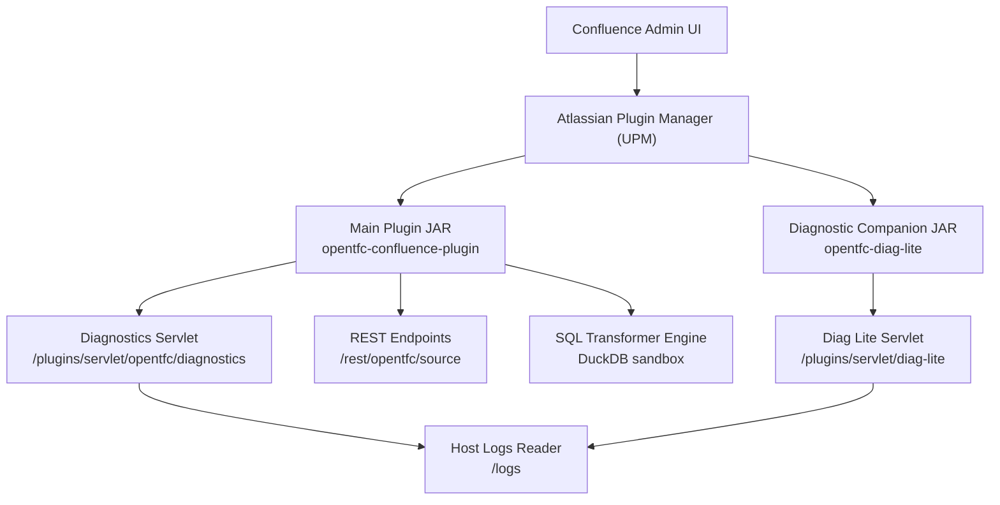
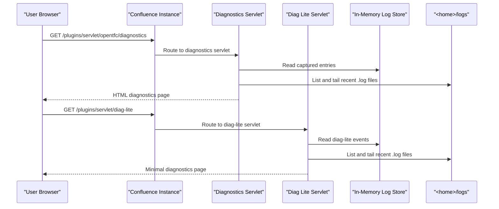
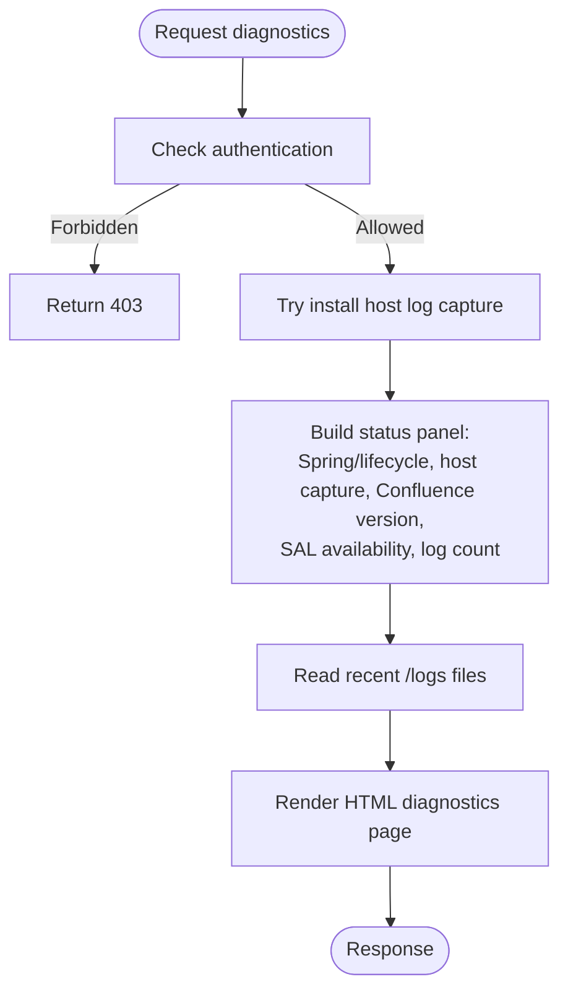
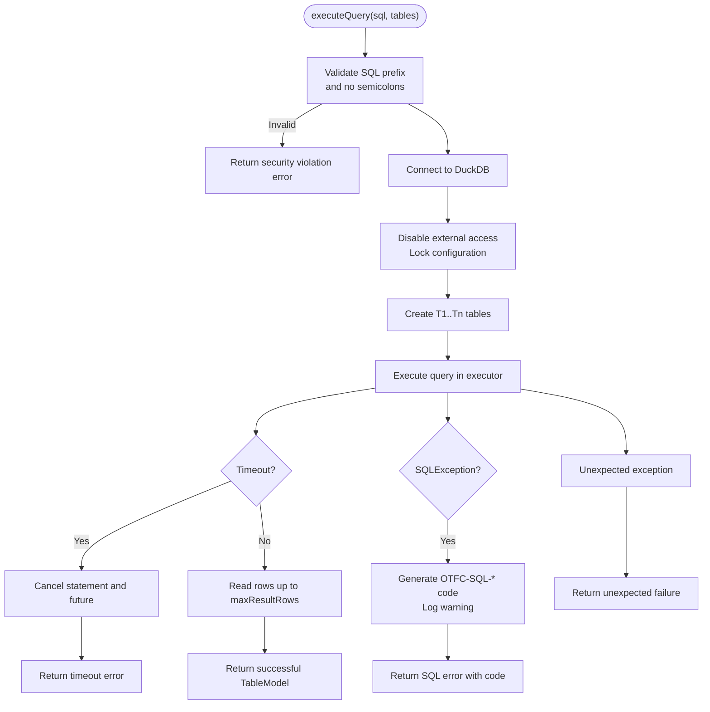
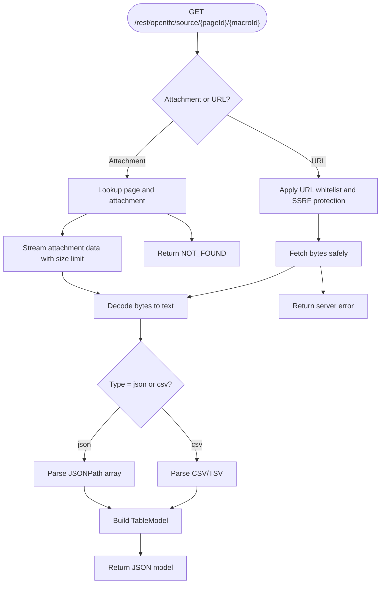
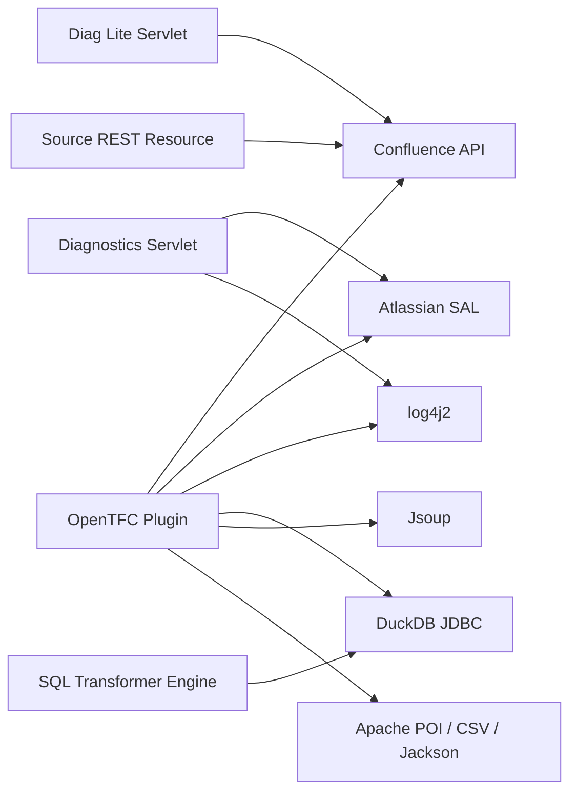

# Troubleshooting and FAQ

<cite>
**Referenced Files in This Document**
- [README.md](file://README.md)
- [INSTALL.md](file://INSTALL.md)
- [USER_GUIDE.md](file://USER_GUIDE.md)
- [OpenTfcDiagnosticsServlet.java](file://src/main/java/org/opentfc/diag/OpenTfcDiagnosticsServlet.java)
- [Log4jRingAppender.java](file://src/main/java/org/opentfc/diag/Log4jRingAppender.java)
- [HostLogCaptureInstaller.java](file://src/main/java/org/opentfc/diag/HostLogCaptureInstaller.java)
- [DiagLiteServlet.java](file://diag-lite/src/main/java/org/opentfc/diag/lite/DiagLiteServlet.java)
- [SqlTransformerEngine.java](file://src/main/java/org/opentfc/service/SqlTransformerEngine.java)
- [TableExtractorImpl.java](file://src/main/java/org/opentfc/service/TableExtractorImpl.java)
- [SourceRestResource.java](file://src/main/java/org/opentfc/rest/SourceRestResource.java)
</cite>

## Table of Contents
1. [Introduction](#introduction)
2. [Project Structure](#project-structure)
3. [Core Components](#core-components)
4. [Architecture Overview](#architecture-overview)
5. [Detailed Component Analysis](#detailed-component-analysis)
6. [Dependency Analysis](#dependency-analysis)
7. [Performance Considerations](#performance-considerations)
8. [Troubleshooting Guide](#troubleshooting-guide)
9. [Conclusion](#conclusion)
10. [Appendices](#appendices)

## Introduction
This document is a practical troubleshooting and FAQ guide for OpenTFC, the open Confluence plugin that provides table filtering, charts, pivot tables, spreadsheet-like editing, SQL transformation, CSV/JSON sources, and attachment listing. It focuses on:
- Setup and activation problems
- Configuration issues
- Performance, memory, and slow query behavior
- Diagnostic tools and log analysis
- Error message interpretation
- Known limitations, browser compatibility notes, and workarounds
- Frequently asked questions about macro behavior, data processing limits, and integration scenarios
- Community resources and bug reporting procedures

The guidance references actual implementation details so you can quickly locate root causes rather than guessing.

## Project Structure
OpenTFC is an Atlassian Confluence Data Center / Server plugin with:
- Backend Java services for macros, REST endpoints, diagnostics, settings, and SQL transformation
- Frontend assets built from TypeScript and CSS
- A small companion diagnostic plugin (`opentfc-diag-lite`) for cases where the main plugin cannot activate

**Diagram sources**
- [OpenTfcDiagnosticsServlet.java:23-30](file://src/main/java/org/opentfc/diag/OpenTfcDiagnosticsServlet.java#L23-L30)
- [DiagLiteServlet.java:13-24](file://diag-lite/src/main/java/org/opentfc/diag/lite/DiagLiteServlet.java#L13-L24)
- [SqlTransformerEngine.java:32-35](file://src/main/java/org/opentfc/service/SqlTransformerEngine.java#L32-L35)
- [SourceRestResource.java:22-27](file://src/main/java/org/opentfc/rest/SourceRestResource.java#L22-L27)

**Section sources**
- [README.md:53-58](file://README.md#L53-L58)
- [INSTALL.md:9-13](file://INSTALL.md#L9-L13)

## Core Components
For troubleshooting, focus on these components:
- Diagnostics servlet: shows OpenTFC events, host WARN/ERROR capture status, Confluence version, Spring lifecycle state, and recent server logs.
- Diag Lite servlet: minimal fallback when the main plugin does not activate; shows OpenTFC state, plugin framework events, and server log tails.
- SQL transformer engine: DuckDB-based in-memory SQL execution with timeout, result row limit, read-only sandboxing, and error codes.
- Source REST resource: loads CSV/TSV or JSON from page attachments or whitelisted URLs, with SSRF protection and fetch size limits.
- Table extractor: parses HTML tables into typed models used by filters, charts, pivots, and transformers.

**Section sources**
- [OpenTfcDiagnosticsServlet.java:23-30](file://src/main/java/org/opentfc/diag/OpenTfcDiagnosticsServlet.java#L23-L30)
- [DiagLiteServlet.java:13-24](file://diag-lite/src/main/java/org/opentfc/diag/lite/DiagLiteServlet.java#L13-L24)
- [SqlTransformerEngine.java:32-35](file://src/main/java/org/opentfc/service/SqlTransformerEngine.java#L32-L35)
- [SourceRestResource.java:22-27](file://src/main/java/org/opentfc/rest/SourceRestResource.java#L22-L27)
- [TableExtractorImpl.java:16-19](file://src/main/java/org/opentfc/service/TableExtractorImpl.java#L16-L19)

## Architecture Overview
The most common troubleshooting flow starts at the user’s browser and ends in either the diagnostics UI or the Confluence server logs.

**Diagram sources**
- [OpenTfcDiagnosticsServlet.java:154-179](file://src/main/java/org/opentfc/diag/OpenTfcDiagnosticsServlet.java#L154-L179)
- [DiagLiteServlet.java:39-78](file://diag-lite/src/main/java/org/opentfc/diag/lite/DiagLiteServlet.java#L39-L78)

## Detailed Component Analysis

### Diagnostics and Logging Infrastructure
OpenTFC provides two complementary diagnostic surfaces:
- `/plugins/servlet/opentfc/diagnostics`: full diagnostics page with OpenTFC events, plugin framework ENABLED/DISABLED events, host WARN/ERROR capture status, Confluence version, Spring lifecycle bean status, and recent server log tails.
- `/plugins/servlet/diag-lite`: lightweight fallback when the main plugin fails to activate; it avoids heavy dependencies and still shows OpenTFC state, plugin framework events, and server log tails.

Key behaviors:
- The diagnostics servlet tries to install host log capture via log4j2. If log4j-core is not wired into the plugin, host capture remains unavailable, but the rest of the plugin continues working.
- Both pages protect access: they require an authenticated user; if SAL is unavailable, they fall back to checking the Seraph session cookie.
- The diagnostics page renders plain HTML without Velocity decorators or AUI, so it remains readable even when Confluence rendering is broken.
- Server log tails are read only from the actual `<home>/logs` directory using safe file name matching; request parameters are never passed to file operations.

**Diagram sources**
- [OpenTfcDiagnosticsServlet.java:192-214](file://src/main/java/org/opentfc/diag/OpenTfcDiagnosticsServlet.java#L192-L214)
- [OpenTfcDiagnosticsServlet.java:239-352](file://src/main/java/org/opentfc/diag/OpenTfcDiagnosticsServlet.java#L239-L352)
- [HostLogCaptureInstaller.java:17-33](file://src/main/java/org/opentfc/diag/HostLogCaptureInstaller.java#L17-L33)
- [Log4jRingAppender.java:11-31](file://src/main/java/org/opentfc/diag/Log4jRingAppender.java#L11-L31)

**Section sources**
- [INSTALL.md:61-94](file://INSTALL.md#L61-L94)
- [OpenTfcDiagnosticsServlet.java:23-30](file://src/main/java/org/opentfc/diag/OpenTfcDiagnosticsServlet.java#L23-L30)
- [OpenTfcDiagnosticsServlet.java:147-190](file://src/main/java/org/opentfc/diag/OpenTfcDiagnosticsServlet.java#L147-L190)
- [OpenTfcDiagnosticsServlet.java:192-227](file://src/main/java/org/opentfc/diag/OpenTfcDiagnosticsServlet.java#L192-L227)
- [OpenTfcDiagnosticsServlet.java:310-321](file://src/main/java/org/opentfc/diag/OpenTfcDiagnosticsServlet.java#L310-L321)
- [Log4jRingAppender.java:6-10](file://src/main/java/org/opentfc/diag/Log4jRingAppender.java#L6-L10)
- [HostLogCaptureInstaller.java:8-11](file://src/main/java/org/opentfc/diag/HostLogCaptureInstaller.java#L8-L11)
- [DiagLiteServlet.java:13-24](file://diag-lite/src/main/java/org/opentfc/diag/lite/DiagLiteServlet.java#L13-L24)
- [DiagLiteServlet.java:39-78](file://diag-lite/src/main/java/org/opentfc/diag/lite/DiagLiteServlet.java#L39-L78)

### SQL Transformer Engine: Timeouts, Limits, and Errors
The SQL transformer executes user queries against in-memory tables exposed as `T1`, `T2`, etc., using DuckDB. It is intentionally sandboxed:
- Only allowed query starters are accepted: SELECT, WITH, FROM, PIVOT, UNPIVOT, VALUES.
- Multiple statements separated by semicolons are rejected.
- External access is disabled and configuration locking is enabled.
- Queries run in a fixed thread pool with a configurable timeout.
- Result rows are limited to a configured maximum.

Common symptoms and meanings:
- Query timeout: indicates a complex or large dataset query exceeded the configured seconds.
- Security violation: indicates the query was rejected because it did not start with an allowed statement or contained multiple statements.
- SQL error code: each SQL exception is logged with a stable short code derived from the error message hash; this helps correlate frontend errors with backend logs.

**Diagram sources**
- [SqlTransformerEngine.java:50-58](file://src/main/java/org/opentfc/service/SqlTransformerEngine.java#L50-L58)
- [SqlTransformerEngine.java:95-148](file://src/main/java/org/opentfc/service/SqlTransformerEngine.java#L95-L148)
- [SqlTransformerEngine.java:150-180](file://src/main/java/org/opentfc/service/SqlTransformerEngine.java#L150-L180)

**Section sources**
- [SqlTransformerEngine.java:32-35](file://src/main/java/org/opentfc/service/SqlTransformerEngine.java#L32-L35)
- [SqlTransformerEngine.java:40-48](file://src/main/java/org/opentfc/service/SqlTransformerEngine.java#L40-L48)
- [SqlTransformerEngine.java:50-58](file://src/main/java/org/opentfc/service/SqlTransformerEngine.java#L50-L58)
- [SqlTransformerEngine.java:95-148](file://src/main/java/org/opentfc/service/SqlTransformerEngine.java#L95-L148)
- [SqlTransformerEngine.java:150-180](file://src/main/java/org/opentfc/service/SqlTransformerEngine.java#L150-L180)
- [SqlTransformerEngine.java:182-231](file://src/main/java/org/opentfc/service/SqlTransformerEngine.java#L182-L231)
- [SqlTransformerEngine.java:234-254](file://src/main/java/org/opentfc/service/SqlTransformerEngine.java#L234-L254)

### Source Data Loading: Attachments, URLs, and SSRF Protection
The source REST endpoint supports:
- Reading CSV/TSV from a page attachment
- Fetching CSV/TSV or JSON from a URL
- Decoding with configurable encoding
- Parsing JSONPath arrays into tables
- Limiting fetch size and applying whitelist-based SSRF protection

Typical failures:
- Source not found: attachment missing, page missing, or URL blocked/not reachable.
- Load failed: network error, decoding error, parsing error, or SSRF guard triggered.

**Diagram sources**
- [SourceRestResource.java:61-111](file://src/main/java/org/opentfc/rest/SourceRestResource.java#L61-L111)

**Section sources**
- [SourceRestResource.java:22-27](file://src/main/java/org/opentfc/rest/SourceRestResource.java#L22-L27)
- [SourceRestResource.java:61-111](file://src/main/java/org/opentfc/rest/SourceRestResource.java#L61-L111)

### Table Extraction and Type Inference
The table extractor parses HTML tables into typed models. It:
- Finds the first table element
- Extracts headers from `<thead>` or infers header from the first row
- Extracts rows from `<tbody>` or all rows if no tbody exists
- Infers column types: number, date, select, or text based on content patterns
- Supports numeric formats with optional currency symbols and thousands separators
- Supports several date formats

Common issues:
- Missing or malformed headers cause generic column names.
- Mixed content may prevent correct type inference, causing filters to behave like text filters instead of numeric/date/select filters.

**Section sources**
- [TableExtractorImpl.java:31-103](file://src/main/java/org/opentfc/service/TableExtractorImpl.java#L31-L103)
- [TableExtractorImpl.java:105-146](file://src/main/java/org/opentfc/service/TableExtractorImpl.java#L105-L146)
- [TableExtractorImpl.java:148-164](file://src/main/java/org/opentfc/service/TableExtractorImpl.java#L148-L164)

## Dependency Analysis
OpenTFC depends on:
- Confluence APIs: PageManager, AttachmentManager, UserManager, ApplicationProperties
- Atlassian SAL for component resolution and application properties
- log4j2 for host log capture when available
- DuckDB JDBC for in-memory SQL execution
- Jsoup for HTML table parsing
- Apache POI and Commons CSV/Jackson for export and data parsing

**Diagram sources**
- [OpenTfcDiagnosticsServlet.java:3-6](file://src/main/java/org/opentfc/diag/OpenTfcDiagnosticsServlet.java#L3-L6)
- [Log4jRingAppender.java:3-4](file://src/main/java/org/opentfc/diag/Log4jRingAppender.java#L3-L4)
- [SqlTransformerEngine.java:13-19](file://src/main/java/org/opentfc/service/SqlTransformerEngine.java#L13-L19)
- [TableExtractorImpl.java:3-6](file://src/main/java/org/opentfc/service/TableExtractorImpl.java#L3-L6)
- [SourceRestResource.java:3-10](file://src/main/java/org/opentfc/rest/SourceRestResource.java#L3-L10)

**Section sources**
- [README.md:53-58](file://README.md#L53-L58)

## Performance Considerations
OpenTFC includes several safeguards and configuration points relevant to performance:

- SQL query timeout: default 10 seconds. Long-running or overly complex queries will be cancelled and return a timeout error.
- Maximum result rows: default 50,000. Large result sets are truncated to avoid excessive memory usage.
- Shared executor: DuckDB queries use a fixed thread pool of 2 daemon threads to avoid per-query thread leaks.
- Source fetch size limit: attachment and URL data streams are read with a maximum fetch size before decoding.
- Table extraction scans rows once to infer types; very large tables with mixed content can increase CPU time during parsing.

Recommendations:
- Simplify SQL queries: filter early, avoid unnecessary joins, and prefer aggregation over returning huge datasets.
- Reduce result set size: use WHERE clauses, LIMIT-like logic in your query design, or pre-aggregate data.
- Avoid chaining many heavy macros on one page: each macro may parse, transform, or render data.
- Use pagination and filtered views: keep interactive tables manageable.
- Monitor diagnostics: check query execution logs and host WARN/ERROR entries.

[No sources needed since this section provides general guidance]

## Troubleshooting Guide

### Setup and Activation Issues

#### Symptom: Plugin does not activate or UPM reports activation failure
Likely causes:
- OSGi/Spring context failure
- Missing dependencies or incompatible Confluence version
- Cascading DISABLED events for bundled plugins

Steps:
1. Check UPM and Confluence startup logs.
2. Open `/plugins/servlet/opentfc/diagnostics`.
   - If the page is 404, the plugin likely did not activate.
   - If Spring/lifecycle bean is not up, inspect host WARN/ERROR capture and server logs.
   - If many bundled plugins show DISABLED, remove OpenTFC via UPM and restart to recover rendering.
3. If server logs are inaccessible, install `opentfc-diag-lite.jar` and open `/plugins/servlet/diag-lite`.
4. After installing the main plugin again, refresh diag-lite and download the log tail for support.

**Section sources**
- [INSTALL.md:47-58](file://INSTALL.md#L47-L58)
- [INSTALL.md:61-94](file://INSTALL.md#L61-L94)
- [OpenTfcDiagnosticsServlet.java:76-83](file://src/main/java/org/opentfc/diag/OpenTfcDiagnosticsServlet.java#L76-L83)
- [DiagLiteServlet.java:146-150](file://diag-lite/src/main/java/org/opentfc/diag/lite/DiagLiteServlet.java#L146-L150)

#### Symptom: Diagnostics page returns 403 Forbidden
Likely causes:
- Not authenticated
- SAL unavailable and no Seraph session cookie

Steps:
1. Ensure you are logged into Confluence.
2. If SAL is down, verify the Seraph session cookie exists.
3. Retry after re-authentication.

**Section sources**
- [OpenTfcDiagnosticsServlet.java:192-214](file://src/main/java/org/opentfc/diag/OpenTfcDiagnosticsServlet.java#L192-L214)
- [DiagLiteServlet.java:40-55](file://diag-lite/src/main/java/org/opentfc/diag/lite/DiagLiteServlet.java#L40-L55)

### Configuration Problems

#### Symptom: SQL transformer times out or returns security violation
Likely causes:
- Query too complex or dataset too large
- Query does not start with an allowed statement
- Query contains multiple statements

Steps:
1. Simplify the SQL: filter early, reduce joins, aggregate before returning results.
2. Ensure the query starts with SELECT, WITH, FROM, PIVOT, UNPIVOT, or VALUES.
3. Remove semicolons and ensure only one statement runs.
4. Increase timeout only if necessary; prefer reducing workload.
5. Check diagnostics for SQL error codes and messages.

**Section sources**
- [SqlTransformerEngine.java:50-58](file://src/main/java/org/opentfc/service/SqlTransformerEngine.java#L50-L58)
- [SqlTransformerEngine.java:95-148](file://src/main/java/org/opentfc/service/SqlTransformerEngine.java#L95-L148)

#### Symptom: Source data not found or load failed
Likely causes:
- Attachment missing or wrong name
- URL blocked by whitelist or SSRF protection
- Encoding mismatch
- JSONPath or CSV parsing error

Steps:
1. Verify attachment name and page ID.
2. For URLs, confirm the domain is whitelisted and reachable.
3. Set correct encoding parameter.
4. For JSON, validate JSONPath and structure.
5. Check diagnostics for source load errors.

**Section sources**
- [SourceRestResource.java:61-111](file://src/main/java/org/opentfc/rest/SourceRestResource.java#L61-L111)

### Daily Usage Issues

#### Symptom: Filters do not recognize numbers or dates
Likely causes:
- Mixed content in the column prevents type inference
- Currency symbols or thousands separators confuse parsers
- Dates in unsupported format

Steps:
1. Clean the source table: ensure consistent numeric and date formats.
2. Remove mixed text values from numeric columns.
3. Normalize date formats to supported patterns.
4. Re-render the macro after fixing the source.

**Section sources**
- [TableExtractorImpl.java:105-146](file://src/main/java/org/opentfc/service/TableExtractorImpl.java#L105-L146)
- [TableExtractorImpl.java:148-164](file://src/main/java/org/opentfc/service/TableExtractorImpl.java#L148-L164)

#### Symptom: Charts do not update or look incorrect
Likely causes:
- Underlying table data changed but chart did not refresh
- Category or value columns misconfigured
- Aggregation function inappropriate for data

Steps:
1. Confirm the chart is nested inside a filter macro if real-time updates are expected.
2. Verify category and value column names match the table.
3. Choose appropriate aggregation: SUM, AVG, COUNT, MIN, MAX, or NONE.
4. Check browser console for JavaScript errors if interactivity is broken.

**Section sources**
- [USER_GUIDE.md:109-134](file://USER_GUIDE.md#L109-L134)

#### Symptom: Spreadsheet save fails or conflicts occur
Likely causes:
- Attachment write permissions issue
- Concurrent editing conflict
- XLSX file corrupted or too large

Steps:
1. Verify page attachment permissions.
2. Close other editors; OpenTFC uses soft session locking.
3. Save smaller spreadsheets or split across sheets.
4. Check Confluence logs for attachment manager errors.

**Section sources**
- [USER_GUIDE.md:219-230](file://USER_GUIDE.md#L219-L230)

### Performance and Memory Problems

#### Symptom: Slow page load with large tables
Likely causes:
- Large HTML tables parsed by Jsoup
- Many macros chained together
- Heavy SQL transformations returning large datasets

Steps:
1. Reduce table size: filter or aggregate upstream.
2. Avoid nesting multiple heavy macros.
3. Use pagination and custom views.
4. Monitor diagnostics for long-running SQL queries.

**Section sources**
- [TableExtractorImpl.java:31-103](file://src/main/java/org/opentfc/service/TableExtractorImpl.java#L31-L103)
- [SqlTransformerEngine.java:40-48](file://src/main/java/org/opentfc/service/SqlTransformerEngine.java#L40-L48)

#### Symptom: High memory usage during SQL execution
Likely causes:
- Large result sets exceeding default row limit
- Complex joins or aggregations loading too much data

Steps:
1. Add WHERE clauses and reduce result size.
2. Pre-aggregate data in SQL.
3. Adjust timeout and max result rows only if necessary.
4. Watch for truncation behavior: results are limited to configured maximum rows.

**Section sources**
- [SqlTransformerEngine.java:56-67](file://src/main/java/org/opentfc/service/SqlTransformerEngine.java#L56-L67)
- [SqlTransformerEngine.java:150-180](file://src/main/java/org/opentfc/service/SqlTransformerEngine.java#L150-L180)

### Log Analysis Techniques

#### Where to look
- Diagnostics page: `/plugins/servlet/opentfc/diagnostics`
- Diag Lite page: `/plugins/servlet/diag-lite`
- Server logs: `<home>/logs/atlassian-confluence.log`

#### What to look for
- Spring/lifecycle bean status
- Host log capture installation status
- ENABLED/DISABLED plugin framework events
- SQL engine logs and OTFC-SQL-* error codes
- Source REST warnings and errors
- Dropped log entries count

#### How to collect evidence
- Use auto-refresh on diagnostics to capture live events.
- Download `.log` from diagnostics or diag-lite.
- Download the latest server log tail from diagnostics.
- Include Confluence version and OpenTFC version in reports.

**Section sources**
- [INSTALL.md:61-94](file://INSTALL.md#L61-L94)
- [OpenTfcDiagnosticsServlet.java:239-352](file://src/main/java/org/opentfc/diag/OpenTfcDiagnosticsServlet.java#L239-L352)
- [DiagLiteServlet.java:111-210](file://diag-lite/src/main/java/org/opentfc/diag/lite/DiagLiteServlet.java#L111-L210)

### Error Message Interpretation

#### SQL-related errors
- “Security violation: only a single SELECT query is permitted”
  - Cause: disallowed query starter or multiple statements.
  - Fix: rewrite as a single SELECT/WITH/FROM/PIVOT/UNPIVOT/VALUES query.
- “Query timeout (N s) exceeded”
  - Cause: query took longer than configured timeout.
  - Fix: simplify query, add filters, reduce result size.
- “SQL error [...] (OTFC-SQL-*)”
  - Cause: DuckDB SQL exception.
  - Fix: check the first line of the error and the corresponding backend log entry with the same code.

**Section sources**
- [SqlTransformerEngine.java:95-148](file://src/main/java/org/opentfc/service/SqlTransformerEngine.java#L95-L148)

#### Source data errors
- “Source not found”
  - Cause: attachment or page missing.
  - Fix: verify page ID, attachment name, and permissions.
- “Failed to retrieve source data”
  - Cause: network, decoding, parsing, or SSRF issue.
  - Fix: check URL whitelist, encoding, JSONPath, and CSV delimiter.

**Section sources**
- [SourceRestResource.java:61-111](file://src/main/java/org/opentfc/rest/SourceRestResource.java#L61-L111)

### Known Limitations and Workarounds

#### Stiltsoft macro names
- Old macro names without the `open-*` prefix were removed to avoid conflicts with Confluence’s built-in Chart macro and other plugins.
- Workaround: convert existing pages to use OpenTFC macro names such as `opentfc-table-filter`, `open-chart`, `open-pivot`, `open-table-transformer`.

**Section sources**
- [USER_GUIDE.md:339-345](file://USER_GUIDE.md#L339-L345)

#### Compatibility with Confluence versions
- Supported: Confluence Data Center 8.5 LTS – 9.x.
- If you see “No macro metadata” on Confluence 8.5, ensure you have v1.0.1 or newer and check diagnostics for activation events.

**Section sources**
- [USER_GUIDE.md:344-345](file://USER_GUIDE.md#L344-L345)
- [INSTALL.md:9-13](file://INSTALL.md#L9-L13)

#### Browser compatibility
- Frontend uses modern web technologies including AG Grid and Apache ECharts.
- Workarounds:
  - Use a supported modern browser.
  - Disable aggressive ad blockers or script blockers that interfere with dynamic content.
  - Clear cache if UI elements appear broken after upgrade.

[No sources needed since this section provides general guidance]

### Reporting Bugs and Getting Support

#### Before reporting
- Collect diagnostics:
  - Open `/plugins/servlet/opentfc/diagnostics` and download `.log`.
  - If main plugin is inactive, use `/plugins/servlet/diag-lite` and download its event log.
  - Download the latest server log tail from diagnostics.
- Record environment:
  - Confluence version
  - OpenTFC version
  - Steps to reproduce
  - Screenshots or screen recordings if applicable

#### Where to report
- Repository: [https://github.com/Pofium/opentfc-confluence-plugin](https://github.com/Pofium/opentfc-confluence-plugin)
- Include all collected logs and environment details.

**Section sources**
- [USER_GUIDE.md:355-357](file://USER_GUIDE.md#L355-L357)
- [INSTALL.md:86-94](file://INSTALL.md#L86-L94)

## Conclusion
Most OpenTFC issues can be narrowed down quickly by using the diagnostics and diag-lite pages, reviewing host WARN/ERROR capture, and examining server log tails. For SQL performance, focus on query complexity and result size. For data loading, verify attachments, URLs, encodings, and whitelist configuration. When in doubt, collect diagnostics artifacts and report them through the official repository with clear reproduction steps.

[No sources needed since this section summarizes without analyzing specific files]

## Appendices

### Quick Reference: Common URLs and Actions
- Diagnostics: `/plugins/servlet/opentfc/diagnostics`
- Diag Lite: `/plugins/servlet/diag-lite`
- UPM: `/plugins/servlet/upm`
- Admin settings: `/admin/opentfc/view-opentfc-admin.action`
- Download diagnostics log: append `?format=txt`
- Download server log tail: append `?dl=1`
- Auto-refresh diagnostics: append `?auto=10`

**Section sources**
- [INSTALL.md:61-94](file://INSTALL.md#L61-L94)
- [OpenTfcDiagnosticsServlet.java:161-179](file://src/main/java/org/opentfc/diag/OpenTfcDiagnosticsServlet.java#L161-L179)
- [DiagLiteServlet.java:58-76](file://diag-lite/src/main/java/org/opentfc/diag/lite/DiagLiteServlet.java#L58-L76)